<h1 align="center">Atomic</h1>

<p align="center"></p>

<p align="center">
  <b>The verifiable coding agent runtime. Build your engineering process as explicit, checkable execution graphs.</b>
</p>

<p align="center">
  <b>Run verifiable engineering loops with control, alignment, and confidence.</b>
</p>

<p align="center">
  Atomic prioritizes quality over quick responses. Complex runs can take hours, days, or weeks because Atomic researches, implements, and verifies the work that quick coding-agent passes tend to leave to you.
</p>

<p align="center">
  Engineers using Atomic tell us this means less babysitting, less code review comments, and less stress. The end result is work built and verified for production review, backed by evidence instead of another round of manual prompting.
</p>

<p align="center">
  <a href="#get-started"><b>Get started →</b></a>
  &nbsp;·&nbsp;
  <a href="#how-atomic-works">How it works</a>
  &nbsp;·&nbsp;
  <a href="#what-you-get">What you get</a>
  &nbsp;·&nbsp;
  <a href="#faq">FAQ</a>
  &nbsp;·&nbsp;
  <a href="https://docs.bastani.ai/">Docs</a>
</p>

<p align="center">
  <a href="https://docs.bastani.ai/"></a>
  <a href="https://discord.gg/9CvdXUGXR4"></a>
  <a href="https://bastani.ai/case-studies/gridd/"></a>
  <a href="https://deepwiki.com/bastani-inc/atomic"></a>
  <a href="./package.json"></a>
  <a href="./LICENSE"></a>
</p>

<p align="center">
  <sub>USED BY ENGINEERS AT</sub>
  <br /><br />
  
  &nbsp;&nbsp;&nbsp;&nbsp;&nbsp;&nbsp;
  
  &nbsp;&nbsp;&nbsp;&nbsp;&nbsp;&nbsp;
  
  &nbsp;&nbsp;&nbsp;&nbsp;&nbsp;&nbsp;
  
</p>

<p align="center">
  If Atomic is useful to you, star the repository ⭐
</p>

**Users are reporting:**

- ⚡ A 1–1.5 hour reduction in manual verification per task compared to traditional coding agents, not including time saved from fewer follow-up fixes and reverts
- 🔀 ~95% merge rate on Atomic-generated PRs, with reduced follow-ups and a 0% revert rate
- 🛡️ Production incidents caught that CI did not cover

<!-- feature-wall:featured:start -->

## Atomic Verifiable Runtime

Every row is a real Atomic session recorded from the installed product. Open the Atomic docs for reference or follow the crash course step by step.

<table>
<tr>
<td width="42%" valign="top">
<h4>Create a workflow in plain English</h4>
<p>Describe inputs, parallel stages, synthesis, and outputs in prose; Atomic writes and reloads the runnable TypeScript graph.</p>
<p><a href="https://docs.bastani.ai/workflows"><sub>Atomic docs · Workflows</sub></a></p>
<p><a href="https://github.com/bastani-inc/atomic-crash-course#a8-natural-language-workflow-authoring"><sub>Crash course · A.8 Natural-language workflow authoring</sub></a></p>
</td>
<td width="58%" valign="top">
<a href="https://github.com/bastani-inc/atomic-crash-course#a8-natural-language-workflow-authoring">
<picture>
<source srcset="assets/feature-wall/38-natural-language-workflow-authoring.gif" type="image/gif">
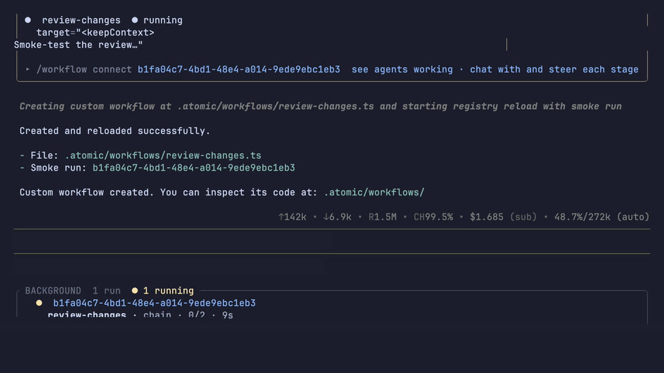
</picture>
</a>
</td>
</tr>
<tr>
<td width="42%" valign="top">
<h4>Steer and control a live run</h4>
<p>Attach to a running stage, watch it stream, and steer, pause, or abort it mid-flight.</p>
<p><a href="https://docs.bastani.ai/workflows"><sub>Atomic docs · Workflows</sub></a></p>
<p><a href="https://github.com/bastani-inc/atomic-crash-course#62-steer-and-control-a-live-run"><sub>Crash course · 6.2 Steer and control a live run</sub></a></p>
</td>
<td width="58%" valign="top">
<a href="https://github.com/bastani-inc/atomic-crash-course#62-steer-and-control-a-live-run">
<picture>
<source srcset="assets/feature-wall/23-steer-a-live-run.gif" type="image/gif">
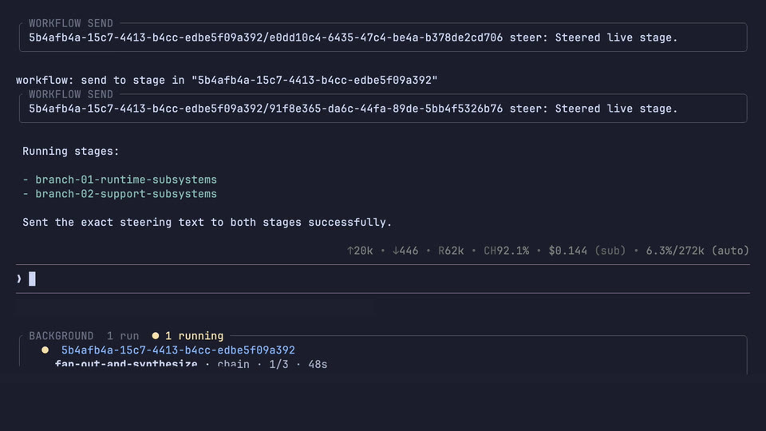
</picture>
</a>
</td>
</tr>
<tr>
<td width="42%" valign="top">
<h4>Durability and resume</h4>
<p>Runs checkpoint as they go, so killing the process leaves them retained and resumable instead of lost.</p>
<p><a href="https://docs.bastani.ai/workflows"><sub>Atomic docs · Workflows</sub></a></p>
<p><a href="https://github.com/bastani-inc/atomic-crash-course#65-durability-and-resume"><sub>Crash course · 6.5 Durability and resume</sub></a></p>
</td>
<td width="58%" valign="top">
<a href="https://github.com/bastani-inc/atomic-crash-course#65-durability-and-resume">
<picture>
<source srcset="assets/feature-wall/26-durability-and-resume.gif" type="image/gif">
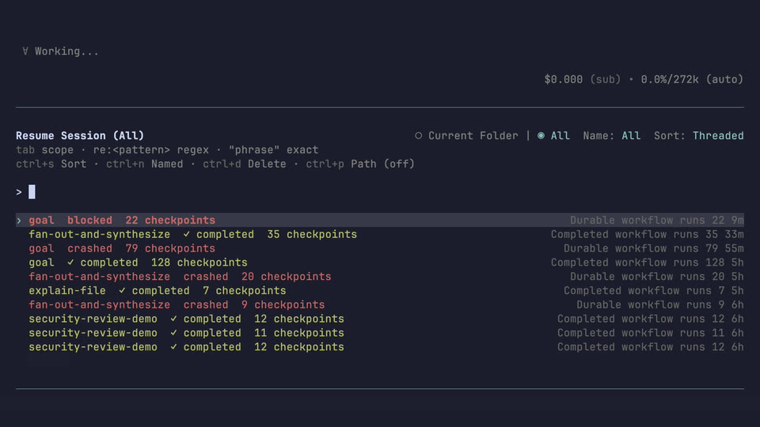
</picture>
</a>
</td>
</tr>
<tr>
<td width="42%" valign="top">
<h4>Human-in-the-loop gates</h4>
<p>Put an approval gate anywhere in the graph and the run waits for a person before it proceeds.</p>
<p><a href="https://docs.bastani.ai/workflows"><sub>Atomic docs · Workflows</sub></a></p>
<p><a href="https://github.com/bastani-inc/atomic-crash-course#64-human-in-the-loop-gates"><sub>Crash course · 6.4 Human-in-the-loop gates</sub></a></p>
</td>
<td width="58%" valign="top">
<a href="https://github.com/bastani-inc/atomic-crash-course#64-human-in-the-loop-gates">
<picture>
<source srcset="assets/feature-wall/25-human-in-the-loop-gates.gif" type="image/gif">
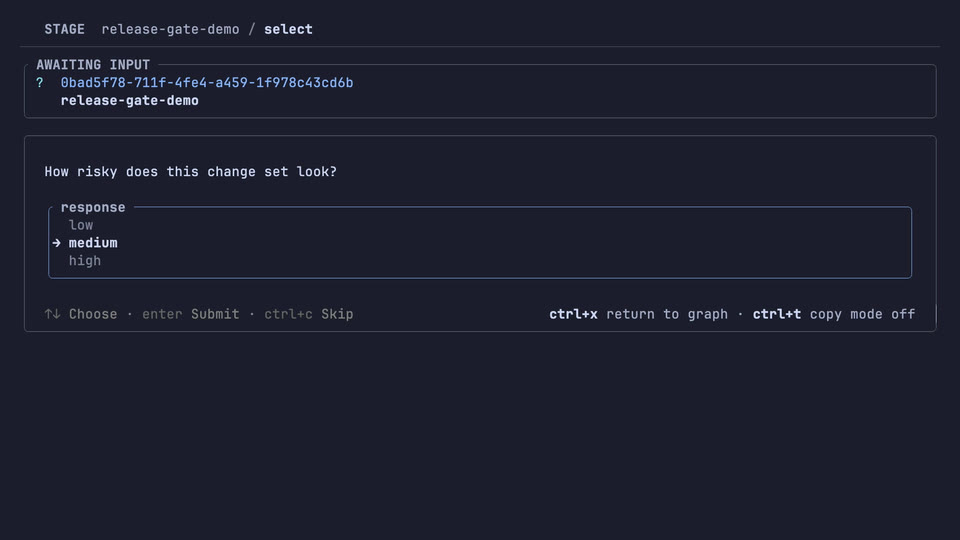
</picture>
</a>
</td>
</tr>
<tr>
<td width="42%" valign="top">
<h4>Planner-worker intercom coordination</h4>
<p>Separate sessions message each other over intercom to split a job and agree on the answer.</p>
<p><a href="https://docs.bastani.ai/intercom"><sub>Atomic docs · Intercom</sub></a></p>
<p><a href="https://github.com/bastani-inc/atomic-crash-course#53-plannerworker-intercom-coordination"><sub>Crash course · 5.3 Planner-worker intercom coordination</sub></a></p>
</td>
<td width="58%" valign="top">
<a href="https://github.com/bastani-inc/atomic-crash-course#53-plannerworker-intercom-coordination">
<picture>
<source srcset="assets/feature-wall/18-planner-worker-intercom.gif" type="image/gif">
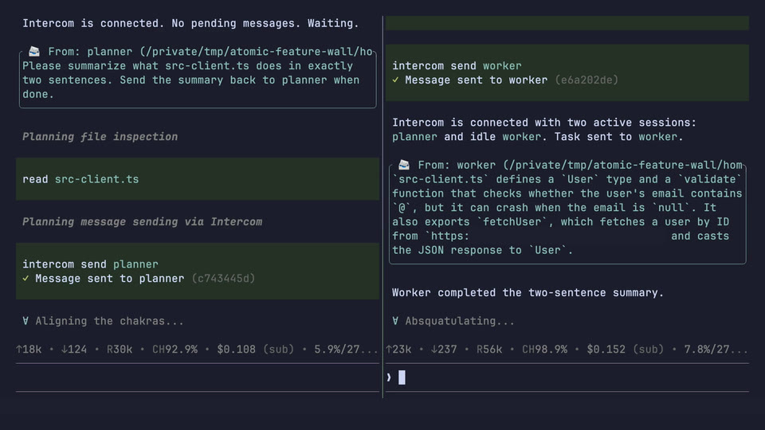
</picture>
</a>
</td>
</tr>
<tr>
<td width="42%" valign="top">
<h4>Verification built in</h4>
<p>Executable checks and fresh reviewers produce evidence; failures route into bounded repair until the gate passes.</p>
<p><a href="https://docs.bastani.ai/workflows"><sub>Atomic docs · Workflows</sub></a></p>
<p><a href="https://github.com/bastani-inc/atomic-crash-course#66-security-review-with-a-repair-loop"><sub>Crash course · 6.6 Security review with a repair loop</sub></a></p>
</td>
<td width="58%" valign="top">
<a href="https://github.com/bastani-inc/atomic-crash-course#66-security-review-with-a-repair-loop">
<picture>
<source srcset="assets/feature-wall/27-security-review-repair-loop.gif" type="image/gif">
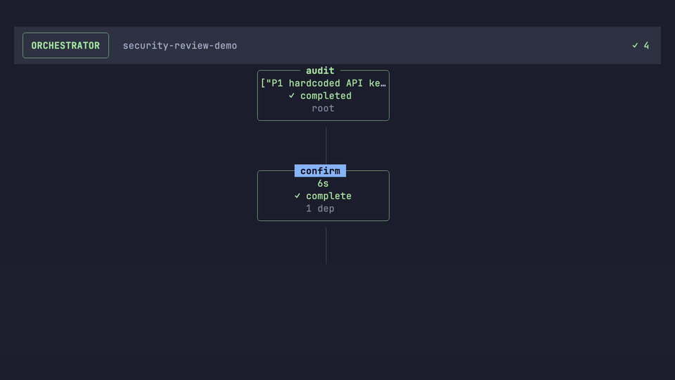
</picture>
</a>
</td>
</tr>
</table>

<p><a href="#more-atomic-capabilities"><strong>Explore 31 more Atomic capabilities ↓</strong></a></p>

<!-- feature-wall:featured:end -->

Write repeatable procedures as skills. Use codemode to run checks, launch subagents, and bring their results back to the parent chat.

Atomic’s primitives are built for the software engineering lifecycle. Verification is built into the execution model.

Atomic is open so you can inspect and adapt it. You own the workflow, the evidence, and the rules for completion.

Own your intelligence. Build in the open. Question the defaults. Keep control of the process. ☠︎

<!-- readme-badges:start -->

### Works with your engineering stack

<p align="center">
  <a href="https://github.com/"></a>
  <a href="https://gitlab.com/"></a>
  <a href="https://git-scm.com/"></a>
  <a href="https://www.atlassian.com/software/jira"></a>
  <a href="https://linear.app/"></a>
  <a href="https://www.notion.so/">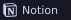</a>
  <a href="https://slack.com/"></a>
  <a href="https://www.docker.com/"></a>
  <a href="https://kubernetes.io/"></a>
  <a href="https://aws.amazon.com/"></a>
  <a href="https://cloud.google.com/">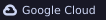</a>
  <a href="https://azure.microsoft.com/"></a>
  <a href="https://sentry.io/"></a>
  <a href="https://www.datadoghq.com/"></a>
  <a href="https://www.postgresql.org/"></a>
  <a href="https://playwright.dev/"></a>
  <a href="https://www.google.com/chrome/"></a>
  <a href="https://modelcontextprotocol.io/"></a>
  <a href="https://docs.bastani.ai/extensions"></a>
</p>

Atomic connects through installed CLIs, MCP servers, APIs, scripts, and custom extensions; you supply the credentials and permissions.

### Works with your models

<p align="center">
  <a href="https://platform.openai.com/docs/">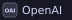</a>
  <a href="https://docs.anthropic.com/">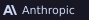</a>
  <a href="https://github.com/features/copilot"></a>
  <a href="https://openrouter.ai/"></a>
  <a href="https://www.kimi.com/code">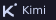</a>
  <a href="https://x.ai/api"></a>
  <a href="https://www.ant-ling.com/en/">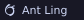</a>
  <a href="https://azure.microsoft.com/en-us/products/ai-services/openai-service"></a>
  <a href="https://aws.amazon.com/bedrock/"></a>
  <a href="https://platform.deepseek.com/"></a>
  <a href="https://build.nvidia.com/"></a>
  <a href="https://ai.google.dev/gemini-api"></a>
  <a href="https://cloud.google.com/vertex-ai">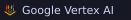</a>
  <a href="https://mistral.ai/"></a>
  <a href="https://groq.com/">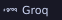</a>
  <a href="https://inference-docs.cerebras.ai/"></a>
  <a href="https://developers.cloudflare.com/ai/"></a>
  <a href="https://vercel.com/ai-gateway"></a>
  <a href="https://z.ai/model-api"></a>
  <a href="https://opencode.ai/"></a>
  <a href="https://huggingface.co/"></a>
  <a href="https://fireworks.ai/"></a>
  <a href="https://www.together.ai/"></a>
  <a href="https://www.minimax.io/"></a>
  <a href="https://www.moonshot.ai/"></a>
  <a href="https://qwen.ai/"></a>
  <a href="https://platform.xiaomimimo.com/"></a>
</p>

See [provider setup and the current catalog](https://docs.bastani.ai/providers). Availability depends on your credentials, subscription, region, and the provider catalog; one login does not unlock every provider.

#### Local and open models

<p align="center">
  <a href="https://github.com/ggml-org/llama.cpp"></a>
  <a href="https://ollama.com/"></a>
  <a href="https://lmstudio.ai/">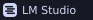</a>
  <a href="https://docs.vllm.ai/"></a>
  <a href="https://github.com/sgl-project/sglang">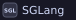</a>
  <a href="https://huggingface.co/"></a>
  <a href="https://www.llama.com/"></a>
  <a href="https://ai.google.dev/gemma"></a>
  <a href="https://github.com/deepseek-ai/">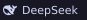</a>
  <a href="https://qwen.ai/">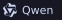</a>
  <a href="https://github.com/MoonshotAI/"></a>
  <a href="https://github.com/zai-org/GLM-4.5"></a>
  <a href="https://mistral.ai/models/"></a>
  <a href="https://github.com/MiniMax-AI/"></a>
  <a href="https://openai.com/open-models/"></a>
</p>

Atomic can run tool-capable models exposed through llama.cpp, Ollama, LM Studio, vLLM, SGLang, Hugging Face, or a compatible OpenAI, Anthropic, or Google endpoint. Actual model and tool support depends on the server and model.

The model-family badges are representative open families, not a closed allowlist. See [Models](https://docs.bastani.ai/models) and [llama.cpp](https://docs.bastani.ai/llama-cpp).

<!-- readme-badges:end -->
---

## Get started

### Prerequisites

- **Package install:** Node.js 22.19 or newer plus npm, pnpm, Yarn, or Bun. Use Bun 1.4.2+ for Bun installs.
- **Release archive install:** macOS and Linux need `tar` and either `curl` or `wget`. Windows uses built-in PowerShell commands. This path does not need Node.js or a package manager.
- **Model-provider access** — use a supported subscription login or API key.

### Install

Install with npm:

```bash
npm install -g @bastani/atomic
```

With pnpm:

```bash
pnpm add -g @bastani/atomic
```

With Bun:

```bash
bun add -g @bastani/atomic
```

Atomic does not require package install scripts. Add `--ignore-scripts` to a package install command if you want to disable dependency lifecycle scripts.

Alternatively, install the self-contained release archive, which needs no Node.js or package manager.

On macOS or Linux:

```bash
curl -fsSL https://raw.githubusercontent.com/bastani-inc/atomic/main/install.sh | sh
```

On Windows, run this in PowerShell:

```powershell
irm https://raw.githubusercontent.com/bastani-inc/atomic/main/install.ps1 | iex
```

The archive installer verifies `SHA256SUMS`, keeps versioned payloads, and links its launcher from `~/.local/bin/atomic` on macOS/Linux or `%LOCALAPPDATA%\atomic\bin\atomic.cmd` on Windows, printing PATH guidance when needed. It accepts a few environment variables:

- `ATOMIC_VERSION` — pin an exact release tag.
- `ATOMIC_FORCE_INSTALL=1` (or `--force` / `-Force`) — reinstall even when that release is already installed. By default the installer skips the download for a healthy install of the requested or latest release.
- `ATOMIC_INSTALL_DIR` / `ATOMIC_BIN_DIR` — change the install and launcher locations. On macOS/Linux, relative directories resolve against the physical directory where the installer starts.
- `GITHUB_TOKEN` / `GH_TOKEN` — optional; raises GitHub API limits on shared networks.
- `NO_COLOR` — plain output with no colours, progress bar, or logo; the installer also switches to plain output when its output is not a terminal or `CI` is set.

The Linux musl archives bundle their C++ runtime libraries and run on stock Alpine without an `apk add` step; Android and Termux remain unsupported. See the [Quickstart](https://docs.bastani.ai/quickstart) for path-resolution and Windows `PATHEXT` details.

### Authenticate and run

Start Atomic:
```bash
atomic
```
Login. Atomic supports subscription login for Codex, Claude, GitHub Copilot, xAI, as well as API-key providers such as OpenRouter:

```bash
/login   # then select your provider
```

Claude login from a third-party harness uses Anthropic extra usage billed per token rather than Claude plan limits. See [Providers & Models](./packages/coding-agent/README.md#providers--models) for integration details.

Missing a provider? [Open an issue](https://github.com/bastani-inc/atomic/issues/new) or contribute an integration.

For API-key setup, export the key before starting Atomic:

```bash
export OPENROUTER_API_KEY=sk-or-...
atomic
```

Atomic stores provider credentials in `~/.atomic/agent/auth.json` and creates the file with owner-only permissions where the platform supports them. For non-interactive use, `atomic -p "<prompt>"` prints the response and exits.

After authenticating, type a message. To try parallel work, ask Atomic to delegate a review and report what each child found.

> ⚠️ Atomic has no built-in sandbox or command-level shell permission gate. Tools and extensions run with your user permissions. Run autonomous work inside a devcontainer, VM, or remote development machine—not on a host with sensitive data or credentials.

<details>
<summary><b>Devcontainer, terminal, and SDK references</b></summary>

Atomic runs in a standard devcontainer or VM. Use the release-archive installer for an image without Node.js or npm, or install Node.js 22.19+ and use a package manager. Pass provider credentials through environment variables.

See [Terminal setup](./packages/coding-agent/docs/terminal-setup.md), [Security](./packages/coding-agent/docs/security.md), and [Programmatic Usage](./packages/coding-agent/README.md#programmatic-usage) for the SDK and RPC entry points.

</details>

### Bring your skill stack

Already have agent skills? Bring them into Atomic by pointing Atomic at their existing directories or placing them in its project or user skill locations. Atomic implements the Agent Skills standard, and configured Claude Code or Codex skill directories can be used without rewriting them. See [Skills](./packages/coding-agent/docs/skills.md#using-skills-from-other-harnesses).

A skill can [run as a workflow](./packages/coding-agent/docs/skills.md#skills-as-workflows). Describe the inputs, what may run in parallel, and what must pass. If you have an earlier Atomic workflow definition, [ask Atomic to convert it into a skill](./packages/coding-agent/docs/orchestration/migrating-workflows.md); the original stays untouched.

### Migrating from another coding agent

Atomic publishes an agent-readable **[`llms.txt`](https://docs.bastani.ai/llms.txt)**. Ask your current coding agent to:

```text
Install and set up Atomic by following https://docs.bastani.ai/llms.txt.
```

<!-- feature-wall:more:start -->

## More Atomic capabilities

Explore the rest of Atomic’s real recorded capabilities, with public docs and crash-course links for each one.

<table>
<tr>
<td width="42%" valign="top">
<h4>Launch a workflow in plain English</h4>
<p>Ask in normal chat and Atomic routes the request through its workflow tool into a real registered run - no command syntax required.</p>
<p><a href="https://docs.bastani.ai/workflows"><sub>Atomic docs · Workflows</sub></a></p>
<p><a href="https://github.com/bastani-inc/atomic-crash-course#part-6--workflows"><sub>Crash course · W.1 Launch a workflow in plain English</sub></a></p>
</td>
<td width="58%" valign="top">
<a href="https://github.com/bastani-inc/atomic-crash-course#part-6--workflows">
<picture>
<source srcset="assets/feature-wall/28-launch-workflow-plain-english.gif" type="image/gif">
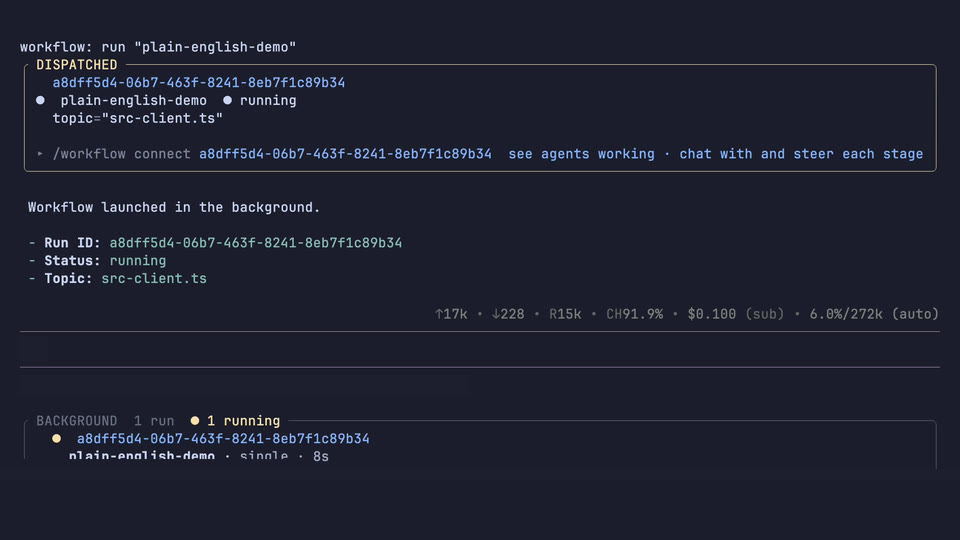
</picture>
</a>
</td>
</tr>
<tr>
<td width="42%" valign="top">
<h4>Autonomous implementation loops</h4>
<p><code>ralph</code> refines, researches, implements, reviews, and repairs against a bounded loop contract.</p>
<p><a href="https://docs.bastani.ai/workflows"><sub>Atomic docs · Workflows</sub></a></p>
<p><a href="https://github.com/bastani-inc/atomic-crash-course#a10-autonomous-implementation-loops"><sub>Crash course · A.10 Autonomous implementation loops</sub></a></p>
</td>
<td width="58%" valign="top">
<a href="https://github.com/bastani-inc/atomic-crash-course#a10-autonomous-implementation-loops">
<picture>
<source srcset="assets/feature-wall/40-autonomous-implementation-loops.gif" type="image/gif">
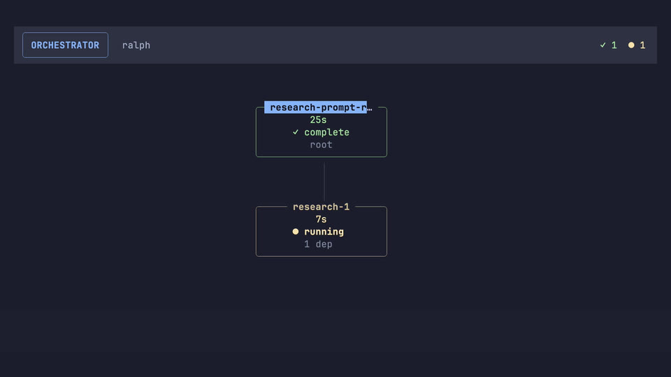
</picture>
</a>
</td>
</tr>
<tr>
<td width="42%" valign="top">
<h4>Inspect and control workflows</h4>
<p>Browse running and completed workflows with <code>/workflows</code>, then pause, resume or quit a run from its graph.</p>
<p><a href="https://docs.bastani.ai/workflows"><sub>Atomic docs · Workflows</sub></a></p>
<p><a href="https://github.com/bastani-inc/atomic-crash-course#61-touring-the-builtins"><sub>Crash course · W.3 Inspect and control workflows</sub></a></p>
</td>
<td width="58%" valign="top">
<a href="https://github.com/bastani-inc/atomic-crash-course#61-touring-the-builtins">
<picture>
<source srcset="assets/feature-wall/30-inspect-control-workflows.gif" type="image/gif">
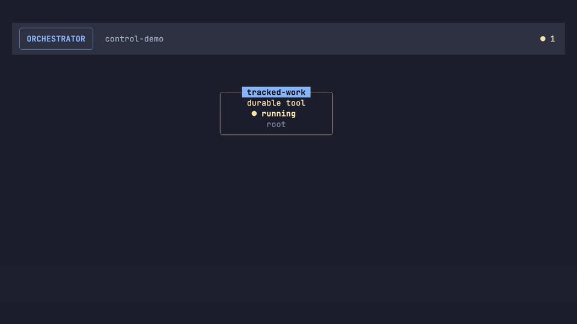
</picture>
</a>
</td>
</tr>
<tr>
<td width="42%" valign="top">
<h4>Worktree-isolated parallel work</h4>
<p>Parallel agents each get their own git worktree, so concurrent edits cannot collide.</p>
<p><a href="https://docs.bastani.ai/subagents"><sub>Atomic docs · Subagents</sub></a></p>
<p><a href="https://github.com/bastani-inc/atomic-crash-course#52-worktree-isolated-parallel-work"><sub>Crash course · 5.2 Worktree-isolated parallel work</sub></a></p>
</td>
<td width="58%" valign="top">
<a href="https://github.com/bastani-inc/atomic-crash-course#52-worktree-isolated-parallel-work">
<picture>
<source srcset="assets/feature-wall/17-worktree-parallel-work.gif" type="image/gif">
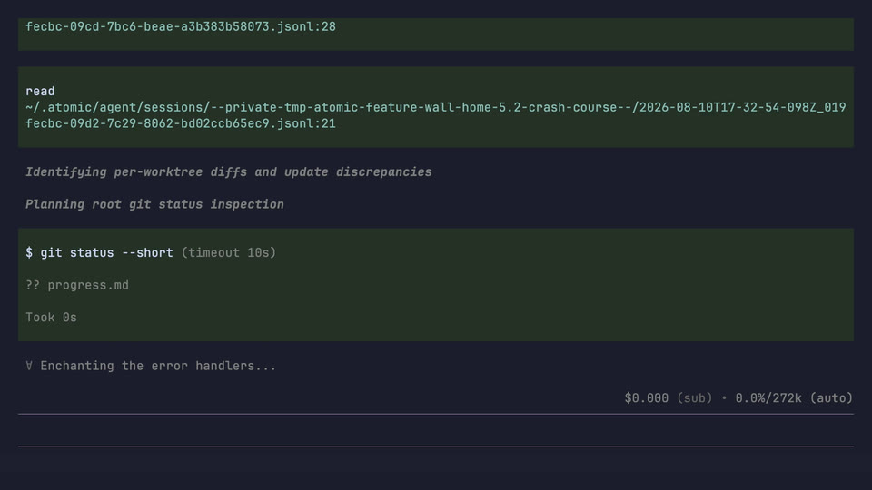
</picture>
</a>
</td>
</tr>
<tr>
<td width="42%" valign="top">
<h4>Escalating to a human supervisor</h4>
<p>A delegate that hits a real product decision stops, asks the human supervising the run, and waits for the answer.</p>
<p><a href="https://docs.bastani.ai/intercom"><sub>Atomic docs · Intercom</sub></a></p>
<p><a href="https://github.com/bastani-inc/atomic-crash-course#54-escalating-to-a-human-supervisor"><sub>Crash course · 5.4 Escalating to a human supervisor</sub></a></p>
</td>
<td width="58%" valign="top">
<a href="https://github.com/bastani-inc/atomic-crash-course#54-escalating-to-a-human-supervisor">
<picture>
<source srcset="assets/feature-wall/19-escalate-to-supervisor.gif" type="image/gif">
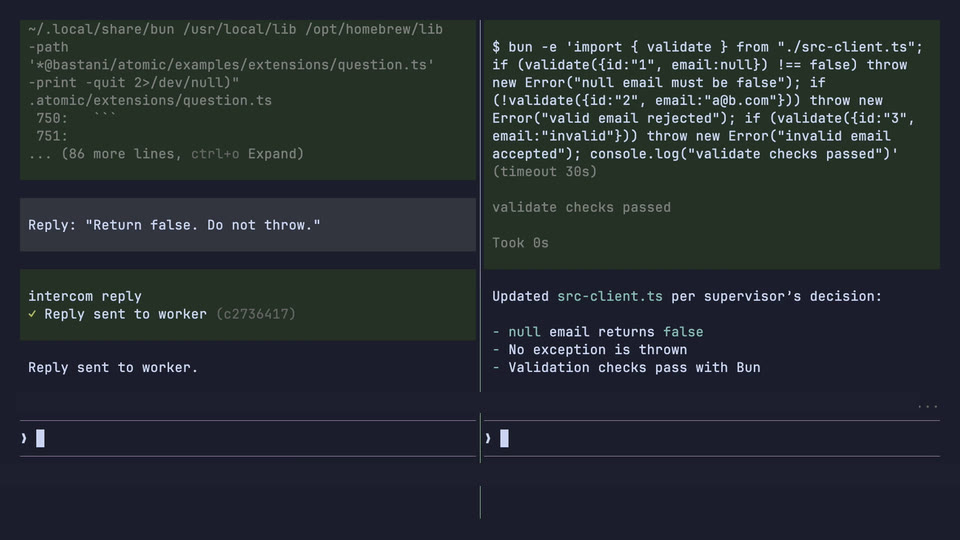
</picture>
</a>
</td>
</tr>
<tr>
<td width="42%" valign="top">
<h4>Nesting builtin workflows</h4>
<p>Compose imported workflow definitions with <code>ctx.workflow(...)</code>; child stages flatten into one inspectable parent graph.</p>
<p><a href="https://docs.bastani.ai/workflows"><sub>Atomic docs · Workflows</sub></a></p>
<p><a href="https://github.com/bastani-inc/atomic-crash-course#a9-nesting-builtin-workflows"><sub>Crash course · A.9 Nesting builtin workflows</sub></a></p>
</td>
<td width="58%" valign="top">
<a href="https://github.com/bastani-inc/atomic-crash-course#a9-nesting-builtin-workflows">
<picture>
<source srcset="assets/feature-wall/39-nesting-builtin-workflows.gif" type="image/gif">
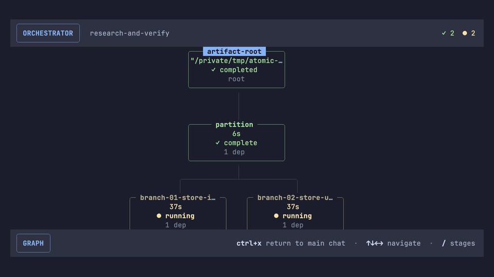
</picture>
</a>
</td>
</tr>
<tr>
<td width="42%" valign="top">
<h4>Intercom context handoff</h4>
<p>Hand a task to another session with the context attached, instead of pasting it by hand.</p>
<p><a href="https://docs.bastani.ai/intercom"><sub>Atomic docs · Intercom</sub></a></p>
<p><a href="https://github.com/bastani-inc/atomic-crash-course#55-intercom-context-handoff"><sub>Crash course · 5.5 Intercom context handoff</sub></a></p>
</td>
<td width="58%" valign="top">
<a href="https://github.com/bastani-inc/atomic-crash-course#55-intercom-context-handoff">
<picture>
<source srcset="assets/feature-wall/20-intercom-context-handoff.gif" type="image/gif">
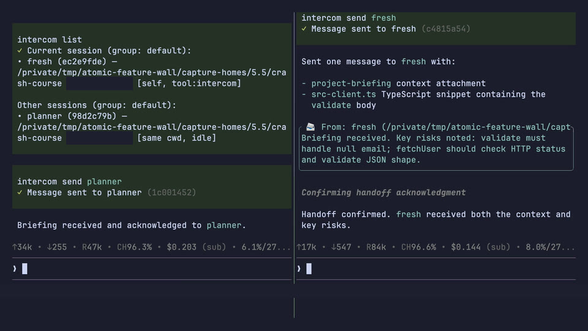
</picture>
</a>
</td>
</tr>
<tr>
<td width="42%" valign="top">
<h4>Delegating to bundled specialists</h4>
<p>Fan work out to scoped subagents that do the reading, so the main context stays small.</p>
<p><a href="https://docs.bastani.ai/subagents"><sub>Atomic docs · Subagents</sub></a></p>
<p><a href="https://github.com/bastani-inc/atomic-crash-course#51-delegating-to-bundled-specialists"><sub>Crash course · 5.1 Delegating to bundled specialists</sub></a></p>
</td>
<td width="58%" valign="top">
<a href="https://github.com/bastani-inc/atomic-crash-course#51-delegating-to-bundled-specialists">
<picture>
<source srcset="assets/feature-wall/16-bundled-specialists.gif" type="image/gif">
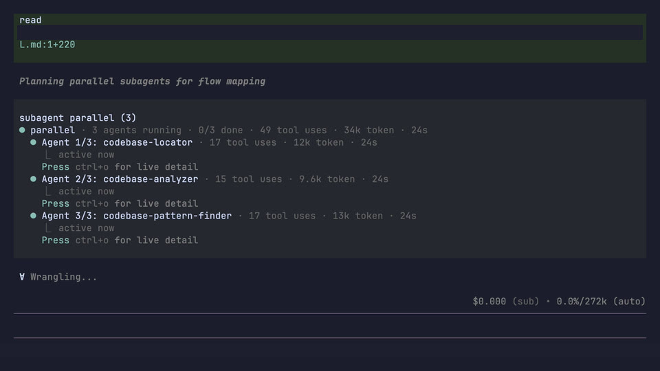
</picture>
</a>
</td>
</tr>
<tr>
<td width="42%" valign="top">
<h4>Writing your own workflow</h4>
<p>Stages, schemas, and gates are versioned TypeScript you review, not per-run improvisation.</p>
<p><a href="https://docs.bastani.ai/workflows"><sub>Atomic docs · Workflows</sub></a></p>
<p><a href="https://github.com/bastani-inc/atomic-crash-course#63-writing-your-own-workflow"><sub>Crash course · 6.3 Writing your own workflow</sub></a></p>
</td>
<td width="58%" valign="top">
<a href="https://github.com/bastani-inc/atomic-crash-course#63-writing-your-own-workflow">
<picture>
<source srcset="assets/feature-wall/24-write-your-own-workflow.gif" type="image/gif">
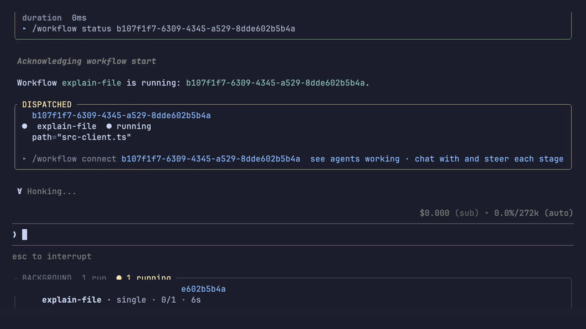
</picture>
</a>
</td>
</tr>
<tr>
<td width="42%" valign="top">
<h4>Touring the builtins</h4>
<p>Bundled workflows for research, planning, implementation, and review, ready before you write one.</p>
<p><a href="https://docs.bastani.ai/workflows"><sub>Atomic docs · Workflows</sub></a></p>
<p><a href="https://github.com/bastani-inc/atomic-crash-course#61-touring-the-builtins"><sub>Crash course · 6.1 Touring the builtins</sub></a></p>
</td>
<td width="58%" valign="top">
<a href="https://github.com/bastani-inc/atomic-crash-course#61-touring-the-builtins">
<picture>
<source srcset="assets/feature-wall/22-touring-the-builtins.gif" type="image/gif">
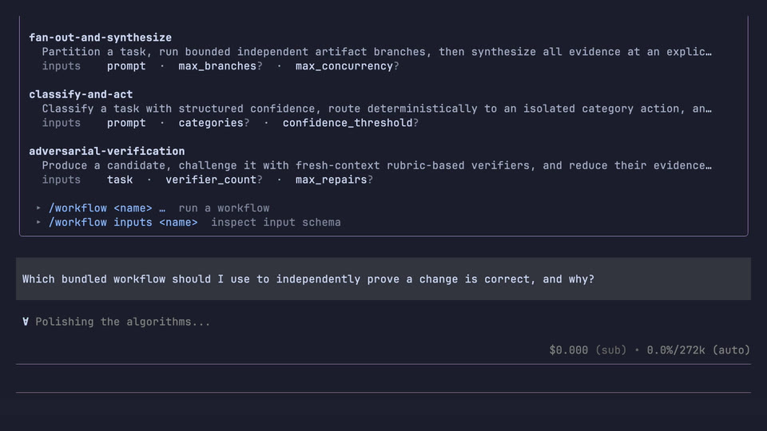
</picture>
</a>
</td>
</tr>
<tr>
<td width="42%" valign="top">
<h4>Run a workflow with typed inputs</h4>
<p>Ask for a workflow by name; the workflow tool validates its typed inputs against TypeBox before the run starts.</p>
<p><a href="https://docs.bastani.ai/workflows"><sub>Atomic docs · Workflows</sub></a></p>
<p><a href="https://github.com/bastani-inc/atomic-crash-course#61-touring-the-builtins"><sub>Crash course · W.2 Run a workflow with typed inputs</sub></a></p>
</td>
<td width="58%" valign="top">
<a href="https://github.com/bastani-inc/atomic-crash-course#61-touring-the-builtins">
<picture>
<source srcset="assets/feature-wall/29-workflow-typed-inputs.gif" type="image/gif">
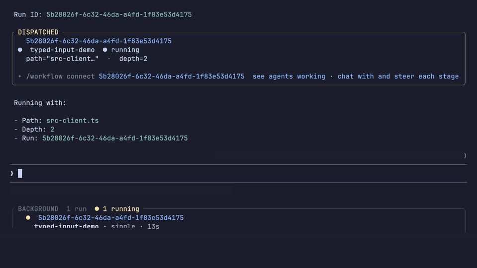
</picture>
</a>
</td>
</tr>
<tr>
<td width="42%" valign="top">
<h4>Context compaction</h4>
<p>Compaction clears the context window, and the agent recovers what it needs from session history, <code>&lt;keepContext&gt;</code> spans first and verbatim.</p>
<p><a href="https://docs.bastani.ai/compaction"><sub>Atomic docs · Compaction</sub></a></p>
<p><a href="https://github.com/bastani-inc/atomic-crash-course#22-verbatim-compaction"><sub>Crash course · 2.2 Verbatim compaction</sub></a></p>
</td>
<td width="58%" valign="top">
<a href="https://github.com/bastani-inc/atomic-crash-course#22-verbatim-compaction">
<picture>
<source srcset="assets/feature-wall/06-verbatim-compaction.gif" type="image/gif">
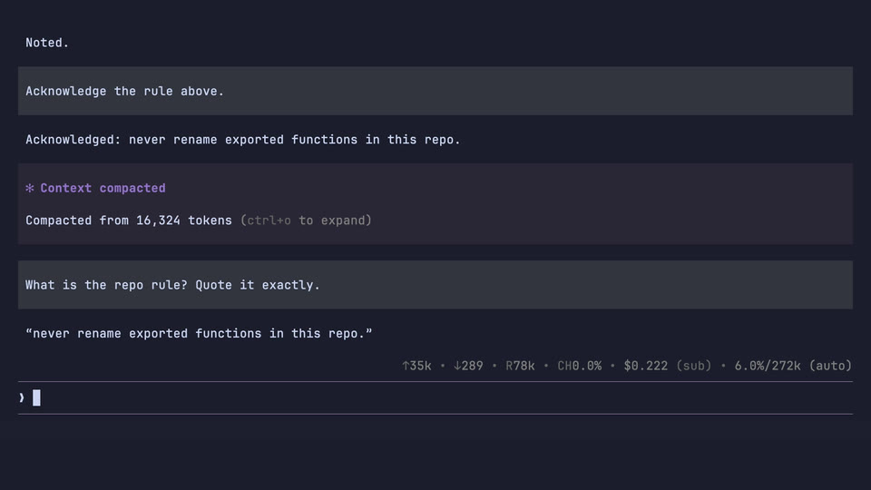
</picture>
</a>
</td>
</tr>
<tr>
<td width="42%" valign="top">
<h4>The agent interviews you</h4>
<p><code>ask_user_question</code> replaces the editor with a structured question UI mid-task, and your answers land in the transcript as data.</p>
<p><a href="https://docs.bastani.ai/tools"><sub>Atomic docs · Built-in tools</sub></a></p>
<p><a href="https://github.com/bastani-inc/atomic-crash-course#13-the-agent-interviews-you"><sub>Crash course · 1.3 The agent interviews you</sub></a></p>
</td>
<td width="58%" valign="top">
<a href="https://github.com/bastani-inc/atomic-crash-course#13-the-agent-interviews-you">
<picture>
<source srcset="assets/feature-wall/03-agent-interviews-you.gif" type="image/gif">
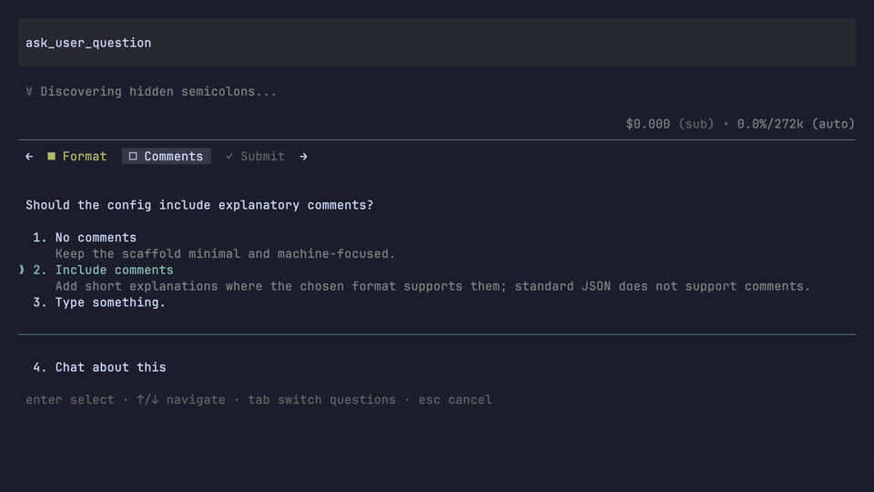
</picture>
</a>
</td>
</tr>
<tr>
<td width="42%" valign="top">
<h4>Permission gate extension</h4>
<p>A <code>tool_call</code> hook catches a risky shell call before execution and asks the operator to allow or block it.</p>
<p><a href="https://docs.bastani.ai/extensions"><sub>Atomic docs · Extensions</sub></a></p>
<p><a href="https://github.com/bastani-inc/atomic-crash-course#a2-permission-gate-extension"><sub>Crash course · A.2 Permission gate extension</sub></a></p>
</td>
<td width="58%" valign="top">
<a href="https://github.com/bastani-inc/atomic-crash-course#a2-permission-gate-extension">
<picture>
<source srcset="assets/feature-wall/32-permission-gate-extension.gif" type="image/gif">
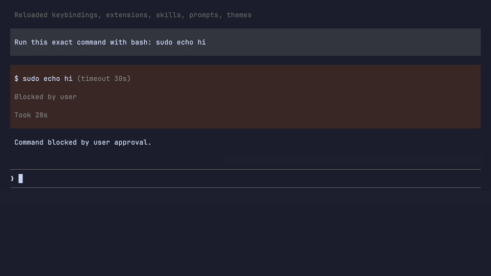
</picture>
</a>
</td>
</tr>
<tr>
<td width="42%" valign="top">
<h4>Block a dangerous command</h4>
<p>A tool-call hook inspects the arguments and rejects the call before it ever reaches your shell.</p>
<p><a href="https://docs.bastani.ai/extensions"><sub>Atomic docs · Extensions</sub></a></p>
<p><a href="https://github.com/bastani-inc/atomic-crash-course#32-block-a-dangerous-command"><sub>Crash course · 3.2 Block a dangerous command</sub></a></p>
</td>
<td width="58%" valign="top">
<a href="https://github.com/bastani-inc/atomic-crash-course#32-block-a-dangerous-command">
<picture>
<source srcset="assets/feature-wall/09-block-a-dangerous-command.gif" type="image/gif">
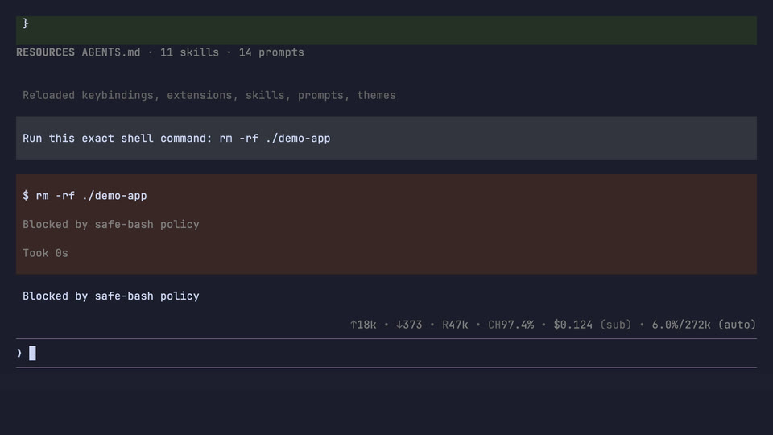
</picture>
</a>
</td>
</tr>
<tr>
<td width="42%" valign="top">
<h4>Full-screen TUI tool</h4>
<p>An extension can take over the whole screen with its own interactive component, then hand control back.</p>
<p><a href="https://docs.bastani.ai/tui"><sub>Atomic docs · TUI components</sub></a></p>
<p><a href="https://github.com/bastani-inc/atomic-crash-course#33-full-screen-tui-tool"><sub>Crash course · 3.3 Full-screen TUI tool</sub></a></p>
</td>
<td width="58%" valign="top">
<a href="https://github.com/bastani-inc/atomic-crash-course#33-full-screen-tui-tool">
<picture>
<source srcset="assets/feature-wall/10-full-screen-tui-tool.gif" type="image/gif">
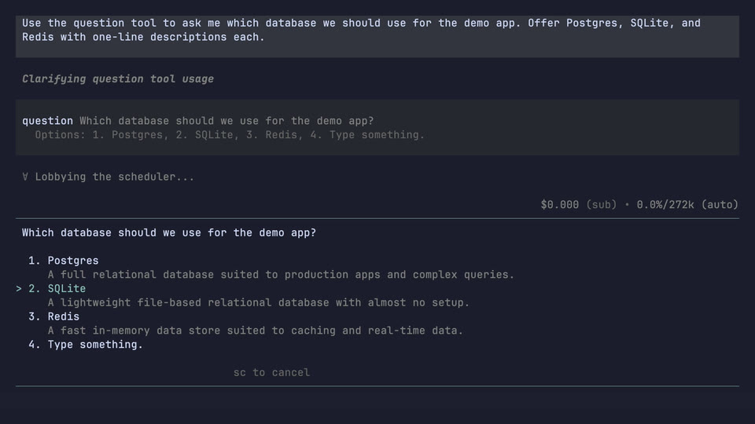
</picture>
</a>
</td>
</tr>
<tr>
<td width="42%" valign="top">
<h4>Embed the agent with the SDK</h4>
<p>Drive the same agent loop from your own TypeScript program, with your own tools and your own UI.</p>
<p><a href="https://docs.bastani.ai/sdk"><sub>Atomic docs · SDK</sub></a></p>
<p><a href="https://github.com/bastani-inc/atomic-crash-course#43-embed-the-agent-with-the-sdk"><sub>Crash course · 4.3 Embed the agent with the SDK</sub></a></p>
</td>
<td width="58%" valign="top">
<a href="https://github.com/bastani-inc/atomic-crash-course#43-embed-the-agent-with-the-sdk">
<picture>
<source srcset="assets/feature-wall/15-embed-with-the-sdk.gif" type="image/gif">
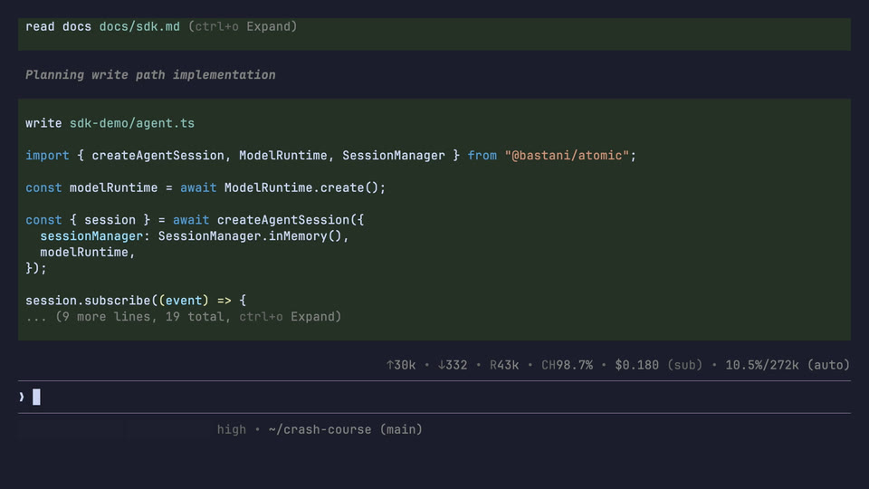
</picture>
</a>
</td>
</tr>
<tr>
<td width="42%" valign="top">
<h4>Build an extension</h4>
<p>Drop a TypeScript file into <code>.atomic/extensions/</code> and the agent gains a new tool in the running session.</p>
<p><a href="https://docs.bastani.ai/extensions"><sub>Atomic docs · Extensions</sub></a></p>
<p><a href="https://github.com/bastani-inc/atomic-crash-course#31-build-an-extension"><sub>Crash course · 3.1 Build an extension</sub></a></p>
</td>
<td width="58%" valign="top">
<a href="https://github.com/bastani-inc/atomic-crash-course#31-build-an-extension">
<picture>
<source srcset="assets/feature-wall/08-build-an-extension.gif" type="image/gif">
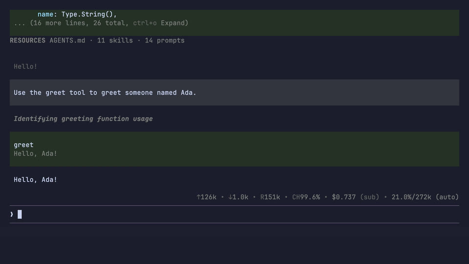
</picture>
</a>
</td>
</tr>
<tr>
<td width="42%" valign="top">
<h4>Write a skill</h4>
<p>A <code>SKILL.md</code> file teaches the agent a procedure it loads on demand - the same format Claude Code and Codex use.</p>
<p><a href="https://docs.bastani.ai/skills"><sub>Atomic docs · Skills</sub></a></p>
<p><a href="https://github.com/bastani-inc/atomic-crash-course#34-write-a-skill"><sub>Crash course · 3.4 Write a skill</sub></a></p>
</td>
<td width="58%" valign="top">
<a href="https://github.com/bastani-inc/atomic-crash-course#34-write-a-skill">
<picture>
<source srcset="assets/feature-wall/11-write-a-skill.gif" type="image/gif">
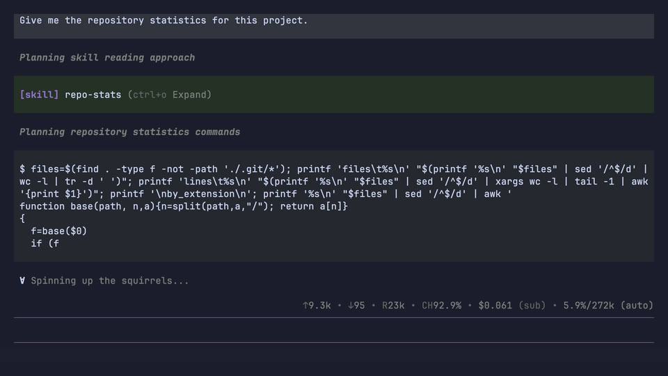
</picture>
</a>
</td>
</tr>
<tr>
<td width="42%" valign="top">
<h4>Local models via models.json</h4>
<p>Point Atomic at Ollama or any OpenAI-compatible endpoint by declaring it in <code>models.json</code>.</p>
<p><a href="https://docs.bastani.ai/models"><sub>Atomic docs · Custom models</sub></a></p>
<p><a href="https://github.com/bastani-inc/atomic-crash-course#42-local-models-via-modelsjson"><sub>Crash course · 4.2 Local models via models.json</sub></a></p>
</td>
<td width="58%" valign="top">
<a href="https://github.com/bastani-inc/atomic-crash-course#42-local-models-via-modelsjson">
<picture>
<source srcset="assets/feature-wall/14-local-models.gif" type="image/gif">
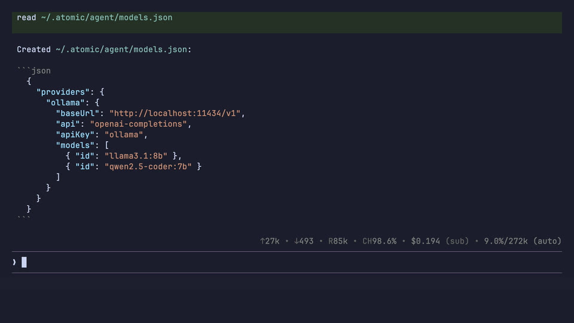
</picture>
</a>
</td>
</tr>
<tr>
<td width="42%" valign="top">
<h4>Headless print and JSON mode</h4>
<p><code>-p</code> prints one answer and exits; <code>--mode json</code> streams structured events, so Atomic drops into scripts and CI.</p>
<p><a href="https://docs.bastani.ai/json"><sub>Atomic docs · JSON event stream</sub></a></p>
<p><a href="https://github.com/bastani-inc/atomic-crash-course#41-headless-print-and-json-mode"><sub>Crash course · 4.1 Headless print and JSON mode</sub></a></p>
</td>
<td width="58%" valign="top">
<a href="https://github.com/bastani-inc/atomic-crash-course#41-headless-print-and-json-mode">
<picture>
<source srcset="assets/feature-wall/13-headless-print-and-json.gif" type="image/gif">
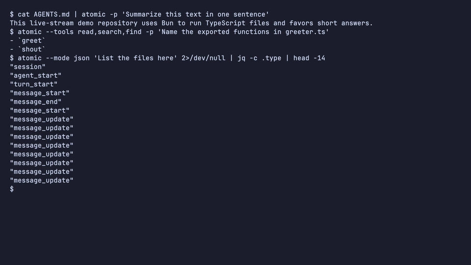
</picture>
</a>
</td>
</tr>
<tr>
<td width="42%" valign="top">
<h4>Branching with tree, fork, clone</h4>
<p>Fork a session at any point and try a second approach without losing the first; <code>/tree</code> shows the whole shape.</p>
<p><a href="https://docs.bastani.ai/sessions"><sub>Atomic docs · Sessions</sub></a></p>
<p><a href="https://github.com/bastani-inc/atomic-crash-course#21-branching-with-tree-fork-clone"><sub>Crash course · 2.1 Branching with tree, fork, clone</sub></a></p>
</td>
<td width="58%" valign="top">
<a href="https://github.com/bastani-inc/atomic-crash-course#21-branching-with-tree-fork-clone">
<picture>
<source srcset="assets/feature-wall/05-branching-tree-fork-clone.gif" type="image/gif">
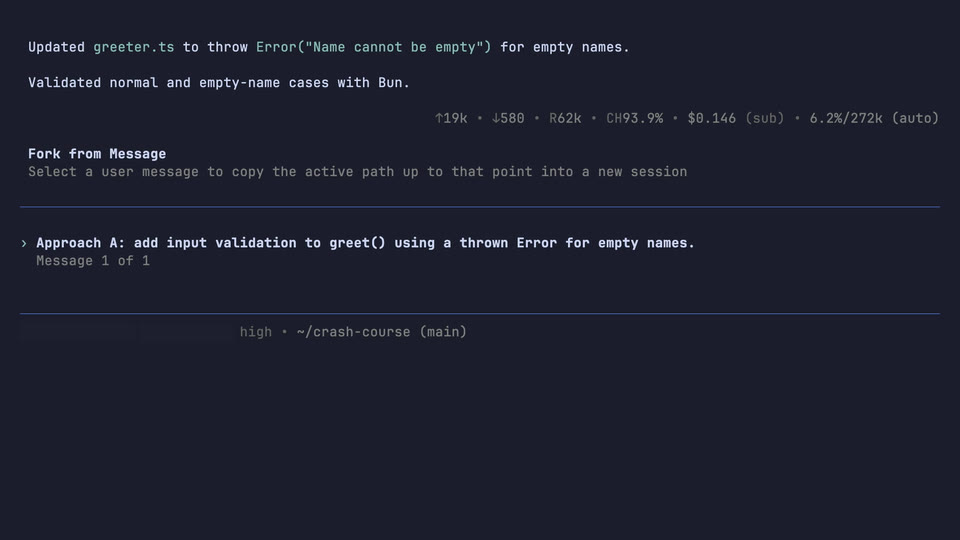
</picture>
</a>
</td>
</tr>
<tr>
<td width="42%" valign="top">
<h4>Sessions are just JSONL</h4>
<p>Every session is an append-only JSONL file on disk, so you can grep it, diff it, and script against it.</p>
<p><a href="https://docs.bastani.ai/session-format"><sub>Atomic docs · Session format</sub></a></p>
<p><a href="https://github.com/bastani-inc/atomic-crash-course#23-sessions-are-just-jsonl"><sub>Crash course · 2.3 Sessions are just JSONL</sub></a></p>
</td>
<td width="58%" valign="top">
<a href="https://github.com/bastani-inc/atomic-crash-course#23-sessions-are-just-jsonl">
<picture>
<source srcset="assets/feature-wall/07-sessions-are-jsonl.gif" type="image/gif">
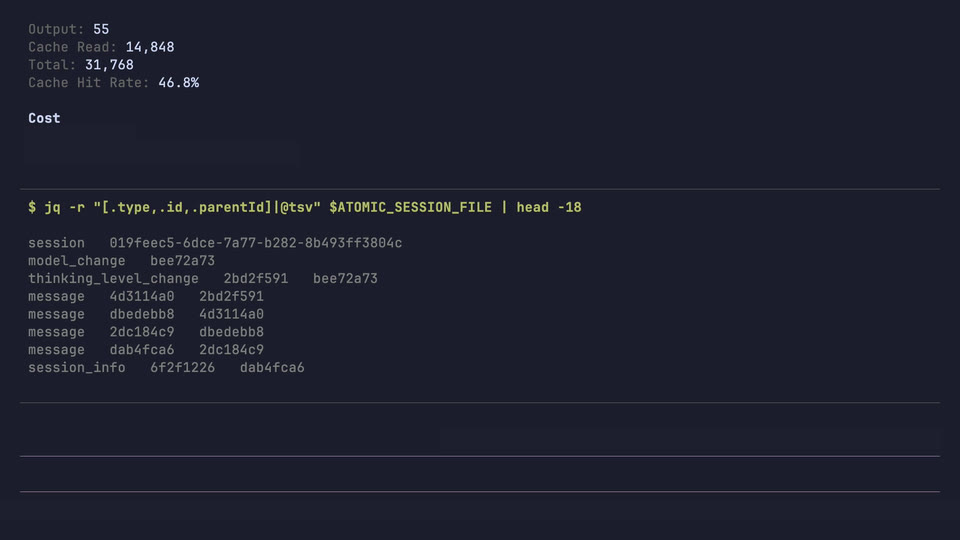
</picture>
</a>
</td>
</tr>
<tr>
<td width="42%" valign="top">
<h4>Your first session</h4>
<p>One editor for prompts, <code>@</code> file references, and <code>!</code> shell commands, with steering you can type while the agent works.</p>
<p><a href="https://docs.bastani.ai/usage"><sub>Atomic docs · Using Atomic</sub></a></p>
<p><a href="https://github.com/bastani-inc/atomic-crash-course#11-your-first-session"><sub>Crash course · 1.1 Your first session</sub></a></p>
</td>
<td width="58%" valign="top">
<a href="https://github.com/bastani-inc/atomic-crash-course#11-your-first-session">
<picture>
<source srcset="assets/feature-wall/01-first-session.gif" type="image/gif">
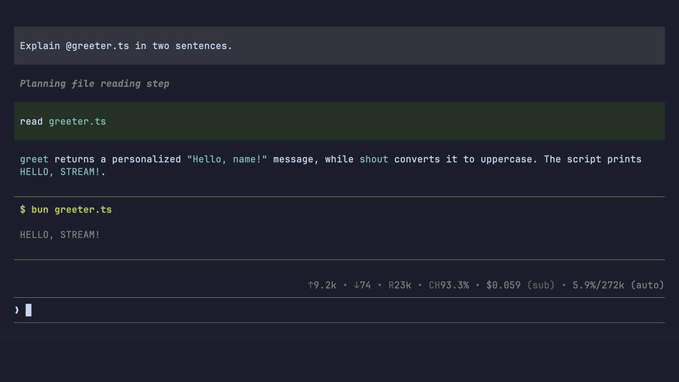
</picture>
</a>
</td>
</tr>
<tr>
<td width="42%" valign="top">
<h4>File-based todos</h4>
<p>Plans are durable files under <code>.atomic/todos/</code>: plain text you can grep, review, and commit alongside the code.</p>
<p><a href="https://docs.bastani.ai/tools"><sub>Atomic docs · Built-in tools</sub></a></p>
<p><a href="https://github.com/bastani-inc/atomic-crash-course#14-file-based-todos"><sub>Crash course · 1.4 File-based todos</sub></a></p>
</td>
<td width="58%" valign="top">
<a href="https://github.com/bastani-inc/atomic-crash-course#14-file-based-todos">
<picture>
<source srcset="assets/feature-wall/04-file-based-todos.gif" type="image/gif">
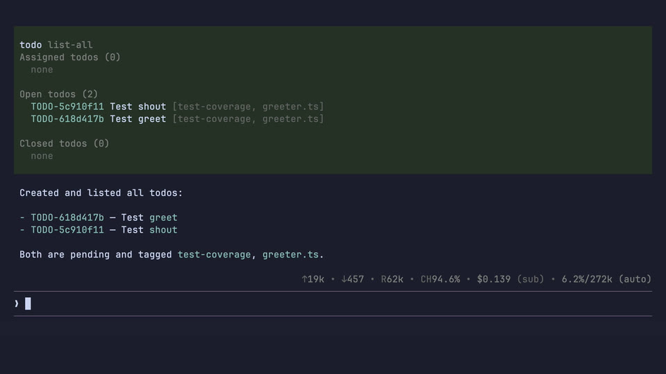
</picture>
</a>
</td>
</tr>
<tr>
<td width="42%" valign="top">
<h4>A handoff command of your own</h4>
<p>Package a repeatable handoff as a project-local slash command your whole team can run.</p>
<p><a href="https://docs.bastani.ai/prompt-templates"><sub>Atomic docs · Prompt templates</sub></a></p>
<p><a href="https://github.com/bastani-inc/atomic-crash-course#56-a-handoff-command-of-your-own"><sub>Crash course · 5.6 A handoff command of your own</sub></a></p>
</td>
<td width="58%" valign="top">
<a href="https://github.com/bastani-inc/atomic-crash-course#56-a-handoff-command-of-your-own">
<picture>
<source srcset="assets/feature-wall/21-your-own-handoff-command.gif" type="image/gif">
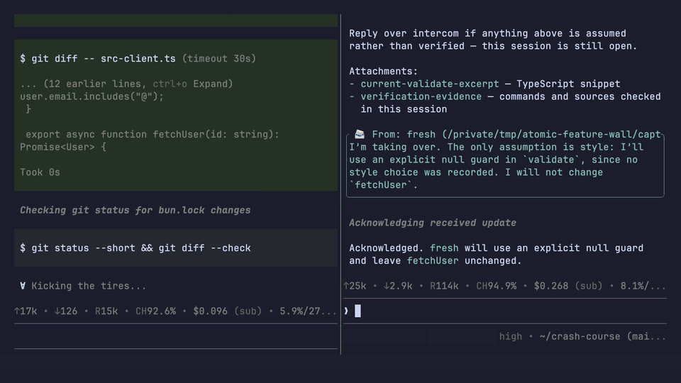
</picture>
</a>
</td>
</tr>
<tr>
<td width="42%" valign="top">
<h4>Intercom group isolation</h4>
<p>Sessions in different groups cannot message each other; only an explicit read-only group peek crosses the boundary.</p>
<p><a href="https://docs.bastani.ai/intercom"><sub>Atomic docs · Intercom</sub></a></p>
<p><a href="https://github.com/bastani-inc/atomic-crash-course#a7-intercom-group-isolation"><sub>Crash course · A.7 Intercom group isolation</sub></a></p>
</td>
<td width="58%" valign="top">
<a href="https://github.com/bastani-inc/atomic-crash-course#a7-intercom-group-isolation">
<picture>
<source srcset="assets/feature-wall/37-intercom-group-isolation.gif" type="image/gif">
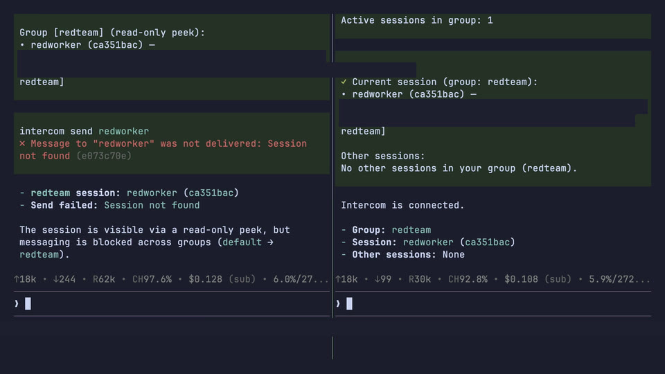
</picture>
</a>
</td>
</tr>
<tr>
<td width="42%" valign="top">
<h4>Prompt templates with arguments</h4>
<p>Project Markdown becomes a slash command with autocomplete hints and positional argument expansion.</p>
<p><a href="https://docs.bastani.ai/prompt-templates"><sub>Atomic docs · Prompt templates</sub></a></p>
<p><a href="https://github.com/bastani-inc/atomic-crash-course#a4-prompt-templates-with-arguments"><sub>Crash course · A.4 Prompt templates with arguments</sub></a></p>
</td>
<td width="58%" valign="top">
<a href="https://github.com/bastani-inc/atomic-crash-course#a4-prompt-templates-with-arguments">
<picture>
<source srcset="assets/feature-wall/34-prompt-templates-arguments.gif" type="image/gif">
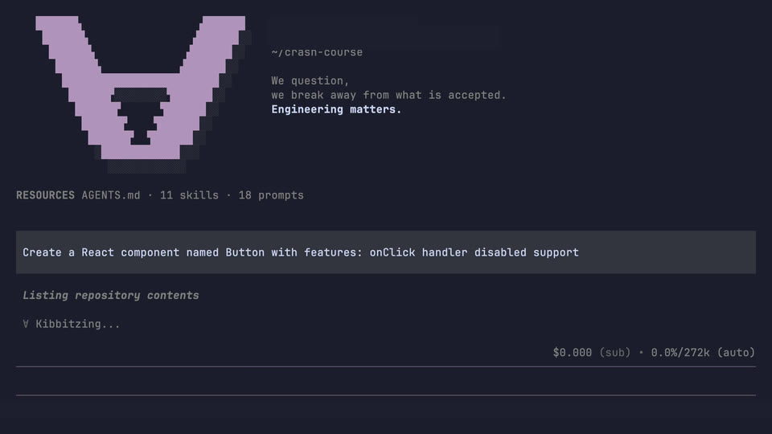
</picture>
</a>
</td>
</tr>
<tr>
<td width="42%" valign="top">
<h4>Runtime system-prompt mutation</h4>
<p>A live command toggles extension state, and <code>before_agent_start</code> rewrites the system prompt on the next turn.</p>
<p><a href="https://docs.bastani.ai/extensions"><sub>Atomic docs · Extensions</sub></a></p>
<p><a href="https://github.com/bastani-inc/atomic-crash-course#a3-runtime-system-prompt-mutation"><sub>Crash course · A.3 Runtime system-prompt mutation</sub></a></p>
</td>
<td width="58%" valign="top">
<a href="https://github.com/bastani-inc/atomic-crash-course#a3-runtime-system-prompt-mutation">
<picture>
<source srcset="assets/feature-wall/33-runtime-system-prompt.gif" type="image/gif">
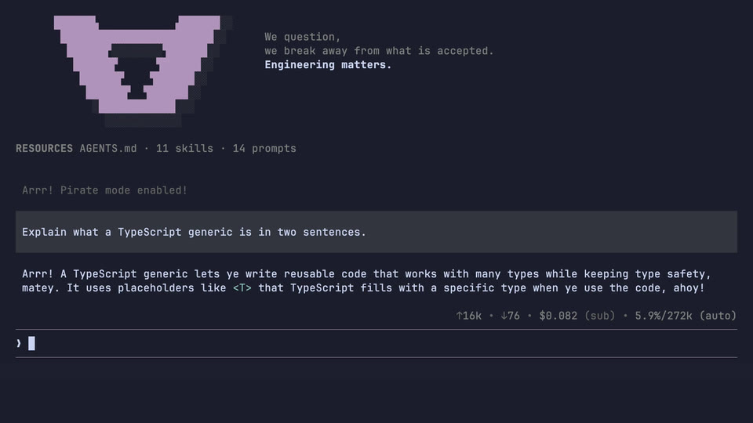
</picture>
</a>
</td>
</tr>
<tr>
<td width="42%" valign="top">
<h4>Keybindings and hot reload</h4>
<p>Every TUI action is remappable in global JSON; <code>/reload</code> applies the map without restarting the session.</p>
<p><a href="https://docs.bastani.ai/keybindings"><sub>Atomic docs · Keybindings</sub></a></p>
<p><a href="https://github.com/bastani-inc/atomic-crash-course#a1-keybindings-and-hot-reload"><sub>Crash course · A.1 Keybindings and hot reload</sub></a></p>
</td>
<td width="58%" valign="top">
<a href="https://github.com/bastani-inc/atomic-crash-course#a1-keybindings-and-hot-reload">
<picture>
<source srcset="assets/feature-wall/31-keybindings-hot-reload.gif" type="image/gif">
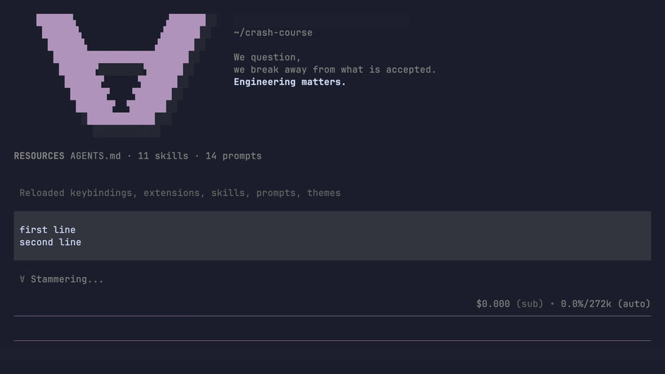
</picture>
</a>
</td>
</tr>
<tr>
<td width="42%" valign="top">
<h4>Custom theme</h4>
<p>Theme the entire TUI from a project-local file and switch to it live with <code>/theme</code>.</p>
<p><a href="https://docs.bastani.ai/themes"><sub>Atomic docs · Themes</sub></a></p>
<p><a href="https://github.com/bastani-inc/atomic-crash-course#35-custom-theme"><sub>Crash course · 3.5 Custom theme</sub></a></p>
</td>
<td width="58%" valign="top">
<a href="https://github.com/bastani-inc/atomic-crash-course#35-custom-theme">
<picture>
<source srcset="assets/feature-wall/12-custom-theme.gif" type="image/gif">
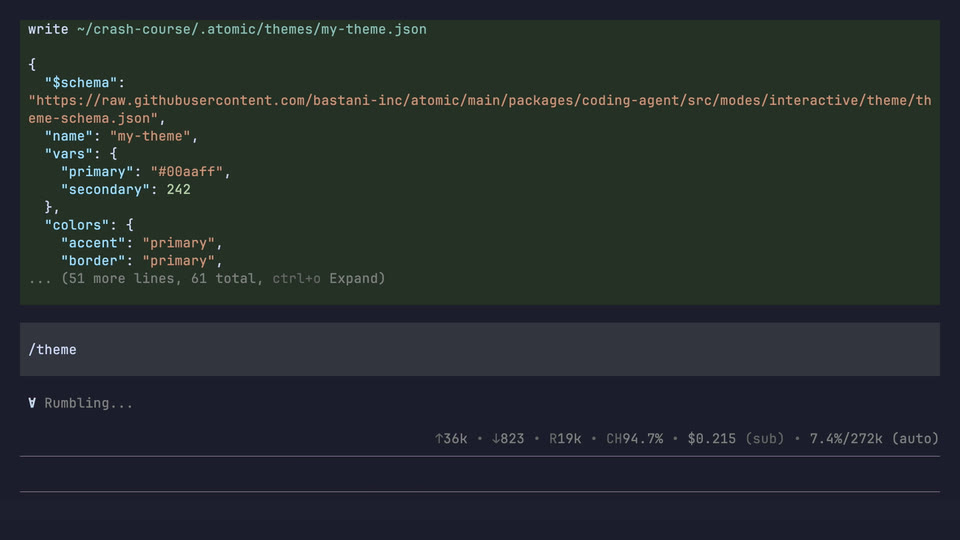
</picture>
</a>
</td>
</tr>
</table>

<!-- feature-wall:more:end -->

---

## How Atomic works

A skill describes the procedure. The parent chat uses codemode to call tools, launch specialist subagents, and check their results. It can do other work after launching children and continue from their completion notices.

Atomic is a fork of Pi, so it works with the providers, tools, MCP servers, skills, and extensions already in your Pi stack.

Use direct chat for a small task. For a larger one, tell the parent the scope, how to verify the result, and when to stop. If a repair needs another round, run the check first. Children have persisted, resumable sessions; an interrupted script does not automatically replay its actions.

Atomic can support:

- **Engineering runs** — research, plan, implement, test, review, and release.
- **Debugging and migrations** — reproduce, diagnose, patch, migrate in waves, and verify.
- **Research and triage** — gather context, fan out analysis, classify issues, and synthesize findings.
- **QA, docs, and compliance** — run repeatable checks with evidence and approval points.
- **Custom agent products** — build on Atomic's runtime, SDK, tools, and skills.

### Examples

Focused codebase research:

```text
/skill:research-codebase how the rate limiter works in src/middleware/
```

Repository-wide research with durable artifacts:

```text
Give one read-only agent to each subsystem. Map the old auth middleware call sites, then combine the findings with file and line references.
```

A task-specific implementation and review loop:

```text
Implement specs/2026-03-rate-limit.md. Have an independent agent review the patch, run the burst test, and stop when it returns 429 with Retry-After or after three repair attempts.
```

---

## What you get

### 1. Codemode orchestration

The parent can split a task across agents, collect their results, and decide the next step from an actual check. Use `/tasks` to inspect children and `/resume` to reopen the parent session. See [Orchestration patterns](./packages/coding-agent/docs/orchestration/patterns.md) for examples of fan-out, independent verification, tournaments, and bounded repair loops.

### 2. Skills

Skills are reusable expert instructions and process modules. Atomic can select one from its description, or you can call it with `/skill:<name>`.

| Skill               | Purpose                                                                                      |
| ------------------- | -------------------------------------------------------------------------------------------- |
| `research-codebase` | Analyze a focused area and write a dated research document.                                  |
| `create-spec`       | Produce a technical execution spec grounded in research and engineer feedback.               |
| `subagent`          | Delegate work through single agents, parallel groups, or forked context.                     |
| `intercom`          | Coordinate parent, child, and peer sessions on the same machine.                             |
| `prompt-engineer`   | Refine prompts, research questions, and skill inputs.                                     |
| `skill-creator`     | Create, improve, and evaluate reusable skills.                                               |
| `tdd`               | Apply a red-green-refactor loop and testing guidance.                                        |
| `tmux`              | Drive and verify terminal applications.                                                      |
| `agent-browser`     | Automate browser interactions and end-to-end UI checks.                                      |
| `agent-desktop`     | Drive native desktop apps through their accessibility trees with agent-desktop (vercel-labs/agent-desktop, Apache-2.0). |
| `qlty`              | Lint, auto-format, and measure code quality across 70+ linters via the qlty CLI.              |
| `liteparse`         | Extract text, tables, and values from documents and images.                                  |
| `impeccable`        | Design, audit, and refine frontend interfaces.                                               |
| `show-me`           | Explain topics visually with concise diagrams, code-shape sketches, and focused HTML artifacts (HumanLayer, MIT). |

### 3. Specialized subagents

Subagents are purpose-built agents with scoped context, tools, and termination conditions. Atomic bundles nine definitions from [`packages/subagents/agents/`](./packages/subagents/agents/).

| Subagent                     | Purpose                                                    |
| ---------------------------- | ---------------------------------------------------------- |
| `worker`                     | Implement a bounded task and return a concise result.      |
| `codebase-locator`           | Locate files and components relevant to a task.            |
| `codebase-analyzer`          | Analyze implementation details.                            |
| `codebase-pattern-finder`    | Find similar implementations and usage examples.           |
| `codebase-online-researcher` | Fetch current documentation and authoritative web sources. |
| `codebase-research-locator`  | Find relevant prior research in the repository.            |
| `codebase-research-analyzer` | Extract decisions and rationale from local research.       |
| `code-simplifier`            | Refine recent code without changing behavior.              |
| `debugger`                   | Reproduce, diagnose, and verify fixes for failures.        |

Large, mixed, or growing contexts can make attention harder. Specialized agents reduce that risk through isolation, focus, tool scoping, and deliberate handoffs. Independent tasks can also run in parallel.


---

## Documentation

Full documentation lives at **[docs.bastani.ai](https://docs.bastani.ai/)**. It covers the CLI and SDK, security, containerized execution, codemode orchestration, session management, configuration, troubleshooting, and provider setup.

The docs live in this repository under [`packages/coding-agent/docs`](./packages/coding-agent/docs). Open a pull request to suggest a change.

## FAQ

### Is Atomic another coding agent?

Atomic includes a coding-agent CLI. Its main product idea is the runtime around the agent session: scoped context, tools, executable checks, subagents, and human approvals.

### Why not use Claude Code, Codex, or OpenCode?

Use any interactive coding tool that fits the job. Use Atomic when work needs an explicit process you can inspect, version, resume, and verify. Atomic connects to model providers directly rather than running those tools underneath it.

### How is Atomic different from products that fan out many agents?

Atomic can fan work out too. The difference is not whether agents run in parallel; it is whether developers control the context, handoffs, evidence, checks, and approval rules around that work. Parallel execution increases throughput. Assurance comes from the process you define and enforce.

### Is Atomic deterministic?

The selected model can produce different answers. Put deterministic checks in scripts and inspect their exit status and artifacts before relying on an answer.

### Why not Markdown checklists or `CLAUDE.md`?

A skill is Markdown the model can follow. It can also include scripts for checks that prose alone cannot perform. Reserve decisions that require human approval for the user.

### Why not LangGraph or a generic agent framework?

Atomic is repo-native and focused on software engineering work: issues, research, specs, branches, diffs, tests, lint, artifacts, reviewers, approvals, and handoffs. It provides a coding-agent runtime rather than a set of generic application primitives.

### Where do artifacts live?

Choose project paths for deliverables you want to keep. Research commonly lives in `research/` and specs in `specs/`. A child can return a file path for the parent to read and verify.

---

## Orchestration guide

Read [Orchestration with codemode and subagents](./packages/coding-agent/docs/orchestration.md) to plan independent work, recover after interruption, and verify results.

## Support & ideas

Join the [Atomic Discord community](https://discord.gg/9CvdXUGXR4) for questions, help, feedback, feature ideas, and examples of what you have built.

## Contributing

See [CONTRIBUTING.md](CONTRIBUTING.md) for contribution guidelines and [DEV_SETUP.md](DEV_SETUP.md) for development setup and testing.

To share a reusable procedure, see [Writing skills](./packages/coding-agent/docs/skills/authoring.md).

## License

MIT — see [LICENSE](LICENSE).

## Sponsors

Thanks to [Namespace](https://namespace.so/github-actions/?utm_source=oss&utm_campaign=atomic) for powering our CI/CD pipelines with fast macOS, Linux, and Windows runners.

[](https://namespace.so/github-actions/?utm_source=oss&utm_campaign=atomic)

## Credits

- [Pi](https://pi.dev)
- [Superpowers](https://github.com/obra/superpowers)
- [Anthropic Skills](https://github.com/anthropics/skills)
- [Ralph Wiggum Method](https://ghuntley.com/ralph/)
- [OpenAI Codex Cookbook](https://github.com/openai/openai-cookbook)
- [HumanLayer](https://github.com/humanlayer/humanlayer)
- [Impeccable](https://github.com/pbakaus/impeccable)
