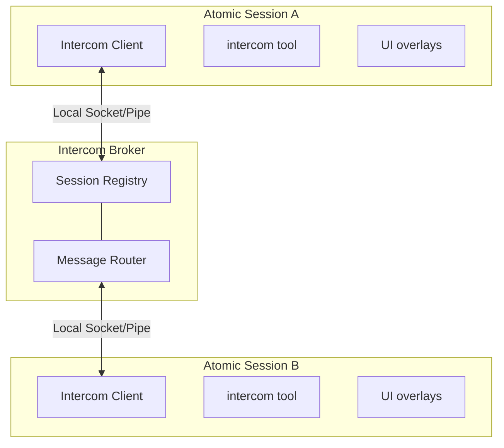

# @bastani/intercom

`@bastani/intercom` is Atomic's bundled extension for direct messaging between Atomic sessions on one machine, or across machines that share storage. Send context, findings, or requests from one session to another, or let agents coordinate directly.

See the [Intercom guide](../coding-agent/docs/intercom.md), [Intercom operations](../coding-agent/docs/intercom/operations.md), and [Intercom reference](../coding-agent/docs/intercom/reference.md) for full details.

## Overview

When you run multiple Atomic sessions at the same time, such as one researching and another implementing, Intercom lets you coordinate them without copying text between terminals:

- **User-driven orchestration.** Press `Alt+M` or run `/intercom` to pick a session and send context or instructions.
- **Agent collaboration.** Agents can list live peers, send notifications, ask questions, and exchange file or code attachments.
- **Subagent escalation.** Delegated subagents receive a typed admission-issued `contact_supervisor` tool with canonical run metadata and a broker-issued supervisor capability bound to the child's `IntercomClient`. Descendants cannot inherit a parent capability through process environment variables. Normal sessions see only the `intercom` tool.

## Setup

Atomic bundles `@bastani/intercom` with `@bastani/atomic`. No separate installation is required.

At startup, the extension registers the `intercom` tool, `/intercom` command, `Alt+M` shortcut, and bundled `intercom` skill (`/skill:intercom`). An interactive session connects to the local broker in the background a few seconds after startup, so other sessions in its group can list and message it right away. Print (`-p`), JSON, RPC, and SDK sessions connect on first use. Interactive sessions also wait for first use when `joinAtStartup` is `false` in config, `ATOMIC_INTERCOM_JOIN_AT_STARTUP=0` is set, or `intercom` is excluded from the session's tools. Admitted subagent children join at session start so peers and the parent can list and message them immediately.

You can add this snippet to your project's `AGENTS.md` to guide when agents should coordinate across sessions:

```xml
<intercom>
Coordinate with other local Atomic sessions on related codebases. Use `/skill:intercom` for patterns.

When: same codebase (parallel work), reference codebase (consulting patterns), related repos (shared libraries).
Not when: unrelated codebases, trivial questions, or work you can complete independently.
Principle: use `send` for notifications and `ask` when you need an answer. `ask` does not block forever; its reply arrives as a message.
</intercom>
```

The session list, `Alt+M` picker, and group counts include connected agent sessions only. Internal control connections are hidden and cannot receive ordinary messages, even by exact session ID or through a supervisor route. An agent executing a tool or waiting for user input stays visible and messageable.

Unnamed sessions keep a runtime alias such as `subagent-chat-1a2b3c4d-1111-4222-8333-123456789abc` for name lookup. Session listings omit that generated alias and lead with the copyable full session ID while keeping user-chosen names as metadata.

## Quick start

### From the keyboard

Press `Alt+M` or run `/intercom` to open the session list overlay:

1. Select a target session with the up and down arrow keys.
2. Write your message in the compose overlay.
3. Press `Enter` to send, or `Escape` to cancel.

### From the agent

Agents list sessions, manage groups, and exchange messages through the `intercom` tool. The bundled `/skill:intercom` skill contains reusable coordination patterns.

```typescript
// List active sessions in your groups
intercom({ action: "list" })

// Add a named group membership (creates the group if no session is in it yet)
intercom({ action: "join", group: "api-review" })

// Discover all active groups and see which ones you belong to
intercom({ action: "groups" })

// Leave one membership, or omit group to reset to your startup home group
intercom({ action: "leave", group: "api-review" })

// Send a message to a named session
intercom({ action: "send", to: "research", message: "Check whether UserService.validate() handles null." })

// Broadcast to matching sessions in your groups, or to subagents you launched
intercom({ action: "send", to: "subagent-worker-*", message: "Scope changed; skip the migration.", broadcast: true })
intercom({ action: "send", to: "subagents:*", message: "Wrap up and report what you have." })

// Ask by exact full session ID or name; replies come back inline if quick or later as a message
intercom({ action: "ask", to: "6332faab-1111-4222-8333-123456789abc", message: "Which validation path should I use?" })

// Ask without waiting, or wait up to a custom budget
intercom({ action: "ask", to: "research", message: "Any blockers?", wait: { kind: "background" } })
intercom({ action: "ask", to: "research", message: "Any blockers?", wait: { kind: "foreground", budgetMs: 60000 } })

// Inspect pending asks and cancel one
intercom({ action: "pending" })
intercom({ action: "cancel", askId: "4c4d8427" })

// Check connection state, group memberships, and multi-node routing
intercom({ action: "status" })

// Send with attachments (file, snippet, or context)
intercom({
  action: "send",
  to: "worker",
  message: "Here is the fix:",
  attachments: [{
    type: "snippet",
    name: "auth.ts",
    language: "typescript",
    content: "function validate(user: User) { ... }"
  }]
})
```

### Receiving messages

Incoming messages appear inline in chat with the sender's details and a reply hint:

```text
**From research** (~/projects/api)

To reply, use the intercom tool: intercom({ action: "reply", message: "..." })

Found the issue. UserService.validate() does not check for null input.
See auth.ts:142-156.
```

The reply hint is enabled by default and points to `intercom({ action: "reply", ... })`, so recipients do not have to reconstruct raw sender or message IDs. Idle recipients start a new turn immediately. Busy interactive recipients receive the message once idle. Attachment contents are included in the agent-visible body, and messages are stored in Atomic session history.

Recipients save each message to their session before the sender receives `delivered`. If a recipient closes or crashes before showing a saved message, reopening that session recovers the message in arrival order.

For `send` and `ask`, the `delivery` parameter controls how a busy recipient handles the message:

| `delivery` | Behavior for a busy recipient | Use when |
| --- | --- | --- |
| `"steer"` (default) | Arrives after current tool calls finish without cancelling work. | Sharing findings, updates, and normal coordination. |
| `"followUp"` | Waits until the recipient finishes and stops. | Sending low-priority notes meant for after the current task. |
| `"interrupt"` | Cancels the current model call or cancellable tool call immediately. | Sending an urgent correction or stop order. |

A single-target `send` or `ask` to a subagent that completed or failed queues the message and has its launching session resume it. A message to a paused or quit subagent waits without expiring until its launching session continues it. Queued messages survive broker restarts in `ended-child-queue.sqlite`, or in the shared database when multi-node routing is active. Permanently cancelled children reject new messages.

For delegated children, queued messages and terminal lifecycle notices stay ordered per child. Intercom drains the child's pre-terminal entries in FIFO order and admits that prelude together with the terminal notice, deduplicated by terminal identity so each child's terminal notice is admitted once.

## Planner-worker coordination

A common setup splits a task across two terminals running `atomic`, one holding the plan and the other doing the implementation. Name each session so they can address each other:

```text
# Terminal 1                    # Terminal 2
/name planner                   /name worker
```

Confirm both sessions appear in `intercom({ action: "list" })`, then coordinate:

```typescript
// Planner delegates with send
intercom({
  action: "send",
  to: "worker",
  message: "Task-3: Add retry logic to src/api/client.ts and src/api/types.ts. Ask if anything is unclear."
})

// Worker asks for clarification and keeps working if the answer is not immediate
intercom({
  action: "ask",
  to: "planner",
  message: "Should retry apply to all endpoints or only idempotent ones? What max retry count and backoff should I use?"
})
```

If the planner replies within the wait budget, the reply returns inline as the tool result. Otherwise the ask stays pending with no expiry and the answer arrives later as a message starting `"Reply to your ask <id> from planner"`.

To coordinate two chat sessions privately without changing startup settings, have both call `intercom({ action: "join", group: "api-review" })`. Joining adds a membership without changing the session ID or removing existing memberships. Joined memberships survive broker reconnects and Atomic restarts; groups you leave are not rejoined. Sending to a session that is live only in another group fails with `<name> is live in group <group>; join it to send`.

### Communication patterns

| Pattern | Action | Reason |
| --- | --- | --- |
| Task delegation | `send` | Fire-and-forget; the sender does not need an answer to continue. |
| Clarification request | `ask` | The sender needs an answer and keeps working while waiting. |
| Discovery escalation | `ask` | The sender needs approval before changing course. |
| Peer handoff | `send` | A sibling subagent passes file paths, evidence, or a reproduction directly to another sibling. |
| Peer challenge | `ask` | One reviewer questions another sibling's finding with evidence. |
| Broadcast | `send` with glob or `subagents:*` | One agent shares an update with every matching live session at once. |

### `send`, `ask`, and `reply`

`send` delivers a message and returns once the recipient saves it. Sends run immediately by default. Set `"confirmSend": true` in config to require an interactive approval dialog before non-reply sends; replies carrying `replyTo` always skip confirmation.

`ask` delivers a question to one exact target and returns once delivered, including `askId`, `delivered`, and the recipient's state (`idle` or `busy`, plus `currentAction` when known). The `wait` parameter matches `bash`. Omitting `wait` waits up to the automatic yield (default 10 seconds), `{ kind: "foreground", budgetMs }` waits up to that budget, and `{ kind: "background" }` returns at delivery. If a reply arrives within the wait, `ask` returns it inline. Otherwise the ask stays pending with no expiry until the reply arrives as a message, or until a refusal or recipient exit arrives as a failed-ask message.

`reply` answers an inbound ask. In the turn triggered by an incoming message, `intercom({ action: "reply", message: "..." })` targets that sender and thread automatically. Outside that turn, omitting selectors falls back to the single unresolved inbound ask. When several asks are pending, call `intercom({ action: "pending" })` and pass `to` or the exact `replyTo` message ID (or unique 8-hex UUID prefix). Explicit selectors never silently fall back to another thread.

## Subagent escalation with `contact_supervisor`

When Atomic's subagent runtime admits a delegated child with supervisor coordination, the child receives the `contact_supervisor` tool alongside `intercom`. Normal sessions never see `contact_supervisor`.

The tool is registered from the child's typed admission record, which binds the supervisor target, child identity, child index, session name, and broker-issued capability directly to the child session. In parallel runs, blocking `contact_supervisor` requests wait only in the requesting child and resume that same execution once the supervisor replies. Active and queued siblings keep running with their original identities and worktrees. Only a single child run directly by an SDK host without a task owner ends with a `[TASK_CONTEXT]` fresh-child handoff when its blocking parent ask is claimed.

| Reason | Behavior | Use when |
| --- | --- | --- |
| `need_decision` | Waits for a correlated reply in the same child (or returns a `[TASK_CONTEXT]` handoff for a single ownerless SDK child). | The child is blocked or faces an unapproved product, API, or scope decision. |
| `interview_request` | Waits for structured JSON answers in the same child (or returns a `[TASK_CONTEXT]` handoff for a single ownerless SDK child). | The child needs multiple machine-readable answers in one exchange. |
| `progress_update` | Sends a non-blocking update and returns at delivery. | A discovery changes the plan or merits an explicit update. |

Do not use `contact_supervisor` for routine completion handoffs. Return the child's normal final result instead.

Cross-group supervisor delivery uses a dedicated broker protocol. Raw `send` frames remain group-isolated and reject forged `channel: "supervisor"` markers. A child crosses groups only after its broker-issued capability binds its socket to the exact supervisor. Replies cross back only when `replyTo` matches a recorded supervisor message in the reverse direction.

```typescript
// Blocked subagent asks for a decision
contact_supervisor({
  reason: "need_decision",
  message: "The auth service returns 403 instead of 401 for expired tokens. Should I treat 403 as a re-auth trigger or a hard failure?"
})

// Structured supervisor interview
contact_supervisor({
  reason: "interview_request",
  message: "Please answer these questions before I continue the migration.",
  interview: {
    title: "API migration choices",
    questions: [
      { id: "api", type: "single", question: "Which API should I target?", options: ["Stable API", "Experimental API"] },
      { id: "constraints", type: "text", question: "What constraints should I preserve?" }
    ]
  }
})

// Non-blocking progress update
contact_supervisor({
  reason: "progress_update",
  message: "The bug is in the retry wrapper rather than the API client."
})
```

### What the supervisor receives

The supervisor sees the child identity, run metadata, and question:

```text
**From subagent-worker-78f659a3-1**

Subagent needs a supervisor decision.
Run: 78f659a3
Agent: worker
Child index: 0

Which API should I use?
```

The supervisor answers with `intercom({ action: "reply", message: "..." })`. For `interview_request`, questions use `{ id, type, question, options?, context? }` where `type` is `single`, `multi`, `text`, `image`, or `info` (`info` questions need no response). The supervisor replies with plain JSON or a fenced `json` block matching this shape:

```json
{
  "responses": [
    { "id": "api", "value": "Stable API" },
    { "id": "constraints", "value": "Keep the public error shape unchanged." }
  ]
}
```

When the reply matches valid question IDs and options, the child tool result includes the parsed object in `details.structuredReply` alongside the raw reply text.

## Tool reference

### `intercom`

| Parameter | Type | Description |
| --- | --- | --- |
| `action` | string | `"list"`, `"groups"`, `"join"`, `"leave"`, `"send"`, `"ask"`, `"reply"`, `"pending"`, `"cancel"`, or `"status"`. |
| `to` | string | Live session name, exact full session ID, or unique 8-hex UUID prefix. `send` also accepts a session-name glob (`subagent-worker-*`, `*`) or `subagents:*` / `subagents:<runId>/*`. `ask` requires one exact target. |
| `message` | string | Message body for `send`, `ask`, or `reply`. |
| `broadcast` | boolean | Required with `send` when a session-name glob matches more than one session. `subagents:` targets broadcast without it. |
| `attachments` | array | Optional `file`, `snippet`, or `context` attachments (`{ type, name, content, language? }`). |
| `delivery` | string | Optional urgency for `send` or `ask`: `"steer"` (default), `"followUp"`, or `"interrupt"`. |
| `wait` | object | Optional wait policy for `ask`: omitted uses the automatic yield (default 10 seconds), `{ kind: "foreground", budgetMs }` waits up to a budget, and `{ kind: "background" }` returns at delivery. |
| `askId` | string | For `cancel`, the ID or unique prefix of one of your pending asks. |
| `replyTo` | string | Exact pending-ask message ID or unique 8-hex UUID prefix. With `cancel`, closes an inbound ask sent to you without replying. |
| `group` | string | Group name for `join` or targeted `leave`, or read-only group filter for `list` and `status`. |

### `contact_supervisor`

Registered only in subagent sessions admitted with supervisor coordination.

| Parameter | Type | Description |
| --- | --- | --- |
| `reason` | string | `"need_decision"`, `"interview_request"`, or `"progress_update"`. |
| `message` | string | Decision request, optional interview note, or progress update. |
| `interview` | object | Required for `interview_request`: `{ title?, description?, questions: [...] }`. |

### Actions

- **`list`** returns the current session and every active session sharing at least one membership. Pass `group` for a read-only view of one group.
- **`groups`** lists every group represented by a connected session with connected counts and membership markers.
- **`join`** adds a trimmed named membership and creates that group if empty. `default` is shared; `true` and `auto` are reserved for subagent auto-groups.
- **`leave`** removes the specified `group`, or resets memberships to the startup home group when `group` is omitted.
- **`send`** delivers a message to one target or every live match of a pattern within your groups. A session-name glob matching multiple sessions requires `broadcast: true`; without it, nothing is sent and the error lists all matches.
- **`ask`** sends a question to one exact target, waits according to `wait`, and keeps the ask open until answered or cancelled. Up to `maxPendingAsks` (default 6) calls may wait concurrently; further asks still deliver and receive replies as messages.
- **`reply`** answers the active incoming message or single pending inbound ask, or an explicit `to` / `replyTo` thread.
- **`pending`** lists unresolved inbound asks and your own outbound asks still waiting for replies.
- **`cancel`** cancels one of your outbound asks by `askId` (any later reply appears once, marked late), or closes an inbound ask sent to you by `replyTo` without notifying its sender.
- **`status`** reports connection status, session ID, memberships, visible session count, and the `Multi-node routing:` state (including live peer brokers in shared storage).

Target lookup accepts an exact full Intercom session ID, an exact case-insensitive session name, a unique 8-hex UUID prefix, or a connected session's Atomic session ID when unambiguous. Workflow stage targets (`workflow:<rootRunId>/...`) were removed with workflows in Atomic 0.10.0 and return `Session not found`.

A session outside your groups whose message reached you (such as through a host reach policy or supervisor exchange) can be answered directly without joining a group, up to 3 messages within 30 minutes of its latest message. Pattern sends never use this return path.

Host registrations may set `recipientPurpose` to `"agent"` or `"control"` (omission defaults to `"agent"`). Presence updates cannot change a session's registered purpose, and control connections are excluded from discovery and ordinary delivery.

Only one blocking `contact_supervisor` request can wait at a time per child. One supervisor wait can coexist with peer asks, while a second concurrent supervisor wait fails with `Already waiting for a supervisor reply`.

### CLI broker commands

```bash
atomic intercom status     # Inspect the running broker, storage alignment, and protocol version
atomic intercom restart    # Ask the running broker to shut down so sessions reconnect to a fresh broker
atomic intercom upgrade    # Replace an older broker when safe
```

## Keyboard shortcuts

| Key | Action |
| --- | --- |
| `Alt+M` | Open the session list overlay |
| `Up` / `Down` | Move through the session list |
| `Enter` | Select a session or send a message |
| `Escape` | Cancel or close the overlay |

## Configuration

Create `~/.atomic/agent/intercom/config.json`. When that file is absent and neither `ATOMIC_CODING_AGENT_DIR` nor `PI_CODING_AGENT_DIR` is set, Atomic also checks legacy `~/.pi/agent/intercom/config.json`.

```json
{
  "brokerCommand": "npx",
  "brokerArgs": ["--no-install", "tsx"],
  "brokerStartupTimeoutMs": 30000,
  "confirmSend": false,
  "maxPendingAsks": 6,
  "replyHint": true,
  "joinAtStartup": true,
  "status": "researching"
}
```

The default `npx --no-install tsx` pair is a compatibility sentinel. Intercom recognizes it and spawns the broker with the current Atomic runtime (`process.execPath`) without resolving `npx`, `tsx`, or `bun` on `PATH`. Installed builds run `broker/broker.bundle.mjs`, Node source checkouts run `broker/broker.ts` through Atomic's bundled `jiti` loader, Bun source checkouts run with the active Bun binary, and standalone Atomic binaries re-enter the launcher internally.

| Setting | Default | Description |
| --- | --- | --- |
| `brokerCommand` | `"npx"` | Broker spawn command. The default sentinel uses the active Atomic runtime internally. |
| `brokerArgs` | `["--no-install", "tsx"]` | Arguments passed to `brokerCommand` before the broker script path. |
| `brokerStartupTimeoutMs` | `30000` | Maximum milliseconds a session waits for a newly spawned broker to answer on its socket (minimum `1000`). Raise this if slow source-checkout starts time out. |
| `confirmSend` | `false` | Prompt for interactive confirmation before non-reply sends. |
| `maxPendingAsks` | `6` | Maximum concurrent waiting asks per session (minimum `1`). |
| `replyHint` | `true` | Include the `intercom({ action: "reply", ... })` hint in incoming messages. |
| `status` | none | Optional status suffix appended after automatic lifecycle states (`idle`, `thinking`, `tool:<name>`). |
| `group` | none | Optional default home group. `ATOMIC_INTERCOM_GROUP` (or legacy `PI_INTERCOM_GROUP`) overrides it. |
| `joinAtStartup` | `true` | Connect interactive sessions in the background at startup. `ATOMIC_INTERCOM_JOIN_AT_STARTUP=0` disables startup join, and `ATOMIC_INTERCOM_JOIN_AT_STARTUP=1` forces startup join even when config sets `joinAtStartup` to `false`. |

Custom broker commands remain supported. To launch the broker explicitly with Bun from `PATH`:

```json
{
  "brokerCommand": "bun",
  "brokerArgs": []
}
```

## How it works



The broker is a standalone process that manages session registration and message routing over length-prefixed JSON frames (4-byte length header plus JSON payload) on a Unix domain socket (macOS and Linux) or named pipe (Windows). When shared storage is configured through `@bastani/atomic-storage-libsql` or `@bastani/atomic-storage-postgres`, brokers also enable multi-node routing so sessions on different machines can list and message each other, and ungrouped sessions default to their repository's `project:<owner>/<repo>` group instead of `default`.

### Broker lifecycle and recovery

- **Auto-spawn and idle exit.** The broker starts automatically when needed and exits after 5 seconds with no registered sessions. A spawn lock prevents duplicate brokers when multiple sessions connect concurrently.
- **Reconnects.** Clients reconnect automatically with bounded backoff (1s, 2s, 5s, 10s, then 30s) if the broker restarts or retires.
- **Watchdog.** A broker-owned watchdog probes its local request path independently of the main thread and exits its own process after roughly one minute without a valid response so clients spawn a healthy replacement.
- **Internal delivery retries.** Each `send`, `ask`, or `reply` call retries recoverable disconnects internally up to 3 times (after 1, 2, and 5 seconds) with the same message ID, arguments, attachments, and reply route, within an 11-minute deadline. Caller-supplied `retryToken` parameters are rejected without sending. If recovery cannot confirm the outcome, the tool returns a terminal error with `outcome: "unknown"` so callers check with the recipient rather than duplicating automatically.
- **Durable delivery authority.** Accepted operations are recorded for 12 minutes in `delivered-messages.sqlite` as keyed SHA-256 HMAC digests paired with `delivered-messages.key` (never plaintext bodies or attachments). On POSIX, the Intercom directory is set to `0700` and database and key files to `0600`. Capacity limits are bounded at 1,000 client identity slots, 10,000 live broker authority records, and 64 MiB of broker authority storage; limits fail closed instead of evicting live authority.
- **Mixed-version compatibility.** The protocol range supports Atomic 0.9.x sessions alongside 0.10.x sessions on the same broker. Legacy 0.9.x workflow frames receive compatible responses without closing the connection, while `workflow:` targets return `Session not found`.
- **Session teardown safety.** Async startup, reconnect, overlay, and relay tasks become no-ops if the session shuts down or reloads before they settle.

### Runtime files

Runtime files live in `~/.atomic/agent/intercom/`. Setting `ATOMIC_CODING_AGENT_DIR` (or legacy `PI_CODING_AGENT_DIR` when unset) relocates this directory.

- `broker.sock` holds the Unix domain socket on macOS and Linux (Windows uses a named pipe). If the path exceeds the Unix socket path limit (107 bytes on Linux, 103 bytes on macOS), the broker creates an owner-only `atomic-intercom-<uid>/<digest>.sock` socket under `$XDG_RUNTIME_DIR` or the system temp directory.
- `broker.sock.path` records the moved socket path when `broker.sock` would exceed the platform limit.
- `broker.pid` stores the broker process ID.
- `broker.starting` records a starting broker's PID until it begins listening.
- `broker.spawn.lock` coordinates concurrent broker spawns with a 60-second backstop.
- `broker.sock.replace.lock` serializes stale socket replacement during broker startup.
- `broker-launch.vbs` launches the broker without a console window on Windows.
- `broker.log` captures broker stderr, capped internally at 8 KiB by `broker/bounded-stderr-install.ts`.
- `broker.log.previous` keeps the bounded tail of the previous nonempty broker log.
- `broker-watchdog.log` records the latest watchdog termination.
- `delivered-messages.sqlite` and `delivered-messages.key` store durable delivery deduplication digests and their owner-only HMAC key.
- `away-asks.sqlite` stores open asks and replies held for away sessions.
- `ended-child-queue.sqlite` stores queued messages waiting to resume or reach finished and paused subagents across broker restarts.
- `config.json` stores user configuration.

## Package layout

```text
packages/intercom/
├── package.json
├── index.ts                      # Lazy extension entry point
├── index-heavy.ts                # Runtime wiring and session lifecycle
├── intercom-tool.ts              # intercom tool implementation
├── contact-supervisor-tool.ts    # Subagent-only contact_supervisor tool
├── config.ts                     # Config loading and validation
├── types.ts                      # Protocol and session types
├── broker/
│   ├── broker.ts                 # Broker process entry point
│   ├── client.ts                 # IntercomClient socket client
│   ├── framing.ts                # Length-prefixed JSON framing
│   ├── paths.ts                  # Platform socket, pipe, and state paths
│   ├── spawn.ts                  # Auto-spawn and lock coordination
│   ├── multinode-router.ts       # Cross-machine routing over shared storage
│   └── watchdog.ts               # Broker liveness watchdog
├── ui/
│   ├── session-list.ts           # Session picker overlay
│   ├── compose.ts                # Message composition overlay
│   └── inline-message.ts         # Inline received message renderer
└── skills/
    └── intercom/
        └── SKILL.md              # Bundled /skill:intercom guide
```

## Limitations

- **Local IPC by default.** Without shared storage, Intercom connects sessions on the same machine only. Cross-machine messaging requires configuring a shared storage adapter (`@bastani/atomic-storage-libsql` or `@bastani/atomic-storage-postgres`).
- **No separate transcript file.** Messages are stored in Atomic session history rather than a dedicated Intercom inbox file.
- **No attachments UI.** The `intercom` tool supports `file`, `snippet`, and `context` attachments, while the `Alt+M` compose overlay sends plain text only.
- **Connected sessions only.** `intercom list` shows sessions currently registered with the broker, not disconnected or offline Atomic processes.
