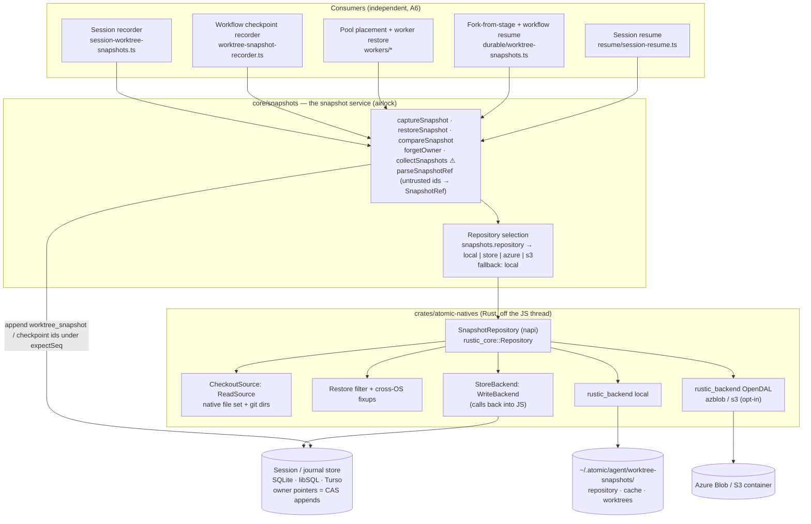

# rustic_core Worktree Snapshots — Technical Design Document / RFC

| Document Metadata      | Details |
| ---------------------- | ------- |
| Author(s)              | Alex Lavaee (with Atomic) |
| Status                 | Draft (WIP), design only. Implementation starts after [#4588](https://github.com/bastani-inc/atomic/issues/4588) merges, as the issue requires. |
| Team / Owner           | `packages/coding-agent` (snapshot service, resume), `crates/atomic-natives` + `packages/natives` (rustic_core binding), `packages/workflows` (checkpoint recorder, pool placement) |
| Created / Last Updated | 2026-11-09 |
| Tracks                 | [#4595](https://github.com/bastani-inc/atomic/issues/4595). Builds on [#4584](https://github.com/bastani-inc/atomic/issues/4584) (PR #4592, restored-checkout warnings) and [#4588](https://github.com/bastani-inc/atomic/issues/4588) (blueprints, in flight) |
| Research               | `research/2026-11-09-write-the-design-spec-for-bastani-inc-atomic-4595-read-it-with-gh-issue-view-459.md` (stage artifact of this workflow run; not committed) |
| Engine (user decision) | [`rustic_core` 0.13.0](https://docs.rs/rustic_core/0.13.0/rustic_core/) with [`rustic_backend` 0.7.0](https://docs.rs/rustic_backend/0.7.0/rustic_backend/) (same upstream commit `1030be4`), used **as is**, embedded in the existing N-API module |
| Compatibility posture  | **Breaking changes not allowed.** See §10. |

---

## 1. Executive Summary

Atomic snapshots every checkout a session or workflow touches so the work can resume on any machine. Today that layer is 3,728 lines of hand-written git plumbing (scratch indexes, patch chains, bundles, fetches, a SQL blob store with 9 tables and 15 triggers, crash records and repository locks) plus about 20.8k lines of tests. It needs git on every node and a reachable remote, and it refuses to resume when either is missing.

This spec replaces it with `rustic_core`: immutable, encrypted, content-addressed snapshots of the **whole checkout including its `.git` data**, written lock-free from any number of nodes. A snapshot's identity is its rustic id. The only mutable state is the owner's pointer to its latest snapshot, advanced by the compare-and-swap appends that sessions and workflow journals already use. Restore materializes into a fresh directory, applies cross-OS fixups, and swaps it into place with one rename. No fetch, bundle or remote is involved, and no git binary is needed; git is used only, when present, to re-apply executable bits to a Windows snapshot restored on Unix.

By default the repository lives on the local disk (single machine) or inside the existing session database (shared storage), so nothing new has to be provisioned. Azure Blob and S3 are opt-in through one guided command.

Two doors carry the design: `captureSnapshot` (the only way a snapshot pointer moves) and `restoreSnapshot` (the only way a snapshot becomes a directory). `collectSnapshots` ⚠ is the only door that destroys snapshot data. A restore never blocks a resume: anything a blueprint can rebuild becomes agent context, and lost user work becomes a prominent warning.

## 2. Context and Motivation

### 2.1 Current State

The research artifact (§2) inventories the current code. In summary:

```text
packages/coding-agent/src/core/
├── worktree-snapshot/            3,728 lines, 15 files: the git-based engine
│   ├── capture.ts          534   scratch index, read-tree/diff-files/ls-files, write-tree, snapshot commit,
│   │                             binary patch chain, bundle of unpushed commits, envHash
│   ├── restore.ts        1,022   shared bare store per remote set, fetch → bundle fallback, patch replay,
│   │                             git worktree add + read-tree, LFS pull, verify, staging + worktree move,
│   │                             crash records under proper-lockfile, in-process repository lock
│   ├── blob-store.ts     1,057   9 tables, 7 indexes, 15 triggers on session/journal/pool tables
│   ├── garbage.ts          202   paced collection with a claim row and batches of 256
│   ├── git.ts              325   provisioned-git resolver + installedGitUnavailable
│   └── records.ts, types.ts, settings.ts, env-hash.ts, head-advance.ts, policy.ts, paths.ts, …
├── session-worktree-snapshots.ts   771   turn-end recorder, resume planning, restore notices
└── resume/                         session-resume.ts 774, preflight.ts 186 (git probe), setup-hook.ts 336, …
packages/workflows/src/
├── durable/worktree-snapshot-recorder.ts 134   per-checkpoint capture, serialized per root run
├── durable/worktree-snapshots.ts         210   frontier, resume, forkRun restore
└── workers/ snapshot-restore.ts 82, dispatch-snapshot.ts 94, workspace-binding.ts 63, placement-choice.ts 129
```

How it works today:

- **Capture.** At the end of each turn that called `bash`, `edit`, `write`, `powershell` or a `writesFiles` tool (`agent-session-boundaries.ts:123-125`), and at every durable stage and tool checkpoint, git builds a tree through a private index, writes a snapshot commit into the user's object store, a binary patch against `HEAD` and earlier snapshots, and a bundle of unpushed commits. The patches and bundles go to `${prefix}snapshot_blobs`.
- **Restore.** Atomic fetches the recorded commit from a remote (bundle fallback), replays the patch chain into a scratch index, runs `git worktree add --no-checkout` and `read-tree -u`, pulls LFS objects, verifies the tree id, and moves the staging worktree into `~/.atomic/agent/worktree-snapshots/worktrees/<id12>-<uuid8>`.
- **Retention.** 15 triggers on `session_entries`, `wf_events`, `wf_runs`, `wf_runs_work` and `wf_runs_pool_root_snapshot` maintain a reference index. `garbage.ts` deletes unreferenced blobs in batches under a 120 s claim lease.

**Leaking doors (today):**

- `captureWorktreeSnapshot` is named for a joint but promises git: it returns `unavailable` when no git can be provisioned, and the whole layer is gated on `resolveGit` (`worktree-snapshot/git.ts:27-72`, `capture.ts:441-443`).
- `restoreWorktreeSnapshot` hides a network dependency. It succeeds only when a remote that holds `head` is reachable or the bundle was captured. The deny-list rule leaves the bundle out when unpushed history touched `.env`, which makes the restore *fail* (`docs/worktree-snapshots.md:49`).
- The irreversible effect "delete snapshot content" is guarded by `collectSnapshotGarbage` in name, but **15 triggers** on five tables written by unrelated code paths decide what it may delete. No reader of a door can see that weight.
- `WorkspaceBinding = {remotes, head, tree, envHash}` (`types.ts:5-10`) makes pool placement a git question: `workspaceAffinityKey = JSON([sortedRemotes, tree])`, and a host without git cannot claim bound work (`sql-shared-pool.ts:286-299`).
- Resume refuses on missing prerequisites (`git-unavailable`, `setup-hook-missing`, `ResumePreconditionError`), even when the code itself could be put back.

### 2.2 The Problem

- **User impact.** A resume on a machine without git, without network access to the remote, or after the user stashed or rebased can fail with `WorkspaceDriftError` or `ResumePreconditionError`. Git stashes, local branches and the index are never captured, so they are lost on another machine.
- **Operational impact.** Multi-node pools need git on every worker and a reachable remote for every bound workspace. Collection is paced by triggers on hot tables.
- **Technical debt.** The engine reimplements a content-addressed store, a reference-counted index, crash recovery and locking, which a backup engine provides as a library.

### 2.3 Contract amendments (user-authored, authoritative)

The launch objective was amended six times during this run (once corrected). The amendments are **required scope**. They are reproduced verbatim in Appendix A, and §3.1 traces every clause to a section. Where an amendment replaced launch text, this spec follows the amendment:

| # | Amendment (short form) | Replaces in the launch objective |
|---|---|---|
| A1 | Default backends: a local repository under the agent dir, and a custom rustic backend storing repository files in Atomic's session store. OpenDAL object stores (S3, Azure, GCS) are opt-in. Cover pack size and cost in libSQL/Turso. | "fs and s3 via rustic_backend/OpenDAL" |
| A2 | Never block on anything `.atomic/blueprint.yaml` can rebuild. Report only lost user work, and even then resume with a prominent warning. Decide design questions with rationale; keep user-owned questions minimal. | — |
| A3 | Git-agnostic snapshots of the whole checkout, `.git` included. Restore needs no git, fetch, bundle or remote. Lock-file consistency rule. Five cross-OS fixups. Rejected: git-as-metadata, a git remote as the rustic backend. | "Git is metadata only … bundle … `git worktree add --detach` … rustic restore with delete semantics" |
| A4 (corrected) | Keep portable git provisioning (#4322) and its public API unchanged. The snapshot layer itself must not call git, except the optional exec-bit fixup. Bindings and pool placement move to rustic snapshot ids. Remove only snapshot-specific git-unavailable handling. | — |
| A5 | One guided `atomic snapshots setup` / `status` command and `/snapshots setup`, Entra-first Azure auth, no plain-text secrets, a "Share snapshots across machines" guide, a real two-VM Azure E2E. | — |
| A6 | One small modular snapshot service, consumed independently by the session recorder, the workflow checkpoint recorder, worker placement/restore, and fork/resume. Owner identity in tags. Journal stores snapshot ids. GC roots from sessions and journals. Workflow scenarios in tests and the Azure E2E. | — |

The launch clause "pass the exact file set from `git ls-files --cached --others --exclude-standard`" now meets A4's rule that the snapshot layer runs no git commands. This spec computes **the same set natively**, without a git binary, and proves parity against real `git ls-files` in tests (§5.4.4, decision D4).

## 3. Goals and Non-Goals

### 3.1 Functional Goals (traceability)

| Contract clause | Goal | Where |
|---|---|---|
| Launch: rustic_core 0.13.0 as is, embedded in the N-API module | All capture, restore and GC go through `rustic_core`, called from `crates/atomic-natives` without wrappers for upstream bugs | §5.2, §7.5 |
| Launch: immutable snapshots + one mutable pointer updated by CAS | Snapshots are immutable rustic snapshot files. The pointer is the owner's newest snapshot record, advanced only by an `expectSeq` CAS append | §5.5, §5.10 |
| Launch: restore into a fresh directory, then swap | Restore writes only into an empty staging directory and commits with one rename | §5.7 |
| Launch: lock-free concurrent snapshots; two-phase prune with `keep_delete` | No lock on capture or restore. A single GC claimant runs `prune` with the default `keep_delete` | §5.10, §5.12 |
| Item 1: unchanged user-visible behaviour | Resume on any machine, `atomic --session`, workflow resume, the #4584 notices and warnings | §3.3 |
| Item 2 + A1 + A5: natives API, repository location, backends, session-store relation, settings | `SnapshotRepository` napi class; `local`, `store`, `azure`, `s3` backends; `snapshots.repository` setting | §5.2, §5.3 |
| Item 3 + A3 + A6: layout, tags, metadata, ignore rules | Virtual `/checkout` and `/gitdir` paths; owner, session, worktree, host tags; v2 metadata; native file set equal to `git ls-files --cached --others --exclude-standard` | §5.4 |
| Item 4 + A3: capture and restore flows, incremental parents, LFS, symlinks, exec bits, Windows paths, large files | Step-by-step flows and the five fixups | §5.6, §5.7 |
| Item 5: multi-node and concurrency | What is CAS (owner pointers, GC lease) and what is lock-free (everything else) | §5.10 |
| Item 6 + A1 + A3: GC, retention, cost model | Roots, forget, prune; first-snapshot vs incremental cost including `.git/objects`; when to recommend local, store, or an object store | §5.12 |
| Item 7: migration and settings deprecations | v1 read / v2 write window, then removal; `snapshots.fullEvery` and `snapshots.maxSnapshotBytes` deprecated | §5.15, §10 |
| Item 8: deletions with line counts, new tests | Deletion inventory; unit, integration, multi-node, Windows, cross-OS and Azure E2E tests | §4.5, §8.1 |
| Item 9: `.atomic/blueprint.yaml` after restore | The `afterRestore` seam and the never-block outcomes | §5.13 |
| Item 10: stacked slices of about 100–500 lines with verification; open questions | 17 slices with RGR verification; one user-owned question | §8.2, §9 |
| A2: never block | Failure matrix covering every failure mode named in A2 and A3 | §5.9 |
| A4: snapshot layer is git-free; provisioning is kept | No `resolveGit` or git command in capture, restore, binding or placement; only the optional exec-bit fixup | §5.6, §5.7, §5.11 |
| A5: easy setup | `atomic snapshots setup|status`, `/snapshots setup`, Entra-first auth, user-delegation SAS adapter, guide, Azure E2E | §5.14, §8.1.6 |
| A6: one modular service, four independent consumers | `core/snapshots/` service; session recorder, workflow recorder, pool, fork/resume | §5.1, §5.11 |

### 3.2 Non-Goals (Out of Scope)

- [ ] No second snapshot engine, no defensive wrappers around `rustic_core`'s open upstream issues, and no "safeguards" layer. The user chose `rustic_core` as is (§7.5 lists upstream issues neutrally).
- [ ] No change to Atomic's portable git provisioning (#4322) or to `resolveGit`, `getToolPath("git")` or `GitUnavailableError` (A4, corrected). Workflow git worktrees, the agent's own git use and `atomic install git:` keep using it.
- [ ] No in-place restore over a live checkout, and no `RestoreOptions.delete`. A restore never writes into the user's own checkout.
- [ ] No capture of dependency or build directories that git ignores (`node_modules`, `target`, …). The blueprint rebuilds them (A2, A3).
- [ ] No on-disk deduplication between two restored worktrees of the same repository on one host. The repository deduplicates storage; the restored directories are independent (D10).
- [ ] No eager conversion of v1 snapshots to v2. They are read through the legacy path during the window (D15).
- [ ] No implementation of #4588 here. This spec defines the seam it plugs into (§5.13).
- [ ] No GCS, SFTP, rclone or REST backends in the guided setup. OpenDAL could add them later; only `azure` and `s3` are designed and tested.
- [ ] `restoreSnapshot` will NOT gain a second effect path: no other code creates a restored worktree directory (§7.1, rubric #8).

### 3.3 Behaviour that must stay the same (item 1)

| Entry point | Code today | Behaviour kept |
|---|---|---|
| Turn-end capture | `agent-session-boundaries.ts:123-125` → `SessionWorktreeSnapshotRecorder.recordTurn` (`session-worktree-snapshots.ts:81-158`) | Same trigger tools, same directories (session cwd plus parents of `edit`/`write` paths). In-memory sessions record nothing. Each distinct unavailable reason is reported once. |
| Session close | `agent-session-events.ts:760` → `scheduleCollection()` | Background GC that never blocks close and never keeps the process alive. |
| `atomic --session <id>`, `--resume`, `--continue` | `main-session.ts` → `prepareSessionResume` | A session whose recorded checkout is missing or drifted continues in a restored worktree. An id that a restore moved here opens directly instead of forking. A hung storage lookup still times out after 15 s with `ResumeCatalogTimeoutError`. |
| `/resume`, session switch, rehydrate | `agent-session-runtime.ts:607-616, 818-820` | Same rules. A woken session continues in place in checkouts it worked in on this node. |
| SDK `createAgentSession({ sessionManager })` | `sdk.ts` | Prepares a supplied session unless `cwd` or `workspace` is given. |
| Workflow resume and `forkRun` | `engine/run.ts:221, 231` → `resolveWorkflowSnapshotFrontier` | Restores once before continuing. `forkRun` materializes the snapshot at the fork point. |
| Pool claim and placement | `pool-coordinator.ts`, `workers/snapshot-restore.ts` | Warm hosts first, then hosts that can restore. Restore backoff from 1 s to 60 s. Now also git-less hosts (A4). |
| `/session snapshot` | `interactive-slash-commands.ts:397` | Lists each checkout's latest snapshot and compares it with the checkout. It still reports a match when only commits moved forward over the same files. |
| `/export`, `--import`, `/import`, `/share` | `agent-session-export.ts`, `session-manager-core.ts` | An exported file restores without the source storage. `/share` leaves snapshot content out. |
| **#4584 notices** (PR #4592) | `session-resume.ts`, `session-worktree-snapshots.ts:416` | Unchanged texts: `Restored worktree snapshot <id12> of <from> into <to>`; `Continuing without restoring <root> (snapshot <id12>): <reason>` with the reasons `it does not exist on this node`, `it no longer matches the snapshot`, `it changed since the snapshot, and the session worked in it on this node, so it stays as it is`, `it could not be compared with the snapshot: …`, `…, and restoring it failed: …`; the setup warning `Continuing without the setup hook in <root>…`. Ids keep the 12-character prefix (rustic ids are 64 hex characters). Notices show at startup and after `/resume` and `/import`. Only the checkout containing the cwd is "required" (`planRestores`). |

Two #4584 behaviours change deliberately, both required by A2/A4:

- The reason `…, and Git is unavailable here (<code>), which restoring it needs` (`session-resume.ts:696`) becomes unreachable and is removed.
- The precondition **refusals** for the checkout that contains the cwd (`git-unavailable`, `setup-hook-missing`, `restore-failed`) become warnings. The resume continues (§5.9). `ResumePreconditionError` keeps its storage-adapter and credential problems (`adapter-not-installed`, `credential-missing`, `credential-unreadable`), because without them no session can be read at all.

## 4. Proposed Solution (High-Level Design)

### 4.1 System Architecture Diagram



The **airlock** is `core/snapshots`. Snapshot ids and repository ids that arrive from storage, imported session files or pool rows are parsed there into a branded `SnapshotRef` (`parseSnapshotRef`). Nothing behind the service accepts a raw string id. Cloud credentials are resolved only in repository selection. The Rust side never reads settings.

### 4.2 Architectural Pattern

**Content-addressed store plus a mutable pointer**, the pattern of Bazel's Remote Execution API (an immutable CAS plus a small mutable action cache), restic/rustic repositories, and Jujutsu's operation log (immutable operations, heads advanced lock-free). Restore follows **materialize, then switch**, as Codespaces prebuilds and Devin snapshots do: build the environment somewhere fresh, then point the session at it. A failed environment step degrades the session instead of refusing it (Devin's "Partial" build outcome).

### 4.3 Key Components

| Component | Responsibility | Technology | Justification |
|---|---|---|---|
| `core/snapshots/` service (TS) | The doors, owner identity, repository selection, fallback, the never-block policy, GC roots | TypeScript in `packages/coding-agent` | One modular service for four consumers (A6) |
| `SnapshotRepository` napi class (Rust) | `archive`, restore, compare, list, forget, prune, copy, probe | `rustic_core` 0.13.0, napi 3 `task::blocking` | rustic is synchronous (rayon/crossbeam). It runs on a blocking thread, never on the JS thread |
| `CheckoutSource` (Rust) | The exact file set plus the git dirs, under virtual paths, with the lock-file check and `.git/config` sanitizing | `rustic_core::ReadSource`, `ignore` 0.4 (already a dependency), `gix-index` (new) | rustic has no files-from option. A custom source is the public way to pass an exact set (§5.4) |
| `StoreBackend` (Rust + TS) | rustic repository files as chunked rows in the session database | `ReadBackend` / `WriteBackend`, napi `ThreadsafeFunction`, existing `SqliteDatabase` facade | No new infrastructure for multi-node (A1). Reuses the one connection, writer queue, prefixes and secrets |
| Local backend | Single-machine default | `rustic_backend` local | Zero setup |
| OpenDAL backends | Azure Blob, S3 (opt-in) | `rustic_backend` 0.7.0 `opendal` feature (`opendal` 0.58.x) | Large pools (A1) |
| Azure user-delegation SAS adapter (TS) | Entra ID through an `az` login, which OpenDAL's signer cannot run | `az storage container generate-sas --as-user --auth-mode login` | Smallest adapter that keeps Entra first (A5, §5.3.5) |
| `atomic snapshots` CLI + `/snapshots` TUI | setup, status | `cli/storage-command.ts` pattern | A5 |

#### File map

| Path | Action | Owns |
|---|---|---|
| `crates/atomic-natives/Cargo.toml`, workspace `Cargo.toml` | change | `rustic_core = "=0.13.0"`, `rustic_backend = { version = "=0.7.0", default-features = false, features = ["opendal"] }`, `gix-index` |
| `crates/atomic-natives/src/snapshots/mod.rs` | add | `SnapshotRepository` napi class and request/result structs (generate the `.d.ts`) |
| `crates/atomic-natives/src/snapshots/source.rs` | add | `CheckoutSource: ReadSource`: file set, layouts, lock files, config sanitizer |
| `crates/atomic-natives/src/snapshots/restore.rs` | add | Node-stream filter, partial restore, staging, rename |
| `crates/atomic-natives/src/snapshots/fixups.rs` | add | The five cross-OS fixups |
| `crates/atomic-natives/src/snapshots/store_backend.rs` | add | `StoreBackend` over a `ThreadsafeFunction` |
| `packages/natives/native/index.d.ts`, `index.js` | regenerate | napi-rs output |
| `packages/coding-agent/src/core/snapshots/{index,service,owner,refs,repository-selection,store-bridge,gc,host-id,errors,types}.ts` | add | The service and its doors |
| `packages/coding-agent/src/core/snapshots/azure-sas.ts`, `detect-cloud.ts` | add | User-delegation SAS adapter; `az`/AWS detection |
| `packages/coding-agent/src/cli/snapshots-command.ts` | add | `atomic snapshots setup|status` |
| `packages/coding-agent/src/main.ts`, `core/slash-commands.ts`, `modes/interactive/interactive-input-handling.ts` | change | Dispatch `snapshots`; `/snapshots setup|status` |
| `packages/coding-agent/src/core/session-worktree-snapshots.ts` | rewrite | Session recorder and resume planning over the service |
| `packages/coding-agent/src/core/resume/session-resume.ts`, `preflight.ts` | change | Remove git probes and refusals; the never-block matrix |
| `packages/coding-agent/src/core/worktree-snapshot/` | shrink | Keep `policy.ts`, `paths.ts`, `errors.ts`, `excluded-roots.ts`, `types.ts` (v1 + v2); move the v1 engine into `legacy/` for the window, then delete it (§4.5) |
| `packages/coding-agent/src/core/settings-schema.ts`, `settings-defaults.ts`, `schemas/settings.schema.json` | change | `snapshots.repository`; deprecations |
| `packages/workflows/src/durable/worktree-snapshot-recorder.ts`, `durable/worktree-snapshots.ts` | change | Snapshot ids per checkpoint; frontier over ids |
| `packages/workflows/src/workers/{dispatch-snapshot,workspace-binding,placement-choice,snapshot-restore,worker-host,local-pool,pool-coordinator}.ts`, `durable/journal/sql-shared-pool.ts` | change | Binding v2, affinity by snapshot id, git-free restore |
| `packages/coding-agent/docs/worktree-snapshots.md`, `guides/resume-on-any-machine.md`, `settings.md`, `storage.md`, `sessions.md`, `session-format.md`, `sdk.md`, `sdk/reference.md`, `workflows/api-reference.md`, `workflows/operations.md` | change | User docs |
| `packages/coding-agent/docs/guides/share-snapshots-across-machines.md` | add | A5 guide |
| `packages/coding-agent/CHANGELOG.md`, `packages/workflows/CHANGELOG.md` | change | Added / Changed / Fixed; Breaking Changes only in the removal release |

### 4.4 The Door Set at a Glance (Stranger-Across-Time View)

`captureSnapshot`, `restoreSnapshot`, `compareSnapshot`, `forgetOwner`, `collectSnapshots` ⚠, `parseSnapshotRef`, `parseSnapshotRecord`, `exportSnapshots`, `importSnapshots`, `setupSnapshotStorage` ⚠, `describeSnapshotStorage`, `dropLegacySnapshotStore` ⚠.

Read alone, they say: Atomic records what a checkout looked like for an owner, can put that state back somewhere new, can tell whether a checkout still matches, lets an owner walk away from its history, and has exactly one door that destroys snapshot data. Ids from outside are parsed once. Snapshots can travel inside a session file. Shared storage is set up through one door, and one door retires the old engine's data.

⚠ marks the doors with irreversible effects: `collectSnapshots` deletes snapshot files and packs; `setupSnapshotStorage` may create a cloud container or bucket and rewrites global settings; `dropLegacySnapshotStore` drops the v1 tables.

### 4.5 Deletion and Replacement Inventory (item 8)

Counts are `wc -l` on the base commit unless marked *(locator)*, which means they came from the research locator subagent and were not re-counted for this spec.

**Source, `packages/coding-agent/src/core/worktree-snapshot/` (3,728 lines):**

| Disposition | Files (lines) | Subtotal |
|---|---|---|
| Move unchanged into `worktree-snapshot/legacy/` (S7); it reads v1 records and backs the deprecated SDK exports during the migration window; delete in S17 | `restore.ts` (1,022), `blob-store.ts` (1,057), `capture.ts` (534), `git.ts` (325), `garbage.ts` (202), `records.ts` (100), `env-hash.ts` (61), `head-advance.ts` (17) | 3,318 |
| Rewrite | `index.ts` (102), `settings.ts` (53), `types.ts` (135, gains v2 types and keeps v1) | 290 |
| Keep | `policy.ts` (70), `paths.ts` (24), `errors.ts` (2) | 96 |
| Keep (the #4414 test-isolation seam loaded by `vitest.config.ts` and asserted by `test/ci/ci-workflow-contracts.test.ts`) | `excluded-roots.ts` (24) | 24 |

`legacy/restore.ts` imports `capture.ts`, `git.ts`, `records.ts`, `env-hash.ts` and the blob reader, which is why the whole v1 engine moves rather than only `restore.ts`. From S8 on, Atomic's own capture, resume, workflow and pool paths never call into `legacy/` except to restore a v1 record. `env-hash.ts` is superseded for v2 records by the #4588 blueprint digest.

**Other source:**

| File | Lines | Disposition |
|---|---|---|
| `core/session-worktree-snapshots.ts` | 771 | Rewritten over the service (expected about 350) |
| `core/resume/session-resume.ts` | 774 | Adapted: remove `holdsSnapshotCommit`, `GitProbe` and the git-unavailable plans (about 150 lines) |
| `core/resume/preflight.ts` | 186 | Remove `probeGit`, `notProvisioned`, `gitUnavailableProblem` (about 45 lines). The storage-adapter and secret preflight stay |
| `core/resume/setup-hook.ts`, `run-setup.ts` | 336, 143 | Owned by #4588 |
| `workflows/src/durable/worktree-snapshot-recorder.ts` | 134 | Adapted (ids instead of records; `gitUnavailable` removed) |
| `workflows/src/durable/worktree-snapshots.ts` | 210 | Adapted (frontier over ids) |
| `workflows/src/workers/snapshot-restore.ts`, `dispatch-snapshot.ts`, `workspace-binding.ts`, `placement-choice.ts` | 82, 94, 63, 129 | Adapted to snapshot ids |
| `workflows/src/workers/worker-host.ts` (`hostGit`, git-gated `restorePort`), `durable/journal/sql-shared-pool.ts` (`capableHostLive` git requirement, `recordedSnapshots` payload scan), `sql-run-journal.ts` (`snapshotBlobs`), `pool-coordinator.ts`, `local-pool.ts` | edits | Adapted |
| `scripts/perf/snapshot-index/benchmark.ts` | 233 | Delete |

**Tables, indexes and triggers** (all carry the storage prefix; dropped by `dropLegacySnapshotStore` in the removal release, §5.15):

- 9 tables: `snapshot_blobs`, `snapshot_run_refs`, `snapshot_run_state`, `snapshot_session_refs`, `snapshot_session_links`, `snapshot_session_records`, `snapshot_carried_refs`, `snapshot_collection`, `snapshot_index_sources`.
- 7 indexes: `snapshot_blobs_age`, `snapshot_carried_refs_hash`, `snapshot_run_refs_hash`, `snapshot_session_links_broken`, `snapshot_session_links_entry`, `snapshot_session_links_leaves`, `snapshot_session_records_hash`.
- 15 triggers: `session_entries_snapshot_{links,refs,pending,refs_delete}`, `wf_events_snapshot_{refs,state}`, `wf_runs_snapshot_{state_insert,state_status,refs_delete}`, `wf_runs_work_snapshot_carried_{insert,update,delete}`, `wf_runs_pool_root_snapshot_snapshot_carried_{insert,update,delete}`.

**Tests deleted** (they test engine internals that no longer exist):

| Group | Files | Lines | Deleted in |
|---|---|---|---|
| `packages/coding-agent/test/session-worktree-*` (the v1 session recorder) | 15 | 4,496 | S8, replaced by S8's recorder tests |
| `test/unit/worktree-snapshot-*` (the v1 engine, which stays in `legacy/` for the window) | 40 | 13,088 | S17 |
| `packages/coding-agent/test/legacy-session-snapshot-blobs.test.ts` | 1 | 106 | S17 |
| Integration `worktree-snapshot-collection-exit` (285), `worktree-snapshot-restore-crash` (355); replaced by S3's crash test and S11's GC tests | 2 | 640 | S17 |
| Helpers in `test/helpers/`: `worktree-snapshot.ts` (131), `snapshot-reference-index.ts` (261), `worktree-snapshot-faults.ts` (172), `workflow-snapshot-journal.ts` (70). `checkout-snapshot-isolation.ts` (43) is **ported**, not deleted | 4 | 634 | S17 |
| Fixtures *(locator)* | 3 | 94 | S17 |
| Snapshot cases inside `test/unit/storage-schema-upgrades.test.ts` (555), `storage-provider-snapshot-collection.test.ts` (184), `workspace-error-family.test.ts` (112). Only their snapshot cases go | 3 | ≤851 | S17 |
| **Total** | | **19,058 fully deleted, plus up to 851** | |

Integration `workflow-worktree-snapshot-chaos` (544) and `workflow-worktree-snapshot-pooled` (99) are **rewritten** for v2 in S9 and S10, not deleted.

`session-blob-store.test.ts` (released-agent session blobs) is **kept**: it does not test snapshots.

**Tests adapted** (behaviour preserved, engine swapped): `packages/coding-agent/test/resume-*` and `main-session-worktree-*` (5,603 lines), `test/unit/workflow-worktree-snapshot-*` (20 files, 4,560 lines), `multinode-resume*` integration (4 files, 1,741 lines), multinode fixtures (≈1,394 *(locator)*), pool and resume unit tests (`workflow-snapshot-restore`, `workflow-dispatch-snapshot`, `workflow-shared-pool-coordinator-*`, `subagents-released-wake-restore`, `distributed-resume-suite`, ≈5,050 *(locator)*).

**Kept unchanged (A4, corrected):** portable git provisioning in `utils/tools-manager.ts`, `git-install-command.ts`, `git-errors.ts`, `git-env.ts`, the bash-tool PATH injection in `utils/shell.ts`, startup readiness, `core/workspace/git.ts`, and their tests (`git-provisioning.test.ts` and others).

**Net:** about 3.3k v1 engine lines and about 19k test lines deleted (most of them in S17, after the window), plus the replaced parts of the session recorder, resume and workflow modules; about 2.5k Rust and 2.5k TypeScript lines added, plus new tests (§8.1).

## 5. Detailed Design

### 5.1 The Doors (Entrypoint Contracts)

The service lives in `packages/coding-agent/src/core/snapshots/` and is exported from `@bastani/atomic`. Its four consumers (A6) call it independently. None of them sees rustic, a backend, or a git command.

```ts
// — Identity. Parsed once at the airlock; nothing behind it takes a raw string. —

type SnapshotId   = string & { readonly __brand: "SnapshotId" };    // rustic snapshot id, 64 lowercase hex
type RepositoryId = string & { readonly __brand: "RepositoryId" };  // rustic repository config id, 64 lowercase hex
type HostId       = string & { readonly __brand: "HostId" };        // stable random id of this machine (§5.4.2)

interface SnapshotRef {               // where a snapshot is and which one; the only handle doors accept
  readonly id: SnapshotId;
  readonly repository: RepositoryId;
}

parseSnapshotRef(untrusted: { id: unknown; repository: unknown }): SnapshotRef | InvalidSnapshotRef
// Guarantee: returns a SnapshotRef only for well-formed ids.
// InvalidSnapshotRef = { code: "invalid-snapshot"; field: string }   — names the field, never the value

parseSnapshotRecord(untrusted: unknown): SnapshotRecord | InvalidSnapshotRef
// Guarantee: returns a SnapshotRecord (below) only when every field has the form Atomic writes; uses parseSnapshotRef.

// — Ownership. Who a snapshot belongs to decides its tags and its GC root. —

type SnapshotOwner =
  | { readonly kind: "session";      readonly sessionId: string }
  | { readonly kind: "workflow-run"; readonly rootRunId: string; readonly runId: string }
  | { readonly kind: "stage";        readonly rootRunId: string; readonly runId: string;
      readonly stageId: string; readonly checkpointId: string }
  | { readonly kind: "tool";         readonly rootRunId: string; readonly runId: string;
      readonly checkpointId: string };

type PathRole = "cwd" | "edited" | "stage-worktree" | "child-worktree" | "bound-worktree" | "pool-root";

interface OwnedPath { readonly path: string; readonly role: PathRole }
```

#### `captureSnapshot`

```ts
captureSnapshot(request: {
  readonly paths: readonly OwnedPath[];          // directories the owner touched; each resolves to its checkout root
  readonly owner: SnapshotOwner;
  readonly parent?: readonly SnapshotRecord[];   // candidate parents; picked per path by longest containing root
  readonly signal?: AbortSignal;
}): Promise<readonly SnapshotCapture[]>          // one per distinct checkout root, in input order of first appearance

type SnapshotCapture =
  | { readonly status: "captured";  readonly record: SnapshotRecord; readonly parent: SnapshotId | null }
  | { readonly status: "unchanged"; readonly record: SnapshotRecord }      // the parent still describes the checkout
  | { readonly status: "busy";      readonly root: string; readonly lockFiles: readonly string[] }
  | { readonly status: "skipped";   readonly path: string; readonly reason: CaptureSkipReason };

type CaptureSkipReason =
  | "disabled"                 // snapshots.enabled = false for this checkout
  | "not-a-checkout"           // no .git entry above the path
  | "unreadable-path"          // the walk hit an unreadable path; `path` names it
  | "lock-appeared";           // a git lock file appeared during capture; nothing was published
```

- **Guarantee:** records each touched checkout as an immutable snapshot in the selected repository, falling back to the local repository when the selected one is unreachable.
- **What it does not do:** it does not move any pointer. The caller appends the returned `SnapshotRecord` to its own log under its own CAS (`expectSeq` on the session or run journal, `generation` on a pool row). That keeps "one writer per owner" where it already lives and keeps the door honest: capturing is lock-free; publishing is the owner's CAS (§5.10).
- **Never:** throws for a checkout problem, a missing git binary, or an unreachable backend. It throws only `AbortError` (on `signal`) and `SnapshotServiceError { code: "repository-init-failed" }` when even the local repository cannot be created (disk full, read-only agent dir), which the recorder reports once and keeps going.
- **Refusals in types:** a capture without an owner cannot be expressed. A parent is a `SnapshotRecord`, which only `captureSnapshot`, `parseSnapshotRecord` or `importSnapshots` produce.

```ts
interface SnapshotRecord {             // what owners store; replaces WorktreeSnapshot v1 for new data
  readonly version: 2;
  readonly ref: SnapshotRef;
  readonly root: string;               // absolute checkout root on the capturing host (informational)
  readonly host: HostId;
  readonly platform: NodeJS.Platform;
  readonly layout: "normal" | "linked";
  readonly git: GitFacts | null;        // read from files, never from a git binary
  readonly omitted: readonly SnapshotOmission[];
  readonly blueprintDigest: string | null;
  readonly capturedAt: string;          // ISO 8601
}

interface GitFacts {
  readonly head: string | null;                    // commit id, or null when unborn
  readonly branch: string | null;                  // null when detached
  readonly remotes: readonly string[];             // fetch URLs, credentials removed
  readonly worktreeName: string | null;            // linked worktrees only
  readonly filters: { readonly autocrlf: string | null; readonly eol: string | null; readonly drivers: readonly string[] };
}

type SnapshotOmission =
  | { readonly reason: "denied" | "snapshot-ignore" | "untracked-excluded" | "unreadable"; readonly path: string }
  | { readonly reason: "over-file-cap"; readonly path: string; readonly bytes: number };
```

#### `restoreSnapshot`

```ts
restoreSnapshot(request: {
  readonly id: SnapshotRef;           // A6's `restoreSnapshot({ id, target })`; root, layout and platform are read
                                      // from the snapshot's own description in the repository
  readonly target?: string;           // container directory that must not exist; the checkout lands in <target>/<basename>
                                      // default <storeDir>/worktrees/<id12>-<rand8>
  readonly signal?: AbortSignal;
}): Promise<RestoredSnapshot>

interface RestoredSnapshot {
  readonly outcome: "complete" | "partial" | "unavailable";
  readonly from: string | null;       // the recorded root; null when the repository could not be read
  readonly to: string | null;         // the restored checkout; null only when outcome = "unavailable"
  readonly snapshot: SnapshotRef;
  readonly warnings: readonly SnapshotRestoreWarning[];
}

type SnapshotRestoreWarning =
  | { readonly code: "omitted-content"; readonly omitted: readonly SnapshotOmission[] }                // blueprint context
  | { readonly code: "paths-not-restorable"; readonly paths: readonly { path: string; why: "invalid-name" | "case-collision" | "too-long" }[] }
  | { readonly code: "symlinks-as-files"; readonly paths: readonly string[] }
  | { readonly code: "exec-bits-unknown"; readonly paths: readonly string[] }    // Windows capture, Unix target, no git
  | { readonly code: "content-missing"; readonly paths: readonly string[]; readonly recoverableFromGit: boolean }
  | { readonly code: "user-work-missing"; readonly detail: string }   // PROMINENT; callers add root and capture time from their record
  | { readonly code: "repository-fallback"; readonly configured: string; readonly used: "local" }
  | { readonly code: "stale-restore-retained"; readonly path: string; readonly kind: "worktree" };
```

- **Guarantee:** puts the snapshot's checkout into a new directory that did not exist before, or says exactly what could not be put back.
- **Every exit keeps the promise.** A partial pack set gives `outcome: "partial"` with `content-missing` naming the files. An unreachable repository gives `outcome: "unavailable"` with `user-work-missing`, and the caller continues in the recorded root or the launch cwd. A crash before the rename leaves only a `.staging-*` directory, never a half-written final path. A crash after it leaves a complete worktree. A second call for the same record creates a second, independent directory; restores are idempotent in content, not in path.
- **Never:** writes into an existing directory, deletes anything outside its staging directory, runs git (except the optional exec-bit fixup, §5.7 step 6), or throws for a recoverable failure. It throws only `AbortError`; an unparsed id cannot reach it, because the parameter is a `SnapshotRef`.
- **Refusals:** `target` must not exist. An existing target is not overwritten; the restore goes to the default location and adds no warning, because the caller asked for a fresh directory and got one.

#### `compareSnapshot`

```ts
compareSnapshot(request: { readonly id: SnapshotRef; readonly dir: string; readonly signal?: AbortSignal })
  : Promise<SnapshotComparison>

type SnapshotComparison =
  | { readonly status: "matches" }                                       // working files equal; .git ignored
  | { readonly status: "changed"; readonly modified: number; readonly missing: number; readonly added: number;
      readonly sample: readonly string[] }                               // first 20 paths, for /session snapshot
  | { readonly status: "absent" }
  | { readonly status: "unknown"; readonly reason: "repository-unavailable" | "unreadable-path"; readonly detail: string };
```

- **Guarantee:** reports whether `dir`'s working files equal the snapshot's working files.
- `.git` is outside the comparison, so committing the recorded edits, or any move of `HEAD` over the same files, still `matches`. That preserves today's head-advance rule without `merge-base` (§5.8).
- Read-only. Never writes to `dir`.

#### `forgetOwner`

```ts
forgetOwner(owner: SnapshotOwner): Promise<{ readonly released: number }>
```

- **Guarantee:** the owner's snapshots stop being GC roots.
- Deleting a session or a run from history already removes the entries and checkpoints that make roots (§5.12), so `forgetOwner` is what those deletions call to drop the snapshot data's pending references in pool rows and the grace list. It deletes no repository data; `collectSnapshots` does that later.

#### `collectSnapshots` ⚠

```ts
collectSnapshots(request: { readonly repository?: RepositoryId; readonly signal?: AbortSignal })
  : Promise<SnapshotCollectionOutcome>

type SnapshotCollectionOutcome =
  | { readonly status: "collected"; readonly forgotten: number; readonly packsMarked: number; readonly packsDeleted: number; readonly bytesFreed: number }
  | { readonly status: "skipped"; readonly reason: "disabled" | "claimed-elsewhere" | "too-soon" | "pool-worker" }
  | { readonly status: "failed"; readonly error: WorkspaceCollectionError };
```

- **Guarantee:** removes snapshots no live owner can reach, then lets rustic delete their data after the `keep_delete` grace.
- **The single chokepoint** for destroying snapshot data. Nothing else calls `delete_snapshots`, `prune` or `WriteBackend::remove` on a pack.
- **Every exit:** a crash between forget and prune leaves forgotten snapshots whose packs the next run prunes. A crash during prune leaves packs marked for deletion, which a later run deletes after `keep_delete`. A concurrent capture that reuses a blob in a marked pack is safe for `keep_delete` (rustic FAQ). Only one claimant per repository runs at a time (§5.10).

#### `exportSnapshots` / `importSnapshots`

```ts
exportSnapshots(records: readonly SnapshotRecord[], signal?: AbortSignal): Promise<SnapshotArchive>
importSnapshots(archive: SnapshotArchive, signal?: AbortSignal): Promise<readonly SnapshotRecord[]>  // rewritten refs

interface SnapshotArchive {           // inlined into /export session.jsonl as one entry
  readonly version: 2;
  readonly password: string;          // of the temporary repository only, never of a user repository
  readonly files: readonly { type: "config" | "keys" | "index" | "snapshots" | "data"; id: string; base64: string }[];
}
```

- **Guarantee:** an exported session restores with no access to the source storage.
- Export copies the snapshots into a temporary local repository with `Repository::copy` and inlines its files. Import verifies every file's id against its content (rustic ids are SHA-256 of the ciphertext), copies the snapshots into the target repository, and rewrites the records' refs. A tampered archive fails import with `invalid-snapshot`, before the session is saved, as today.

#### `setupSnapshotStorage` ⚠ and `describeSnapshotStorage`

```ts
setupSnapshotStorage(plan: SnapshotStoragePlan, confirm: ConfirmEffect): Promise<SnapshotStorageReport>
describeSnapshotStorage(): Promise<SnapshotStorageReport>

type SnapshotStoragePlan =
  | { readonly backend: "local" }
  | { readonly backend: "store" }
  | { readonly backend: "azure"; readonly account: string; readonly container: string; readonly root?: string;
      readonly auth: AzureAuth; readonly createIfMissing: boolean }
  | { readonly backend: "s3"; readonly bucket: string; readonly region: string; readonly endpoint?: string;
      readonly root?: string; readonly auth: S3Auth; readonly createIfMissing: boolean };

type ConfirmEffect = (effect: "create-container" | "create-bucket" | "replace-repository-setting", detail: string) => Promise<boolean>;

interface SnapshotStorageReport {
  readonly backend: "local" | "store" | "azure" | "s3";
  readonly location: string;                  // no credentials
  readonly auth: string;                      // e.g. "entra (workload identity)", "entra (az login, user-delegation SAS)"
  readonly probe: "ok" | { readonly failed: SnapshotStorageProblem };
  readonly repository: { readonly id: RepositoryId | null; readonly bytes: number | null; readonly snapshots: number | null };
  readonly recommendation: "keep" | "consider-object-store";
  readonly fallbackActive: boolean;           // captures are going to the local repository
}
```

- **Guarantee:** leaves the settings pointing at a backend that just passed a write–read–delete round trip, or leaves them unchanged.
- Creating a container or bucket happens only after `confirm` returns `true`. Settings are written last, under `withGlobalSettings`, after the probe passed.

#### `dropLegacySnapshotStore` ⚠

```ts
dropLegacySnapshotStore(database: SqliteDatabase, prefix: string): Promise<"dropped" | "already-dropped">
```

- **Guarantee:** removes the v1 snapshot tables, indexes and triggers exactly once, recorded by a marker row. Runs only in the removal release (§5.15).

#### Per-door audit (rubric)

| Door | (1) Joint | (2) One sentence | (3) Honest name | (5) Every exit | (6) Refusals real | (7) Trust transition | (8) Chokepoint |
|---|---|---|---|---|---|---|---|
| `parseSnapshotRef` / `parseSnapshotRecord` | ✅ identifying a snapshot | ✅ | ✅ parse, no lookup | n/a | raw strings never reach the service (branded types) | ✅ **the** untrusted→trusted step for ids and records | ✅ only constructors of `SnapshotRef`/`SnapshotRecord` from outside data |
| `captureSnapshot` | ✅ "record what this checkout looks like" | ✅ | ✅ does not claim to publish; returns records | busy, lock-appeared, unreachable → fallback; abort | ownerless capture unrepresentable | n/a | sole writer of snapshot files |
| `restoreSnapshot` | ✅ "put a checkout back" | ✅ | ✅ "restore", into a new directory only | partial, unavailable, crash before/after rename, repeat call | existing target never written | n/a | sole creator of restored worktrees |
| `compareSnapshot` | ✅ "does it still match" | ✅ | ✅ read-only | unknown when unreadable | n/a | n/a | n/a |
| `forgetOwner` | ✅ "walk away from history" | ✅ | ✅ "forget", not "delete" | idempotent | n/a | n/a | n/a (deletes nothing) |
| `collectSnapshots` ⚠ | ✅ "collect garbage" | ✅ | ✅ irreversibility stated | claimed-elsewhere, crash mid-prune, concurrent capture | only roots-minus-reachable is forgotten | n/a | ✅ sole path to `delete_snapshots`/`prune` |
| `exportSnapshots`/`importSnapshots` | ✅ "move as a file" | ✅ | ✅ | tampered archive refused before save | content-verified ids | ✅ archive content is checked at import | n/a |
| `setupSnapshotStorage` ⚠ | ✅ "set up shared storage" | ✅ | ✅ | probe failure leaves settings unchanged | cloud creation needs `confirm` | ✅ credentials resolved here only | ✅ sole writer of `snapshots.repository` |
| `describeSnapshotStorage` | ✅ | ✅ | ✅ read-only probe | probe failure reported | n/a | n/a | n/a |
| `dropLegacySnapshotStore` ⚠ | ✅ "retire v1 data" | ✅ | ✅ | marker row makes it idempotent | n/a | n/a | ✅ sole dropper of v1 tables |

Rubric #2 note for `captureSnapshot`: "records each touched checkout … falling back to the local repository when the selected one is unreachable" reads as one guarantee with a stated degradation, not two effects. The fallback is reported (`repository-fallback` on the next restore elsewhere, and once per session at capture time).

### 5.2 Natives API Surface (item 2)

Rust lives in `crates/atomic-natives/src/snapshots/`. napi-rs generates `packages/natives/native/index.d.ts`, so the TypeScript below is what the generated declaration must look like (field names in camelCase). Every method is an `AsyncTask` run through the existing `task::blocking` helper (`task.rs`), with panic capture and the `CancelToken` wired to `AbortSignal`. rustic never runs on the JS thread; that matters for the store backend, whose callbacks need the JS thread free (§5.3.3).

```ts
// packages/natives/native/index.d.ts (generated)
export class SnapshotRepository {
  static open(options: RepositoryOpenOptions, store?: SnapshotStoreBridge, signal?: AbortSignal): Promise<SnapshotRepository>;
  get id(): string;                                    // rustic repository config id
  capture(request: CaptureRequest, signal?: AbortSignal): Promise<CaptureResult>;
  restore(request: RestoreRequest, signal?: AbortSignal): Promise<RestoreResult>;
  compare(request: CompareRequest, signal?: AbortSignal): Promise<CompareResult>;
  snapshots(filter: SnapshotFilter, signal?: AbortSignal): Promise<SnapshotSummary[]>;
  forget(ids: string[], signal?: AbortSignal): Promise<number>;
  prune(request: PruneRequest, signal?: AbortSignal): Promise<PruneResult>;
  copyTo(destination: SnapshotRepository, ids: string[], signal?: AbortSignal): Promise<CopiedSnapshot[]>;
  stats(signal?: AbortSignal): Promise<RepositoryStats>;   // pack count and bytes, for status and the recommendation
}
export function probeSnapshotBackend(options: RepositoryOpenOptions, store?: SnapshotStoreBridge, signal?: AbortSignal): Promise<ProbeResult>;

export interface RepositoryOpenOptions {
  backend: "local" | "store" | "opendal";
  location: string;                 // local path | "atomic-store:<storeId>" | "azblob" | "s3"
  options?: Record<string, string>; // OpenDAL options; secrets resolved by TS, never persisted by Rust
  password: string;
  cacheDir: string;                 // per host, under the agent dir
  initIfMissing: boolean;
  packs?: { datapackSize?: number; datapackGrowfactor?: number; datapackSizeLimit?: number;
            treepackSize?: number; treepackGrowfactor?: number; treepackSizeLimit?: number };
}

export interface SnapshotStoreBridge {   // implemented in TS over SqliteDatabase (§5.3.3)
  list(type: StoreFileType): Promise<Array<{ id: string; size: number }>>;
  read(type: StoreFileType, id: string, offset: number | null, length: number | null): Promise<Uint8Array>;
  write(type: StoreFileType, id: string, data: Uint8Array): Promise<void>;
  remove(type: StoreFileType, id: string): Promise<void>;
}
export type StoreFileType = "config" | "index" | "keys" | "snapshots" | "data";

export interface CaptureRequest {
  root: string; layout: "normal" | "linked";
  gitDir: string; commonDir: string | null; worktreeName: string | null;
  parents: string[];                // rustic snapshot ids, newest first
  hostname: string; tags: string[]; description: string;   // description = SnapshotRecord JSON minus ref
  includeUntracked: boolean; maxFileBytes: number;
  denyPatterns: string[]; snapshotIgnoreFile: string | null;
}
export interface CaptureResult {
  status: "captured" | "unchanged" | "busy" | "lock-appeared" | "unreadable";
  snapshotId: string | null; parentId: string | null;
  lockFiles: string[]; unreadablePath: string | null;
  omitted: Array<{ reason: string; path: string; bytes: number | null }>;
  git: { head: string | null; branch: string | null; remotes: string[];
         autocrlf: string | null; eol: string | null; drivers: string[] } | null;
  summary: { filesNew: number; filesChanged: number; filesUnmodified: number; dataAdded: number; dataAddedPacked: number };
}
export interface RestoreRequest {
  snapshotId: string; finalPath: string; stagingPath: string;
  targetPlatform: "win32" | "posix"; gitAvailable: string | null;   // path of a git binary for fixup (4), or null
}
export interface RestoreResult {
  outcome: "complete" | "partial"; finalPath: string; checkoutPath: string; gitDirPath: string | null;
  skipped: Array<{ path: string; why: "invalid-name" | "case-collision" | "too-long" | "content-missing" }>;
  symlinksAsFiles: string[]; execBitsUnknown: string[];
}
export interface CompareRequest { snapshotId: string; dir: string }
export interface CompareResult { status: "matches" | "changed" | "absent"; modified: number; missing: number; added: number; sample: string[] }
export interface PruneRequest { keepIds: string[]; keepWithinSeconds: number; keepDelete: string /* "23h" */ }
export interface PruneResult { forgotten: number; packsMarked: number; packsDeleted: number; bytesFreed: number }
export interface ProbeResult { ok: boolean; error: { kind: string; status: number | null; code: string | null; message: string } | null }
```

**rustic_core calls behind each method** (all verified on docs.rs for 0.13.0 unless listed in Appendix B as unverified):

| Method | rustic_core API |
|---|---|
| `open` | `RepositoryBackends::new(repository, repo_hot)`, `Repository::new(&RepositoryOptions, &RepositoryBackends)`, `.open(&Credentials)` or `.init(&Credentials, &KeyOptions, &ConfigOptions)`; `RepositoryOptions::cache_dir`; `ConfigOptions::set_datapack_size` and the other pack setters |
| `capture` | `Repository::to_indexed_ids()`, `Repository::archive(&BackupOptions, &CheckoutSource, SnapshotFile, &[PathBuf])` with `ParentOptions { parents, skip_if_unchanged }` and `SnapshotOptions { label, tags, description, host }` |
| `restore` | `node_from_snapshot_path("<id>:/checkout", …)`, `ls(&Node, &LsOptions)`, `prepare_restore(&RestoreOptions, stream, &LocalDestination, false)`, `RestorePlan::to_packs()`, `restore(plan, &RestoreOptions, stream, &LocalDestination)`, `LocalDestination::new(path, true, false)` |
| `compare` | the same streams, filtered to exclude `.git/**`, with `prepare_restore(…, dry_run = true)`, `RestoreOptions { verify_existing: true }` and `LocalDestination::new(dir, false, false)`. A test proves the dry run writes nothing (Appendix B lists it as unverified) |
| `snapshots` | `get_matching_snapshots` / `get_all_snapshots` |
| `forget` | `delete_snapshots(&[SnapshotId])` |
| `prune` | `PruneOptions` (setters; the struct is `#[non_exhaustive]`), `prune_plan`, `prune` |
| `copyTo` | `Repository::copy(&dest, snapshots)` |
| `probe` | `WriteBackend::write_bytes`, `ReadBackend::read_full`, `WriteBackend::remove` for `FileType::Pack` and a random `Id`. A probe pack left behind by a crash is unindexed, and the next `prune` deletes unindexed packs |

The `.d.ts` is generated, so `native-binding-exports` and the loader in `packages/natives/native/index.js` update in the same slice (S1). Because a natives module that fails to load breaks every static importer, `core/snapshots` imports `@bastani/atomic-natives` **lazily** at first use, as other optional native features do, and a load failure is one more `repository-init-failed` capture skip, never a startup failure.

### 5.3 Repository Location, Backends and the Session Store (item 2, A1, A5)

#### 5.3.1 Selection

```text
resolveRepository(store)                       // store = the session store or the workflow journal store
  setting = snapshots.repository ?? "auto"
  if setting is an object store (azure | s3)
    → that backend, shared by every store in this process (one repository, roots from all stores, §5.12)
  if setting is "local" or { backend: "local", path }
    → local repository
  if setting is "store"
    → store backend in `store`'s database (refused for JSONL and memory stores → local, with a one-time notice)
  if setting is "auto"
    if `store` is a shared database (the top-level `storage` adapter, the rule Intercom uses for multi-node,
       specs/2026-10-19-intercom-multi-node.md §14.3)
      → store backend in that database
    else
      → local repository
  on open failure of anything but local → local repository; mark fallback active; warn once per process
```

`auto` resolves **per store** (A6). A session store and a journal store in different databases each get their own repository, and each repository's GC sees the roots of its own store. An explicit object store is one repository shared by both, and its GC reads roots from every store the collecting process has open; a snapshot whose owner store that process cannot read is never forgotten by it (§5.12).

#### 5.3.2 Local backend (single-machine default)

| Item | Value |
|---|---|
| Repository | `join(getAgentDir(), "worktree-snapshots", "repository")` via the `src/config.ts` helpers (`getAgentDir()`, `config.ts:386`) |
| Cache | `…/worktree-snapshots/cache` (`RepositoryOptions.cache_dir`; rustic's default would be the OS cache dir) |
| Restored worktrees | `…/worktree-snapshots/worktrees/<id12>-<rand8>/` (the path documented today; multinode tests assert it) |
| Password | 256-bit random, stored in `AuthStorage` (`auth.json`, mode 0600) under `worktree-snapshots/<repositoryId>` |
| Pack settings | rustic defaults: datapack 32 MiB with growfactor 32, treepack 4 MiB with growfactor 32 |

`snapshots.repository: { backend: "local", path }` moves it, for example onto a larger disk.

#### 5.3.3 Store backend (multi-node default, no new infrastructure)

A custom `WriteBackend` that keeps rustic's repository files as rows in the session database. The traits were checked on docs.rs for 0.13.0 ([`ReadBackend`](https://docs.rs/rustic_core/0.13.0/rustic_core/trait.ReadBackend.html), [`WriteBackend`](https://docs.rs/rustic_core/0.13.0/rustic_core/trait.WriteBackend.html)):

```rust
pub trait ReadBackend: Send + Sync + 'static {
    fn location(&self) -> String;
    fn list_with_size(&self, tpe: FileType) -> RusticResult<Vec<(Id, u32)>>;
    fn read_full(&self, tpe: FileType, id: &Id) -> RusticResult<Bytes>;
    fn read_partial(&self, tpe: FileType, id: &Id, cacheable: bool, offset: u32, length: u32) -> RusticResult<Bytes>;
    fn warmup_path(&self, tpe: FileType, id: &Id) -> String;
    // provided: list, needs_warm_up, warm_up
}
pub trait WriteBackend: ReadBackend {
    fn write_bytes(&self, tpe: FileType, id: &Id, cacheable: bool, content: BytesList) -> RusticResult<()>;
    fn remove(&self, tpe: FileType, id: &Id, cacheable: bool) -> RusticResult<()>;
    // provided: create
}
```

rustic layers its own cache and encryption on top (`DecryptBackend` over `CachedBackend` over the backend), so the store only ever sees ciphertext keyed by `(FileType, Id)`.

**Tables** (new names; none collide with the v1 `snapshot_*` tables):

```sql
CREATE TABLE ${p}snapshot_repository_files (
  type TEXT NOT NULL CHECK (type IN ('config','index','keys','snapshots','data')),
  id TEXT NOT NULL, size INTEGER NOT NULL, chunks INTEGER NOT NULL, created_at INTEGER NOT NULL,
  PRIMARY KEY (type, id)) STRICT;
CREATE TABLE ${p}snapshot_repository_chunks (
  type TEXT NOT NULL, id TEXT NOT NULL, idx INTEGER NOT NULL, data BLOB NOT NULL,
  PRIMARY KEY (type, id, idx)) STRICT;
```

| Trait method | Store operation |
|---|---|
| `write_bytes` | One write transaction: insert the chunks (1 MiB each), then the header row. `list_with_size` reads headers only, so it never sees a partial file. Writing an existing `(type, id)` is a no-op (content addressing makes it the same bytes) |
| `read_full` | Header, then chunks in batches of at most 8 per statement |
| `read_partial` | Only the chunk range covering `[offset, offset+length)`, at most 8 chunks per statement |
| `list_with_size` | `SELECT id, size FROM files WHERE type = ?` |
| `remove` | Delete header and chunks in one transaction |
| `location` | `atomic-store:<storeId>` |
| `create` | No-op. The TS schema migration creates the tables |

**Chunk size: 1 MiB**, the same rule `SESSION_BLOB_CHUNK_BYTES` follows (`sql-session-store.ts:42`): sqld limits a row or bound value to 5 MB and a response to 10 MB, and base64 on the wire turns 1 MiB into about 1.4 MB.

**Bridge.** rustic runs on a blocking worker thread. Each backend call is posted to the JS thread through a napi `ThreadsafeFunction`; the Rust side waits on a oneshot channel for the promise's result. JS runs the statement on the existing `SqliteDatabase` facade. Decision D6 records why this beats opening the database again from Rust: one connection and transaction discipline (node:sqlite's cross-process writer queue, libSQL `transaction("write")`), every `openDatabase` adapter, prefixes and `SecretRef` tokens, for free.

**Pack size settings for the store backend** (set once at `init` through `ConfigOptions`, stored in the repository config):

| Setting | Store value | rustic default | Why |
|---|---|---|---|
| `set_datapack_size` | 4 MiB | 32 MiB | A pack is ≤ 4 chunk rows written in one transaction |
| `set_datapack_growfactor` | 0 | 32 | Target = √(stored bytes) × growfactor + size; 0 keeps packs at 4 MiB however large the repository grows |
| `set_datapack_size_limit` | 8 MiB | — | Hard cap: a pack never exceeds 8 rows |
| `set_treepack_size` | 1 MiB | 4 MiB | Tree packs are small and cacheable |
| `set_treepack_growfactor` | 0 | 32 | Same reason |
| `set_min_packsize_tolerate_percent` | default 30% | 30% | Prune repacks packs below 30% of target, which merges the many small packs short captures produce |

A pack also closes at 10,000 blobs or after 5 minutes (`packer.rs`), whichever comes first.

#### 5.3.4 Size and cost of packs in libSQL/Turso; when to recommend something else

Measured on this repository as a linked worktree: 7,456 tracked files and 157.9 MiB of working tree; the common `.git` holds 317.8 MiB of packs and 59.9 MiB of loose objects (`git count-objects -vH`).

| Quantity | First snapshot | Incremental snapshot |
|---|---|---|
| Data stored | zstd(working files) + `.git/objects` (already zlib-compressed, so zstd gains almost nothing) + trees. **≈0.4–0.55 GiB** here | New content-defined chunks of changed files + changed tree blobs + `.git/index` (rewritten by most git commands; CDC usually confines that to 1–2 chunks) + new loose objects. **Typically KBs to low MBs** |
| Store rows written | ≈1 per MiB stored + 1 header per pack: ≈500–600 | Single digits to tens |
| Store rows read by a restore | ≈1 per MiB restored: ≈500–600 | — |

Turso's published Developer plan includes 9 GB of storage and 25M rows written / 2.5B rows read per month, then $0.75 per GB of storage (turso.tech/pricing, read during research; plans change, and the free-tier storage figure differs between Turso pages, so treat it as unverified). At 1 MiB per row, **row quotas are negligible; storage dominates**. On a plain SQLite file, deleted pages are reused but the file never shrinks without `VACUUM` (already documented in `docs/storage.md`).

`git gc` or a full repack rewrites `.git/objects/pack/*`. CDC deduplicates only aligned regions of the new pack, so the worst case after a repack is a re-upload of most of `.git/objects`; prune reclaims the old one after `keep_delete`. Atomic never changes the user's git config to avoid this.

**Recommendation rule** (printed by `atomic snapshots status`):

| Situation | Backend |
|---|---|
| One machine | `local` (default under `auto`) |
| A few machines sharing a database; snapshot data in the database below ≈2–5 GB and `.git/objects` per repository below ≈1 GB | `store` (default under `auto` with shared storage) |
| Larger data, bigger repositories, or pools where 3 or more hosts restore concurrently (each restore reads every byte through 1 MiB row reads on one JS thread) | `azure` or `s3` |

`status` reports `consider-object-store` when `stats()` shows more than 2 GB in a store-backed repository or any snapshot whose `/gitdir/objects` subtree exceeds 1 GB.

#### 5.3.5 Object stores (opt-in): Azure Blob and S3

Built with `rustic_backend = { version = "=0.7.0", default-features = false, features = ["opendal"] }` (drops `rest`, `rclone`, SFTP), OpenDAL `0.58.x` with `services-azblob` and `services-s3`. Options go through `Operator::via_iter(scheme, options)`; rustic adds only `retry`, `connections` and `throttle`.

**Azure auth order (A5): Entra ID first.** What OpenDAL's azblob signer (reqsign-azure-storage 3.x) does natively, verified in the published crate source during research:

| Method | Native in reqsign? | Atomic's handling |
|---|---|---|
| Workload identity (`AZURE_FEDERATED_TOKEN_FILE`, …) | Yes | Pass nothing; reqsign picks it up |
| Managed identity (IMDS) | Yes | Same |
| Service principal via env (`AZURE_CLIENT_ID` + `AZURE_CLIENT_SECRET` or certificate) | Yes | Same |
| `az login` (Azure CLI) | **No**: OpenDAL configures no command executor, so reqsign's CLI provider always fails | **Adapter:** mint a container-scoped **user-delegation SAS** with `az storage container generate-sas --account-name <a> --name <c> --permissions racwdl --expiry <now+24h> --auth-mode login --as-user -o tsv`, pass it as `sas_token`, and reopen the repository when less than 20% of its lifetime remains, checked at the start of each operation. OpenDAL never refreshes a static SAS |
| SAS token | Yes (`sas_token` option) | `SecretRef` only |
| Account key | Yes (`account_key` option) | `SecretRef` only; last resort |

A user-delegation SAS works when the storage account sets `AllowSharedKeyAccess=false`, which is why it is the adapter of choice. It needs **Storage Blob Data Contributor** on the container (or account) and the right to request a user delegation key (**Storage Blob Delegator**) at account scope when the data role is container-scoped. If `AZURE_STORAGE_KEY` or `AZURE_STORAGE_SAS_TOKEN` is set in the environment, reqsign prefers it over Entra; `status` reports that as a warning, because the process environment cannot be scrubbed for one library.

**S3 auth order:** the default chain (environment, shared config and credentials files, SSO, web identity, ECS, IMDSv2), then a named `profile` (OpenDAL 0.58.2's `profile` option; pin 0.58.2, which `rustic_backend`'s `^0.58.1` allows), then `SecretRef` keys. `credential_process` does not work (no command executor), and setup says so when it finds one in the profile.

**Secrets never go into `settings.json` in plain text.** The setting holds only `SecretRef` values of the existing `{ env }` or `{ file }` forms (`settings-schema.ts:468-476`, `provider.ts`). A secret the user pastes during setup is written to a 0600 token file under the agent dir (the `storage-token.<uuid>` pattern, `team.ts`) or to `AuthStorage`, and the setting references it.

#### 5.3.6 Repository identity and password

- The repository id is rustic's repository config id. Records carry it, so a record names the repository it lives in.
- `${p}snapshot_repositories(id TEXT PRIMARY KEY, backend TEXT, location TEXT, password TEXT, created_at INTEGER)` in each database store records the repositories that store's owners use, including the store-backed one. `password` is set for `store`, `azure` and `s3` repositories. That is the trust boundary the docs already state: database access is full read access (`docs/storage.md`). Local repositories keep their password in `AuthStorage`.
- The password is random (256 bits) and generated at `init`. rustic always encrypts (AES-256-CTR + Poly1305, scrypt key derivation), so an object store only ever holds ciphertext, and cloud credentials stay on each host (restic's split between storage credentials and repository password).

#### 5.3.7 Settings changes

```diff
 "snapshots": {
   "enabled": true,
   "includeUntracked": true,
-  "maxFileBytes": 5242880,          // all files
+  "maxFileBytes": 52428800,         // untracked files and .git/lfs/objects only (D11)
-  "maxSnapshotBytes": 52428800,     // deprecated: no-op, warns once
-  "fullEvery": 10,                  // deprecated: no-op, warns once
+  "repository": "auto",             // "auto" | "local" | "store" | { backend: "local", path }
+                                    // | { backend: "azure", account, container, root?, endpoint?,
+                                    //     auth: "entra" | "az-login" | "sas" | "key", sasToken?: SecretRef, accountKey?: SecretRef }
+                                    // | { backend: "s3", bucket, region, endpoint?, root?, profile?,
+                                    //     accessKeyId?: SecretRef, secretAccessKey?: SecretRef, sessionToken?: SecretRef }
   "autoCollect": true,
   "collectIntervalSeconds": 3600,
   "graceSeconds": 3600
 }
```

- Deprecations use `SettingsManager.migrateSettings` plus `warnDeprecation` (`utils/deprecation.ts`) and `deprecated: true` in `schemas/settings.schema.json`.
- `snapshots.repository` can be set only in global settings, like `resume.setupCommand` (`settings-manager-basic-accessors.ts:630-633`): a project must not redirect where a user's snapshots go.
- `resume.setupCommand` and `.atomic/setup` are deprecated by #4588, not here.

### 5.4 Snapshot Layout (item 3, A3, A6)

#### 5.4.1 Virtual paths

`Repository::archive` takes a custom `ReadSource` and the `backup_paths` it records (`snap.paths`). Atomic's `CheckoutSource` presents each checkout under **stable virtual paths**, so host absolute paths, drive letters and multi-root path lists never enter the repository:

| Layout | Virtual tree | `backup_paths` |
|---|---|---|
| Normal checkout | `/checkout/**` including `/checkout/.git/**` | `["/checkout"]` |
| Linked worktree | `/checkout/**` (its `.git` is a file) and `/gitdir/**` = the common dir, with `worktrees/<name>/` for **this** worktree only. Other `worktrees/*` are left out: on restore they would be stale admin entries | `["/checkout", "/gitdir"]` |
| Initialized submodules | Inside the above: their git dirs live under `.git/modules/**` and their working files under `/checkout/<sub>/**` | — |

The common `.git` of two linked worktrees of one repository produces identical chunks, so the repository stores it once (A3's "deduplicated across worktrees"). Capture also passes the newest snapshot of a sibling worktree of the same common dir on this host as a second parent, so `/gitdir/**` hits the stat cache (D3).

#### 5.4.2 Snapshot fields and tags

| `SnapshotFile` field | Value |
|---|---|
| `label` | `atomic-worktree` |
| `hostname` | The Atomic host id: a random UUID kept at the path `poolHostId` uses today (`workflows/src/workers/pool-journal.ts:217`), lifted into `core/snapshots/host-id.ts` so snapshots and pool placement agree on what "this host" is. Not the OS hostname, so containers and cloned VMs stay distinct |
| `paths` | The virtual `backup_paths` |
| `tags` | Below |
| `description` | The `SnapshotRecord` JSON without `ref` (`version: 2`) |
| `parent` | Set by rustic from `ParentOptions` |

**Tags.** rustic's tags are a `StringList` split on commas, so no tag value contains a comma. Every tag is `atomic:<key>=<value>`:

| Tag | Values | Purpose |
|---|---|---|
| `atomic:owner` | `session` \| `workflow-run` \| `stage` \| `tool` | Owner kind (A6) |
| `atomic:session` | session id | Session owners |
| `atomic:run` / `atomic:child` | root run id / run id | Workflow owners |
| `atomic:stage` / `atomic:checkpoint` | stage id / checkpoint id | Stage and tool owners |
| `atomic:worktree` | `pathKey` = first 16 hex of SHA-256 over `hostId` + canonical root | Groups snapshots of one checkout on one host; parent lookup |
| `atomic:host` | host id | "Worked here", warm placement |
| `atomic:role` | a `PathRole` | Why the owner captured this path (A6) |
| `atomic:layout` | `normal` \| `linked` | Restore shape |
| `atomic:store` | the owning store's id (`${p}snapshot_meta.store_id`) | GC: only a process that can read that store may forget it (§5.12) |

#### 5.4.3 Metadata

`SnapshotRecord` (§5.1) is the metadata; it maps onto the launch list as follows:

| Launch item | v2 field | Source, without git |
|---|---|---|
| head | `git.head` | `HEAD` (or `worktrees/<name>/HEAD`), following one symbolic ref through loose refs and `packed-refs` |
| branch | `git.branch` | The symbolic ref name, or `null` when detached |
| remotes | `git.remotes` | `remote.*.url` from `.git/config`, userinfo removed |
| bundle | — | Replaced by A3: unpushed commits, stashes, local branches and the index are in the captured `.git` |
| omitted files | `omitted` | The source's filter decisions |

`git.filters` (`core.autocrlf`, `core.eol`, the drivers `.gitattributes` names) is informational: bytes are restored exactly as captured, so no `filters` warning is raised for v2 snapshots.

#### 5.4.4 File set (ignore rules)

The launch contract asks for exactly the set `git ls-files --cached --others --exclude-standard` prints. A4 forbids running git. `CheckoutSource` computes the same set natively:

```text
fileSet(root, gitDir, commonDir)
  tracked   = entries of <gitDir>/index (gix-index), excluding skip-worktree entries absent on disk,
              that exist on disk (a deleted tracked file is simply not in the snapshot)
  untracked = ignore::WalkBuilder(root)
                .git_ignore(true).git_exclude(true).git_global(true)   // .gitignore, info/exclude, core.excludesFile
                .hidden(false).require_git(false).parents(true)
              minus tracked, minus nested repositories that are not submodules (git prints them as "dir/";
              capture.ts:205 already drops them)
  set       = tracked ∪ untracked
  apply policy (policy.ts, unchanged): deny list, .atomic/snapshot-ignore, includeUntracked,
              maxFileBytes (untracked files only, D11)
  add git data: /checkout/.git/** (normal) or /gitdir/** (linked), with
              - lock files and *.lock skipped (they are the consistency check, not data)
              - .git/config served through the sanitizer (D13)
              - .git/lfs/objects/** subject to maxFileBytes per object (D11)
```

`gix-index` is a new dependency (`ignore` 0.4 is already in the workspace `Cargo.toml`). A parity test compares the computed set against `git ls-files -z --cached --others --exclude-standard --deduplicate` on fixture repositories wherever git is installed: nested ignores, negations, global excludes, `git add -f` of an ignored file, unmerged entries, sparse checkout, submodules, untracked directories containing only ignored files, and non-UTF-8 names on Unix.

### 5.5 Data Model

#### 5.5.1 Owner records (the pointers)

The launch model asks for one mutable session-to-snapshot pointer updated by compare-and-swap. Atomic already has that primitive in every store: appends carry `expectSeq` and fail with `SessionConflictError` (sessions) or `JournalCasConflictError` (workflow journals) when someone else appended first. **The pointer is the owner's newest snapshot record on its log, and moving it is a CAS append** (decision D9). There is no second pointer table to keep in sync, branch semantics stay exact (each session branch's leaf has its own latest snapshot per checkout), and JSONL and memory stores work unchanged.

```diff
 // packages/coding-agent/src/core/session-manager-types.ts
 export interface WorktreeSnapshotEntry extends SessionEntryBase {
   type: "worktree_snapshot";
   root: string;
   snapshotId: string;                     // v2: record.ref.id (64 hex); v1: 32 hex
-  snapshot?: WorktreeSnapshot;
+  snapshot?: WorktreeSnapshot | SnapshotRecord;   // v2 entries always carry it (it names the repository)
   restore?: WorktreeRootMapping;          // unchanged shape; `tree` holds the rustic tree id for v2
   restoreWarnings?: WorktreeRestoreHostWarning[];
-  blobs?: Record<string, string>;
+  blobs?: Record<string, string>;         // v1 only, read during the window
+  archive?: SnapshotArchive;              // v2 export only (§5.1 exportSnapshots)
 }
```

```diff
 // packages/workflows/src/durable/types.ts (stage and tool checkpoints)
-  readonly worktreeSnapshots?: readonly WorktreeSnapshot[];
+  readonly worktreeSnapshots?: readonly WorktreeSnapshot[];      // v1, read during the window
+  readonly snapshotRecords?: readonly SnapshotRecord[];          // v2: one per path the checkpoint owns
```

The journal stores snapshot ids (inside `SnapshotRecord.ref`) per checkpoint instead of `WorktreeSnapshot` records (A6). The record stays small (a few hundred bytes); the payload lives in the repository.

```diff
 // packages/coding-agent/src/core/worktree-snapshot/types.ts
 export interface WorkspaceBinding {
-  remotes: string[];
-  head: string;
-  tree: string;
-  envHash: string;
+  version?: 2;
+  snapshot?: SnapshotRef;     // v2 identity: placement and restore use only this
+  remotes: string[];          // v2: informational (from GitFacts), may be []
+  head: string;               // v2: informational, "" when unknown
+  tree: string;               // v2: the rustic tree id
+  envHash: string;            // v2: the blueprint digest when #4588 has landed, else ""
 }
```

Keeping the v1 fields present (typed as before) means existing SDK readers of `WorkspaceBinding` still type-check; the `version: 2` marker and `snapshot` carry the new identity (§10).

```diff
 // packages/workflows/src/shared/worktree-snapshot-contract.ts
 export interface WorkflowSnapshotBoundary {
   readonly seq: number;
   readonly kind: "tool" | "stage";
   readonly checkpointId: string;
   readonly root: string;
-  readonly snapshot: WorktreeSnapshot;
+  readonly snapshot: WorktreeSnapshot | SnapshotRecord;   // discriminated by `version`
 }
```

#### 5.5.2 New tables (database stores only)

| Table | Purpose | Concurrency |
|---|---|---|
| `${p}snapshot_meta(key TEXT PRIMARY KEY, value TEXT) STRICT` | `store_id` (random, written once with `INSERT OR IGNORE`), `schema_version`, `legacy_dropped` marker | Insert-if-absent |
| `${p}snapshot_repositories(id TEXT PRIMARY KEY, backend TEXT, location TEXT, password TEXT, created_at INTEGER) STRICT` | Repositories this store's owners use (§5.3.6) | Insert-if-absent; never updated |
| `${p}snapshot_gc(repository_id TEXT PRIMARY KEY, holder TEXT, claimed_at INTEGER, finished_at INTEGER, error_code TEXT, forgotten INTEGER, bytes_freed INTEGER) STRICT` | Single-claimant lease for GC per repository | CAS: `UPDATE … WHERE holder IS NULL OR claimed_at < now - 120s` |
| `${p}snapshot_repository_files`, `${p}snapshot_repository_chunks` | Store backend (§5.3.3) | Content-addressed; lock-free |

No triggers. Schema upgrades read `schema_version` instead of probing columns.

Local single-machine setups with a JSONL session directory have no database: their store id is a `store-id` file in the session directory, and their GC lease is a file, `<storeDir>/gc.lease`, created with `O_EXCL`, holding host id, pid and claim time, and considered stale after 120 s or when its pid is dead on this host.

### 5.6 Capture Flow (item 4)

```text
captureSnapshot({ paths, owner, parent? })
  repo   = resolveRepository(owner's store)                  // §5.3.1; fallback local, warn once
  roots  = group paths by checkout root                      // walk up to the nearest .git entry; no git binary
  for each root, concurrently across roots (rustic is lock-free), serially per (owner, root):
    layout   = .git is a directory → normal | a file "gitdir: …" → linked (commondir from <gitdir>/commondir)
    if snapshots.enabled is false for root                    → skipped(disabled)
    if lock files exist in gitDir or commonDir                → busy(lockFiles)          // retried at next boundary
    parent   = candidates from request.parent whose root contains this root, longest first
               else newest snapshot tagged atomic:worktree=<pathKey> and atomic:host=<hostId> in repo
    sibling  = (linked) newest snapshot on this host whose layout is linked with the same commonDir
    result   = native.capture({ root, layout, gitDir, commonDir, parents: [parent, sibling], tags, description, … })
                 └─ Repository::archive(BackupOptions{ ParentOptions{ parents, skip_if_unchanged: true } },
                                        CheckoutSource, SnapshotFile{ label, hostname, tags, description },
                                        ["/checkout"(, "/gitdir")])
    if result.status = unchanged                              → unchanged(record of parent)
    re-check lock files                                       → lock-appeared: return skipped(lock-appeared)
                                                                 (the written snapshot has no owner; GC forgets it)
    → captured(record, parent)
  caller: append worktree_snapshot entry / checkpoint snapshotRecords under expectSeq      // the CAS (§5.10)
```

**Lock-file consistency (A3).** The files checked are `index.lock`, `HEAD.lock`, `shallow.lock`, `packed-refs.lock` and every `*.lock` under `refs/`, in the worktree's git dir and in the common dir. Present at the start: `busy`, and the next boundary (turn end, checkpoint) tries again. Appearing during the walk: nothing is returned for that root. rustic does not detect files changing while it reads them (`archiver.rs`), and Jujutsu likewise snapshots only at command boundaries; the before/after check is the boundary.

**Incremental capture.** rustic compares each file with the parent tree's node (type, size, mtime, ctime and inode; `archiver/parent.rs`). An unchanged file is not read again; its blob ids are reused if the index still holds them. A changed file is split by content-defined chunking (Rabin, about 1 MiB average, 512 KiB to 8 MiB, a random polynomial per repository), and only chunks the repository lacks are uploaded. Deduplication is repository-wide: across owners, sessions, worktrees and hosts. `skip_if_unchanged` writes no snapshot when the tree equals the parent's. Tree ids include node metadata, so the same content captured on two hosts gives different trees but shares every data blob; cross-host parents bring no stat-cache benefit, which is why the parent lookup prefers this host.

**Per-kind handling:**

| Kind | Capture behaviour |
|---|---|
| `.git` data | Captured whole (A3): objects, refs, `packed-refs`, `config` (sanitized, D13), `index`, `logs`, `stash` reflog, hooks, `info`, `modules`, `lfs`. Lock files are skipped. Linked worktrees: only `worktrees/<name>/` of this worktree |
| Git LFS | Working-tree files are their smudged content, like any file. `.git/lfs/objects/**` is captured per object up to `maxFileBytes`; larger objects are omitted (`over-file-cap`) and become blueprint context: `git lfs pull` in `maintenance` refetches them (A2) |
| Symlinks | Captured as symlink nodes with their target text; never followed. A link pointing outside the checkout is captured as the link only |
| Executable bits | Unix: the mode is part of the node. Windows: no mode exists; the index (inside `.git`) still says `100755`, which fixup (4) uses on a Unix target |
| Windows paths | `\` becomes `/` under the virtual root; names are stored as UTF-8. A name that is not valid UTF-16 (unpaired surrogate) is omitted as `unreadable` |
| Large files | No size limit from rustic: files are chunked across packs (a single pack file is limited to 4 GiB because sizes are `u32`, which CDC never approaches). The policy cap `maxFileBytes` (default 50 MiB) applies to untracked files and LFS objects, and to tracked files only when their stat data still matches the index, which means git can put them back unchanged (D11). A tracked file whose stat data differs may hold uncommitted edits and is always captured |
| Unreadable path | That root's capture returns `skipped(unreadable-path)` naming the path, as today. Make it readable or add it to `.atomic/snapshot-ignore` |
| Nested repositories | Not submodules: skipped, as `git ls-files` does |

**What no longer exists:** `installedGitUnavailable`, provisioning checks, scratch indexes, snapshot commits in the user's object store, patch chains, bundles, the deny-list history check, `blob-store-unsupported`. A JSONL session directory now records snapshots too (into the local repository). In-memory sessions still record nothing.

### 5.7 Restore Flow (item 4, A3)

```text
restoreSnapshot({ id, target? })
  1  repo     = open id.repository: snapshot_repositories row → configured backend → local
                none opens → unavailable + user-work-missing (§5.9)
     meta     = the snapshot's description (root, layout, platform, worktree name)
  2  D        = target (if absent) else <storeDir>/worktrees/<id12>-<rand8>
     checkout = D/<basename(meta.root)>;  gitdir = D/.git-common   (linked only)
     S        = <dirname(D)>/.staging-<hostId>-<pid>-<rand8>        // same parent, so the rename stays on one filesystem
     sweep .staging-<hostId>-* in that parent whose pid is dead on this host (unremovable → stale-restore-retained)
  3  streams  = ls(node_from_snapshot_path("<id>:/checkout")) (+ "/gitdir"), recursive
     probe the target filesystem in S: case sensitivity, symlink privilege, long-path support
     filter   = drop and record nodes that cannot exist here:
                  Windows-invalid names (CON, PRN, AUX, NUL, COM1-9, LPT1-9, trailing dot or space, <>:"\|?* , controls)
                  case collisions on a case-insensitive target (first in tree order wins)
                  paths over the length limit when long paths are unavailable
                  nodes whose blobs are only in packs the backend does not list (to_packs() minus list(Pack))
  4  plan     = prepare_restore(RestoreOptions{ delete: false, verify_existing: false }, filtered, LocalDestination(S/…, create))
     restore(plan, …)                                            // rustic restores contents, dirs, times; Unix modes, symlinks
  5  fixups (native, against the FINAL paths D/…, before the swap):
     (1) linked: write <checkout>/.git = "gitdir: <gitdir>/worktrees/<name>" and
                 <gitdir>/worktrees/<name>/gitdir = "<checkout>/.git", in the form git writes on the target OS
                 (forward slashes with a drive letter on Windows)
     (2) set core.filemode, core.symlinks, core.ignorecase in the (common) .git/config from the probe, as git init does
     (3) remove core.worktree; remove core.hooksPath when it is absolute and under the old root (relative paths stay);
         rewrite includeIf "gitdir:<old root>…" conditions to the new location; leave other absolute paths alone
     (5) symlinks on Windows (rustic does not create them there): create with symlink_file/symlink_dir when privileged,
         else write a plain file holding the target text (git's core.symlinks=false form) → symlinks-as-files
  6  fixup (4), the only git use (A4): when the snapshot was captured on Windows and the target is Unix,
     and a git binary is already available (installed or previously provisioned; never downloaded for this),
     run `git ls-files -s -z` in the restored checkout and chmod +x every 100755 entry;
     otherwise → exec-bits-unknown listing the 100755 paths (read natively from the index)
  7  swap: rename(S, D)                                          // the commit point
     Windows sharing violations are retried briefly; a persistent failure removes S → unavailable + warning
  8  return { outcome: complete | partial, from: meta.root, to: checkout, warnings }
  caller: record WorktreeRootMapping {from, to, snapshotId, tree, restoredAt}; run afterRestore (§5.13)
```

- **No `RestoreOptions.delete`.** The destination is always empty, so there is nothing to delete, and `delete` would remove every entry missing from the stream, including a linked worktree's `.git` file.
- **The index is restored as is.** git re-stats it lazily: the first `git status` sees new mtimes and inodes, re-hashes the files and rewrites the index. Nothing else is needed.
- **Crash safety without records or locks.** Before the rename only `S` exists, and step 2 of a later restore on the same host removes it once its pid is dead. After the rename `D` is complete. The final path never holds a partial checkout. This replaces the crash records, `proper-lockfile` and the in-process repository lock.
- **On-disk layout.** Restored checkouts keep the repository's directory name (`D/<basename>`), which tools and prompts show to the agent. Two linked worktrees of one repository restored on one host get two independent common dirs; the repository deduplicates storage, not the restored directories (D10).
- **Platform behaviour of rustic (from source, Appendix B):** on Unix rustic restores modes, ownership (Atomic passes `no_ownership`), symlinks, special files, xattrs and times. On Windows it restores contents, directories and times only; symlinks are not created, hence fixup (5).

### 5.8 Match and "Worked Here" Without Git

Resume and `/session snapshot` need two predicates that today run git (`verifyWorktree`, `isHeadOnlyAdvance`, `holdsSnapshotCommit`):

| Predicate | v2 definition | Replaces |
|---|---|---|
| **Matches** | `compareSnapshot` = `matches`: the native file set of `dir` equals the snapshot's `/checkout` set minus `.git/**`, and a dry-run `prepare_restore` with `verify_existing` reports nothing to restore or modify. `additional` files are ignored only when the file-set comparison already found them excluded (for example `node_modules`) | `verifyWorktree` tree recomputation |
| **Head-only advance** | Implied: `.git` is outside the comparison, so committing the recorded edits, pulling, or switching to a branch with the same files still matches | `isHeadOnlyAdvance` (`merge-base --is-ancestor`) |
| **Worked here** | The record's `host` is this host id and its `root` exists, or the root is under `<storeDir>/worktrees` | `holdsSnapshotCommit` (looked up the snapshot commit in the local object store) |

Same-host fast path: before the content comparison, a dry-run `archive` against the record as parent (stat cache) answers "unchanged" without reading file contents.

### 5.9 Never-Block Failure Matrix (A2)

A restore succeeds and the resume continues whenever the code can be materialized. Everything a blueprint can rebuild is **context**, never an error. Only lost user work is reported, prominently, and the resume still continues.

| Failure | What happens | What the agent/user sees |
|---|---|---|
| Configured backend unreachable at capture | Capture goes to the local repository | One notice per session: `Snapshots are being saved on this machine only: <backend> is unreachable (<reason>)` |
| Repository unreachable at restore (all candidates) | `outcome: "unavailable"`. If the recorded root exists here, continue there; else continue in the launch cwd | **Prominent** `user-work-missing`: `Could not restore <root> from snapshot <id12> captured at <time>: <reason>. Uncommitted, untracked and unpushed work from that checkout is not available here.` |
| Missing packs or corrupt blobs | Partial restore around them | `content-missing` names every file not restored; tracked ones can be checked out from the restored `.git`. Missing objects inside `.git` additionally raise `user-work-missing` naming the git paths |
| rustic restore error on one file | Prevented for the known classes by the step-3 filter; any other per-file error ends that restore as `unavailable` (staging removed) | As above |
| Invalid names, case collisions, long paths, symlink privilege | Skipped or converted | `paths-not-restorable`, `symlinks-as-files` |
| No git on the node | Capture, restore, compare, binding and placement unaffected | Only `exec-bits-unknown` for a Windows→Unix restore |
| Excluded dependency or build dirs, toolchains, caches | Never captured | Blueprint context (`maintenance` + `knowledge`, labelled "not run" or "partial") |
| LFS objects or files over the cap | Omitted at capture | `omitted-content` as blueprint context; `maintenance` refetches |
| Filters and CRLF | Bytes restored exactly as captured | Nothing (no `filters` warning for v2) |
| Lock files at capture | `busy`, retried next boundary | Nothing |
| Blueprint step failed / blueprint missing / untrusted worktree | Per #4588: Partial or Failed builds warn; missing or skipped setup is silent | #4588's texts |
| Setup or credential failure of an object store (shared key disabled, missing RBAC, expired SAS, firewall) | Local fallback | The capture notice above; `atomic snapshots status` names the error and its fix |
| v1 snapshot without git, or after the window | Continue without restoring that checkout | `Continuing without restoring <root> (snapshot <id12>): it was recorded by an older Atomic and needs Git to restore` / `… by an Atomic version whose snapshots are no longer supported` |

The A2 example "a git fetch failure for `head` (fall back to the bundle, then to restoring the files without git history)" cannot occur for v2 snapshots: A3 removed fetch and bundle, and git history is in the snapshot. It still applies to v1 snapshots read through `legacy/` during the window: the legacy restore tries the fetch, then the bundle. A v1 snapshot stores only patches against `head`, so when neither yields `head` there is nothing from which the files could be rebuilt without history; the resume continues without that checkout and raises `user-work-missing` naming it and the unpushed commits.

**What happens to today's errors:**

| Today | v2 |
|---|---|
| `WorkspaceDriftError` (`restore-failed`) for the checkout containing the cwd | Warning; resume continues (above) |
| `ResumePreconditionError` problems `git-unavailable`, `setup-hook-missing` | Removed (unreachable) |
| `ResumePreconditionError` problems `adapter-not-installed`, `credential-missing`, `credential-unreadable` | Kept: without the storage adapter or its token no session can be read |
| `GitUnavailableError` | Kept as a public class for git features (A4), never raised by the snapshot layer |
| `ResumeSetupHookError` | Owned by #4588 (Partial/Failed become warnings) |
| `snapshot-not-found` | Kept for a session that refers to a record it does not hold |

### 5.10 Multi-Node Model and Concurrency (item 5)

```mermaid
sequenceDiagram
    participant A as Node A (session S)
    participant R as Repository (store / Azure / S3)
    participant DB as Session store
    participant B as Node B
    A->>R: archive() — packs, index, snapshot file (lock-free)
    A->>DB: append worktree_snapshot (expectSeq = n)  ← CAS
    Note over A,DB: conflict → SessionConflictError; the snapshot stays unreferenced and GC forgets it
    B->>DB: load session S, newest record per checkout on the branch
    B->>R: restore record.ref into a fresh dir (lock-free reads)
    B->>B: fixups, rename, blueprint
    B->>DB: append worktree_snapshot with restore mapping (expectSeq) ← CAS
```

| Operation | Coordination | Why it is safe |
|---|---|---|
| Writing packs, index files, snapshot files | **None** (lock-free) | Content-addressed and immutable; two nodes writing the same blob produce duplicates in different packs, which prune compacts. rustic has no lock files at all (rustic FAQ) |
| Restore, compare, list | **None** | Read-only |
| Concurrent owners and paths in one repository | **None** | Different snapshot files; shared blobs deduplicate |
| Session pointer (newest `worktree_snapshot` per root on a branch) | **CAS**: `expectSeq` on the session append | Existing single-writer rule for sessions (`docs/storage.md`) |
| Workflow checkpoint records | **CAS**: `expectSeq` on the journal append | Existing rule; serialization per root run (`serializeRun`) keeps parent order |
| Pool work carrying a snapshot | **CAS**: the work row's `generation` / `epoch` | Existing pool rules |
| GC per repository | **Lease** row (`snapshot_gc`) or lease file | rustic FAQ: run forget and prune from one host; parallel prunes are not tested |
| Prune vs concurrent capture | rustic's two-phase prune | Packs are marked, then deleted only after `keep_delete` (default 23h). A capture must finish within `keep_delete`, which bounds capture duration |

A CAS conflict never retries the capture blindly: the loser re-reads the log. If it is still the owner's writer it captures again at the next boundary with the new parent; otherwise its snapshot is garbage.

**Cross-host rules:** each host has its own cache directory (rustic caches are per host). Pooled workers on other hosts open the same repository from the `snapshot_repositories` row of the shared journal database; object-store credentials are per host and come from that host's environment or settings (A6). Fallback snapshots written to one host's local repository are not promoted: the next successful capture to the shared repository supersedes them (D20).

### 5.11 The Four Consumers (A6)

Each consumer calls the service directly and owns exactly the paths it captures. None shares state with another.

```text
(1) Session recorder — session-worktree-snapshots.ts (rewritten)
    recordTurn(toolsCalled)
      paths  = cwd (role cwd) + parent dirs of edit/write targets (role edited)
      caps   = captureSnapshot({ paths, owner: {kind:"session", sessionId}, parent: currentRecords(branch) })
      append worktree_snapshot entries for captured records (expectSeq); unchanged/busy append nothing
      report each distinct skip reason once
    resume: prepareSessionResume → planRestores (unchanged split: required = checkout containing cwd)
      per checkout: compareSnapshot → matches | worked here → continue in place
                    else restoreSnapshot → mapping + notices (#4584 texts)

(2) Workflow checkpoint recorder — durable/worktree-snapshot-recorder.ts
    at every stage and ctx.tool checkpoint, serialized per root run:
      paths  = workflow cwd (role cwd) + the checkpoint's own dirs: the stage's git_worktree_dir (stage-worktree),
               a child's worktree (child-worktree), bound worktrees (bound-worktree)
      owner  = {kind:"stage", rootRunId, runId, stageId, checkpointId} | {kind:"tool", …}
      parent = the previous checkpoint's snapshotRecords; picked per path by longest containing root
      commit {...checkpoint, snapshotRecords}                       // journal CAS
    gitUnavailable handling is removed

(3) Worker placement and restore — workers/*
    DispatchSnapshots.capture (root and bound child) → captureSnapshot({ owner: workflow-run | stage, role pool-root })
    WorkspaceBinding v2 = { version: 2, snapshot: SnapshotRef, …informational }
    affinity key        = snapshot.id    (was JSON([sortedRemotes, tree]))
    choosePlacement     = warm host (has a restored dir mapped from this snapshot id, or captured it: host tag) first,
                          else any live host that can open the repository        (git no longer required)
    snapshotRestore     = restoreSnapshot({ id: record.ref }) → path; failures back off 1 s → 60 s as today
    recordedSnapshots   = id lookup over checkpoint records (was instr(payload, tree))
    capableHostLive     = drops the git requirement

(4) Fork-from-stage and workflow resume — durable/worktree-snapshots.ts
    listWorkflowSnapshotBoundaries → boundaries carry SnapshotRecord (v2) or WorktreeSnapshot (v1)
    workflowSnapshotFrontier       → newest boundary per root at or before the fork/resume point
    resolveWorkflowSnapshotFrontier→ compareSnapshot; restoreSnapshot on drift; maps run, stage and git_worktree_dir paths
    forkRun at a mid-run stage     → restores that stage's owned paths (its git_worktree_dir), not the session's
```

`WorkspaceBinding` is also produced by `core/workspace/resolve.ts` (`describeWorktree`) and checked by `workspace/restore.ts` (`assertNoDrift`, which reads `head` and `remotes`). For v2 bindings `assertNoDrift` uses `compareSnapshot` instead. `core/workspace/git.ts` and git worktree creation for workflows are unchanged (A4).

### 5.12 GC, Retention and Cost (item 6)

**Roots**, recomputed at every collection from the owners' own data (no triggers, no reference index):

| Root | Source | Today's equivalent |
|---|---|---|
| (a) Sessions | For every session with snapshot entries: the newest record per checkout on **every leaf branch**, mapping restored roots back to their originals (`getBranchPath` + the current-snapshot logic over loaded entries). A session with a dangling parent or duplicate ids keeps every record | `sessionHeads` recursive CTE, "broken" sessions |
| (b) Workflow runs | Every checkpoint record of root runs that `isDurableWorkflowResumable` retains (`running`, `paused`, `failed`, `blocked`, not marked non-resumable), including child runs and forks that reference a source boundary | `retainedByStatus` |
| (c) Pool | Snapshot refs on queued work rows and pool root snapshot rows | carried refs (#4503) |
| (d) Grace | Snapshots younger than `snapshots.graceSeconds` (default 3600) | grace window |

```text
collectSnapshots(repository)
  claim the lease (snapshot_gc row or gc.lease); claimed elsewhere → skipped
  roots      = (a) ∪ (b) ∪ (c) from every store this process has open whose store_id tags appear in the repository
  candidates = snapshots tagged atomic:store=<a store this process has open>, minus roots, minus (d)
  delete_snapshots(candidates)                                  // forget
  prune_plan(PruneOptions: keep_delete = 23h default, instant_delete = false, max_unused 5%, max_repack 10%)
  prune(plan)                                                   // marks packs, deletes packs marked > keep_delete ago
  record outcome in the lease row; release
```

- Computing (a) reads only `worktree_snapshot` entries and the parent links of the sessions that have them (one indexed query per store), not whole session histories.
- A snapshot whose `atomic:store` tag names a store the collecting process cannot read is never a candidate, so a shared object-store repository used by two stores is collected safely from either side.
- `forgetOwner` and deleting a session or run from history make their snapshots non-roots at the next collection.
- **Scheduling is unchanged:** `snapshots.autoCollect`, `collectIntervalSeconds` (per repository, measured on the lease row's database clock), triggered when a session closes or a root run finishes, on unref'd timers that never keep a process alive; pooled workers never collect. Collection failures are recorded in the lease row and surfaced as today (`WorkspaceCollectionError` notice for workflows, process warning for SDK hosts).
- `instant_delete` is never used (rustic FAQ). `keep_delete` stays at rustic's default of 23h; upstream renames it `keep_marked` in the unreleased 0.14 (#639), which matters only when the dependency is bumped.

**Cost model.** §5.3.4 gives the numbers. The shape:

```text
first snapshot   ≈ zstd(tracked + untracked working files) + .git/objects (incompressible) + trees
                   example (this repository): 158 MiB + 318 MiB packs + 60 MiB loose ≈ 0.4–0.55 GiB
second worktree  ≈ its changed working files + its worktrees/<name> + trees   (common .git deduplicated)
incremental      ≈ new chunks of changed files + changed tree blobs + .git/index chunk(s) + new loose objects
after git gc     ≈ up to .git/objects again (repacked pack files); prune reclaims the old one
restore          = reads every byte of the snapshot once (cacheable tree packs via the per-host cache)
```

### 5.13 `.atomic/blueprint.yaml` After Restore (item 9, #4588)

The `feat/issue-4588-blueprints` branch was not found on origin or locally when this spec was written, so this section follows the #4588 issue text, not code (unverified against an implementation).

```text
restoreSnapshot → rename → afterRestore(checkout, { snapshot, restoredFrom })
  #4588 merged:
    if the worktree is trusted:
      build = global initialize → repository (initialize + maintenance) → workspace includes → global post-build
              differential: Inherit (maintenance only) when the workspace digest matches this machine's last build,
              else Rebuild
    first turn context: maintenance + knowledge, labelled "ran", "not run" (untrusted, inherited) or "partial"
    Partial/Failed → #4588's warnings; missing blueprint → silent
  before #4588 merges (only if S15 must ship first):
    run the existing setup hook non-blocking: `setup-hook-missing` is no longer a precondition refusal;
    a failing hook is the existing "Continuing without the setup hook …" warning
```

- A restored worktree is a new directory, so project trust starts unset, as for a fresh clone. Untrusted means no execution, but `maintenance` and `knowledge` still reach the agent (#4588).
- `SnapshotRecord.blueprintDigest` records the digest of the blueprint inputs at capture, so the record can tell the agent whether the environment it is resuming into was built for the same inputs. `envHash` (25 lockfile and toolchain files, `env-hash.ts`) is replaced by it.
- Missing `node_modules`, `target`, caches, toolchains and over-cap LFS objects are exactly what `initialize`/`maintenance` rebuild, so they are never errors (A2).
- **Git on a node without git (A4).** The snapshot layer never needs it. Features that do (workflow git worktrees, `atomic install git:` packages, the agent's own git use) get Atomic's portable git as today, or the blueprint installs a system git:

```yaml
# ~/.atomic/agent/blueprint.yaml (global) — install git where it is missing
initialize:
  - name: Install git (Debian/Ubuntu)
    run: command -v git >/dev/null || (sudo apt-get update && sudo apt-get install -y git git-lfs)
---
runs-on: windows
shell: powershell
initialize:
  - name: Install Git for Windows
    run: if (-not (Get-Command git -ErrorAction SilentlyContinue)) { winget install --id Git.Git -e --silent --accept-package-agreements --accept-source-agreements }
```

### 5.14 Shared Storage Setup (A5)

```text
atomic snapshots setup                                  # interactive
atomic snapshots setup azure --account <name> --container <name> [--root <prefix>] [--create] [--auth entra|az-login|sas|key]
atomic snapshots setup s3 --bucket <b> --region <r> [--endpoint <url>] [--profile <p>] [--root <prefix>] [--create]
atomic snapshots setup local [--path <dir>]
atomic snapshots setup store
atomic snapshots status [--json]
/snapshots setup   /snapshots status                    # TUI: same flow through showExtensionSelector/Confirm/Input
```

```text
setupSnapshotStorage(plan, confirm)
  detect      azure: `az` on PATH (findExecutableOnPath), `az account show` → tenant/user;
                     env: AZURE_FEDERATED_TOKEN_FILE, AZURE_CLIENT_ID(+SECRET|CERT), IMDS reachability (short timeout)
              s3:    AWS_* env, AWS_PROFILE, ~/.aws/config and credentials profiles, SSO sessions, web identity
  auth        strongest available: azure  entra env/MI/WI → az-login (user-delegation SAS adapter) → SAS → key
                                    s3     default chain → profile → keys
  exists?     probe container/bucket; missing →
              confirm("create-container", …) → `az storage container create --auth-mode login` / CreateBucket
              declined → stop; settings unchanged
  secrets     pasted SAS/keys → 0600 token file or AuthStorage; the setting gets { file } / { env } only
  probe       probeSnapshotBackend: write, read and delete a probe object through the WriteBackend
  init/open   repository init if empty; password into snapshot_repositories (shared DB) or AuthStorage
  write       withGlobalSettings: snapshots.repository = { … }                   // last, after the probe
  report      backend, location (account/container/root or bucket/region/root), auth used, repository id
```

`status` prints the same report plus repository size, snapshot count, whether captures are falling back to local, and the §5.3.4 recommendation. `--json` emits `SnapshotStorageReport`.

**The "Share snapshots across machines" guide** (`docs/guides/share-snapshots-across-machines.md`) has copy-paste steps for Azure Blob (Entra ID: role assignment with `az role assignment create --role "Storage Blob Data Contributor"`, then `atomic snapshots setup azure …`), S3 (bucket, policy, `atomic snapshots setup s3 …`) and local/store, and a troubleshooting table:

| Symptom (`status` / probe error) | Cause | Fix |
|---|---|---|
| `KeyBasedAuthenticationNotPermitted` | Shared key disabled on the account | Use Entra (default) or a user-delegation SAS; do not configure an account key |
| `AuthorizationPermissionMismatch` | Missing RBAC role | Assign "Storage Blob Data Contributor" (and "Storage Blob Delegator" at account scope for the az-login adapter); role assignments take minutes to apply |
| `AuthenticationFailed` … "Signed expiry time" | Expired SAS | Re-run setup or use Entra; the az-login adapter refreshes automatically |
| `AuthorizationFailure` / `AuthorizationSourceIPMismatch` | Storage firewall | Allow the host's network or use a private endpoint |
| `command execution not supported: no command executor configured` in debug logs | OpenDAL's own az-CLI provider, which Atomic does not use | Ignore |
| S3 `AccessDenied`, `credential_process` profiles | Missing permissions; unsupported provider | Grant `s3:GetObject/PutObject/DeleteObject/ListBucket`; use SSO or keys instead of `credential_process` |

None of these blocks a resume: captures fall back to the local repository and warn (§5.9).

### 5.15 Migration and Compatibility of Existing Snapshots (item 7)

| Release | Behaviour |
|---|---|
| **N** (first release with rustic snapshots) | Write v2 only. Read v1 records (session entries, checkpoint `worktreeSnapshots`, pool bindings) through `worktree-snapshot/legacy/` (today's engine, unchanged: git required, reading `snapshot_blobs`). A v1 restore that cannot run (no git, no remote, no bundle) is a never-block warning. The first capture after a v1 restore writes v2. v1 tables, indexes and triggers are **left in place and untouched**; Atomic N neither writes nor collects them, so older Atomic versions on other nodes of the same database keep working during a rolling upgrade (their triggers and collection still run). Old SDK exports stay, marked `@deprecated` |
| **N + 2 minor releases** | `dropLegacySnapshotStore` drops the 9 tables, 7 indexes and 15 triggers once (marker row in `snapshot_meta`), `legacy/` is deleted, deprecated exports are removed (CHANGELOG `### Breaking Changes`). A v1 record still found later is a warning: `… recorded by an Atomic version whose snapshots are no longer supported` |

- **No eager conversion.** Converting would need git and a reachable remote for every old snapshot, which is exactly what A3 removes; snapshots convert lazily on the next capture (D15).
- **Export/import:** v1 `blobs` keep importing through `legacy/` during the window; v2 uses `archive` (§5.1).
- **Settings:** `snapshots.fullEvery` and `snapshots.maxSnapshotBytes` become deprecated no-ops with a one-time `warnDeprecation`; `snapshots.maxFileBytes` changes scope and default (D11); `snapshots.repository` is added.
- **`atomic storage status`** gains snapshot lines (repository backend, size, legacy tables present or dropped).

## 6. Alternatives Considered

### 6.1 Rejected alternatives

| Option | Pros | Cons | Reason for rejection |
|---|---|---|---|
| Keep the git engine (status quo) | No migration | Needs git and a reachable remote; 15 triggers; crash records and locks; refuses resumes | The issue's premise |
| **Git as metadata**: record commit, branch, remotes and a bundle of unpushed commits; restore with `git worktree add --detach`, then a rustic restore with delete semantics (the launch objective) | Small snapshots (git history not stored) | Needs a reachable remote that holds `head`; loses stashes, local branches and the index; needs git on every node | **Rejected by the user (A3).** |
| **A git remote as the rustic backend** | No new storage | Pushes private working state to a shared git host; no dedup gain over git's own packs; rustic's prune (mark, then delete after `keep_delete`) has no equivalent in git ref semantics | **Rejected by the user (A3).** |
| `Repository::backup(&PathList)` with rustic's excludes | Built-in source | No files-from option, so the exact `ls-files` set cannot be expressed; absolute host paths and drive letters land in the tree; one path list per checkout and git dir | A custom `ReadSource` passes the exact set under stable virtual paths (D3) |
| Store backend through a Rust-native SQLite/libSQL client | No JS round trip | A second connection that bypasses node:sqlite's cross-process writer queue; re-implements every `openDatabase` adapter, prefixes and `SecretRef` tokens | D6 |
| One row per repository file (no chunking) | Simpler SQL | sqld limits a row to 5 MB and a response to 10 MB | D7 |
| A separate pointer table `snapshot_heads(owner, path) → snapshot_id, revision` with its own CAS | Fast lookup by owner and path | A second source of truth beside the session log; loses per-branch semantics; does not exist for JSONL stores | D9: the owner's log append is already the CAS |
| Restore in place over the existing checkout with `RestoreOptions.delete` | No second directory | Patches a live tree the user may be using; `delete` removes every entry missing from the stream, including a linked worktree's `.git` file | Launch model: fresh directory, then swap |
| Convert v1 snapshots eagerly at upgrade | One data model at once | Needs git and every remote for every old snapshot | D15 |
| Drop the v1 tables and triggers in release N | Earlier cleanup | Older Atomic nodes on the same database reinstall triggers and expect their tables during a rolling upgrade | D15 |
| One capture door per consumer (`captureSessionSnapshot`, `captureCheckpointSnapshot`, …) | Tailored signatures | Four chokepoints for one effect; owner identity duplicated | A6: one service, owner as data |
| Azure account key as the default credential | Works everywhere shared keys are enabled | Many tenants disable shared-key access; long-lived secret | A5: Entra first |
| A git-free exec-bit fixup that reads modes with `gix-index` | Works without git | The contract specifies "when git is present … otherwise warn" | Not adopted; listed under deferred work |

### 6.2 Decision log

Each decision cites the precedent A2 asks for.

| # | Decision | Rationale | Precedent |
|---|---|---|---|
| D1 | `rustic_core` 0.13.0 + `rustic_backend` 0.7.0, as is | User decision | restic/rustic |
| D2 | Snapshot the whole checkout including `.git`; restore needs no git | User decision (A3); stashes, branches, index and unpushed work travel | Devin snapshots (whole machine state), Jujutsu working-copy snapshots |
| D3 | Custom `CheckoutSource` with virtual `/checkout` and `/gitdir` paths; sibling-worktree second parent | Exact file set; OS-independent trees; stable `paths` keep rustic's parent grouping working | Bazel REAPI's input-root digests are path-relative |
| D4 | Compute the `ls-files --cached --others --exclude-standard` set natively (`gix-index` + `ignore`), with a parity test | Launch ignore rule under A4's no-git rule | — |
| D5 | `auto` = local for single-host stores, store backend for shared databases, per store; any failure → local with a warning | Zero setup (A1); never block (A2) | Intercom's "local file = single host" rule |
| D6 | Store backend calls back into JS over a `ThreadsafeFunction` | One connection and writer queue, all adapters and secrets reused | — |
| D7 | 1 MiB chunk rows; store packs 4 MiB (cap 8 MiB), growfactor 0; tree packs 1 MiB | sqld row/response limits; ≤ 8 rows per pack transaction | `SESSION_BLOB_CHUNK_BYTES` |
| D8 | Random 256-bit repository password in `snapshot_repositories` (database stores) or `AuthStorage` (local) | Object stores hold ciphertext only; credentials stay per host | restic's split of storage credentials and repository password |
| D9 | The pointer is the owner's newest snapshot record, moved by its existing `expectSeq` CAS append | One source of truth; branch-exact; works for JSONL | Jujutsu op heads, Bazel action cache over CAS |
| D10 | Restore into `<storeDir>/worktrees/<id12>-<rand8>/<basename>` (+ `.git-common` for linked), commit with one rename; no on-disk dedup between restored worktrees | Atomic swap; crash leaves only staging | Codespaces prebuilds, Devin "materialize then switch" |
| D11 | `maxFileBytes` (default 50 MiB) applies to untracked files, LFS objects, and tracked files whose stat still matches the index; other tracked files and `.git/objects` are always captured | Code and uncommitted edits are user work; large refetchable content is blueprint-recoverable (A2) | Codespaces excludes rebuildable state from prebuilds |
| D12 | Lock files → `busy` at start, `lock-appeared` at end; retry at the next boundary | rustic has no change detection | Jujutsu snapshots at command boundaries |
| D13 | Serve `.git/config` through a sanitizer: userinfo removed from `remote.*.url`/`pushurl`, `http.*.extraheader` removed | Keeps today's documented credential redaction | Codespaces never bakes user secrets into prebuilds |
| D14 | GC recomputes roots from owners' data, single claimant per repository, `delete_snapshots` then `prune` with default `keep_delete` | No triggers; rustic FAQ's single-host prune guidance | restic forget/prune |
| D15 | Release N writes v2 and reads v1; v1 tables untouched; removal two minor releases later; no eager conversion | Rolling upgrades of multi-node fleets; conversion would need git and remotes | Kubernetes-style N/N+1 compatibility windows |
| D16 | Export/import through `Repository::copy` into a temporary repository | Session files stay self-contained | restic `copy` |
| D17 | Azure `az login` via a container-scoped user-delegation SAS, 24h lifetime, reopened at 80% | OpenDAL has no command executor; works with shared keys disabled | Azure's recommended SAS type |
| D18 | Host id = the existing pool host id, lifted into `core/snapshots/host-id.ts` | Snapshots and pool placement agree on "this host" | — |
| D19 | "Matches" compares working files only; "worked here" uses the host tag | Preserves head-advance semantics without git | — |
| D20 | Fallback snapshots are not promoted to the shared repository | The next capture supersedes them; less machinery | — |
| D21 | `afterRestore` seam runs the #4588 build; never blocks | A2 | Devin Partial build outcome |
| D22 | `core/snapshots` imports the natives module lazily | A load failure must not break startup | existing optional native features |
| D23 | Parent per owned path: caller candidates by longest containing root, else newest same-host snapshot with the same `atomic:worktree` tag | A6; same-host parents give stat-cache hits | today's `previous` selection in the workflow recorder |
| D24 | Rust unit tests run with `cargo test -p atomic-natives` in the natives CI job; behaviour tests go through vitest | CI runs no `cargo test` today | — |

## 7. Cross-Cutting Concerns

### 7.1 Security and Privacy

- **The trust transition is singular.** Ids from storage, imported files and pool rows become `SnapshotRef` only in `parseSnapshotRef`. Archive content is verified against its ids in `importSnapshots`. Cloud credentials are resolved only in repository selection and setup.
- **Encryption.** Every repository is encrypted and authenticated by rustic (AES-256-CTR + Poly1305, scrypt). Object stores hold ciphertext only; a party with bucket access but not the password can neither read nor plant content.
- **Passwords and secrets.** Repository passwords live in the session database (database access is already full access, `docs/storage.md`) or in `AuthStorage` (0600). Cloud secrets are `SecretRef`s; pasted secrets go to 0600 files. Nothing secret is written to `settings.json`, logs, warnings or `status` output.
- **What travels that did not before.** The whole `.git`: unpushed commits, stashes, reflogs, hooks, local config. Deny-listed working-tree files (`.env*`, keys, credentials) are still excluded, and credentials in remote URLs are still redacted (D13). A deny-listed file **committed** locally is inside `.git/objects` and is captured, encrypted. This narrows today's deny-list guarantee and is the one user-owned question (§9, Q1).
- **Hooks.** `.git/hooks` is user state and travels with the checkout. A restored worktree starts untrusted for Atomic's project trust, as today; git itself runs hooks regardless of Atomic's trust, exactly as on the source machine.
- **Irreversible effects pass one chokepoint each:** snapshot data destruction through `collectSnapshots`, v1 table drops through `dropLegacySnapshotStore`, cloud resource creation and global setting rewrites through `setupSnapshotStorage` behind `confirm`.
- **Path safety.** Restore writes only under its staging directory; names that cannot exist on the target are filtered before rustic sees them (§5.7 step 3).

### 7.2 Observability

- Capture: one notice per session for fallback and for each distinct skip reason (as today).
- Restore: the #4584 notices plus the v2 warnings (§5.1), recorded on the session entry's `restoreWarnings`.
- `atomic snapshots status` / `/snapshots status`: backend, location, auth used, probe, repository size, snapshot count, fallback state, recommendation.
- `atomic storage status`: snapshot lines and legacy-table state.
- GC: outcome in `snapshot_gc` (or the lease file), surfaced as today on failure.

### 7.3 Performance

- rustic runs off the JS thread. Capture cost is dominated by stat calls on unchanged files and reading changed files; restore by reading every byte once.
- The store backend serializes row I/O on the JS thread; that is why §5.3.4 recommends an object store for pools with several concurrent restorers.
- `prepare_restore` with `verify_existing` hashes every compared file, so `compareSnapshot` first tries the same-host stat-cache path (§5.8).

### 7.4 Platforms (Windows, macOS, Linux)

| Platform | Specifics |
|---|---|
| Linux (glibc, musl; x64, arm64) | Full rustic restore semantics. musl archives already bundle `libgcc_s`/`libstdc++`; verify the new C dependencies (zstd, `aws-lc-sys` through OpenDAL's TLS) build for musl in S1/S13 |
| macOS (x64, arm64) | Default APFS is case-insensitive: the probe sets `core.ignorecase=true` and the case-collision filter applies |
| Windows (x64, arm64, MSVC) | No symlinks from rustic → fixup (5); invalid names and long paths filtered; exec bits from fixup (4) only on Unix targets; rename retried on sharing violations. Local workers stay unavailable on Windows (unchanged) |

### 7.5 Risks

**Upstream `rustic_core` 0.13.0 issues**, listed neutrally (the user chose to use the library as is; no wrappers are added for them):

| Area | Issues |
|---|---|
| Fixed upstream after 0.13.0, unreleased | #610/#632 inverted `ignore_inode`; #590 restore path traversal; rustic#1946/#639 overlapping prunes can delete packs; rustic#1875/#544 cache race |
| Open: cache and data | #647 cache temp-name collision; #583 retried upload reported as success; #612 OpenDAL listing retry skips a directory; #641 one unreadable snapshot fails `get_all_snapshots`; #490, #403 prune index or size mismatches |
| Open: multi-path and paths | rustic#1905 multi-source backups drop files; rustic#1986 Windows snapshot paths |
| Open: Windows | #19 (umbrella), #594, #242, rustic#635, rustic#1205 |
| Open: symlinks | #571, #570, #645, #646 |
| Open: restore panics | #525, #593 |
| Open: globs | #503, rustic#707 |
| Open: S3 | #346, rustic#1421 |
| reqsign | No az CLI executor in OpenDAL (by design); the adapter covers it |

**Other risks:**

- Dependency footprint: `rustic_backend` with only `opendal` resolves to about 181 crates (about 393 with defaults), measured on Linux only; C toolchains (`aws-lc-sys`, zstd) across 8 targets.
- OpenDAL registers schemes through `ctor`; whether that runs inside a Node addon is unverified (S13 opens `opendal:azblob` from the addon before relying on it).
- `keep_delete` (23h) bounds how long a capture may take.
- After `git gc`, the next snapshot can cost up to `.git/objects` again.
- First-snapshot size: repositories with multi-GB `.git/objects` make the store backend expensive; `status` recommends an object store.
- #4588 is not merged; §5.13 is designed from its issue text.

## 8. Test Plan and Rollout

### 8.1 Test Plan

Tests target the doors' promises and refusals. Test names carry the issue number where they guard a contract clause, for example `test("restores a linked worktree without git (#4595)", …)`.

#### 8.1.1 Rust unit tests (`cargo test -p atomic-natives`, D24)

- `CheckoutSource`: entries sorted; normal and linked layouts; only this worktree's `worktrees/<name>`; lock files skipped; `.git/config` sanitizer removes userinfo and `extraheader` and nothing else.
- Restore filter per target OS: reserved names, trailing dot/space, forbidden characters, case collisions (first wins), long paths, nodes in missing packs.
- Fixups: pointer-file text for POSIX and Windows targets; `core.filemode/symlinks/ignorecase` writes; `core.worktree` removal, `core.hooksPath` and `includeIf gitdir:` rewrites; idempotence on a second run.
- Store-backend chunk math: chunk count, range-to-chunk mapping, ≤ 8 chunks per statement, `u32` bounds.

#### 8.1.2 Unit tests (vitest)

- **File-set parity (D4):** fixture repositories compared with `git ls-files -z --cached --others --exclude-standard --deduplicate` when git is installed: nested and negated ignores, global excludes, `git add -f`, unmerged entries, sparse checkout, submodules, nested repositories, non-UTF-8 names (Unix).
- **Git-free capture:** with `PATH` emptied and `setWorktreeSnapshotGit` absent, a capture and a restore succeed (A4).
- **Lock files:** `index.lock` at start → `busy`; a lock created by a hook mid-walk → `lock-appeared` and no record returned.
- **Unchanged capture writes no snapshot**; one changed file adds only its chunks (`summary.dataAdded` small).
- **Parent per path (A6):** a stage owning `git_worktree_dir` and the run cwd gets the right parent for each; longest containing root wins.
- **Owner tags (A6):** every owner kind produces exactly its tags; no tag contains a comma.
- **CAS:** a session append with a stale `expectSeq` loses; the loser's snapshot is not a GC root.
- **`parseSnapshotRef` refusals:** wrong length, uppercase, non-hex, missing repository → `invalid-snapshot` naming the field, not the value.
- **Never-block matrix (§5.9):** one test per row, asserting the resume continues and the exact warning text; the #4584 notice texts unchanged.
- **GC roots parity:** today's retention cases re-expressed: every branch leaf keeps its newest record per checkout; restored roots map back to originals; broken sessions keep everything; resumable run statuses; carried pool refs; grace window.
- **Settings:** deprecations warn once and are no-ops; `snapshots.repository` is ignored in project settings; secrets accepted only as `{ env }`/`{ file }`.
- **v1 compatibility:** v1 entries, checkpoints and bindings still parse; `WorkflowSnapshotBoundary` discriminates by `version`.
- **CLI parsing:** `atomic snapshots setup azure|s3|local|store`, `status --json` (the `storage-command.ts` test pattern).

#### 8.1.3 Integration tests

- Round trip on the **local** and the **store** backend (node:sqlite file, libSQL fake server, and a real `sqld` as the `session-blob-sqld` suite does): bytes, modes, symlinks (Unix), empty dirs, `.git` intact (`git status` clean after restore where git exists, `git stash list` preserved).
- Linked worktree round trip: pointer files rewritten; `git worktree list` in the restored common dir shows the restored path.
- Partial restore: delete one data pack from the repository → `outcome: "partial"`, `content-missing` lists exactly the affected files.
- Crash before the swap (kill the process between restore and rename) → only `.staging-*` remains; the next restore on the host sweeps it; the final path never exists half-written.
- Concurrent capture while prune runs (two processes) → the capture's snapshot restores after prune completes (`keep_delete`).
- Export/import of a session with v2 snapshots into a fresh agent dir with no access to the source storage; a tampered archive fails before the session is saved.
- OpenDAL: Azurite (azblob, SAS) and MinIO (s3) probe round trips and a capture/restore.
- Workflow: a stage with `git_worktree_dir` checkpoints both paths; `forkRun` at that stage restores the stage's worktree, not the session cwd (A6).

#### 8.1.4 Multi-node (adapt the four `multinode-resume*` suites)

- Scenario 1: byte-identical restore on node B with no git on B.
- Scenario 6, rewritten: "a git-less node restores and resumes" (was "git-less node provisions Git").
- Released session and subagent wake on another node.
- Pooled child: bound work claimed and restored by a git-less worker; affinity by snapshot id prefers the warm host.
- Two nodes capturing concurrently into one store-backed repository; both snapshots restore.
- Partition to the shared object store → local fallback and the capture notice; resume elsewhere → `user-work-missing`.

#### 8.1.5 Windows and cross-OS

- Linux snapshot → Windows restore: invalid names and case collisions reported; symlinks created with privilege or written as files without it; `core.symlinks`/`core.ignorecase` set from the probe; linked worktree pointer files in Windows form.
- Windows snapshot → Linux restore: exec bits re-applied from the index when git is present; `exec-bits-unknown` listing the `100755` paths when it is not.
- macOS: case-insensitive volume collision handling.
- Runs in the existing Windows test shard plus a Linux job that restores checked-in Windows-captured repository fixtures.

#### 8.1.6 Real Azure E2E (A5, A6)

A scripted harness (`scripts/e2e/azure-snapshots.ts`, run on demand with a test subscription, not in PR CI) creates and tears down everything:

1. Resource group, storage account with `AllowSharedKeyAccess=false`, one container; VM **A** (Linux), VM **B** (Linux), VM **C** (Windows); system-assigned managed identities with "Storage Blob Data Contributor" on the container; one shared libSQL database for sessions and journals.
2. On A and B: `atomic snapshots setup azure --account … --container …` → report shows `entra (managed identity)`. Repeat once on A with only `az login` → `entra (az login, user-delegation SAS)`.
3. **Linux → Linux:** on A, a session edits files in a **linked worktree**, stashes a change, creates an unpushed commit; on B, `atomic --session <id>` restores it: files, stash, branch, unpushed commit and index present; no git fetch happened (B has no network route to the git remote).
4. **Linux → Windows:** resume the same session on C; cross-OS fixups verified (pointer files, `core.*`, symlink handling, warnings).
5. **Never block:** the repository's `node_modules` is ignored and absent after restore; blueprint `maintenance` (`npm install`) rebuilds it; the agent's first turn shows `maintenance` and `knowledge` context; no error or prompt.
6. **Workflow stage owning a separate worktree:** a workflow on A whose stage uses `git_worktree_dir`; the stage is captured on A and restored on B by a **pooled worker**.
7. **Fork from a mid-run stage:** `forkRun` at that stage on B restores the stage's paths, not the session's.
8. **Fallback:** revoke the role on A → captures fall back to local with the notice; restore the role.
9. **Teardown:** delete the role assignments, container, storage account, VMs and resource group; the harness fails if anything remains.

Evidence: the harness writes a transcript of each step's command and outcome.

#### 8.1.7 Interactive verification checklist

| # | Door | Do | Expected |
|---|---|---|---|
| 1 | `captureSnapshot` | In a scratch repo, run a turn that edits a file; `/session snapshot` | One v2 record with a 64-hex id; tags shown; `matches` |
| 2 | `captureSnapshot` | `touch .git/index.lock`; run a turn | No new record; no error |
| 3 | `restoreSnapshot` | Move the repo away; `atomic --session <id>` | `Restored worktree snapshot <id12> of <from> into <to>`; `<to>` under `worktree-snapshots/worktrees/`; `git stash list` and `git log` match the original |
| 4 | `restoreSnapshot` | Same with git removed from `PATH` | Same result; no git-related warning |
| 5 | `restoreSnapshot` | Delete a data pack, resume | Resume continues; `content-missing` names the files |
| 6 | `compareSnapshot` | Commit the recorded edits, `/session snapshot` | `matches` |
| 7 | `collectSnapshots` ⚠ | Delete the session, run collection twice across `keep_delete` (test override) | Snapshot forgotten, then packs deleted |
| 8 | `setupSnapshotStorage` ⚠ | `atomic snapshots setup azure --account x --container y` with no container | Confirmation prompt; decline leaves settings unchanged |
| 9 | `describeSnapshotStorage` | `atomic snapshots status --json` | Backend, location, auth, probe `ok`, size, recommendation |
| 10 | `exportSnapshots` / `importSnapshots` | `/export s.jsonl` on A, `--import s.jsonl` on a fresh agent dir | Restores without the source storage |

### 8.2 Rollout: Stacked Slices

Each slice is one PR on top of the previous one, about 100–500 added lines (deletions of replaced code are listed separately), with a red test first, the smallest green implementation, then a refactor that keeps the test green. Nothing user-visible switches until S8.

| Slice | Content | +lines (≈) | −lines (≈) | Red test (first) | Verification |
|---|---|---|---|---|---|
| S1 | Cargo deps (`rustic_core =0.13.0`, `rustic_backend =0.7.0` opendal-only, `gix-index`); `SnapshotRepository.open/init/id` on the local backend; generated `.d.ts`; lazy import; `cargo test` step | 250 | 0 | `open` on an empty temp dir inits a repository and returns a 64-hex id | `cargo clippy`; all 8 native targets build in CI; vitest open/init |
| S2 | `CheckoutSource` (file set, layouts, lock files, sanitizer, cap, deny list) and `capture` with parents, `skip_if_unchanged`, tags, description | 450 | 0 | Parity with `git ls-files` on the fixture set | Rust units; vitest parity; git-less capture |
| S3 | `restore` (streams, target filter, missing packs, staging, rename) and `compare` | 400 | 0 | Round trip of a normal checkout is byte-identical | vitest round trip; missing-pack fixture; dry-run writes nothing |
| S4 | Fixups (1)–(5) | 300 | 0 | Linked worktree restored to a new path has working pointer files | Windows shard; Windows-captured fixtures on Linux |
| S5 | Store backend: TSFN bridge, `snapshot_repository_*` tables, chunking | 450 | 0 | Conformance suite: write/list/read_partial/remove on node:sqlite | node:sqlite, libSQL fake, real sqld |
| S6 | `core/snapshots` service: doors, `parseSnapshotRef`, owners/tags, repository selection and fallback, host id, `snapshot_meta`/`snapshot_repositories` | 400 | 0 | `captureSnapshot` with an unreachable configured backend falls back to local | unit tests for selection, fallback, owners, parse refusals |
| S7 | v2 types beside v1; move the v1 engine into `legacy/` unchanged; settings (`repository`, deprecations, `maxFileBytes` scope) | 300 | 50 (moves are renames) | A v1 session entry still resumes through `legacy/` | settings tests; v1 parse tests; `npm run check` |
| S8 | Session wiring: recorder, `prepareSessionResume`, never-block matrix, #4584 texts, git probes and refusals removed | 500 | ≈650 source (recorder rewrite, `GitProbe`/`holdsSnapshotCommit` plans, preflight git probe) plus the 15 `session-worktree-*` test files | Resume in a moved checkout restores without git and prints the #4584 notice | adapted `resume-*`, `main-session-worktree-*`; multinode scenario 1 |
| S9 | Workflow recorder (`snapshotRecords`), frontier, resume, `forkRun` | 450 | ≈400 + adapted tests | `forkRun` at a stage restores the stage's `git_worktree_dir` (A6) | adapted `workflow-worktree-snapshot-*` |
| S10 | Pool: binding v2, affinity by snapshot id, git-free `snapshotRestore`, `worker-host`, `capableHostLive`, `recordedSnapshots` | 450 | ≈300 | A git-less worker claims and restores bound work | adapted pool tests; `multinode-resume-pool` |
| S11 | GC: roots, lease, forget, prune, scheduling for v2 repositories; Atomic stops scheduling v1 collection | 350 | ≈50 | Roots parity case: two branches keep two snapshots | GC unit tests; concurrent capture during prune |
| S12 | Export/import (`archive`), `/session snapshot` over `compareSnapshot` | 300 | ≈200 | Exported session restores on a fresh agent dir | import/export tests |
| S13 | OpenDAL azblob/s3, user-delegation SAS adapter, `probeSnapshotBackend` | 350 | 0 | Azurite probe round trip | Azurite/MinIO integration; addon opens `opendal:azblob` |
| S14 | `atomic snapshots setup|status`, `/snapshots`, the "Share snapshots across machines" guide, settings/storage/SDK/workflow docs, CHANGELOG | 500 | 0 | `setup azure` with a missing container asks for confirmation; declining leaves settings unchanged | CLI tests; docs review |
| S15 | Blueprint seam (`afterRestore`) once #4588 has merged | 150 | ≈100 (`env-hash.ts`, setup refusal) | A restore runs `maintenance` for a trusted worktree; a missing blueprint is silent | blueprint integration tests |
| S16 | Multi-node, cross-OS and Azure E2E harness and suites | 450 | — | Scenario 6 "git-less node restores and resumes" | §8.1.4–§8.1.6, recorded harness run |
| S17 | **Release N + 2:** `dropLegacySnapshotStore`, delete `legacy/` (3,318 lines) and the v1 tests listed in §4.5, remove deprecated exports (CHANGELOG Breaking Changes) | 100 | ≈3,300 source plus ≈14.6k test lines | After the drop, a v1 record resumes with the "no longer supported" warning | `npm run check`; `npm run test:all` |

S8 is the switch: before it, everything is additive and unused; after it, Atomic writes v2 only.

## 9. Open Questions / Unresolved Issues

A2 asks for decisions rather than questions; §6.2 records them. One choice is genuinely the user's:

- [ ] **Q1. Deny-list guarantee with whole-`.git` capture.** Today: "no deny-listed bytes are captured unless they are already in a commit reachable from a remote-tracking ref" (`docs/worktree-snapshots.md:49`). Capturing `.git` whole (A3) means a `.env` committed locally but never pushed, or stashed, is captured (encrypted).
  - **(A) Recommended:** narrow the guarantee to working-tree files: deny-listed files in the checkout are never captured; git history, stashes and objects are captured as they are, encrypted; credentials in remote URLs stay redacted (D13). Trade-off: a locally committed secret now travels to the repository (under the repository password).
  - **(B)** Keep the old guarantee: detect deny-listed paths in unpushed history and leave `.git/objects` out for that checkout. Trade-off: needs git or a native object walker to find them, contradicts A3's whole-`.git` capture, and loses stashes and history exactly when they matter.

  The spec is written assuming (A).

## 10. Backwards Compatibility

Posture: **breaking changes not allowed** (released users hold v1 data; both packages export the snapshot SDK).

| Surface | Release N | Removal release (N + 2) |
|---|---|---|
| Session `worktree_snapshot` entries | v1 read through `legacy/`, v2 written; `snapshot` field widened to a union | v1 entries resume with a warning |
| Workflow checkpoints | `worktreeSnapshots` (v1) read; `snapshotRecords` (v2) written | v1 checkpoints resume with a warning |
| `WorkspaceBinding` | v1 fields kept and typed as before; `version: 2` and `snapshot` added | unchanged |
| `WorkflowSnapshotBoundary.snapshot` | Union of `WorktreeSnapshot` and `SnapshotRecord`, discriminated by `version` | unchanged |
| SDK exports from `@bastani/atomic` (`captureWorktreeSnapshot`, `restoreWorktreeSnapshot`, `verifyWorktree`, `removeRestoredWorktree`, `collectSnapshotGarbage`, `scheduleSnapshotCollection`, `SqlSnapshotBlobStore`, `MemorySnapshotBlobStore`, `snapshotBlobHashes`, `snapshotIndexTables`, `setWorktreeSnapshotGit`, `isHeadOnlyAdvance`, `computeEnvironmentHash`, `bindingOf`, …) | Kept, `@deprecated`, backed by `legacy/`; new doors exported beside them | Removed; listed under `### Breaking Changes` |
| `resumeSessionWorktree`, `openSessionInWorktree`, `formatWorktreeRestoreNotice`, `formatWorktreeRestoreWarning`, `mapRestoredPath` | Same signatures, v2 underneath | unchanged |
| `listWorkflowSnapshotBoundaries`, `workflowSnapshotFrontier` (`@bastani/workflows`) | Same signatures, widened record type | unchanged |
| `GitUnavailableError`, `gitInstallCommand`, `resolveGit`, `getToolPath("git")` | Unchanged (A4) | unchanged |
| `ResumePreconditionError` problem codes | `git-unavailable`, `setup-hook-missing` no longer produced; the type keeps the literals | literals removed (Breaking Changes) |
| `WorktreeRestoreWarning` codes | `filters`, `lfs-objects-unavailable` no longer produced for v2; new codes added | v1-only codes removed |
| Settings | `fullEvery`, `maxSnapshotBytes` deprecated no-ops; `maxFileBytes` scope/default changed (CHANGELOG `### Changed`); `repository` added | deprecated keys removed |
| Database | v1 tables, indexes, triggers untouched; new tables added | v1 tables dropped once |

Only `legacy/` runs git during the window (v1 restores and the deprecated v1 SDK functions); the rustic layer never does (A4). An SDK caller that keeps using the deprecated `captureWorktreeSnapshot` still writes v1 content, which Atomic N no longer collects automatically; `collectSnapshotGarbage` still collects it on request, and the removal release drops it. The CHANGELOG for release N lists the new storage under `### Added`, the never-block change and git-free resume under `### Changed`/`### Fixed`, and the deprecations under `### Changed`.

**Deferred (outside this contract):** a git-free exec-bit fixup reading index modes with `gix-index`; promotion of fallback snapshots; on-disk deduplication of restored common dirs; GCS and other OpenDAL backends in the guided setup; a user setting for store pack sizes.

---

## Appendix A. Contract Amendments (verbatim)

**A1.** "Using rustic_core must NOT require S3, Azure Blob or any new external storage. Default backends: (a) single machine: a local rustic repository under the Atomic agent dir (resolve via the src/config.ts helpers); (b) multi-node / resume on any machine: a custom rustic_core backend (implementing its ReadBackend/WriteBackend traits; verify the exact trait names and signatures against docs.rs v0.13) that stores repository files (config, keys, index, snapshots, packs) as key-to-blob rows in Atomic's existing session store (SQLite/libSQL/Turso), so resume-on-any-machine keeps working with no extra infrastructure. S3, Azure Blob, GCS and similar through rustic_backend/OpenDAL are optional opt-in backends for large pools. The spec must cover the size and cost implications of pack files in libSQL/Turso, the pack size settings, and when to recommend an object-store backend instead."

**A2.** "Never block the user on a failure that `.atomic/blueprint.yaml` can inherently recover from. A restore must succeed and resume whenever the code itself can be materialized. Everything an environment rebuild can reproduce (excluded dependency dirs such as node_modules or target, build outputs, toolchains, caches, LFS or large files over a cap that the blueprint's initialize/maintenance would refetch, env differences) is NOT captured as a hard requirement. Its absence or failure only surfaces to the agent as blueprint context (maintenance + knowledge, labelled not run or partial), never as an error, prompt or refusal. Only a failure that loses user work (uncommitted, untracked or unpushed changes that cannot be reconstructed) is reported, and even then the resume proceeds with a prominent warning naming exactly what is missing. Apply this to every failure mode in the spec: rustic restore errors, missing packs, an unreachable backend, a git fetch failure for `head` (fall back to the bundle, then to restoring the files without git history, with a warning), LFS, and filters. Design questions: decide them yourself using best judgement and reference high-quality production systems (Devin snapshots and blueprints, Codespaces prebuilds, restic/rustic, Bazel REAPI, Jujutsu working-copy snapshots). Record each decision with its rationale instead of leaving open questions for the user. Keep only genuinely user-owned choices as open questions, and keep that list minimal."

**A3.** "Git-agnostic, Devin-like snapshots. rustic_core snapshots the whole checkout INCLUDING its git data: for a normal checkout, the directory with `.git`; for a linked worktree, the worktree directory, its `.git/worktrees/<name>` gitdir, and the shared common `.git` (objects, refs, config, packed-refs, lfs), deduplicated across worktrees of the same repository. Excluded dependency or build dirs are left for `.atomic/blueprint.yaml` to rebuild. Restore = rustic restore into a fresh directory, then the swap. No git fetch, no bundle, no reachable remote, and git is not required. Capture consistency: never capture while git lock files (`index.lock`, `HEAD.lock`, ref locks, `shallow.lock`) exist; retry at the next boundary. Cross-OS fixups after restore: (1) rewrite the linked-worktree pointer files (the worktree's `.git` file and `.git/worktrees/<name>/gitdir`) for the new absolute locations, in the target OS path format; (2) probe the target filesystem and set `core.filemode`, `core.symlinks` and `core.ignorecase` in `.git/config`, as `git init` does; (3) rewrite or neutralise absolute-path config such as core.worktree, core.hooksPath and includeIf gitdir; (4) when git is present, re-apply executable bits from the index modes (a snapshot captured on Windows and restored on Unix), otherwise warn; (5) paths that cannot exist on the target (Windows-invalid names, case collisions, symlinks without privilege) become warnings to the agent, never a block. The index is restored as-is and git re-stats it lazily. The never-block rule still applies. Update every section accordingly (layout, capture/restore flows, multi-node, cost model including the first-snapshot size of `.git/objects` and when to recommend local or S3 over Turso, migration, deletions, tests including cross-OS restore tests, rollout slices). Rejected alternatives: git-as-metadata (needs a reachable remote and loses stashes, branches and the index), and a git remote as the rustic backend (privacy, no dedup gain, prune semantics)."

**A4 (as corrected; the correction supersedes the original A4, whose removal of git provisioning and its removal slice were withdrawn).** "KEEP Atomic's portable git provisioning (#4322: dugite-native download in tools-manager.ts, git-install-command.ts, git-errors.ts, git-env.ts, the bash-tool PATH injection, startup readiness, and their tests). It stays as a managed tool like rg/fd for git features: workflow git worktrees (worktree-git*.ts, ralph/goal worktree setup, git_worktree_dir), the agent's own git use, and `atomic install git:` packages. There is NO breaking change to resolveGit/getToolPath("git")/GitUnavailableError, and NO removal slice. What still holds: the snapshot/restore layer (rustic_core) must not depend on git at all. It must not call resolveGit or git commands for capture, restore or binding, and it must work identically when git is unavailable. The only exception is the optional cross-OS fixup that re-applies executable bits from the index when git is present. WorkspaceBinding and pool worker placement/restore still move to rustic snapshot IDs. Remove only the snapshot-specific git-unavailable handling (for example capture's installedGitUnavailable check and the snapshot/resume GitUnavailable reasons) that is no longer reachable."

Parts of the original A4 that the correction leaves standing: "Also move WorkspaceBinding (core/worktree-snapshot bindingOf, workspace/git.ts) and pool worker placement / snapshot restore (packages/workflows/src/workers/*, durable/worktree-snapshot-recorder.ts) onto rustic snapshot IDs instead of git remotes/head/tree, so a worker places and restores without git." and "On a node without git, the tool comes from the environment, i.e. a blueprint `initialize` step (document this with an example). Features that need git report the system install command; resume never blocks." (§5.13 has the example; portable provisioning stays the first source of git.)

**A5.** "make shared snapshot storage SUPER EASY to set up. - One guided command, e.g. `atomic snapshots setup` (interactive) with a non-interactive form (`atomic snapshots setup azure --account <name> --container <name>`, `... s3 --bucket <b> --region <r>`, `... local`), plus the same flow from the TUI (`/snapshots setup`). It detects existing CLIs and logins (`az account show`, AWS profile or env), offers to create the container or bucket when missing (with explicit confirmation), picks the strongest available auth, writes the settings, and finishes with a round-trip check: write, read and delete a probe object, then report the backend, location and auth used. `atomic snapshots status` shows the same. - Azure auth order: Entra ID first (az CLI login / managed identity / workload identity / service principal env), because many tenants disable shared-key access; then SAS; then account key. Verify against docs.rs and source which of these rustic_backend/OpenDAL azblob (reqsign) supports natively; for anything unsupported, design the smallest adapter (for example minting a user-delegation SAS through Entra ID and refreshing it before expiry) rather than requiring account keys. The same pattern for S3: default credential chain, profile, then keys. - Secrets never go into settings.json in plain text: use the existing auth/credential storage, and support env-var references. - Docs: a short "Share snapshots across machines" guide with copy-paste steps for Azure Blob, S3 and local, plus troubleshooting for the common failures (shared key disabled, missing RBAC role "Storage Blob Data Contributor", expired SAS, firewall). These setup failures never block a resume: the snapshot falls back to the local repository and warns. - The rollout must include a slice for the setup command and docs, and the test plan must include a real Azure E2E: two machines, one shared Azure Blob container, capture on A, resume on B (Linux to Linux, plus Linux to Windows for the cross-OS fixups), Entra ID auth, a linked worktree, a never-block scenario (missing node_modules rebuilt by blueprint maintenance), and teardown."

**A6.** "Today packages/workflows/src/durable/worktree-snapshot-recorder.ts (createWorkflowSnapshotRecorder) captures at every durable stage and tool checkpoint. It captures the workflow cwd plus the extra directories the checkpoint owns (a stage's git_worktree_dir or child worktree, which can differ from the main session's checkout). It picks the previous snapshot per path by the longest containing root, serializes per root run, and stores the records on the checkpoint (`worktreeSnapshots`) in the workflow journal, with blobs in the journal's snapshotBlobs. Workers restore through workers/snapshot-restore.ts from the snapshot the work carries or from the binding; fork-from-stage and resume restore from checkpoint snapshots. The spec must define ONE small, modular snapshot service in coding-agent (for example `captureSnapshot({ paths, owner, parent? })` returning snapshot IDs, `restoreSnapshot({ id, target })`, `forgetOwner(owner)`) built on rustic_core. It must be consumed independently by: (1) the session recorder (session-worktree-snapshots.ts); (2) the workflow checkpoint recorder, per root run, stage and tool checkpoint, for exactly the paths that checkpoint owns; (3) worker-host placement and restore; (4) fork-from-stage and workflow resume. Owner identity goes into rustic tags and metadata (owner kind: session | workflow-run | stage | tool, session/run/stage/checkpoint IDs, host, path role). Parent selection is per owned path. Different owners and paths capture concurrently and lock-free into one shared repository. The workflow journal stores snapshot IDs per checkpoint instead of WorktreeSnapshot records. GC roots are the union of live session entries and workflow journal checkpoints (including forks and pooled children). When the journal store differs from the session store, the repository location is configured per store, or one shared repository is used with roots from both. Pooled workers on other hosts restore using the same backend config (Azure, S3, or the store-backed backend). Include workflow scenarios in the test plan and in the Azure E2E: a stage owning a separate worktree is captured and restored on the other VM by a pooled worker, and a fork from a mid-run stage restores that stage's paths, not the session's."

## Appendix B. rustic_core / rustic_backend API Citations and Unverified Items

Docs roots: <https://docs.rs/rustic_core/0.13.0/rustic_core/> and <https://docs.rs/rustic_backend/0.7.0/rustic_backend/>. Source permalinks: `https://github.com/rustic-rs/rustic_core/blob/1030be4568e5f83ddf9a1d5354479adc57dce227/crates/core/src/…`.

✅ means verified on docs.rs for 0.13.0 during the research stage; "re-fetched" marks the pages fetched again while writing this spec.

| API | Verified on docs.rs 0.13.0 | Used in |
|---|---|---|
| `ReadBackend` (`location`, `list_with_size`, `read_full`, `read_partial`, `warmup_path`; provided `list`, `needs_warm_up`, `warm_up`) | ✅ (signatures quoted in §5.3.3) | Store backend |
| `WriteBackend` (`write_bytes(tpe, id, cacheable, content: BytesList)`, `remove(tpe, id, cacheable)`; provided `create`) | ✅ (re-fetched for this spec) | Store backend, probe |
| `ReadSource` (`type Open`, `type Iter`, `size()`, `entries()`), `ReadSourceEntry { path, node, open }` | ✅ (re-fetched for this spec) | `CheckoutSource` |
| `Repository::archive(&BackupOptions, &R: ReadSource, SnapshotFile, backup_paths: &[PathBuf])` | ✅ | capture |
| `ParentOptions { group_by, parents, skip_if_unchanged, force, ignore_ctime, ignore_inode }` | ✅ | capture |
| `SnapshotOptions { label, tags, description, host, … }`, `SnapshotFile` fields | ✅ | capture |
| `Repository::new`, `RepositoryBackends::new`, `open(&Credentials)`, `init(&Credentials, &KeyOptions, &ConfigOptions)`, `RepositoryOptions { cache_dir, no_cache, … }`, `Credentials::password` | ✅ | open |
| `ConfigOptions::set_datapack_size`, `set_datapack_growfactor`, `set_datapack_size_limit`, `set_treepack_size`, `set_treepack_growfactor`, `set_min_packsize_tolerate_percent` | ✅ | store pack sizes |
| `node_from_snapshot_path`, `ls(&Node, &LsOptions)`, `prepare_restore`, `restore`, `LocalDestination::new`, `RestoreOptions { delete, numeric_id, no_ownership, verify_existing, sparse }`, `RestorePlan::to_packs` | ✅ | restore, compare |
| `get_matching_snapshots`, `get_all_snapshots`, `delete_snapshots` | ✅ | list, forget |
| `PruneOptions` (`#[non_exhaustive]`; `max_repack`, `max_unused`, `keep_pack`, `keep_delete`, `instant_delete`, `early_delete_index`, … with setters), `prune_plan`, `prune`; `PrunePlan::from_prune_options` | ✅ (re-fetched for this spec) | GC |
| `Repository::copy(&dest, snapshots)` | ✅ | export/import |
| `KeepOptions`, `ForgetGroups` | ✅ (not used: Atomic computes roots itself) | — |

**Unverified** (to be proven by the named slice's tests):

- Windows restore behaviour (contents, dirs, times only; no symlinks) — inferred from `local_destination.rs`; S3/S4.
- That a dry-run `prepare_restore` against an existing directory writes nothing — S3.
- What `archive` returns when `skip_if_unchanged` skips the snapshot — S2.
- How multiple `parents` combine for the unchanged-file check — S2.
- Case-collision behaviour of rustic on case-insensitive targets — S4.
- Glob behaviour in node streams (not used by this design) — n/a.
- OpenDAL `ctor` scheme registration inside a Node addon — S13.
- `aws-lc-sys` and zstd builds on musl and MSVC targets — S1/S13.
- OpenDAL 0.58.2's `profile` option for S3 — S13.
- `rustic_backend` dependency counts (≈181 opendal-only, ≈393 default; Linux only) — S1.
- Turso pricing figures (plans change; free-tier storage differs between pages).
- The #4588 implementation (branch not found); §5.13 follows the issue text.
