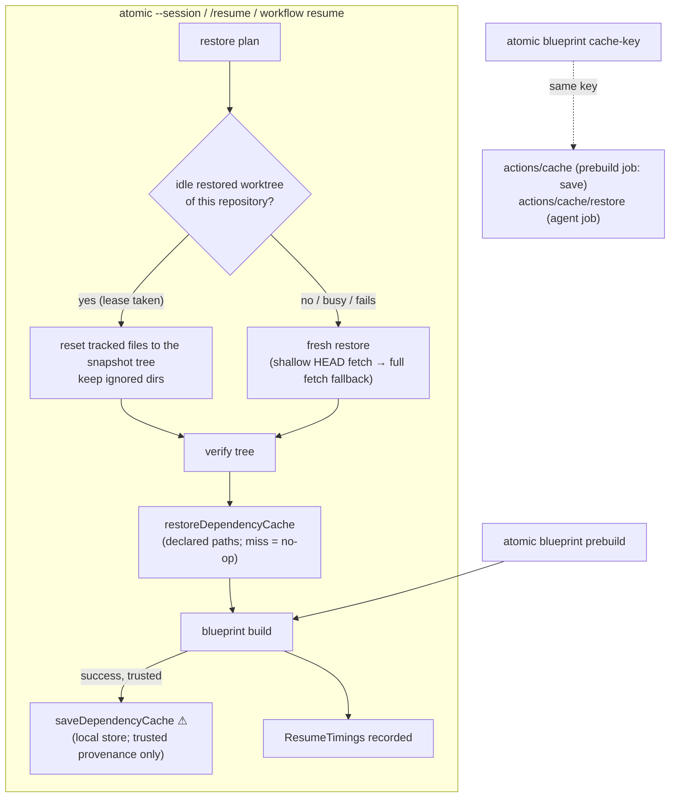

# Resume and Snapshot Performance — Technical Design Document / RFC

| Document Metadata      | Details |
| ---------------------- | ------- |
| Author(s)              | Alex Lavaee (with Atomic) |
| Status                 | Draft (WIP), design only. No product code changes on this branch |
| Team / Owner           | `packages/coding-agent` — worktree snapshots (`src/core/worktree-snapshot/`), resume (`src/core/resume/`), blueprints (`src/core/resume/blueprint/`); docs in `packages/coding-agent/docs` |
| Created / Last Updated | 2026-11-13 |
| Builds on              | #4245 (worktree snapshots), #4329 (resume on any machine), #4416, #4492, #4595 (blueprints, differential builds). The rustic_core redesign ([`c4e0ff0cda`](https://github.com/bastani-inc/atomic/commit/c4e0ff0cda), removed in [`6c122b3bd1`](https://github.com/bastani-inc/atomic/commit/6c122b3bd1) as "not being pursued") is not re-proposed: nothing measured here points at the Git-based snapshot format |
| Prerequisite           | [#4732](https://github.com/bastani-inc/atomic/issues/4732): restored worktrees record no remotes, so a second resume can fail (§2.4). Fixed separately |
| Evidence               | [`research/evidence/resume-performance/`](../research/evidence/resume-performance/README.md): scripts, per-phase results, method |
| Compatibility posture  | **No breaking changes.** Snapshot records, the blueprint format, `restoreWorktreeSnapshot`, `captureWorktreeSnapshot` and the resume errors are public and stay as they are. Everything below is additive: a new optional blueprint key that older Atomic ignores, new CLI subcommands, new optional SDK fields, and internal changes that keep each door's contract |

---

## 1. Executive Summary

A resume that has to restore a worktree spends most of its time building the blueprint, not restoring Git state.
Across four real projects resumed onto a machine without the checkout, the blueprint took **57–86 %** of the time to
the first model request; the restore took 4–32 %; Atomic's own start 1–3 s (§4). The hypothesis holds, with one
correction: the largest single cost is **build output** (`cargo build`, `tsc` and the Rust native module), not the
package download. Warm package stores alone cut uv from 5.2 s to 1.5 s and pnpm by half, but left ripgrep at
7–11 s and Atomic itself at 34–46 s of building, because the fresh worktree has no `target`, `dist` or
`node_modules`.

So the plan keeps the dependency and build directories instead of re-creating them:

1. **Locally**, restore into an idle Atomic-owned worktree of the same repository and keep its ignored
   directories. Estimated time to first prompt: ripgrep 9–14 s → ~4.5 s, create-t3-turbo 6.9 s → ~3 s, fastapi
   3.3–3.5 s → ~2.3–2.6 s, Atomic 40–47 s → ~22–27 s.
2. **On cloud runners**, declare cache paths in the blueprint, print one cache key from
   `atomic blueprint cache-key` that GitHub Actions and gh-aw use as is, save the cache only from a trusted
   prebuild on the default branch, and restore it read-only in agent jobs. Also cache Atomic's own extension
   transpile cache: a new `HOME` costs 7 s before anything else happens.

Every optimization degrades to today's path. Only an unreadable session, overwriting user data or a failed security
check may stop a resume (§3.1). The doors that guard irreversible effects are `reuseIdleRestoredWorktree` ⚠
(rewrites an idle worktree Atomic owns) and `saveDependencyCache` ⚠ (publishes content later runs execute). No gh-aw
change is required.

## 2. Context and Motivation

### 2.1 Current state

A resume of a session whose checkout is missing runs this path (`atomic --session <id>`):

```text
main → prepareSessionResume                                   core/resume/session-resume.ts
  restoreCandidates                                            compare each recorded checkout (4 at a time)
  restorePlanned                                               required checkouts together, optional ones one by one
    resumeSessionWorktree → restoreWorktree                    core/worktree-snapshot/restore.ts
      ensureObjectStore                                        one bare store per remote set, per host
      ensureHead → git fetch -- <remote> <head>                full history of HEAD (no depth, no filter)
                   └ bundle of unpushed commits, if needed
      reconstructTree                                          apply the patch chain into a scratch index
      materialize → worktree add --no-checkout; read-tree --reset -u <tree>
      pullLfsObjects                                           when .gitattributes names the lfs filter
      writeWorkingTree (verify)                                recompute the tree, compare with the snapshot
      worktree move staging → final                           only a verified worktree gets its final path
  setUpCheckoutBlueprints → runBlueprintBuild                  core/resume/blueprint/build.ts
    global initialize (full build) + maintenance
    per repository, one after another: initialize (rebuild) + maintenance
    global post-build
→ first model request
```

Per-turn capture (`captureWorktreeSnapshot`, `core/worktree-snapshot/capture.ts`) copies the user's index into a
private index and keeps its mtime, runs `read-tree --reset HEAD`, `diff-files`, `ls-files --cached --ignored`
(twice when the repository tracks an ignored file), `ls-files --others`, `update-index`, `write-tree`, then
`commit-tree`, `diff-tree -p --binary` and `rev-list HEAD --not --remotes` for the bundle: 16–17 Git processes per
capture.

`envHash` (`core/worktree-snapshot/env-hash.ts`) is a SHA-256 over 25 root-level lockfiles and toolchain files.
It is recorded in every snapshot and binding, and nothing reads it yet.

### 2.2 The problem

- **Users.** A resume on a second team machine, or any resume on a fresh cloud runner, waits for a full
  `initialize` + `maintenance` build in a worktree that has no dependencies. For Atomic's own repository that is
  about one minute before the first model request.
- **Cloud runners (Atomic in a gh-aw custom job).** Nothing persists between runs: package stores, Git objects,
  build output and Atomic's own extension transpile cache (`~/.atomic/agent/cache/jiti`) start empty every time.
- **Visibility.** No user can tell which phase was slow. Blueprint step logs carry no durations; restore phases
  are visible only with `GIT_TRACE2_EVENT`.

### 2.3 What others do

| System | What makes a start fast | Trust and freshness |
|---|---|---|
| OpenAI Codex cloud ([docs](https://learn.chatgpt.com/docs/environments/cloud-environment.md)) | Setup script runs once on the default branch; the container state is cached for up to 12 hours; a resumed container runs an optional maintenance script ("useful when the setup script ran on an older commit and dependencies need to be updated") | Cache invalidated when the setup or maintenance script, environment variables or secrets change; shared by all users of the environment in Business and Enterprise; secrets only during setup |
| Cursor Cloud Agent Builds ([docs](https://cursor.com/docs/cloud-agent/builds), [blog](https://cursor.com/blog/builds)) | A Build clones every repository at its default branch, runs `install` to completion and snapshots the disk; agents boot from pre-warmed copies of the latest successful Build; feature branches check out over the Build's disk "while reusing dependencies from the Build"; `install` must be idempotent | A failed Build never replaces the active one; recurring Builds are skipped when nothing changed; user secrets never enter a shared snapshot |
| GitHub Codespaces prebuilds ([docs](https://docs.github.com/en/codespaces/prebuilding-your-codespaces/configuring-prebuilds)) | A prebuild per branch and dev container configuration, refreshed by an Actions workflow on push, on configuration change or on a schedule; child branches reuse the parent's prebuild | Admins trade freshness for Actions minutes with scheduled triggers ([changelog](https://github.blog/changelog/2022-04-12-codespaces-scheduled-prebuild-configurations/)) |
| Devin blueprints and differential builds ([blueprint reference](https://docs.devin.ai/onboard-devin/environment/blueprint-reference), [differential builds](https://docs.devin.ai/onboard-devin/environment/differential-builds)) | A build produces a bootable snapshot. Differential builds start from the parent snapshot: unchanged workspaces are inherited (pull, run only `maintenance`), changed ones rebuilt | A full build is forced when the newest is older than 7 days, when org configuration changed, or when the parent is incompatible |
| GitHub Actions cache ([reference](https://docs.github.com/en/actions/reference/workflows-and-actions/dependency-caching)) | `key` exact match, then prefix match, then `restore-keys`, first in the current branch and then in the default branch; immutable entries; 10 GB per repository by default, evicted after 7 days unused | Only `push`, `workflow_dispatch`, `repository_dispatch`, `delete`, `registry_package`, `page_build` and `schedule` may write the default branch's scope; `cache-mode: read/write/write-only/none` ([changelog](https://github.blog/changelog/2026-09-10-control-github-actions-cache-access-with-cache-mode/)); "Cache contents are not signed or verified … Extracted caches may modify files that are subsequently executed" |
| gh-aw (`cache:` frontmatter, [frontmatter](https://github.github.com/gh-aw/reference/frontmatter/#cache-configuration-cache)) | `actions/cache` syntax compiled into the agent job, after the user's `steps:` (`pkg/workflow/compiler_yaml_runtime_setup.go`) | With threat detection on, saves only on the trusted event list (`pkg/workflow/cachepolicy/events.go`), restore-only otherwise; the FAQ asks for tight keys and no writable keys across trust boundaries. `tools.drive-memory` is an experimental, preview-only GitHub Drives mount for memory files, not for dependencies |
| Ecosystem actions | `setup-node` caches the package manager's global store keyed on the lockfile ([setup-node](https://github.com/actions/setup-node)); `astral-sh/setup-uv` keys on platform, Python version and `uv.lock`, and prunes before save ([caching](https://github.com/astral-sh/setup-uv/blob/main/docs/caching.md)); `Swatinem/rust-cache` caches `~/.cargo` and `./target` dependency artifacts, dropping workspace crates and incremental data ([rust-cache](https://github.com/swatinem/rust-cache)); `sccache` caches per compiler invocation, made for ephemeral machines ([sccache](https://github.com/mozilla/sccache)); `setup-go` caches `GOMODCACHE` and `GOCACHE` keyed on `go.sum` ([setup-go](https://github.com/actions/setup-go)); `gradle/actions/setup-gradle` writes the cache only from the default branch ([setup-gradle](https://github.com/gradle/actions/blob/main/docs/setup-gradle.md)); Turborepo and Nx keep task outputs in `.turbo/cache` and `.nx/cache` with optional remote caches ([Turborepo](https://turborepo.dev/docs/crafting-your-repository/caching)) | Default-branch-only writes recur in every one of them |

Two lessons carry over. Everyone keeps the *built environment*, not only the download cache, and everyone writes it
from a trusted, default-branch build and reads it everywhere else.

### 2.4 Correctness gap found while measuring (#4732, prerequisite)

A worktree that Atomic restored has no remotes and no remote-tracking refs. Its next capture records
`remotes: []` and treats the whole history as unpushed: it bundles all 2,304 ripgrep commits (5.7 MB) on every
capture after `HEAD` moves, takes 3.5 s for Atomic's 8,953 commits and omits the bundle as over the cap. A
three-machine chain of a fully pushed public repository (fastapi) then **fails** on the third machine with
`commits-unavailable` (`denied-history`) (`results/chain-repro.txt`). #4732 fixes this under the same graceful rule
as this spec; every slice below assumes it.

## 3. Requirements, Goals and Non-Goals

### 3.1 Top-level requirement: resume always works and degrades gracefully

Resume fails only when something is truly fatal: an unreadable session, a write that would overwrite user data, or a
failed security check (an invalid snapshot record, a blob whose hash does not match, a refused transport). Every
optimization in this spec is an accelerator over today's path. A cache miss, a corrupt or poisoned cache entry, a
missing or busy worktree to reuse, a failed prebuild, a failed shallow fetch or a failed blueprint step falls back to
the slower path, or to a resumed but degraded session with **one calm notice**, and never blocks the session. Each
candidate in §6 lists its fallback and how a test proves it.

### 3.2 Goals

- [ ] Show per-phase resume timings to users (restore phases and every blueprint step).
- [ ] Locally, resume into a worktree that already has the repository's dependency and build directories when one
      is idle, and keep them across resumes.
- [ ] Give blueprints a way to declare cache paths, and print one portable key (`envHash` + OS + architecture +
      the declaration) that Atomic, GitHub Actions and gh-aw all use.
- [ ] Ship ecosystem recipes and a gh-aw/Actions example that saves from a trusted default-branch prebuild and
      restores read-only in agent jobs.
- [ ] Make per-turn capture cheaper in fresh clones and large repositories without changing what it records.
- [ ] Shorten restore for large histories (shallow `HEAD` fetch with fallback) and overlap independent work.

### 3.3 Non-goals

- [ ] We will NOT replace the Git-based snapshot format (the removed rustic_core design stays removed).
- [ ] We will NOT capture `node_modules`, `target`, `.venv` or other ignored directories into snapshots or the
      session database. Dependencies travel through caches keyed by their inputs, never through session storage.
- [ ] We will NOT write into a user's own checkout. Only worktrees under Atomic's restore directory are reused.
- [ ] We will NOT cache build output by default. Package stores only, unless a blueprint opts in per path.
- [ ] We will NOT require changes to gh-aw. Everything is opt-in through workflow frontmatter and steps.
- [ ] We will NOT run blueprint `maintenance` at session start when no restore happened (today's rule stays).

## 4. Measurements

### 4.1 Method

Built CLI from this branch's base, throwaway `HOME`s and repositories under `/fast/tmp/resume-perf`, a mock
OpenAI-compatible provider, real GitHub remotes and real package registries. Machine A runs one turn that edits a
tracked file and adds an untracked one; the checkout is then moved away and the session resumed with
`atomic --session <id> -p ...` from a copy of machine A's database in three states: **cold** (new `HOME`, empty
package stores), **warm stores** (new `HOME`, stores from the cold run) and **warm local** (same `HOME` as warm
stores, its restored worktree deleted: Git objects, build ledger and stores warm, no dependency directories).
Restore phases come from `GIT_TRACE2_EVENT`, blueprint steps from their log files, the end point is the timestamp
of the mock's first request. No product instrumentation was needed. Every stage ran twice. Host: 80-vCPU AMD EPYC,
XFS with `reflink=1`, Git 2.53.0, `CARGO_BUILD_JOBS=4`. Details, scripts and noise:
[evidence README](../research/evidence/resume-performance/README.md).

### 4.2 Resume: time to first prompt by phase (seconds, repetition 1 / repetition 2)

| Project | State | Fetch | Reconstruct + materialize | LFS | Verify | Restore total | Blueprint steps | Blueprint total | Startup + other | **Time to first prompt** |
|---|---|---:|---:|---:|---:|---:|---|---:|---:|---:|
| ripgrep (cargo) | cold | 0.56 / 0.78 | 0.11 / 0.14 | — | 0.12 / 0.15 | 0.79 / 1.09 | fetch crates 0.7 / 0.8; `cargo build` 8.6 / 8.6 | 9.3 / 9.4 | 1.8 / 1.8 | **11.9 / 12.3** |
| | warm stores | 0.64 / 0.61 | 0.11 / 0.09 | — | 0.12 / 0.09 | 0.88 / 0.80 | 0.1 / 0.1; 7.8 / 7.1 | 7.9 / 7.2 | 1.9 / 1.5 | **10.7 / 9.4** |
| | warm local | 0.01 / 0.01 | 0.10 / 0.06 | — | 0.15 / 0.10 | 0.28 / 0.18 | 0.1 / 0.1; 11.5 / 7.0 | 11.6 / 7.1 | 2.1 / 1.4 | **14.0 / 8.7** |
| create-t3-turbo (pnpm) | cold | 1.11 / 0.56 | 0.19 / 0.09 | — | 0.17 / 0.09 | 1.50 / 0.74 | install pnpm 2.0 / 0.8; `pnpm install` 27.1 / 9.2 | 29.1 / 10.0 | 3.1 / 1.5 | **33.7 / 12.3** |
| | warm stores | 1.04 / 0.59 | 0.16 / 0.09 | — | 0.15 / 0.08 | 1.37 / 0.77 | 1.9 / 0.6; 13.5 / 5.5 | 15.5 / 6.1 | 2.6 / 1.5 | **19.5 / 8.4** |
| | warm local | 0.01 / 0.01 | 0.05 / 0.05 | — | 0.08 / 0.08 | 0.15 / 0.14 | `pnpm install` 5.3 / 5.4 | 5.3 / 5.4 | 1.4 / 1.4 | **6.9 / 6.9** |
| fastapi (uv) | cold | 2.25 / 1.92 | 0.43 / 0.39 | — | 0.27 / 0.08 | 2.96 / 2.40 | `uv sync` 5.3 / 5.1 | 5.3 / 5.1 | 0.9 / 1.6 | **9.2 / 9.0** |
| | warm stores | 2.85 / 1.98 | 0.39 / 0.40 | — | 0.16 / 0.11 | 3.41 / 2.50 | 1.5 / 1.6 | 1.5 / 1.6 | 1.5 / 1.5 | **6.4 / 5.6** |
| | warm local | 0.01 / 0.01 | 0.34 / 0.34 | — | 0.09 / 0.39 | 0.45 / 0.75 | 1.3 / 1.4 | 1.3 / 1.4 | 1.5 / 1.4 | **3.3 / 3.5** |
| Atomic (npm workspaces + Rust) | cold | 8.51 / 6.86 | 1.73 / 1.77 | 6.10 / 5.60 | 0.22 / 0.22 | 16.6 / 14.5 | `npm install` 5.1 / 5.5; `npm run build` 61.0 / 37.8 | 66.1 / 43.3 | 2.8 / 1.7 | **85.5 / 59.4** |
| | warm stores | 10.79 / 6.97 | 2.20 / 1.71 | 5.86 / 5.51 | 0.24 / 0.21 | 19.1 / 14.4 | 4.7 / 4.4; 34.0 / 46.2 | 38.8 / 50.6 | 1.9 / 2.1 | **59.8 / 67.1** |
| | warm local | 0.01 / 0.01 | 1.04 / 1.22 | 0.51 / 0.60 | 0.20 / 0.25 | 1.77 / 2.10 | 3.6 / 5.3; 33.6 / 37.9 | 37.2 / 43.2 | 1.5 / 1.7 | **40.5 / 47.0** |

Publish (`worktree move`) took 8–17 ms everywhere and is folded into the restore total. "Startup + other" includes
Atomic's own start, which was 1.5–1.8 s for a plain `atomic -p hello --no-session` on the same host. All `HOME`s
above were seeded with a warm extension transpile cache. Without it the first start in a new `HOME` takes 9.2 s
instead of 2.0–2.1 s (`results/cold-home-startup.txt`), and a cloud runner pays that on every run.

**Hypothesis verdict.** Confirmed, with the correction in §1. Blueprint share of time to first prompt, cold:
ripgrep 76–78 %, create-t3-turbo 81–86 %, fastapi 57–58 %, Atomic 73–77 %. Within the blueprint, building
dominates where there is a build (cargo 7–11.5 s, Atomic's build 34–61 s); the restore is material only for large
histories (Atomic: full-history fetch 6.9–10.8 s and LFS 5.5–6.1 s).

### 4.3 Dependency directories materialized into a fresh worktree (warm stores, then maintenance)

`proto-copy.sh`, outside Atomic: a fresh detached worktree of the snapshot's commit, the restored worktree's
ignored directories copied in, then the blueprint's `maintenance` on top. Seconds, copy + maintenance = total.

| Project (what was copied) | No copy (today, warm stores) | `cp -a` | `cp --reflink=always` | `cp -al` (hard links) |
|---|---:|---:|---:|---:|
| ripgrep: `target`, 388 MB, 1,699 files | 0.0 + 6.7 = **6.7** | 0.2 + 2.7 = 2.9 | 0.1 + 2.9 = **3.0** | 0.03 + 2.9 = 2.9 |
| create-t3-turbo: 12 `node_modules`, 1.2 GB, 118,857 files | 0.5 + 5.2 = **5.7** | 14.8 + 1.7 = 16.5 | 8.6 + 1.6 = **10.3** | 3.2 + 0.9 = 4.1 |
| fastapi: `.venv`, 487 MB, 56,751 files | 0.0 + 1.6 = **1.6** | 4.4 + 0.8 = 5.2 | 4.3 + 0.3 = **4.6** | 1.0 + 0.3 = 1.3 |
| Atomic: `node_modules`, `target`, `dist`, generated data; 39,635 files | 0.0 + 38.0 = **38.0** | 2.5 + 21.2 = 23.6 | 5.0 + 23.5 = **28.5** | 0.6 + 18.8 = 19.4 |

Reflink is per-file metadata work on XFS: it wins for few large files (`target`) and loses to a warm package
manager for many small ones (`node_modules`, `.venv`). Hard links are fast but share inodes, so a tool that rewrites
a file in place corrupts the source; pnpm and uv already hard-link or clone from their stores. The **maintenance
column after a copy is also what reusing an existing worktree costs**, without any copy: ripgrep 2.7–2.9 s,
create-t3-turbo 0.9–1.7 s, fastapi 0.3 s, Atomic 18.8–23.5 s.

A copied `.venv` keeps absolute paths of its old location in `pyvenv.cfg` and script shebangs; `uv sync` accepted it
here because the old path still existed. Copies are not safe as a general mechanism; reuse is.

### 4.4 Restore fetch strategies (cold, from GitHub; fetch + checkout, seconds)

| Repository | Full history (today) | `--filter=blob:none` | `--filter=tree:0` | `--depth=1` |
|---|---:|---:|---:|---:|
| ripgrep | 0.68 + 0.03 = 0.71 (7 MB) | 0.29 + 0.50 = 0.80 | 0.29 + 0.61 = 0.90 | 0.42 + 0.03 = **0.45** (1 MB) |
| create-t3-turbo | 0.55 + 0.02 = 0.57 (9 MB) | 0.23 + 0.26 = 0.49 | 0.22 + 0.53 = 0.74 | 0.24 + 0.02 = **0.26** (1 MB) |
| fastapi | 1.94 + 0.27 = **2.21** (59 MB) | 0.72 + 2.76 = 3.47 | 0.45 + 4.02 = 4.46 | 2.31 + 0.27 = 2.58 (17 MB) |
| Atomic | 8.13 + 0.66 = 8.79 (179 MB) | 1.65 + 4.45 = 6.10 | 0.51 + 4.43 = 4.94 | 3.99 + 0.58 = **4.56** (31 MB) |

Partial clone moves the cost into checkout (lazy blob fetches) and loses. A shallow fetch halves the restore of a
long history (Atomic) and is neutral or slightly worse for medium ones. One sample per cell; GitHub-side variance is
high.

### 4.5 Per-turn capture

`captureWorktreeSnapshot` from the built SDK, median of five (full / unchanged turn / one-file edit, ms):

| Repository | Tracked files | Fresh clone | After one `git status` |
|---|---:|---|---|
| ripgrep | 226 | 92 / 54 / 78 | 71 / 37 / 67 |
| create-t3-turbo | 141 | 73 / 38 / 72 | 67 / 34 / 65 |
| fastapi | 3,242 | 166 / 131 / 162 | 86 / 50 / 85 |
| Atomic | 7,645 | **1,446 / 1,500 / 1,350** | **253 / 185 / 245** |
| torvalds/linux (depth 1) | 97,371 | 1,182 / 1,121 / 1,203 | 977 / 918 / 967 |

(`results/capture-bench-rerun.txt`; the first run under a load average near 230 is kept in `capture-bench.txt`.)

In-session captures on machine A: ripgrep 285 ms, create-t3-turbo 275 ms, fastapi 615 ms (16 Git processes each,
about 40 ms of it Git work and roughly 10 ms between processes).

Three causes, each verified at the Git level (`results/git-micro.txt`):

1. **Racily clean entries.** Capture copies the user's index and keeps its mtime. When files are as new as the
   index (a fresh clone, `actions/checkout`, or a worktree Atomic just restored), `read-tree --reset` re-hashes every
   racily clean entry: 0.153 s instead of 0.010 s for Atomic's index. Atomic runs Git with `GIT_OPTIONAL_LOCKS=0` and
   never rewrites the user's index, so the state persists for the whole session on a CI runner.
2. **Stat-dirty index.** In a checkout copied with `cp -a`, every tracked file looks changed; capture hashes files
   up to the 50 MB cap and records 5,191 bogus `over-snapshot-cap` omissions (Atomic, 1.6–4.8 s).
3. **Duplicate ignored listing.** `ls-files --cached --ignored --exclude-standard` runs twice when the repository
   tracks an ignored file: 312 + 318 ms of linux's 977 ms. `diff-index --cached --diff-filter=A HEAD` finds the only
   candidates (staged additions) in 18 ms.

The untracked cache does not help `ls-files --others` (104 ms either way), and Git's built-in fsmonitor daemon is
unavailable on Linux ("not supported on this platform"); capture also forces `core.fsmonitor=false`.

## 5. Proposed Solution (High-Level Design)

### 5.1 Shape



Pattern: **prebuilt environment + incremental maintenance**, the Codex/Cursor/Devin shape, applied to Atomic's
existing restore. The restore stays the integrity boundary (verify before publish). Caches and reuse only
pre-populate ignored directories that `maintenance` would otherwise rebuild, so a wrong cache can cost time but not
correctness of the tracked tree.

### 5.2 Files and modules

| Path | Action | Owns |
|---|---|---|
| `src/core/resume/timings.ts` | add | `ResumeTimings` recorder and its session entry |
| `src/core/session-worktree-snapshots.ts`, `src/modes/**/session` command | change | `/session snapshot` shows the last resume's timings |
| `src/core/resume/blueprint/steps.ts` | change | record each step's start, end and duration in its log header and in the outcome |
| `src/core/worktree-snapshot/capture.ts` | change | persistent private index per checkout; one ignored listing |
| `src/core/worktree-snapshot/restore.ts` | change | shallow `HEAD` fetch with full fallback; in-place reset of an idle restored worktree |
| `src/core/worktree-snapshot/reuse.ts` | add | idle detection and leases for restored worktrees |
| `src/core/resume/blueprint/schema.ts`, `types.ts` | change | optional `cache:` key |
| `src/core/resume/blueprint/cache.ts` | add | `dependencyCacheKey`, `restoreDependencyCache`, `saveDependencyCache` |
| `src/cli/blueprint-command.ts` (name follows existing CLI layout) | add | `atomic blueprint cache-key`, `atomic blueprint prebuild` |
| `packages/coding-agent/docs/guides/resume-on-any-machine.md`, `worktree-snapshots.md`, `guides/team-setup.md` | change | user guidance: cache declarations, recipes, prebuild, timings, gh-aw example |
| `test/unit/...`, `packages/coding-agent/test/...` | add | per-slice tests (§10) |

### 5.3 The door set at a glance

`captureWorktreeSnapshot`, `restoreWorktreeSnapshot`, `verifyWorktree` (unchanged contracts) ·
`reuseIdleRestoredWorktree` ⚠ · `dependencyCacheKey` · `restoreDependencyCache` · `saveDependencyCache` ⚠ ·
`prebuildRepository` · `recordResumeTimings`.

Read alone: a checkout's state is captured and restored and verified exactly as today; a restore may take over an
idle worktree Atomic made earlier; dependency directories come from a cache whose key anyone can compute and that
only a trusted, successful build may fill; a repository can be built ahead of time; every resume reports where its
time went.

## 6. Candidates, rated

Ratings: **High / Medium / Low** expected gain on that target, from §4. "Graceful" names the fallback required by
§3.1 and the test that proves it.

| # | Candidate | Local (persistent disk, team machines) | Cloud (ephemeral gh-aw runner) | Fallback (§3.1) | How the fallback is tested |
|---|---|---|---|---|---|
| 1 | Portable dependency cache keyed by `envHash` + OS + arch, printable key, CoW/hard-link materialization, `cache:` blueprint syntax, package stores only by default | **Low–Medium.** Stores are already warm in a persistent `HOME`; worktree-local build paths (`target`) gain 6.7 → 3.0 s via reflink, `node_modules`/`.venv` lose (5.7 → 10.3 s, 1.6 → 4.6 s) | **High.** pnpm 9–27 → 5–14 s, uv 5.2 → 1.5 s, cargo fetch 0.7 → 0.1 s; with an opted-in `target`: ripgrep build 8.6 → ~2.8 s, Atomic build 38–61 → ~19–24 s (archive download not measured) | Miss, unreadable or corrupt entry, wrong platform, no space: skip it and build as today; one notice "dependency cache unavailable (reason); built from scratch" | Inject a corrupt archive, a key of another arch, a read-only cache dir; assert the build ran, the resume finished, one notice |
| 2 | Restore into an existing (idle, Atomic-owned) worktree of the same repository | **High.** Keeps `node_modules`/`target`/`.venv`: ripgrep 9–14 → ~4.5 s, create-t3-turbo 6.9 → ~3 s, fastapi 3.4 → ~2.3 s, Atomic 40–47 → ~22–27 s | n/a (nothing persists) | No idle candidate, lease held, reset or verify fails: release and do a fresh restore as today; the candidate is left untouched or removed, never published unverified | Two concurrent resumes of one repository; a candidate with a dirty tracked file; a kill between reset and verify; assert fresh restore, no lost user files |
| 3 | Prebuild and warm-up (local across team machines; scheduled cloud job) | **Medium–High** for the *first* resume of a repository on a machine: turns it into case 2 | **High** with 1: the only trusted writer of the cache; agent jobs restore read-only | A failed prebuild leaves the previous idle worktree or cache in place (Cursor's rule); resumes never wait for a prebuild | Fail a prebuild step; assert the previous entry stays active and a resume uses it or builds as today |
| 4 | Ecosystem recipes, blueprint templates, gh-aw `cache:` examples | **Medium** (incremental flags, warm stores, correct store paths) | **High** (most of the cloud gain needs the right paths and keys) | Documentation only; a wrong path is a cache miss | Docs tests; the gh-aw example compiled with `gh aw compile --validate` (§9.3) |
| 5 | Restore speedups: only the needed commit shallow, blob-less partial clone, parallel restores | **Low** (warm object store: fetch 0.01 s) | **Medium** for long histories (Atomic 8.8 → 4.6 s); partial clone **negative**; LFS overlap helps only resumes of several repositories | Shallow fetch, bundle or ancestry check fails: unshallow or full fetch, then today's error path; a parallel restore failure is the same per-checkout outcome as today | Remote refusing shallow (`uploadpack.allowAnySHA1InWant=false`), bundle with prerequisites beyond depth, `isHeadOnlyAdvance` on a shallow store |
| 6 | Cheaper per-turn capture: persistent private index, single ignored listing, untracked cache, fsmonitor, skip unchanged turns | **Medium** for large or freshly cloned repositories (Atomic 1.45 → ~0.25 s, fastapi 0.17 → ~0.09 s, linux ~1.0 → ~0.65 s); Low for small ones | **Medium**: every CI checkout is a fresh clone (case 1 of §4.5) | Any doubt about the persistent index (missing, locked, version, wrong HEAD): discard it and capture as today | Corrupt and truncate the persistent index; edit in the same second as capture; assert identical trees with and without it |
| 7 | Per-phase resume timings shown to users | **High** value, no speed by itself; makes 1–6 measurable in the field | Same; CI logs show where minutes went | Recording failures are ignored; timings never block | Fail the session write of the timings entry; assert the resume completes |

Not pursued: untracked cache and fsmonitor for capture (no Linux gain, §4.5); blob-less or tree-less partial
clone for restore (slower, §4.4); hard-link materialization of package-manager output (inode sharing, §4.3);
putting dependency directories in snapshots or the session database (non-goal).

### 6.1 Estimated gains (time to first prompt)

| Project | Today, local warm (§4.2) | + 2 reuse | Today, cloud cold (+7 s cold `HOME`) | + 1/3/4 caches + Atomic cache | + 5 shallow fetch |
|---|---:|---:|---:|---:|---:|
| ripgrep | 8.7–14.0 | ~4.5 | 19.0–19.4 | ~5.5 + archive download | ~5.3 |
| create-t3-turbo | 6.9 | ~2.6–3.3 | 19.4–40.8 | ~8–17 + download (stores only) | ~8–17 |
| fastapi | 3.3–3.5 | ~2.3–2.6 | 16.1–16.3 | ~5.5 + download | ~5.5 (shallow not used: no gain) |
| Atomic | 40.5–47.0 | ~22–27 | 66.5–92.6 | ~38 + download | ~34 |

Derivation: reuse = startup (~1.5 s) + restore with a warm store (0.15–2.1 s) + maintenance on existing directories
(§4.3 maintenance column). Cloud = cold row + 7.1 s transpile-cache penalty; with caches = warm-store package steps
and, for opted-in `target`/`dist`, the post-copy maintenance column. Overlapping LFS with other repositories'
builds does nothing for a one-repository resume, so the 5.5–6.1 s LFS phase of Atomic stays unless LFS becomes
lazy (§11.4). Archive download and extraction were not
measured; the sizes (`results/cache-sizes.txt`: pnpm store 1.1 GB, uv cache 582 MB, npm cache 150 MB, cargo
registry 68 MB, ripgrep `target` 388 MB) bound them.

## 7. Detailed Design

### 7.1 The doors

```ts
// — Timings. One recorder per resume; reading it never blocks anything. —
interface ResumeTimings {
	readonly startedAt: string;                       // ISO
	readonly restores: readonly CheckoutRestoreTimings[];
	readonly blueprint: readonly BlueprintStepTiming[]; // per step, from steps.ts
	readonly firstPromptReadyMs: number;              // launch → session ready to send
}
interface CheckoutRestoreTimings {
	readonly root: string;
	readonly mode: "fresh" | "reused" | "in-place";
	readonly phases: Readonly<Partial<Record<"fetch" | "reconstruct" | "materialize" | "lfs" | "verify" | "publish", number>>>;
	readonly fetch?: "none" | "shallow" | "full" | "bundle";
}
recordResumeTimings(session: SessionManager, timings: ResumeTimings): Promise<void>
// Guarantee: appends one `resume_timings` entry; a failure is swallowed (debug-logged).
```

```ts
// — Reuse. The only door that rewrites an existing worktree, and only one Atomic made. —
reuseIdleRestoredWorktree(
	snapshot: WorktreeSnapshot,
	options: { storeDir: string; signal?: AbortSignal },
): Promise<ReusedWorktree | NoReusableWorktree>
type NoReusableWorktree = { readonly reused: false; readonly reason: "none" | "busy" | "dirty" | "reset-failed" | "verify-failed" };
// Guarantee: returns a worktree whose HEAD and tree equal the snapshot's, keeping its ignored files.
// ReusedWorktree can only be built here, after verifyWorktree passed; restoreWorktree publishes nothing else.
```

Candidates: worktrees under `<storeDir>/worktrees` registered in the per-repository store of the snapshot's
remotes (the same refusal `removeRestoredWorktree` applies, so a user checkout can never qualify), whose session
mapping is released (no live process holds its lease, §7.4), and whose tracked files match the last snapshot
recorded for it, so no uncaptured agent work is overwritten (`dirty` otherwise). Newest first.

```ts
// — Dependency cache. One key, one reader that never fails the resume, one guarded writer. —
dependencyCacheKey(root: string, options?: { platform?: NodeJS.Platform; arch?: string }): Promise<DependencyCacheKey>
interface DependencyCacheKey {
	readonly key: string;           // "atomic-deps-v1-linux-x64-<hex16>"
	readonly restorePrefix: string; // "atomic-deps-v1-linux-x64-"
	readonly paths: readonly string[]; // declared paths, ~ and $VARS expanded
	readonly envHash: string;
}
// Guarantee: a pure function of envHash, the platform, the architecture and the `cache:` declaration.

restoreDependencyCache(worktree: string, key: DependencyCacheKey, store: LocalCacheStore):
	Promise<CacheRestoreReport>   // per path: "hit" | "prefix-hit" | "miss" | "skipped"(reason)
// Guarantee: fills declared paths that are empty; never throws except on abort; never overwrites a non-empty path.

saveDependencyCache(build: TrustedSuccessfulBuild, key: DependencyCacheKey, store: LocalCacheStore):
	Promise<CacheSaveReport>
// Guarantee: publishes the declared paths under `key` atomically (write to a temp entry, then rename).
// TrustedSuccessfulBuild is minted only by runBlueprintBuild for a trusted worktree whose build status is
// "success": an untrusted or partial build cannot reach this door.
```

```ts
// — Prebuild. Builds ahead of time; the same build a resume runs. —
prebuildRepository(remoteOrDir: string, options: { ref?: string; storeDir: string; signal?: AbortSignal }):
	Promise<PrebuildOutcome>   // "built" | "partial" | "failed", with the build outcome and cache report
// Guarantee: leaves one idle, built worktree of `ref` (default: the remote's default branch) for reuse, and saves
// its cache when the build succeeded; a failed prebuild keeps the previous idle worktree and cache.
```

CLI:

```text
atomic blueprint cache-key [dir] [--format text|json|github-output]
    text:           atomic-deps-v1-linux-x64-3f2a9c1d7b0412ee
    github-output:  key=…  restore-prefix=…  paths<<EOF … EOF   (for $GITHUB_OUTPUT)
atomic blueprint prebuild [dir|remote] [--ref <ref>]
```

**Per-door audit**

| Door | Joint | One sentence | Honest name | Every exit | Refusals | Trust | Chokepoint |
|---|---|---|---|---|---|---|---|
| `recordResumeTimings` | ✅ | "records where a resume's time went" | ✅ | write failure ignored | — | — | — |
| `reuseIdleRestoredWorktree` ⚠ | ✅ | "returns a verified worktree reused for the snapshot" | ✅ says *idle* and *restored* | busy/dirty/reset/verify → `NoReusableWorktree`, caller restores fresh; kill mid-reset → staging crash record as today | user checkouts and live worktrees unrepresentable as candidates | none | ✅ sole door that rewrites an existing worktree |
| `dependencyCacheKey` | ✅ | "names the cache for these inputs" | ✅ | missing blueprint → key of the empty declaration | — | — | — |
| `restoreDependencyCache` | ✅ | "pre-fills empty declared paths" | ✅ | any failure → `skipped`, build runs | never writes a non-empty path | reads untrusted bytes (see §8) | — |
| `saveDependencyCache` ⚠ | ✅ | "publishes a trusted build's declared paths" | ✅ | temp entry discarded on failure | `TrustedSuccessfulBuild` only from a successful trusted build | promotion of build output to shared content | ✅ sole writer of the local cache |
| `prebuildRepository` | ✅ | "builds a repository ahead of resumes" | ✅ | failure keeps the previous artifacts | — | runs project code: trusted projects only | writes only through the two doors above |

### 7.2 Blueprint syntax: `cache:`

An Atomic extension to the Devin format. Today's parser ignores unknown top-level keys, so older Atomic versions
ignore it. Allowed in repository and workspace blueprints, per platform document.

```yaml
cache:
  - path: ~/.local/share/pnpm/store      # default kind: store (a package manager's content-addressed store)
  - path: ~/.cache/uv
  - path: target                         # relative = inside the worktree
    kind: build                          # opt-in: build output, not integrity-checked
    key-files: [Cargo.lock, rust-toolchain.toml]   # optional; default: the envHash inputs
```

- `kind: store` (default) may only name a path outside the worktree. `kind: build` may name either.
- The key covers `envHash` (or the hash of `key-files`), `process.platform`, `process.arch` and a digest of the
  `cache:` list itself, so changing a path invalidates the entry.
- Locally, `store` entries are left where the package manager keeps them (a persistent `HOME` is already warm);
  only `build` entries are copied, with reflink when the filesystem supports it and a plain copy never (a plain
  copy lost to rebuilding in §4.3); on filesystems without reflink they are skipped and reuse (candidate 2) covers
  them.
- On a runner, `atomic blueprint cache-key` prints the key and the expanded paths for `actions/cache`.

### 7.3 Data flow of a resume with every candidate

```text
prepareSessionResume
  timings = startResumeTimings()
  for each checkout to restore (bounded concurrency, required ones first)
    reused = reuseIdleRestoredWorktree(snapshot)            # local only; NoReusableWorktree → fresh
    fresh  = restoreWorktree(snapshot)                      # shallow HEAD fetch → full fetch → bundle → error
    timings.restore(root, phases)
  for each restored repository
    restoreDependencyCache(worktree, dependencyCacheKey(worktree))   # declared build paths; misses are no-ops
  outcome = runBlueprintBuild(...)                           # unchanged semantics; LFS pull may overlap other repos
  if outcome is success and trusted: saveDependencyCache(trustedBuild, key)
  recordResumeTimings(session, timings)
```

State of a restored worktree: `restored (in use)` → session ends or moves on → `idle` (lease released) →
`reused` by a later resume (back to `in use`) or removed by collection. Only `reuseIdleRestoredWorktree` performs
`idle → in use` for a different snapshot.

### 7.4 Reuse leases and idleness

- A worktree is *in use* while a process holds its lease: a `proper-lockfile` lock under
  `<storeDir>/leases/<worktree-id>`, refreshed like today's restore records (stale after 30 s).
- A session or workflow run that continues in a restored worktree takes the lease at resume and releases it at
  close; a crashed holder goes stale. A worktree with no lease is idle.
- The session that last used a reused worktree keeps its record; its next resume finds the path rewritten (another
  snapshot) and restores fresh, as it would if the worktree had been deleted.
- In-place reset: `read-tree -u --reset <tree>` in a temporary index of that worktree, then `verifyWorktree` against
  the snapshot. Ignored files stay. Untracked files that the new tree does not hold are removed only if the last
  recorded snapshot of that worktree held them, else the candidate is `dirty`.

### 7.5 Capture changes (candidate 6)

- **Persistent private index**: `<git-dir>/atomic/snapshot-index` (or under the agent dir keyed by root; §11).
  Refreshed with `update-index -q --refresh` before use, so racily clean and stat-dirty entries are re-hashed once,
  not on every turn. Rebuilt from HEAD when `HEAD` moved, when Git reports it corrupt, or when its version is not
  the one Atomic wrote. The user's index is never written.
- **One ignored listing**: force-added ignored files are staged additions that an ignore rule matches:
  `diff-index --cached --name-only --diff-filter=A HEAD` (18 ms on linux), then `check-ignore --no-index` on those
  paths only.
- **Fewer processes**: read `remote.*.url`, `core.*` and the symbolic ref in one `git config`/`for-each-ref` call
  where possible.
- No untracked cache or fsmonitor work (no Linux gain).

### 7.6 Restore changes (candidate 5)

- Fetch `HEAD` with `--depth=1` first when the store does not hold it; fall back to a full fetch when the shallow
  fetch fails, when a bundle's prerequisites are missing, or when an ancestry check (`isHeadOnlyAdvance`) needs
  history (`fetch --unshallow` on demand).
- Restore optional checkouts with the same bounded concurrency as verification (4), not one by one.
- Start the LFS download of a repository while other repositories' blueprints build; a repository's own
  `maintenance` still waits for its LFS files (open question §11.4 for laziness).

### 7.7 Timings shown to users (candidate 7)

- `/session snapshot` gains a "Last resume" block:
  `restored /repo in 16.6 s (fetch 8.5, LFS 6.1, materialize 1.0, verify 0.2) · blueprint 66.1 s (npm install 5.1, Build 61.0) · ready after 85.5 s`.
- `ATOMIC_TIMING=1` prints the same lines with the existing startup timings.
- Each blueprint step log header gains `# started`, `# finished` and `# duration` lines.
- No new flag. A `--timings` flag is an alternative (§11.5).

## 8. Security model for caches

1. **Package stores by default.** npm (`sha512` integrity), pnpm (content-addressed store), uv (hashes in
   `uv.lock`), cargo (checksums in `Cargo.lock`) and Go (`go.sum`) verify what they read from their stores, so a
   poisoned store entry fails the install instead of running. Build output (`target`, `dist`, `.venv`,
   `node_modules`, `.turbo`) is not verified by anything and is opt-in per path (`kind: build`).
2. **Save only from trusted, successful builds.** Locally, only `saveDependencyCache` writes, only with a
   `TrustedSuccessfulBuild` (trusted project, build status `success`). On GitHub, save only from a prebuild job on
   the default branch triggered by `push`, `schedule` or `workflow_dispatch`, which GitHub already restricts to
   trusted actors ([access for low-trust triggers](https://docs.github.com/en/actions/reference/workflows-and-actions/dependency-caching#cache-access-for-low-trust-workflow-triggers)).
3. **Agent jobs restore only.** An agent job processes untrusted input (issues, comments, PR content) even on a
   trusted trigger, and prompt injection can make it write files. So it restores with `actions/cache/restore`, which
   cannot save; `cache-mode: read` on the job is a second barrier where the platform honours it. gh-aw's own
   `cache:` already saves only on trusted events when threat detection is on.
4. **Never secrets.** Cache paths must not contain credentials (`.npmrc` with tokens, `~/.cargo/credentials.toml`,
   `.env`). `dependencyCacheKey` refuses a declared path that matches the snapshot deny list or one of these files,
   and the docs say so ([GitHub's guidance](https://docs.github.com/en/actions/reference/workflows-and-actions/dependency-caching#best-practices-for-using-caches-securely)).
5. **Poisoning risks that remain.** A trusted job that builds attacker-influenced code (a merged malicious PR)
   produces poisoned build output; keys tied to lockfiles do not help. Mitigations: keep `build` entries off for
   repositories that accept outside contributions, prune workspace crates from `target` as `rust-cache` does, and
   keep full builds periodic (the existing 7-day full-build rule extends to caches: an entry older than a full-build
   interval is ignored).
6. **Locally, across team machines.** The local cache lives under the user's agent directory and is never shared
   through the session database or team storage. Sharing between machines is the prebuild's job (each machine
   builds its own).

## 9. Ecosystem recipes and gh-aw examples (candidate 4)

### 9.1 Blueprint templates

```yaml
# npm workspaces (Atomic)
cache:
  - path: ~/.npm
  - path: target                 # Rust native module output
    kind: build
maintenance:
  - name: Install dependencies
    run: npm install --prefer-offline --no-audit --no-fund
  - name: Build
    run: npm run build
---
# pnpm + Turborepo
cache:
  - path: ~/.local/share/pnpm/store   # `pnpm store path` on Linux; macOS: ~/Library/pnpm/store
  - path: .turbo/cache
    kind: build
maintenance:
  - name: Install dependencies
    run: pnpm install --prefer-offline
---
# uv
cache:
  - path: ~/.cache/uv
maintenance:
  - name: Sync
    run: uv sync --locked
---
# cargo
cache:
  - path: ~/.cargo/registry/index
  - path: ~/.cargo/registry/cache
  - path: ~/.cargo/git/db
  - path: target
    kind: build
maintenance:
  - name: Build
    run: cargo build --locked
---
# Go
cache:
  - path: ~/go/pkg/mod
  - path: ~/.cache/go-build
    kind: build
maintenance:
  - name: Download modules
    run: go mod download
---
# Gradle
cache:
  - path: ~/.gradle/caches
  - path: ~/.gradle/wrapper
maintenance:
  - name: Resolve
    run: ./gradlew --offline dependencies || ./gradlew dependencies
```

Notes: do not cache `node_modules` or `.venv` (§4.3: copying loses to the package manager); keep `npm install`, not
`npm ci`, in `maintenance` (incremental, as today's guide says); Nx uses `.nx/cache` like `.turbo/cache`; `sccache`
with `SCCACHE_DIR` is an alternative to caching `target` when many branches share one key.

### 9.2 Atomic's own cache

`~/.atomic/agent/cache/jiti` (6–7.5 MB) saves 7.1 s on every new `HOME`. Key it on the Atomic version:
`atomic-jiti-${{ runner.os }}-${{ runner.arch }}-<atomic --version>`.

### 9.3 gh-aw: the Atomic sample with caches

The Atomic sample in `guides/team-setup.md` runs Atomic in a custom `jobs:` job. Add a restore-only cache there, and
a separate prebuild that is the only writer:

```yaml
---
on:
  workflow_dispatch:
jobs:
  atomic:
    runs-on: ubuntu-latest
    env:
      ATOMIC_PROFILE: ci
      ATOMIC_TEAM_URL: ${{ vars.ATOMIC_TEAM_URL }}
    steps:
      - uses: actions/checkout@v5
      - run: npm install -g @bastani/atomic
      - run: atomic install npm:@bastani/atomic-storage-libsql
      - id: deps
        run: atomic blueprint cache-key --format github-output >> "$GITHUB_OUTPUT"
      - id: version
        run: echo "atomic=$(atomic --version)" >> "$GITHUB_OUTPUT"
      - uses: actions/cache/restore@v4          # restore-only: this job never saves
        with:
          key: ${{ steps.deps.outputs.key }}
          restore-keys: ${{ steps.deps.outputs.restore-prefix }}
          path: ${{ steps.deps.outputs.paths }}
      - uses: actions/cache/restore@v4
        with:
          key: atomic-jiti-${{ runner.os }}-${{ runner.arch }}-${{ steps.version.outputs.atomic }}
          path: ~/.atomic/agent/cache/jiti
      - run: atomic -p "Fix the failing test in the checkout"
        env:
          ATOMIC_TEAM_TOKEN: ${{ secrets.ATOMIC_TEAM_TOKEN }}
---
```

```yaml
# .github/workflows/atomic-prebuild.yml — the only cache writer (plain Actions workflow)
on:
  push: { branches: [main] }
  schedule: [{ cron: "17 3 * * *" }]
  workflow_dispatch:
jobs:
  prebuild:
    runs-on: ubuntu-latest
    steps:
      - uses: actions/checkout@v5
      - run: npm install -g @bastani/atomic
      - id: deps
        run: atomic blueprint cache-key --format github-output >> "$GITHUB_OUTPUT"
      - id: version
        run: echo "atomic=$(atomic --version)" >> "$GITHUB_OUTPUT"
      - uses: actions/cache@v4
        with:
          key: ${{ steps.deps.outputs.key }}
          path: ${{ steps.deps.outputs.paths }}
      - run: atomic blueprint prebuild . --approve
      - run: atomic -p hello --no-session --offline     # warms ~/.atomic/agent/cache/jiti
      - uses: actions/cache/save@v4
        with:
          key: atomic-jiti-${{ runner.os }}-${{ runner.arch }}-${{ steps.version.outputs.atomic }}
          path: ~/.atomic/agent/cache/jiti
```

When a gh-aw workflow's own agent job needs the same dependencies, the frontmatter `cache:` takes the same key,
because gh-aw emits the user's `steps:` before its cache steps:

```yaml
steps:
  - id: deps
    run: npx -y @bastani/atomic blueprint cache-key --format github-output >> "$GITHUB_OUTPUT"
cache:
  key: ${{ steps.deps.outputs.key }}
  path: ${{ steps.deps.outputs.paths }}
  restore-keys: ${{ steps.deps.outputs.restore-prefix }}
```

gh-aw then saves only on its trusted event list when threat detection is on. **No gh-aw change is required.** Two
optional gh-aw improvements would tighten it: a `restore-only: true` field for frontmatter `cache:` entries (it
exists for cache-memory, not for dependency caches), and forwarding a custom job's `cache-mode` (not verified that
custom jobs pass it through; `actions/cache/restore` makes it unnecessary here).

## 10. Test plan and slices

### 10.1 Verification per candidate

- **Unit:** key determinism and change on each input; `kind: store` refused inside the worktree; deny-listed cache
  paths refused; `TrustedSuccessfulBuild` not constructible outside `runBlueprintBuild` (type test);
  `NoReusableWorktree` reasons; persistent-index invalidation rules.
- **Integration (real Git, temp `HOME`s):** each fallback in §6 (corrupt archive, busy lease, dirty candidate,
  shallow refusal, killed reset) ends in a resumed session with one notice; capture produces identical trees with
  and without the persistent index across the racy-same-second edit case, force-added ignored files, and HEAD moves.
- **Performance regression (CI, not gating):** the harness in `research/evidence/resume-performance/scripts`
  against a local bare remote, asserting phase *shares*, not absolute times.
- **Interactive verification:** `scripts/run-project.sh ripgrep prepare machineA cold warmstores warmlocal`, then
  `/session snapshot` shows the "Last resume" block whose numbers match the harness within 10 %.

### 10.2 Slices (each independently verifiable, about 100–500 lines)

| Slice | Content | Size | Acceptance |
|---|---|---|---|
| **S0** | #4732: restored worktrees record their remotes and remote-tracking state (separate fix) | — | three-machine chain (`chain-repro.sh`) succeeds |
| **S1 timings** | `ResumeTimings`, step durations in blueprint logs, `/session snapshot` block, `ATOMIC_TIMING` lines; docs (`worktree-snapshots.md`) | ~300 | unit: recorder; integration: a resume records phases summing to within 10 % of wall time; write failure ignored |
| **S2 capture: one ignored listing** | replace the second `ls-files --cached --ignored` with `diff-index --cached --diff-filter=A` + `check-ignore` | ~150 | existing capture suite green; force-added ignored file still captured; linux-size fixture timing reported |
| **S3 capture: persistent private index** | refresh-once private index, invalidation rules | ~350 | identical trees across racy and stat-dirty fixtures; corrupt index → today's path |
| **S4 restore: shallow HEAD + concurrency** | `--depth=1` first, unshallow/full fallback, optional restores 4 at a time | ~300 | fallback tests in §6 row 5; existing restore suite green |
| **S5 `cache:` + key** | schema, `dependencyCacheKey`, `atomic blueprint cache-key` (text/json/github-output); docs | ~350 | unit key tests; older-parser compatibility (unknown key ignored) |
| **S6 reuse idle restored worktrees** | leases, idleness, in-place reset + verify, fallback to fresh; docs | ~450 | §6 row 2 tests; never touches a path outside the restore directory |
| **S7 local build cache** | `restoreDependencyCache` / `saveDependencyCache` for `kind: build` with reflink, skip without it | ~400 | §6 row 1 tests; save only from trusted success (type + integration) |
| **S8 prebuild** | `atomic blueprint prebuild`; leaves an idle worktree for S6 and saves for S7 | ~350 | failed prebuild keeps the previous artifacts; a following resume reuses the prebuilt worktree |
| **S9 recipes and gh-aw docs** | §9 templates, `team-setup.md` gh-aw sample, `resume-on-any-machine.md`, changelog | ~300 (docs) | docs tests; the gh-aw sample compiles with `gh aw compile --validate` |
| **S10 LFS overlap (optional)** | start LFS of a repository while other repositories build | ~150 | a two-repository resume shows one repository's LFS phase overlapping the other's build in its timings |

Order: S0 → S1 (measure in the field) → S2, S3 (cheap capture wins, CI checkouts) → S6 (largest local win) →
S5 → S9 (largest cloud win, docs-only consumers) → S8 → S4 → S7 → S10.

## 11. Open questions

1. **Persistent private index location.** (A) `<git-dir>/atomic/snapshot-index`: travels with the repository, one
   per worktree, but writes into the user's `.git` (outside the index itself). (B) under the agent directory keyed
   by worktree root: never touches `.git`, but goes stale when a checkout moves. Recommendation: B.
2. **Reuse across sessions.** Should a worktree last used by session X be reusable by session Y of the same
   repository? (A) yes, any idle one: biggest win, and X's next resume restores fresh. (B) only by the same
   session: no surprise for X, smaller win. Recommendation: A, with the notice naming the reused path.
3. **Devin format divergence.** `cache:` is the second Atomic-only key after the file location. Alternative: keep
   cache declarations in `.atomic/settings.json`. Recommendation: blueprint, because it describes the environment
   and older Atomic ignores it.
4. **LFS laziness.** Leave LFS pointers until something reads them (opt-in `snapshots.lfs: "lazy"`) to save
   5.5–6.1 s on Atomic, or keep today's eager pull with overlap only. Recommendation: overlap only, revisit with
   field timings from S1.
5. **`--timings` flag.** `/session snapshot` plus `ATOMIC_TIMING=1` (recommended), or also a CLI flag for
   non-interactive runs that prints the "Last resume" block to stderr.
6. **Cache key scope.** Include the blueprint `maintenance` digest in the key (a changed install command
   invalidates) or only `envHash` + platform + declaration (the user's request). Recommendation: the latter; the
   differential-build ledger already re-runs `maintenance` on top.
7. **Cloud reuse of the job's own checkout.** On a runner, the job's `actions/checkout` may already hold installed
   dependencies, but a resume restores into a different directory. Copying or linking them is the only way to use
   them, and §4.3 shows copies are rarely worth it. Recommendation: leave it to the cache.

## 12. Risks

- **Reuse overwrites agent work that was not captured.** Mitigated by the `dirty` refusal: a candidate whose tracked
  and untracked files differ from its last recorded snapshot is never reused.
- **Shallow stores break assumptions** (ancestry, bundles, `rev-list --not --remotes`). Mitigated by fallbacks and
  by S0 giving restored worktrees real remote-tracking refs.
- **Measurement noise.** Shared 80-vCPU host; registry and build times varied up to 3x. The recommendations rest on
  phase shares and on effects larger than 2x, not on single numbers.
- **Archive download time on hosted runners** was not measured; for the 1.1 GB pnpm store it may eat much of the
  gain. S1 timings plus a first gh-aw run decide whether pnpm's store is worth caching there.
- **Cache poisoning through trusted builds of malicious merged code** (§8.5).

## 13. Recommendations, in order

1. **S0** (#4732) — correctness of chained resumes; prerequisite.
2. **Reuse idle restored worktrees locally (S6), fed by prebuilds (S8).** The largest local win: roughly halves
   time to first prompt for every project measured (ripgrep 9–14 → ~4.5 s, Atomic 40–47 → ~22–27 s).
3. **Portable cache key + recipes + gh-aw/Actions examples (S5, S9), with saves only from a trusted prebuild and
   restore-only agent jobs, plus Atomic's transpile cache.** The largest cloud win (7 s for every runner, uv 5.2 →
   1.5 s, pnpm about half, Rust and Atomic builds 40–60 % with an opted-in `target`), with no gh-aw change.
4. **Timings (S1)** — cheap, and turns every estimate above into a field measurement.
5. **Cheaper capture (S2, S3)** — up to 1.2 s per turn back on fresh clones of medium repositories such as Atomic
   (every CI checkout is one), about 0.3 s per turn on linux-sized trees.
6. **Shallow fetch, concurrency, LFS overlap (S4, S10)** — only matter for long histories (Atomic: about 4 s) and
   multi-repository resumes.

## 14. Backwards compatibility

- Snapshot records (`version: 1`), bindings and `envHash` are unchanged. The persistent private index and shallow
  stores are host-local and invisible in records.
- `restoreWorktreeSnapshot` keeps its contract: it still returns a new, verified worktree; reuse happens only in
  the resume path (and an opt-in SDK option), never for an explicit `into`.
- The blueprint `cache:` key is optional and ignored by older versions; `envHash` semantics do not change.
- New CLI subcommands and the session entry `resume_timings` are additive; older Atomic ignores unknown entries.
