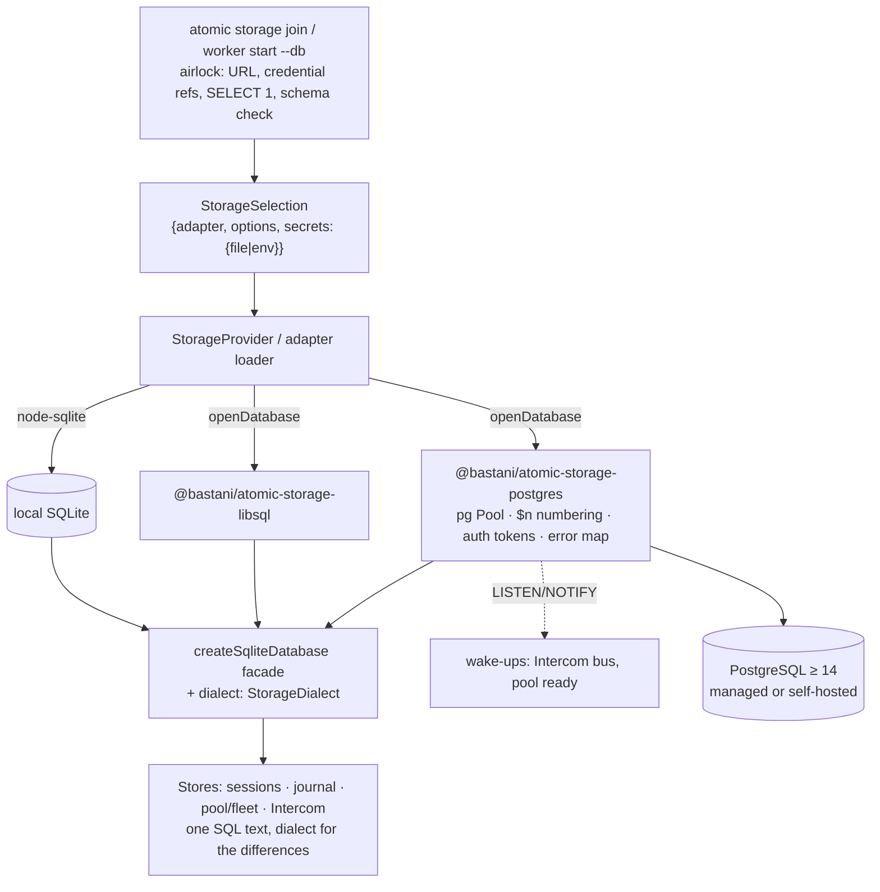

# PostgreSQL Storage Adapter — Technical Design Document / RFC

| Document Metadata      | Details |
| ---------------------- | ------- |
| Author(s)              | Alex Lavaee (with Atomic) |
| Status                 | Draft for review. Implementation ships as slices after 0.9.88 |
| Issue                  | [#4793](https://github.com/bastani-inc/atomic/issues/4793) |
| Team / Owner           | `packages/coding-agent` (storage facade, dialect, CLI, docs); `packages/workflows` (journal, pool, fleet); `packages/intercom` (multi-node routing); new `packages/storage-postgres` |
| Created / Last Updated | 2026-11-14 |
| Builds on              | #4768 elastic multi-host workflows ([spec](2026-11-14-elastic-multi-host-workflows.md)), #4791 S0 one-request pool writes (open), #4720 storage export/import, `@bastani/atomic-storage-libsql` |
| Evidence               | [`research/evidence/postgres-adapter/`](../research/evidence/postgres-adapter/README.md) |
| Compatibility posture  | **No breaking changes.** Published SDK storage API (`SqliteDatabase`, `createSqliteDatabase`, `StorageAdapterModule`, conformance suites), settings, CLI flags and on-disk SQLite schemas keep working unchanged. Defaults stay: local SQLite for sessions and the journal store, libSQL for `libsql://` URLs. Postgres is opt-in by URL |

---

## 1. Executive Summary

Shared placement (#4768) coordinates a fleet through one database, and today that database must speak SQLite. sqld
has one writer: on this machine the shared pool's hot path stops scaling at about 87 checkpoints/s on loopback and
30/s at 2 ms RTT, and its tail grows with every host (§3). Teams that already run managed Postgres (Azure Database
for PostgreSQL, RDS/Aurora, Cloud SQL/AlloyDB, Neon, Supabase) cannot use it.

This RFC adds `@bastani/atomic-storage-postgres`, a separately installed adapter, and a **small dialect seam** under
the existing async storage facade. Stores keep one SQL text written in a portable subset (`ON CONFLICT`, `RETURNING`,
`COALESCE`, explicit sequence columns), and call a `StorageDialect` only for the dozen constructs that differ. Write
transactions on Postgres are serial by default (one advisory lock per domain, the meaning of `BEGIN IMMEDIATE`), and
the audited hot paths opt in to row-level fencing: the root lease `FOR SHARE`, the work row `FOR UPDATE`, the claim
`FOR UPDATE SKIP LOCKED`, and a late, one-statement sequence allocation. In the prototype that design commits
**1 365–1 513 checkpoints/s** at 8–32 hosts on loopback (sqld: 73–87) and **293–331/s** at 2 ms RTT (sqld: 24–31).

The doors at the heart of it: `atomic storage join postgres://…` (one trust transition, credentials by file
reference only) and `PoolQueue.commit` (the one place a checkpoint becomes durable), unchanged in name, newly safe
under many writers.

## 2. Context and Motivation

### 2.1 Current State

- **Architecture.** Every shared store is SQL over one async facade, `SqliteDatabase` (`exec/run/get/all/transaction/batch`,
  `packages/coding-agent/src/core/storage/database.ts`). Adapters implement `openDatabase` (a SQLite-compatible
  driver wrapped by `createSqliteDatabase`) or, for a foreign database, the whole domain (`openSessionStore`,
  `openRunJournal`). Intercom brokers only use `openDatabase`. The docs say it plainly: "The built-in journal uses
  SQLite SQL, so `openDatabase` adapters need a SQLite-compatible driver" (`docs/storage.md`, Sharing storage).
- **Stores on an adapter** (the scope of this RFC): sessions (`sql-session-store.ts`), snapshot blobs and workspace
  leases (`blob-store.ts`, `workspace/lease.ts`), the run journal (`sql-run-journal.ts`, `legacy-journal-tables.ts`,
  `journal-adoption.ts` schema), the worker pool, shared pool and fleet (10 files under
  `packages/workflows/src/durable/journal/` and `workers/`), and Intercom multi-node routing (9 files under
  `packages/intercom/broker/`). Local-file-only stores (journal catalog, transfer, the node-sqlite driver, the
  write-ahead-log helper, the broker's away-asks and delivered-message caches) stay SQLite forever.
- **Concurrency model.** Every write is `BEGIN IMMEDIATE`: one writer per database. Stores read, decide in
  JavaScript, then write, inside that lock (`SqlPoolQueue.commit` runs at least 7 statements, 6–17 requests per transaction in #4768 §3.3).
  Correctness relies on the lock, never on row locks.
- **Leaking doors (today).**
  - The adapter door `openDatabase` promises "a database", but every store behind it assumes SQLite semantics:
    type affinity, `INTEGER` = int64, `rowid`, `MAX(a, b)`, `changes()`, `BEGIN IMMEDIATE` meaning "nobody else
    writes". An adapter can return a facade over Postgres; every store would then fail at runtime, one statement at a
    time.
  - `atomic storage join` and `atomic worker start --db` accept only `libsql://`, `https://`, `wss://` and `file:`
    (`team.ts` `checkTeamUrl`, `worker-command.ts`), and the adapter package is a constant
    (`LIBSQL_ADAPTER_PACKAGE`).

### 2.2 The Problem

- **User impact.** A fleet's checkpoint rate is capped by one writer. #4768 §3 measured 35–39 cps for the full
  Atomic path; the hot-path replica here shows the same plateau and a tail that doubles with each doubling of hosts
  (§3). sqld also has the libsql#2286 wedge, which needs `--checkpoint-interval-s 60` to avoid.
- **Business impact.** Teams standardised on managed Postgres must run and secure a second database (sqld or Turso)
  to use shared placement.
- **Technical debt.** SQLite specifics are scattered across 26 adapter-store files (§3.1). Without a seam, every new
  store adds more.

## 3. Measurements and Inventory

### 3.1 SQLite-specific constructs, by store

`node research/evidence/postgres-adapter/inventory.mjs` (raw JSON in `results/inventory.json`). Counts are matches
in shipped source; "code" excludes comment lines; "files (adapter)" counts files in the adapter stores above.

| Construct | All | Code | Files (adapter) | Postgres equivalent | Seam |
| --- | --- | --- | --- | --- | --- |
| `rowid` (ordering, paging, migration) | 53 | 47 | 7 (6) | explicit `seq BIGINT GENERATED ALWAYS AS IDENTITY` | `dialect.rowOrder`: `rowid` on SQLite, the `seq` column on Postgres |
| `json_extract` / `->>` | 32 | 32 | 5 (5) | `(col::jsonb ->> 'field')`; expression indexes stay expression indexes | `dialect.jsonText(col, path)` |
| `json_each(?)` (bound JSON arrays) | 12 | 12 | 3 (3) | `jsonb_array_elements_text(?::jsonb)` keeps the same bound JSON text | `dialect.jsonValues(param)` |
| other `json_*()` / `json()` | 22 | 22 | 2 (2) | `jsonb_build_object`, `jsonb_agg`, `jsonb_typeof`, `::jsonb` | `dialect.json*` (sessions, blobs only) |
| `INSERT OR IGNORE` | 13 | 13 | 7 (6) | `INSERT … ON CONFLICT DO NOTHING` | portable rewrite (SQLite ≥ 3.24 accepts it) |
| `INSERT OR REPLACE` / `REPLACE INTO` | 8 | 8 | 5 (4) | `ON CONFLICT (key) DO UPDATE SET …` (REPLACE deletes then inserts and fires cascades; the upsert does not) | portable rewrite, each audited for cascade reliance |
| `ON CONFLICT` upserts | 33 | 33 | 17 (15) | same syntax; `DO UPDATE` needs a target matching a unique index | portable as is |
| `BEGIN IMMEDIATE` | 12 | 3 | 5 (1) | `BEGIN` + domain advisory lock (serial) or row locks (fenced) | driver + `TransactionConcurrency` (§5.1) |
| `AUTOINCREMENT` | 7 | 7 | 7 (7) | `BIGINT GENERATED ALWAYS AS IDENTITY` | `dialect.types.serialKey` |
| `INTEGER PRIMARY KEY` (rowid alias) | 15 | 15 | 12 (10) | `BIGINT PRIMARY KEY` (+ IDENTITY where assigned implicitly) | `dialect.types` |
| `PRAGMA` / `pragma_*()` | 40 | 36 | 14 (9) | `foreign_keys` always on; `pragma_table_info` → `information_schema.columns` | `dialect.columnExists`, driver drops PRAGMAs |
| `sqlite_master` / `sqlite_schema` | 19 | 19 | 11 (9) | `to_regclass()` / `information_schema.tables` | `dialect.tableExists` |
| `STRICT` / `WITHOUT ROWID` tables | 16 | 16 | 3 (2) | drop the clause; Postgres types are strict | `dialect.tableOptions` |
| `RETURNING` | 3 | 3 | 3 (2) | same | portable |
| `SAVEPOINT` / `RELEASE` | 2 | 2 | 2 (1) | same | portable |
| `changes()` inside a batch | 3 | 2 | 1 (1) | `WITH ins AS (INSERT … RETURNING 1) UPDATE … WHERE EXISTS (SELECT 1 FROM ins)` | per-dialect statement plan in `SqlRunJournal.appendBatch` |
| `unixepoch()` / `julianday()` clock | 37 | 35 | 20 (17) | `(extract(epoch from clock_timestamp()) * 1000)::bigint` (`clock_timestamp`, not `now()`, which is the transaction's start) | `dialect.nowMs` (replaces the 12 copies of `STORE_NOW`) |
| scalar `MAX(a, b)` / `MIN(a, b)` | 11 | 11 | 8 (7) | `GREATEST` / `LEAST` | `dialect.greatest/least` |
| `IFNULL` / `IIF` / `instr` / `group_concat` | 6 | 6 | 3 (3) | `COALESCE`, `CASE`, `strpos`, `string_agg` | portable rewrite (`COALESCE`, `CASE`) or dialect |
| boolean as integer (`revision + (a != b)`) | 1 | 1 | 1 (1) | `(a <> b)::int` | portable rewrite: `CASE WHEN … THEN 1 ELSE 0 END` |
| template literals with `?` placeholders | 575 | 467 | 36 (26) | `$1…$n` | **driver only**: numbered by the Postgres driver, never by stores |
| `INTEGER` columns | 159 | 159 | 29 (23) | `BIGINT` (Postgres `INTEGER` is 32-bit and overflows on epoch ms) | `dialect.types.int` |
| `BLOB` columns | 8 | 7 | 3 (2) | `BYTEA` | `dialect.types.blob` |
| `SQLITE_BUSY` / busy timeout | 32 | 19 | 5 (1) | SQLSTATE `40001`, `40P01` (retry), `55P03` under `lock_timeout` | driver `transientFailure` |
| `LIKE` / `GLOB` | 5 | 5 | 2 (2) | SQLite `LIKE` is ASCII case-insensitive; Postgres is case-sensitive | portable rewrite to exact or prefix comparisons |
| S0 (#4791, open): trigger fence `RAISE(ABORT, 'atomic-pool-fence')` | — | — | 1 | `CHECK (false)` fence table, portable to both | portable fence (§5.4) |

Per store (code-only counts; `results/inventory.json` has every cell):

| Store | Files | Heaviest constructs |
| --- | --- | --- |
| Sessions | `sql-session-store.ts`, `legacy-session-store.ts` | 7 `json()`, 6 `STRICT`, 3 upserts, 3 PRAGMA, 12 `INTEGER`, 1 `BLOB` |
| Snapshot blobs, workspace leases | `blob-store.ts`, `workspace/lease.ts` | 23 `rowid`, 17 `json_extract`, 7 `json_each`, 15 `json_*`, 13 `unixepoch`, 9 `STRICT`, 5 `INSERT OR IGNORE`, 4 REPLACE |
| Run journal | `sql-run-journal.ts`, `legacy-journal-tables.ts`, `journal-adoption.ts` | `changes()` ×2 in the append batch, `SAVEPOINT`, 3 `INSERT OR IGNORE`, 5 `sqlite_master`, `LIKE` ×4 |
| Worker pool, shared pool, fleet | `sql-pool-queue.ts`, `sql-shared-pool.ts`, `sql-pool-usage.ts`, `pool-stage-usage.ts`, `pool-mutations.ts`, `pool-checkpoint-index.ts`, `pool-remote-journal.ts`, `sql-fleet.ts`, `pool-session-store.ts`, `resource-admission.ts` | 17 `rowid`, 14 `json_extract`, 5 `json_each`, 13 upserts, 9 `unixepoch`, 59 `INTEGER`, one boolean-as-integer |
| Intercom routing | 8 `broker/sql-*.ts` + `database-wake-up-bus.ts` | 6 `AUTOINCREMENT`, 8 scalar `MAX`/`MIN`, 8 `unixepoch`/`julianday`, 6 upserts, 1 `RETURNING` |

### 3.2 Hot-path prototype: sqld against Postgres

The prototype (`research/evidence/postgres-adapter/hotpath.mjs`) runs the statements `SqlPoolQueue` runs for
claim, heartbeat, commit and complete, with the same decisions between them, in the #4768 harness shape: one root,
N host processes × 4 slots, 2 children per slot (64/128/256 children) × 20 checkpoints of 256 bytes. Each host is a
process with its own connections; heartbeats every 7.5 s, host reports every 5 s, root lease renewed every 5 s. It
does **not** run Atomic's workers, IPC or catch-up fold, so its absolute rates are the storage ceiling, not what a
user sees (§3.3 has the full Atomic path).

- `sqlite`: SQLite SQL through `@bastani/atomic-storage-libsql` against sqld 0.24.33 `--checkpoint-interval-s 60`,
  interactive transactions as on `main` (one facade per host, as the host coordinator's one queue).
- `pg-serial`: the same statements mechanically rewritten, `BEGIN IMMEDIATE` kept honest by a database-wide
  `pg_advisory_xact_lock`. This is what architecture (a) must do (§6).
- `pg`: the designed port (§5.4): READ COMMITTED, root lease `FOR SHARE`, work row `FOR UPDATE`,
  `FOR UPDATE SKIP LOCKED` claim, sequence allocated in one late `UPDATE … RETURNING` CTE. `pg` 8.23.1, a pool of
  slots + 1 connections per host.

Postgres 16.16 in Docker (`postgres:16-alpine`, `max_connections=400`, `shared_buffers=1GB`, fsync and
synchronous commit on). One 80-core VM shared with other sessions; load average 21–37 during the runs (each run
started below 30). "Stalls" are gaps of 5 s or more between consecutive commits fleet-wide; none occurred, so the
table shows the largest gap. Every run kept the invariants: one event per key, `max(seq)` = event count.

**Loopback** (`results/hotpath-{sqlite,pg-serial,pg}.json`):

| Backend | Hosts × 4 | cps | p50 ms | p99 ms | max ms | largest gap ms | errors (retried or refused) |
| --- | --- | --- | --- | --- | --- | --- | --- |
| sqld | 8 | 87.2 | 286 | 516 | 532 | 151 | — |
| sqld | 16 | 87.2 | 532 | 873 | 956 | 83 | — |
| sqld | 32 | 72.9 | 986 | 1 946 | 3 723 | 483 | 30 `StorageUnavailableError`, 18 stale work |
| pg-serial | 8 | 434.9 | 60 | 69 | 109 | 34 | — |
| pg-serial | 16 | 387.6 | 119 | 185 | 187 | 79 | — |
| pg-serial | 32 | 286.8 | 229 | 357 | 411 | 162 | — |
| **pg** | 8 | **1 513** | **11.5** | **97** | 131 | 3 | — |
| **pg** | 16 | **1 442** | **24** | **208** | 317 | 5 | — |
| **pg** | 32 | **1 365** | **54** | **399** | 788 | 8 | — |

**2 ms RTT** (`--latency-ms 1`, a TCP hop holding each chunk 1 ms each way; `results/hotpath-*-rtt2ms.json`):

| Backend | Hosts × 4 | cps | p50 ms | p99 ms | max ms | largest gap ms | errors |
| --- | --- | --- | --- | --- | --- | --- | --- |
| sqld | 8 | 30.7 | 794 | 1 386 | 1 609 | 190 | 5 stale work |
| sqld | 16 | 30.0 | 1 524 | 2 644 | 4 289 | 490 | 14 unavailable, 15 stale |
| sqld | 32 | 23.9 | 3 065 | 5 927 | 12 390 | 1 452 | 89 unavailable, 98 stale; 259 commits over 5 s |
| pg-serial | 8 | 41.7 | 654 | 984 | 1 246 | 227 | — |
| pg-serial | 16 | 37.3 | 1 280 | 2 102 | 2 619 | 469 | 2 stale |
| pg-serial | 32 | 28.7 | 2 428 | 4 397 | 4 850 | 817 | 89 stale |
| **pg** | 8 | **331.2** | **58** | **384** | 671 | 11 | — |
| **pg** | 16 | **314.1** | **88** | **1 052** | 2 073 | 17 | — |
| **pg** | 32 | **292.9** | **159** | **2 416** | 5 634 | 21 | 1 stale (one commit over 5 s) |

What the numbers say:

1. **The single writer is the ceiling, whatever the engine.** `pg-serial` (Postgres with SQLite's lock) collapses
   with RTT exactly as sqld does (41.7 → 28.7 cps at 2 ms; sqld 30.7 → 23.9), because the lock is held across every
   round trip of the transaction. A dialect layer that only rewrites SQL keeps this ceiling.
2. **Row-level fencing removes it.** `pg` is 10–17× sqld at 2 ms RTT and 16–19× on loopback, and its p50 stays
   flat-ish where sqld's doubles per doubling of hosts. Its remaining contention is the root's run row, taken in the
   last statement of each commit: every checkpoint of one root is a sequence number in one run.
3. **The `pg` tail at 2 ms** (p99 2.4 s at 32 hosts) comes from that one hot row: a commit's lock is held for one
   statement plus `COMMIT`, i.e. two RTTs plus the fsync, and 128 writers queue on it. S0's one-request shape
   (§5.4, slice P5) folds the fence and the CTE into one pipelined round trip, which halves that hold.
4. **sqld's errors are not benign.** At 16 and 32 hosts with RTT, commits outran the 30 s work lease (stale work,
   attempts fenced) and requests failed outright. The lease is 30 s; a p99 near 6 s means the heartbeat itself queues
   for the lock.

### 3.3 The full Atomic path on sqld (baseline)

`research/evidence/elastic-workers/run-local.mjs` on `main` (S0 not merged), sqld 0.24.33 `--checkpoint-interval-s 60`,
the same children counts (`results/atomic-sqld-{8,16,32}x4.json`):

| Hosts × 4 | Children | cps | p50 ms | p99 ms | max ms | Outcome |
| --- | --- | --- | --- | --- | --- | --- |
| 8 | 64 | 25.7 | 916 | 1 431 | 1 689 | completed, no stall |
| 16 | 128 | 20.4 | 1 802 | 3 423 | 4 645 | 126 of 128; 2 children failed with `StorageUnavailableError` |
| 32 (run 1) | 256 | — | — | — | — | root exited 1 after about 90 s: `SQLITE_BUSY` from a coordinator reply (`atomic-sqld-32x4-run1.json`) |
| 32 (run 2) | 256 | 12.2 | 3 788 | 8 073 | 10 230 | 254 of 256; 2 failed with `StorageUnavailableError`; sqld's slowest queries are `BEGIN IMMEDIATE` at 4.6 s |

Load average was 28–44 at each start; the 32-host runs drive it to 70–78 themselves (160 Node processes), so treat
their absolute numbers as loaded-host. The shape matches #4768 §3.1: throughput falls as writers grow, and from 16
hosts the store starts failing work outright. No run stalled (no 60 s without progress), with the libsql#2286
workaround on.

The full path cannot run against Postgres until slices P1–P5 land: only the hot path was ported (as scoped). The
gap between this table and the `sqlite` hot-path row is Atomic's per-step overhead (worker IPC, catch-up fold,
snapshots); on Postgres that overhead stays per host and the shared ceiling moves (§3.2).

### 3.4 Prior art, and what we copy

| System | Pattern | Taken |
| --- | --- | --- |
| Temporal SQL persistence ([`sqlplugin`](https://github.com/temporalio/temporal/tree/main/common/persistence/sql/sqlplugin): mysql, postgresql, sqlite) | One persistence layer over a narrow plugin interface; per-dialect query constants differ only where SQL differs (placeholders, `FOR UPDATE`, upsert form). Every write first locks the shard row `FOR UPDATE` and compares `range_id`: fencing by row lock under READ COMMITTED | One store layer, one `StorageDialect`. Root lease row as the shard row: `FOR SHARE` for writers, `UPDATE` for renew and takeover; the epoch is our `range_id` |
| Airflow ([`with_row_locks`](https://github.com/apache/airflow/blob/main/airflow/utils/sqlalchemy.py), HA scheduler) | `SELECT … FOR UPDATE SKIP LOCKED` on Postgres and MySQL 8; a no-op on SQLite, where only one scheduler is supported | `dialect.lockClause("update" \| "share" \| "skip-locked")`, empty on SQLite, where `BEGIN IMMEDIATE` already serialises |
| Prefect server ([`query_components`](https://github.com/PrefectHQ/prefect/blob/main/src/prefect/server/database/query_components.py)) | SQLAlchemy core statements shared; `AsyncPostgresQueryComponents` and `AioSqliteQueryComponents` supply JSON builders and the few dialect-specific queries | `StorageDialect` with JSON helpers plus per-dialect statement plans for the few methods whose shape differs |
| Dagster ([`dagster-postgres`](https://github.com/dagster-io/dagster/tree/master/python_modules/libraries/dagster-postgres)) | Shared SQL storage base; Postgres subclass overrides upserts; `LISTEN/NOTIFY` watcher for events where SQLite polls | Wake-ups through `LISTEN/NOTIFY` with the existing polls kept as the backup |
| Kysely / Knex dialects | Dialect = driver + compiler + adapter (`supportsReturning`, `supportsTransactionalDdl`, `acquireMigrationLock` via `pg_advisory_xact_lock`) | Postgres migrations in one transaction under `pg_advisory_xact_lock`; SQLite keeps `BEGIN IMMEDIATE` |

## 4. Proposed Solution (High-Level Design)

### 4.1 System Architecture



The airlock is `openDatabase` plus the CLI: the URL is validated, credentials are resolved from file or environment
references, the server is probed, and every domain's schema version is checked before any store runs. Inside, stores
trust the facade.

### 4.2 Architectural Pattern

**Portable SQL with a small dialect seam** (architecture (b)), in the Temporal/Prefect shape: one store layer, one SQL
text per statement, a `StorageDialect` value that the facade carries, and per-dialect statement plans only where the
transaction shape must differ. Concurrency is a per-transaction declaration: `serial` (the default, SQLite semantics
on every backend) or `fenced` (row locks named by the store, audited per path).

### 4.3 Key Components

| Component | Responsibility | Technology | Justification |
| --- | --- | --- | --- |
| `StorageDialect` | The constructs that differ (§3.1): types, clock, JSON, greatest/least, lock clauses, catalog probes | TypeScript value objects `sqliteDialect`, `postgresDialect` | One home per difference; stores never branch on a name |
| Facade (`createSqliteDatabase`) | Carries `dialect`; runs `transaction(body, { concurrency })` | existing | No new public facade type; `SqliteDatabase` stays the contract |
| `@bastani/atomic-storage-postgres` | Driver: pool, `$n` numbering, BIGINT parsing, error mapping, auth tokens, `serial` lock, `LISTEN` | plain ESM JS + JSDoc + `.d.ts`, dependency `pg` | Same packaging as `storage-libsql`; never in `@bastani/atomic`'s shrinkwrap |
| `StorageMigrations` | Versioned per-domain migrations on Postgres | `<prefix>atomic_migrations` table, `pg_advisory_xact_lock` | Transactional DDL; refuses newer versions as today |
| Wake-up buses | `LISTEN/NOTIFY` for Intercom hints and pool readiness; polls stay | `pg` dedicated client | Lower latency, degrades to polling |
| Conformance matrix | One suite per contract run on SQLite, libSQL (sqld), Postgres | vitest + CI Postgres service container | The only proof that one SQL text holds on three engines |

File and module map:

| Path | Action | Owns |
| --- | --- | --- |
| `packages/coding-agent/src/core/storage/dialect.ts` | add | `StorageDialect`, `sqliteDialect`, `postgresDialect`, `dialectOf(database)` |
| `packages/coding-agent/src/core/storage/database.ts`, `sqlite-facade.ts` | change | `dialect` on the driver and facade; `TransactionConcurrency` option |
| `packages/coding-agent/src/core/storage/migrations.ts` | add | `applyStorageMigrations(database, domain, steps)` |
| `packages/coding-agent/src/core/storage/{team,selection,storage-status}.ts`, `cli/{storage,worker,team}-command.ts` | change | URL scheme → adapter, `--password-file`, `--auth`, status checks |
| `packages/coding-agent/src/core/storage/session/sql-session-store.ts`, `worktree-snapshot/blob-store.ts`, `workspace/lease.ts` | change | portable SQL + dialect calls |
| `packages/workflows/src/durable/journal/*.ts`, `workers/{pool-session-store,resource-admission}.ts` | change | portable SQL; fenced hot paths |
| `packages/intercom/broker/sql-*.ts`, `database-wake-up-bus.ts` | change | portable SQL; `LISTEN/NOTIFY` bus |
| `packages/storage-postgres/{package.json,postgres.js,postgres.d.ts,README.md,CHANGELOG.md}` | add | the adapter |
| `test/helpers/storage-backends.ts` | add | backend matrix fixture (SQLite file, sqld, Postgres) |
| `test/integration/storage-conformance-matrix.test.ts` | add | every conformance suite × every backend |
| `.github/workflows/test.yml` | change | `postgres:16` service container for the conformance job |
| `packages/coding-agent/docs/storage.md`, `guides/worker-hosts.md`, `reference/cli.md`, `guides/team-setup.md` | change | Postgres setup, backend decision table |

### 4.4 The Door Set at a Glance

`atomic storage join` ⚠ (writes settings and a credential file), `atomic storage status`, `atomic worker start`,
`atomic storage export`, `atomic storage import` ⚠ (writes runs and sessions into a store), `openDatabase`,
`applyStorageMigrations` ⚠ (DDL on a shared database), `PoolQueue.claim`, `PoolQueue.heartbeat`,
`PoolQueue.commit` ⚠ (makes a checkpoint durable), `PoolQueue.complete` ⚠ (publishes a child's result),
`RunJournal.acquire` / `renew` (take and keep a run's lease).

Read alone: a machine joins a shared database once, by URL and credential file; the store is checked, migrated under
one lock, then trusted; a run has one owner by lease; a child's work is claimed, kept alive, checkpointed and
completed, and only `commit` and `complete` make anything durable for the root.

## 5. Detailed Design

### 5.1 The Doors (Entrypoint Contracts)

**Dialect and concurrency (in-process seam).**

```ts
// packages/coding-agent/src/core/storage/dialect.ts
export type StorageDialectName = "sqlite" | "postgres";
export interface StorageDialect {
	readonly name: StorageDialectName;
	readonly types: { readonly int: string; readonly blob: string; readonly serialKey: string; readonly real: string };
	readonly tableOptions: string; // " STRICT" | ""
	readonly nowMs: string; // SQL expression: integer ms on the database clock
	jsonText(column: string, ...path: readonly string[]): string;
	jsonValues(parameter: "?"): string; // the elements of a bound JSON array, as a table of `value`
	greatest(a: string, b: string): string;
	least(a: string, b: string): string;
	lockClause(kind: "update" | "share" | "update-skip-locked"): string; // "" on SQLite
	rowOrder(alias?: string): string; // "rowid" on SQLite, "seq" (an identity column) on Postgres
	tableExists(table: string): SqliteStatement; // returns a row when it exists
	columnExists(table: string, column: string): SqliteStatement;
}
export function dialectOf(database: { readonly dialect?: StorageDialect }): StorageDialect; // sqliteDialect when absent

// database.ts (additions; every existing member unchanged)
export type TransactionConcurrency =
	| { readonly kind: "serial" } // default: one writer per domain, what BEGIN IMMEDIATE means
	| { readonly kind: "fenced"; readonly audit: FencedPathId }; // row locks the body takes itself
export type FencedPathId = string & { readonly __fencedPath: unique symbol }; // minted only by `fencedPath()`
export interface SqliteTransactionOptions { /* existing */ readonly concurrency?: TransactionConcurrency }
export interface SqliteDatabase { /* existing */ readonly dialect?: StorageDialect }
```

- **Guarantee (`transaction`, serial):** the body runs as if it were the only writer of its domain. On SQLite this is
  `BEGIN IMMEDIATE`; on Postgres `BEGIN` then `SELECT pg_advisory_xact_lock(hashtextextended(prefix || domain, 0))`.
- **Guarantee (`transaction`, fenced):** the body runs under READ COMMITTED and is correct because it locks its
  fence rows itself. **Refusal:** `fenced` takes a `FencedPathId`, which only `fencedPath(name)` in
  `fenced-paths.ts` mints, and that file lists each audited path with its fence rows and its conformance test.
  An unaudited caller cannot opt in by passing a string. On SQLite `fenced` is identical to `serial`.
- **Never:** a store builds `$n` placeholders, names a dialect in an `if`, or calls `pg` directly.

**Adapter (`openDatabase`, Postgres).**

```ts
// @bastani/atomic-storage-postgres
export interface PostgresDatabaseOptions {
	readonly url: string; // postgres:// or postgresql://, no password, no `password=` parameter
	readonly password?: string; // resolved from secrets { file | env }; re-read per new connection
	readonly auth?: "password" | "azure-entra" | "aws-iam" | "gcp-iam"; // default "password"
	readonly maxConnections?: number; // default 8 per process
	readonly listenUrl?: string; // direct (non-pooled) endpoint for LISTEN; absent → polling only
	readonly statementTimeoutMs?: number; // default 30000, SET LOCAL per transaction
}
export function openPostgresDatabase(options: PostgresDatabaseOptions): Promise<SqliteDatabase>; // dialect: postgres
```

- **Guarantee:** returns a facade on a reachable server ≥ 14 whose credentials stayed out of the descriptor.
- **Named failures:** `StorageConfigError` (`credential-in-url`, `unsupported-url`, `auth-unavailable`),
  `StorageUnavailableError` (`28P01` refused credentials, `3D000` missing database, `42501` no privilege, server
  < 14), `StorageTransientError` (`connection-refused`, `connection-lost`, new `lock-conflict` for
  `40001`/`40P01`/`55P03`, `transaction-timeout` for `57014`), `StorageSchemaVersionError` (newer schema).
- **Refusals:** a URL with a password or `password=` is refused (as `credential-in-url` for libSQL); session-level
  state is never used (no `SET` outside a transaction, no session advisory locks, no named prepared statements), so
  a transaction-mode pooler (pgbouncer, Azure's built-in pgbouncer on 6432, Supavisor, Neon's pooler) cannot break
  it.

**CLI (`atomic storage join`, `atomic worker start --db`).**

```text
atomic storage join <postgres://…|postgresql://…> [--password-file <path> | --token-file <path> | --auth azure|aws|gcp] [--prefix <p>]
atomic worker start --db <postgres://…> [--password-file <path> | --token-file <path> | --auth azure|aws|gcp] [...]
atomic storage status [--json]
```

- **Guarantee (`join`):** after a successful `SELECT 1` and schema-version probe, global settings name the Postgres
  adapter, the credential-free URL and a credential reference, and nothing else changed.
- **Refusals:** two credential sources at once (`conflicting-token`), a password in the URL (`credential-in-url`), an
  empty file (`empty-token`); `--auth` with `--password-file` is refused. `--token-file` means "a file another
  process keeps fresh" (Vault agent, a workload-identity sidecar): it is re-read for every new connection.
  `--password-file` is copied to `~/.atomic/agent/storage-token.<id>` at mode 600, exactly as libSQL's token.
- **Never:** a password or token in settings, argv of child processes, the journal, status output or errors.

**Pool (unchanged names; new fence contract on Postgres).**

```text
PoolQueue.claim(lease, worker, definitions, durationMs, placement?) -> PoolWork | undefined
  Guarantee: at most one attempt holds a work row; a racing claimer gets undefined, never an error.
PoolQueue.commit(lease, token, operationId, mutation) -> PoolCommitReceipt
  Guarantee: the checkpoint is durable once, under the attempt's fence. IRREVERSIBLE for the root.
PoolQueue.heartbeat(lease, token, durationMs, record) -> { work, recorded, control }
PoolQueue.complete(lease, token, result) -> void   (IRREVERSIBLE: publishes the result)
```

**Per-door audit:**

| Door | (1) Joint | (2) One sentence | (3) Honest name | (5) Every exit | (6) Refusals real | (7) Trust transition | (8) One chokepoint |
| --- | --- | --- | --- | --- | --- | --- | --- |
| `storage join` ⚠ | ✅ joining a team's store | ✅ "selects this database for this machine" | ✅ writes only `storage` | connect fails → nothing written; settings write fails → credential file removed | credentials in URL refused; one credential source | ✅ the only CLI door that turns a URL + secret into a trusted selection | ✅ for settings and the credential file |
| `openDatabase` (pg) | ✅ open a store | ✅ "returns a facade on a reachable, supported server" | ✅ | auth refused → typed fatal; refused/lost → transient | pooled-mode-unsafe features absent by construction | ✅ the driver airlock | — |
| `applyStorageMigrations` ⚠ | ✅ bring a schema to a version | ✅ "advances a domain's schema to this build's version, or refuses" | ✅ never downgrades | concurrent migrators serialise on the advisory lock; crash mid-way rolls back (transactional DDL) | newer version refused | — | ✅ only door that runs DDL on Postgres |
| `transaction(fenced)` | ✅ a write under row fences | ✅ "runs a body that locks its own fence rows" | ✅ | 40001/40P01 → `lock-conflict`, retried only with `retryTransientFailures` | unaudited caller cannot mint `FencedPathId` | — | — |
| `PoolQueue.commit` ⚠ | ✅ record a checkpoint | ✅ "makes one checkpoint durable once" | ✅ | replay → same receipt (operation row); lost reply → read back by operation id; takeover → `StaleLeaseError` | stale attempt cannot commit: work row `FOR UPDATE` + epoch check; root takeover blocks on `FOR SHARE` | — | ✅ the only writer of checkpoint events for pooled work |
| `PoolQueue.complete` ⚠ | ✅ publish a child's result | ✅ "records the child's result once" | ✅ | replay with same payload → no-op; different payload → identity conflict | as commit | — | ✅ |

### 5.2 Wire and settings form

There is no new network API. The persistent form of the door is the settings selection, identical in shape to libSQL's:

```json
{
  "storage": {
    "adapter": "@bastani/atomic-storage-postgres",
    "options": { "url": "postgres://atomic@pg.example.com:5432/atomic?sslmode=verify-full", "auth": "azure-entra" },
    "prefix": "team_"
  }
}
```

```json
{ "storage": { "adapter": "@bastani/atomic-storage-postgres",
  "options": { "url": "postgresql://atomic@db.internal/atomic" },
  "secrets": { "password": { "file": "storage-token.3f2a" } } } }
```

Auth, credentials never in the journal or settings:

| `auth` | How the password is obtained, per new connection | Where it comes from |
| --- | --- | --- |
| `password` | `secrets.password` `{ file }` / `{ env }`, re-read | `--password-file` (copied, mode 600) or `--token-file` (referenced in place) |
| `azure-entra` | Managed identity token from IMDS (`169.254.169.254/metadata/identity/oauth2/token?resource=https://ossrdbms-aad.database.windows.net`), else `az account get-access-token --resource-type oss-rdbms` | VM/VMSS managed identity, AKS workload identity, developer `az login` |
| `aws-iam` | `aws rds generate-db-auth-token --hostname … --port … --username …` (SigV4, 15-minute token) | instance profile, IRSA, `AWS_*` |
| `gcp-iam` | Metadata server access token (`metadata.google.internal/…/service-accounts/default/token`), else `gcloud auth print-access-token` | Cloud SQL / AlloyDB IAM database users |

Tokens are cached until 5 minutes before expiry, fetched through `execFile` with argument arrays (the #4768
provisioner pattern: no SDK dependency, the platform's own credential chain), and redacted from every error. The
selection records only `auth` and the user name in the URL. TLS: `sslmode=require` is the default for non-loopback
hosts; `verify-full` is recommended in the docs for managed services.

### 5.3 Data Model / Schema

The Postgres schema is the current SQLite schema of each domain at its current version, created by migration step 1
of that domain, with these mechanical differences (from the dialect, never hand-written per table):

| SQLite | Postgres |
| --- | --- |
| `INTEGER` (int64), `INTEGER PRIMARY KEY` | `BIGINT`, `BIGINT PRIMARY KEY` |
| `INTEGER PRIMARY KEY AUTOINCREMENT` | `BIGINT GENERATED ALWAYS AS IDENTITY PRIMARY KEY` |
| implicit `rowid` | explicit `seq BIGINT GENERATED ALWAYS AS IDENTITY UNIQUE` on each table the code orders or pages by `rowid`; stores write `dialect.rowOrder()` |
| `BLOB` | `BYTEA` |
| `STRICT` | (nothing) |
| JSON in `TEXT` | stays `TEXT`; expression indexes use `((col::jsonb) ->> 'k')` |

New, Postgres only: `<runs>.last_seq BIGINT NOT NULL DEFAULT 0` (the run's sequence counter, which the fenced
commit allocates from; SQLite keeps `MAX(seq) + 1` under `BEGIN IMMEDIATE`, where it is already correct), and `<prefix>atomic_migrations(domain TEXT, version BIGINT, applied_at BIGINT,
PRIMARY KEY(domain, version))` on Postgres. The existing per-domain `meta` version rows stay authoritative for
`StorageSchemaVersionError`.

### 5.4 Algorithms and State Management

**Transactions.** Every transaction runs READ COMMITTED (Postgres's default; pooler-safe, no retry storms).
`serial` adds the domain's transaction advisory lock as the first statement. `fenced` paths (slice P5) are:

```text
commit(lease, token, op, checkpoint)                       -- fenced; was 7 statements under the global lock
  BEGIN
  SELECT lease ⋈ runs ⋈ pool WHERE run_id = root  FOR SHARE OF lease   -- root fence: takeover waits for us
  SELECT * FROM work WHERE id = token.id          FOR UPDATE           -- attempt fence: a second claim waits
  check epoch, generation, worker, expiry, root status
  SELECT receipt FROM operations WHERE (work, generation, op)          -- replay → stored receipt
  validate checkpoint against events (reads only)
  WITH s AS (UPDATE runs SET last_seq = last_seq + 1 WHERE run_id = root RETURNING last_seq),
       e AS (INSERT INTO events SELECT root, s.last_seq, … FROM s RETURNING seq, at)
  INSERT INTO operations SELECT …, receipt(e) FROM e RETURNING receipt  -- the only shared lock, held until COMMIT
  COMMIT
claim: one UPDATE … WHERE id = (SELECT id … ORDER BY ready_at, seq LIMIT 1 FOR UPDATE SKIP LOCKED) RETURNING *
heartbeat: root fence FOR SHARE, then UPDATE work SET expires_at = GREATEST(expires_at, now + d) WHERE <attempt> RETURNING
complete: root fence FOR SHARE, work FOR UPDATE, INSERT result, UPDATE state
lease renew / takeover (RunJournal): UPDATE leases … WHERE epoch = ? — blocks until in-flight FOR SHARE holders commit
```

- **Fencing.** The root lease row is the shard row (Temporal): writers share it, renew and takeover update it. A
  takeover therefore waits for in-flight commits and every later commit sees the new epoch. The epoch check stays
  in JavaScript, as today, so the typed `StaleLeaseError` is unchanged. Lease expiry keeps the database clock, now
  `clock_timestamp()`.
- **Deadlock order.** Every fenced path locks in one order: root lease, work row, run row. A conformance test runs
  claim, commit, heartbeat, complete and takeover concurrently and asserts no `40P01`.
- **One-request form (with S0, #4791).** S0 already plans each pool write from a lock-free read and sends one
  guarded batch whose fences abort it. On Postgres the batch is one transaction sent as a pipeline, and the fence is
  portable: `INSERT INTO <runs>_pool_fence(failed) SELECT 'commit' WHERE NOT (<guard>)` into a table declared
  `CHECK (failed IS NULL)`, which aborts on both engines without a SQLite trigger. Slice P5 carries S0's plans to
  Postgres; until S0 merges, P5 ports today's interactive shape (what §3.2 measured).
- **Wake-ups.** Enqueue, release and complete `NOTIFY <prefix>pool_ready, '<root>'` (transactional: delivered at
  commit); idle hosts `LISTEN` and claim at once. Intercom's `DatabaseWakeUpBus` gets a `LISTEN` twin on
  `<prefix>intercom_wakeups`. Both keep their polls (500 ms hints, the outbox backup poll, the host's claim poll):
  NOTIFY is lost while a listener is disconnected. `LISTEN` needs a session, so it uses `listenUrl` (direct
  endpoint) or is skipped through a transaction pooler, with a status line saying so.
- **Pooling.** One `pg.Pool` per process per selection (default 8; a host coordinator, its admission and Intercom
  share it). Sizing guidance: hosts × (slots + 2) ≤ `max_connections` minus headroom, or put a transaction pooler in
  front. The facade's per-database call ordering is kept for `serial`; `fenced` transactions run concurrently up to
  the pool size.
- **Migrations.** `applyStorageMigrations(database, domain, steps)`: `BEGIN`, `pg_advisory_xact_lock(hash(prefix,
  'migrate'))`, read the domain's applied versions, refuse a newer one, apply missing steps, record them, `COMMIT`.
  Concurrent hosts starting at once serialise; a crash rolls back the whole step. SQLite keeps `CREATE … IF NOT
  EXISTS` plus the version row, as today.

**Resume rule (store errors degrade, never block, unless truly fatal).**

| Failure | Behavior | Never |
| --- | --- | --- |
| Connection refused or lost, failover (`57P01`, `08*`), pooler restart | `StorageTransientError`; not-applied work retried by the facade (5 tries); commit with unknown outcome read back by operation id | Fail a run on the first error, or re-send an unknown-outcome write blindly |
| `40001` / `40P01` / `55P03` | `lock-conflict` transient, retried with full jitter within `lockWaitMs` | Surface as a run failure |
| Token refresh fails (IMDS, CLI) | Keep the cached token until it expires; retry with backoff; `atomic storage status` and fleet status show `degraded` | Block a run whose connections are still open |
| `LISTEN` unavailable | Polling only, one status line | Fail Intercom or the pool |
| Too many connections (`53300`) | Transient; the pool shrinks its target by one for a minute | Exit the host |
| Store down longer than the work lease | Leases lapse; on return, fenced writes get `StaleLeaseError`, work is re-claimed (today's rule) | Duplicate a checkpoint key |
| **Fatal at setup:** `28P01` refused credentials, `3D000`, `42501`, server < 14, newer schema | Typed setup error before anything starts (`SharedPoolSetupError`, `StorageUnavailableError`, `StorageSchemaVersionError`) | — |

**Moving runs between backends** (reuses #4720 export/import):

```text
atomic worker drain / pause roots on the old store           -- quiesce: no live leases
atomic storage export <dir> --storage-file old.json [--unfinished]
atomic storage join postgres://…  --password-file …           -- new selection
atomic storage import <dir>
/workflow resume <runId>                                     -- runs resume on Postgres
```

Export and import gain `--storage <json>` / `--storage-file <path>` to name the source or destination explicitly,
and the "shared libSQL kind is refused" rule is lifted when a selection is named, because then the user chose to copy
out of the shared store. Leases, pool state and snapshot contents are not exported (unchanged): an imported running
run is interrupted, its pooled children re-enqueue at resume and replay from their checkpoints. Import's lease
freshness check (two minutes) protects a run still running on the old store.

## 6. Alternatives Considered

| Option | Shape | Pros | Cons | Decision |
| --- | --- | --- | --- | --- |
| (a) Dialect layer that rewrites SQL under the async SQLite API | Stores unchanged; the Postgres driver parses each statement and rewrites `?`, `INSERT OR`, `json_extract`, `MAX(a,b)`, `rowid`, `BEGIN IMMEDIATE` | No store edits; fastest first demo | Rewriting needs a SQL parser for 467+ statements and still cannot recover semantics: `REPLACE` delete-insert cascades, type affinity, boolean arithmetic, `changes()`, implicit `rowid`. `BEGIN IMMEDIATE` must become a global lock to stay correct, which keeps the single-writer ceiling: `pg-serial` in §3.2 is this design, 28.7 cps at 32 hosts and 2 ms. Failures surface one statement at a time, at runtime, in production | **Rejected.** It preserves exactly the bottleneck the issue exists to remove |
| (b) Portable SQL + small dialect interface (selected) | Stores rewritten once to a portable subset; `StorageDialect` for ~15 differences; per-transaction `serial` / `fenced` | One SQL text, testable on three engines; correctness by default (`serial`), speed by audit (`fenced`); matches Temporal, Prefect, Airflow, Dagster; ~100–500 lines per slice | Touches 26 store files; every fenced path needs an audit and a test | **Selected:** `pg` in §3.2 is this design, 10–19× sqld |
| (c) Store-level repository interfaces, per-backend implementations | `SessionRepository`, `RunJournal`, `PoolQueue`, `IntercomRoutes` each with SQLite and Postgres classes (the `openRunJournal`/`openSessionStore` hooks taken to their end) | Each backend idiomatic; no seam leaks | Doubles the 11 300 lines of the 26 adapter-store files, most of it subtle concurrency code; pool and Intercom semantics exceed what conformance suites pin; every fix lands twice and drifts | **Rejected** as the default. Kept for exactly the methods whose transaction *shape* differs (the journal's append batch, the pool's fenced paths), as per-dialect statement plans inside one class |
| ORM / query builder (Kysely, Knex, Drizzle) | Re-express stores in a builder | Mature dialects | A rewrite of every store, a new runtime dependency in `@bastani/atomic`'s shrinkwrap, no help with the concurrency model | Rejected; we copy their dialect and migration-lock patterns instead |
| `SERIALIZABLE` for all transactions | Keep read-decide-write bodies unchanged; retry `40001` | No fence audit | Bodies with side effects cannot be retried; abort storms under the contention §3.2 shows; pooled deployments see more `40001` | Rejected; `serial` gives the same safety without retries, `fenced` gives the speed |
| Azure SQL (SQL Server) as well | Second network dialect | Covers Azure SQL shops | A rarer dialect (`MERGE`, `OUTPUT`, `UPDLOCK, READPAST`); Azure Database for PostgreSQL covers Azure users | Out of scope (issue) |

### 6.1 Which store to choose (user-facing decision table)

| Situation | Choose | Why |
| --- | --- | --- |
| One machine, one person | **Local SQLite** (default) | No setup; the journal store shards by root |
| A few machines, a small team, CI caches | **libSQL / Turso** | One URL and a token; lightweight; fine up to a handful of concurrent writers (about 9 in #4768 §3.1) |
| Worker fleets, cloud deployments, many concurrent hosts, an existing managed Postgres | **PostgreSQL** (preferred) | Many writers at once; managed HA, backups and IAM on Azure, AWS, GCP, Neon, Supabase |
| Strict data residency on one host | Local SQLite | Nothing leaves the machine |

Once P8 ships, the docs recommend PostgreSQL as the preferred shared store for cloud deployments, libSQL/Turso as
the lightweight option, and local SQLite for single machines.

## 7. Cross-Cutting Concerns

### 7.1 Security and Privacy

- **One trust transition:** `atomic storage join` / `--db` resolve a credential reference; `openDatabase` resolves the
  secret per connection. Nothing else reads a password.
- **Credentials never in the journal:** selections carry `{ file }` / `{ env }` references or an `auth` platform
  name; the journal header's `storage` descriptor is the URL without userinfo or query; worker processes receive the
  selection through `ATOMIC_POOL_DURABLE_JOURNAL` (references only), as today.
- **Least privilege:** docs ship the role grants: `CONNECT` on the database, `USAGE, CREATE` on the schema for the
  first join (migrations), and a variant without `CREATE` for hosts once migrated. Managed IAM users map to that role.
- **TLS** on by default for non-loopback hosts; `verify-full` documented.
- **Threat model:** as with libSQL, anyone holding the credential can read and write every session, run and Intercom
  message under the prefix: database access is full read access (unchanged docs statement).

### 7.2 Observability

`atomic storage status` for a Postgres selection adds: server version, whether the URL goes through a transaction
pooler (a `LISTEN` probe), schema version per domain, the auth mode and token expiry (never the token), clock skew
between host and database, and connection-pool saturation. Fleet status (S8) reports `lock-conflict` and token
refresh failures like libSQL's `writes stalled`.

## 8. Test Plan

Vertical red-green-refactor slices through the doors; every slice adds its rows to the conformance matrix.

- **Conformance matrix (CI):** `registerSqliteDatabaseConformance`, `registerSessionStoreConformance`,
  `registerRunJournalConformance`, a new pool conformance (claim/heartbeat/commit/complete/takeover, concurrent),
  and a new Intercom routing conformance, each × {node-sqlite file, sqld (`ATOMIC_TEST_LIBSQL_URL`), Postgres
  (`ATOMIC_TEST_POSTGRES_URL`)}. CI's integration job runs a `postgres:16` service container and sets the URL; a
  missing URL skips the Postgres rows locally and fails in CI (no soft guards).
- **Unit:** dialect rendering per construct (§3.1 table as a table test); `$n` numbering ignores `?` inside string
  literals; error mapping per SQLSTATE; credential refusals in URLs; token cache expiry; `FencedPathId` cannot be
  forged (type test).
- **Integration:** fenced commit under 32 concurrent writers: one event per key, dense `seq`, no `40P01`; takeover
  during commits: every commit after takeover gets `StaleLeaseError`; migration race: 8 processes start at once,
  one applies; pooler: the suite through pgbouncer in transaction mode (a second service container); LISTEN lost →
  polling still delivers.
- **Property:** random interleavings of claim/commit/expire/takeover against Postgres never yield two holders of a
  work row or a gap in `seq`.
- **Benchmarks (evidence, not CI):** `run-hotpath.mjs` before/after P5, and the full `run-local.mjs` against Postgres
  once P1–P5 land, with `ELASTIC_ADAPTER` pointing at the Postgres adapter.
- **Interactive verification:**

```sh
docker run -d --name atomic-pg -e POSTGRES_PASSWORD=pw -p 127.0.0.1:5432:5432 postgres:16-alpine
printf pw > /tmp/pgpw && chmod 600 /tmp/pgpw
atomic install npm:@bastani/atomic-storage-postgres
atomic storage join postgresql://postgres@127.0.0.1:5432/postgres --password-file /tmp/pgpw   # exit 0; settings hold a file reference only
atomic storage join postgresql://postgres:pw@127.0.0.1/postgres                                 # exit 1, credential-in-url, nothing written
atomic storage status --json | jq '.journal.database'                                            # "answers", server 16.x, schema versions
atomic worker start --db postgresql://postgres@127.0.0.1/postgres --password-file /tmp/pgpw &   # "ready host=…"
docker stop atomic-pg; sleep 20; docker start atomic-pg                                          # host logs degraded, then recovered; exit code unchanged
grep -r pw ~/.atomic/agent/settings.json ~/.atomic/workflows || echo "no secret on disk outside the 600 file"
docker rm -f atomic-pg
```

## 9. Slice Plan

Each slice is about 100–500 changed lines, independently mergeable, defaults unchanged. **P0 and P1 come first.**

| ID | Title | Depends on | Parallel group | Objective | Files | Tests |
| --- | --- | --- | --- | --- | --- | --- |
| P0 | Backend conformance matrix and CI Postgres service | — | A | Fixture that opens node-sqlite, sqld and Postgres facades; run the existing `SqliteDatabase`, session and journal suites on SQLite and sqld; add the `postgres:16` service container and `ATOMIC_TEST_POSTGRES_URL` (Postgres rows `todo` until P2) | `test/helpers/storage-backends.ts`, `test/integration/storage-conformance-matrix.test.ts`, `.github/workflows/test.yml`, `docs/ci.md` | The matrix itself; CI fails when the URL is missing in CI |
| P1 | `StorageDialect`, `TransactionConcurrency`, migrations | — | A | `dialect.ts`, facade `dialect` and `concurrency` options, `fencedPath()`, `applyStorageMigrations`; SQLite behavior byte-identical | `core/storage/{dialect,database,sqlite-facade,migrations,fenced-paths,index}.ts` | Dialect table test; facade conformance unchanged; type test that `FencedPathId` cannot be built from a string |
| P2 | `@bastani/atomic-storage-postgres` adapter | P1 | B | Pool, `$n` numbering, BIGINT parsing, SQLSTATE → typed errors, `serial` advisory lock, password from secrets, URL refusals; publish wiring like `storage-libsql` | `packages/storage-postgres/*`, `scripts` publish lists, `publish.yml` package list | `registerSqliteDatabaseConformance` on Postgres; error-map unit tests; pgbouncer transaction-mode run |
| P3 | Portable SQL: sessions, snapshot blobs, workspace leases | P1 (P2 to run Postgres rows) | C | Rewrite §3.1 constructs to portable SQL + dialect calls; Postgres migration step 1 for both domains | `session/sql-session-store.ts`, `legacy-session-store.ts`, `worktree-snapshot/blob-store.ts`, `workspace/lease.ts` | Session conformance and blob tests on all three backends |
| P4 | Portable SQL: run journal and Intercom routing | P1 | C | Same for the journal (append batch as a per-dialect plan, `last_seq`) and the 9 Intercom files | `sql-run-journal.ts`, `legacy-journal-tables.ts`, `journal-adoption.ts` (schema), `intercom/broker/sql-*.ts`, `database-wake-up-bus.ts` | Journal conformance × 3; new Intercom routing conformance × 3 |
| P5 | Portable pool and fenced hot paths | P1, P4 (S0 #4791 if merged) | C | Pool, shared pool, fleet, admission portable; `fenced` claim/heartbeat/commit/complete per §5.4; portable `CHECK` fence for S0 plans | `sql-pool-queue.ts`, `sql-shared-pool.ts`, `sql-pool-usage.ts`, `pool-stage-usage.ts`, `sql-fleet.ts`, `resource-admission.ts`, `pool-session-store.ts`, `fenced-paths.ts` | Pool conformance × 3; 32-writer property test; deadlock-order test; `run-hotpath.mjs` and `run-local.mjs` on Postgres recorded in the PR |
| P6 | CLI: join, worker `--db`, status, export/import selections | P2 | B | Scheme → adapter map; `--password-file`, `--token-file`, `--auth`; Postgres status checks; `--storage`/`--storage-file` on export/import | `core/storage/{team,selection,storage-status}.ts`, `cli/{storage,worker,team}-command.ts`, `journal-transfer.ts` | Parse and refusal tables; `storage join` against the CI Postgres; export from sqld → import into Postgres → resume |
| P7 | Cloud IAM auth and `LISTEN/NOTIFY` wake-ups | P2, P5 | D | `azure-entra`, `aws-iam`, `gcp-iam` token providers over `execFile`/metadata with cache and redaction; `listenUrl`; pool-ready and Intercom `LISTEN` buses with poll fallback | `packages/storage-postgres/{auth,listen}.js`, `intercom/broker/postgres-wake-up-bus.ts`, `workers/worker-host.ts` | Fake metadata servers and fake CLIs on `PATH`; token never in errors; LISTEN dropped → poll delivers |
| P8 | Docs: Postgres as the preferred cloud store | P6 (P7 for auth sections) | D | `storage.md` (Postgres section, decision table §6.1, sizing, roles, pooler notes), worker-hosts guide (Postgres join first), `atomic storage join` help, team setup; cloud recipes: Terraform examples provision managed Postgres beside the scaling group and the Helm chart takes a Postgres URL secret, in whichever recipe set is on `main` when this slice lands; changelogs | `packages/coding-agent/docs/{storage.md,guides/worker-hosts.md,guides/team-setup.md,reference/cli.md}`, `cli/storage-command.ts` help, recipe files, `packages/*/CHANGELOG.md` | Docs build; custom-driver example check; help snapshot |

Parallel groups: **A** (P0, P1) start together. **B** (P2 → P6) stacks after P1. **C** (P3, P4 in parallel after
P1; P5 after P4) runs alongside B. **D** (P7, P8) after their dependencies; P8 can draft early and land last.

## 10. Backwards Compatibility

- `SqliteDatabase`, `createSqliteDatabase`, `StorageAdapterModule` and the conformance exports keep every member;
  `dialect` and `concurrency` are optional additions. Third-party SQLite adapters need no change.
- SQLite schemas do not change: no column, index or version bump. The portable rewrites (`INSERT OR IGNORE` →
  `ON CONFLICT DO NOTHING`, `IFNULL` → `COALESCE`, boolean arithmetic → `CASE`) are equivalent statements on the
  same tables, so an older Atomic and a newer one keep sharing a SQLite or libSQL database. `rowid` ordering and the
  run's `MAX(seq) + 1` stay on SQLite through the dialect; only the Postgres schema has `seq` and `last_seq`.
- Each `REPLACE` rewritten to an upsert is checked for reliance on its delete-then-insert cascade before it changes;
  where one relies on it, the store deletes explicitly first, in the same transaction.
- Defaults are unchanged: local SQLite, `libsql://` → libSQL. Postgres is used only when a `postgres://` or
  `postgresql://` selection names it.

## 11. Open Questions

1. Default `maxConnections` per process: 8 is a guess from hosts × (slots + 2); measure on Azure with P5.
2. Should the Postgres adapter also implement `openRunJournal` for the default journal-store sharding (one logical
   journal, many shards), or is one Postgres database one shard? This spec says one database is one journal: MVCC
   removes the reason the store shards.
