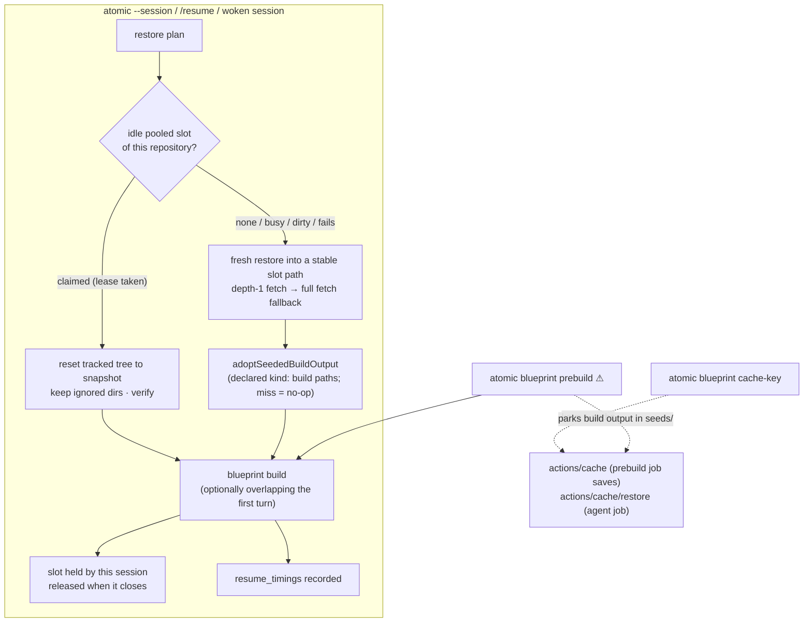

# Resume and Snapshot Performance — Implementation Spec and Slice Plan

| Document Metadata      | Details |
| ---------------------- | ------- |
| Author(s)              | Alex Lavaee (with Atomic) |
| Status                 | In Review (RFC). Design only: no product code changes on this branch |
| Team / Owner           | `packages/coding-agent`: worktree snapshots (`src/core/worktree-snapshot/`), resume (`src/core/resume/`), blueprints (`src/core/resume/blueprint/`), extension loader cache; user docs in `packages/coding-agent/docs` |
| Created / Last Updated | 2026-11-14 |
| Issue                  | [#4748](https://github.com/bastani-inc/atomic/issues/4748). Supersedes the exploration in closed draft #4735 (branch `docs/spec-resume-performance`, `specs/2026-11-13-resume-performance.md`), whose measurements and scripts now live in [`research/evidence/resume-performance/`](../research/evidence/resume-performance/README.md) |
| Target release         | The release after 0.9.87 |
| Builds on              | #4245 (worktree snapshots), #4329 (resume on any machine), #4416, #4492, #4595 (blueprints, differential builds), #4732 (restored worktrees keep their remotes), #4733 and #4738 (resume always opens, degraded restores, workflow runs), #4744 (partial-restore follow-ups), #4720 (storage export) |
| Compatibility posture  | **No breaking changes.** Snapshot records (`version: 1`), bindings, `envHash`, the blueprint format, `captureWorktreeSnapshot`, `restoreWorktree`/`restoreWorktreeSnapshot`, `restoreBestWorktree`, `verifyWorktree` and the resume errors are public and keep their contracts. Everything below is additive: an optional blueprint key older Atomic ignores, new CLI subcommands, a new session entry type older Atomic ignores, new settings with today's behavior as the default, and internal changes behind unchanged doors |

---

## 1. Executive Summary

A resume that must restore a checkout spends most of its time rebuilding the project, and on a fresh cloud runner
it also pays for an empty Atomic install. Re-measured on current `main` on an idle Azure VM: Atomic itself takes
**40–63 s** to its first model request (63–88 % in the blueprint), and **120 s** on a 4-vCPU runner shaped like a
GitHub-hosted one, where an empty `HOME` alone adds **10–12 s** before anything is restored (§4).

The plan keeps what was built instead of rebuilding it, and reports where the time goes:

1. **Per-phase timings first** (`/session snapshot`, `ATOMIC_TIMING=1`), so every later slice is checked on real runs.
2. **A per-machine worktree pool**: restored worktrees live at stable slot paths, are leased while a session works in
   them, and an idle one of the same repository is reset to the new snapshot with its dependency and build folders
   kept. Measured: Atomic's maintenance drops from 36 s to 17 s, ripgrep's from 6.9 s to 0.5 s, fastapi's to 0.1 s.
3. **One printable cache contract for runners** (`atomic blueprint cache-key`): package stores, Atomic's Git object
   store, its extension cache, and build output parked by a trusted `atomic blueprint prebuild`. Stable slot paths
   make cached Rust output valid (3.8 s at another path, 1.2 s at the same path).
4. **Cheaper capture** (a persistent private index: Atomic 0.49 s to 0.04 s of Git work per turn in a fresh clone),
   **depth-1 fetch** (Atomic 9.5 s to 4.8 s), a **seeded extension cache** in the package, and an **opt-in first turn
   that overlaps the build**.

Every accelerator falls back to today's path, and each has a test proving it. The doors that guard irreversible
effects are `claimIdleWorktree` ⚠ (rewrites a worktree another session used) and `prebuildRepository` ⚠ (runs project
code and parks output that later runs execute).

## 2. Context and Motivation

### 2.1 Current state (re-read on `main` at `b2b49c6bb`)

```text
main → prepareSessionResume                                    core/resume/session-resume.ts
  verifyOnce / partialRestores (#4744)                          compare each recorded checkout, once per resume
  returnToStartingCheckout / reuseLaunchCheckout                 continue in place when the checkout is here
  restoreCandidates (4 at a time) → planRestores                 Git unavailable → continue without (#4733)
  restorePlanned                                                 required checkouts together, optional ones one by one
    resumeSessionWorktree → restoreBestWorktree                  core/session-worktree-snapshots.ts, best-restore.ts
      restoreWorktree                                            core/worktree-snapshot/restore.ts
        ensureObjectStore     one bare store per remote set: <storeDir>/repositories/<sha24(remotes)>.git
        ensureHead            git fetch -- <remote> <head>: full history of HEAD, then the bundle if needed
        configureRecordedRemotes + pushedCommits (#4732)        store gets remotes and refs/remotes/atomic/pushed/*
        reconstructTree       apply the patch chain into a scratch index
        publishWorktree       materialize at <storeDir>/worktrees/.staging-<uuid>, LFS pull, verify, worktree move
                              final path: <storeDir>/worktrees/<snapshot12>-<rand8>   (random, never reused)
      restoreDegradedWorktree (#4733) when the exact restore fails: best reachable state, one notice
  openResumedSession
  setUpCheckoutBlueprints → runBlueprintBuild                    core/resume/blueprint/build.ts
    ledger keyed by repository identity: initialize once per machine, maintenance on every restore
→ first model request
```

Since the exploration: #4732 gives restored worktrees remotes and pushed refs (chained resumes no longer bundle all
history); #4733 and #4738 make every resume open, restoring the best reachable state, also for workflow runs and
pooled children; #4744 retries partial restores and reports missing records; #4720 exports sessions with their
snapshot blobs inline (`inlineBlobStore`), which is how a session reaches a cloud runner without shared storage.

Per-turn capture (`SessionWorktreeSnapshotRecorder.recordTurn` → `captureWorktreeSnapshot`, awaited at the end of a
turn that called a file-writing tool) copies the user's index into a scratch private index **keeping its mtime**,
then `read-tree --reset HEAD`, `diff-files`, `ls-files --cached --ignored` (twice when an ignored file is tracked),
`ls-files --others`, `update-index`, `write-tree`, `commit-tree`, `diff-tree -p`, `rev-list HEAD --not --remotes`.

**Leaking doors and hazards found while re-reading:**

- `checkoutsWorkedHere` treats *every* path under `<storeDir>` as "restored here for this session"
  (`restoredHere = isInside(storeDir, root)`). It is true today only because restore paths are random and never
  reused. Any reuse that does not change this rule would let session X continue in a worktree session Y rewrote.
  The pool (§7.3) must make ownership explicit before reuse is allowed.
- Nothing records that a restored worktree is in use. A workflow run (`packages/workflows/src/durable/worktree-snapshots.ts`,
  `workers/snapshot-restore.ts`) restores into the same `<storeDir>/worktrees` and holds no lease either.
- Blueprint step logs have no durations and restore phases are visible only through `GIT_TRACE2_EVENT`.
- `envHash` is recorded everywhere and read nowhere.

### 2.2 The problem

- **Users on a second machine** wait for a full install and build in a worktree with no dependencies: Atomic
  40–63 s (idle 16-vCPU VM) before the first model request.
- **Cloud runners** keep nothing: package stores, Git objects, build output and Atomic's own extension transpile
  cache start empty: Atomic 120 s on a 4-vCPU VM, of which 10–12 s is Atomic's own cold start.
- **CI checkouts are fresh clones**, so every per-turn capture re-hashes racily clean index entries: 0.4–0.5 s of
  Git work per capture for Atomic where 0.035 s suffices.
- **No one can tell which phase was slow.**

### 2.3 What others do (carried over, condensed)

| System | Fast start | Trust and freshness |
|---|---|---|
| Codex cloud | Setup once on the default branch; container state cached up to 12 h; a maintenance script on resume | Invalidated when setup, env or secrets change |
| Cursor Cloud Agent Builds | A Build installs and snapshots the disk; agents boot from the latest successful Build; branches reuse its dependencies | A failed Build never replaces the active one |
| Codespaces prebuilds | Per branch and devcontainer configuration, refreshed by an Actions workflow | Freshness traded against minutes |
| Devin blueprints, differential builds | Unchanged workspaces inherit and run only `maintenance` | Full build forced after 7 days |
| `actions/cache` | Exact `key`, then `restore-keys` prefix, current branch then default branch; immutable entries; the `path` list is part of the cache version | Low-trust events cannot write the default branch scope; contents are not signed |
| Bazel / Turborepo / Nx remote caches, `sccache` | Content-addressed outputs keyed by inputs; outputs valid only at a stable execution root or with path remapping | Writes from trusted CI only |
| `Swatinem/rust-cache` | `~/.cargo` + `target` at a stable path, workspace crates pruned | Default-branch writes |

Three lessons carry over: keep the **built environment**, not only downloads; key it by its **inputs** and fall back
by **prefix**; write it only from a **trusted default-branch build**. The new evidence adds a fourth that Bazel and
rust-cache already encode: build output is valid only at a **stable path** (§4.5).

## 3. Requirements, Goals and Non-Goals

### 3.1 Top-level requirement: resume always works

Resume fails only for an unreadable session, a write that would overwrite user data, or a failed security check.
Every optimization here is an accelerator over today's path: a miss, a corrupt or foreign cache entry, a busy or
dirty pool slot, a failed prebuild, a refused shallow fetch, a missing seeded cache, a timing write failure — each
falls back to the slower path, or to a resumed session with at most **one calm notice**, and never blocks it. §10
lists each fallback and its test.

### 3.2 Targets

Reference machines (§4.1): **workstation** = idle Azure `Standard_D16ds_v5` (16 vCPU); **runner** = Azure
`Standard_D4ds_v5` (4 vCPU, 16 GB, ext4), the shape of a GitHub-hosted `ubuntu-latest` runner. Time to first prompt
(TTFP) = launch to the first model request. Time to first tool (TTFT) = launch to the moment a tool call can run
against a built worktree; today TTFT = TTFP.

| # | Metric (machine, project) | Today | Target | Candidates that reach it |
|---|---|---:|---:|---|
| T1 | Warm local resume, idle pooled worktree of the repository (workstation, Atomic): TTFP | 40.2–40.4 s | **≤ 10 s** | pool reuse (S4, S5) + overlap (S9) |
| T2 | Same, TTFT | 40.2–40.4 s | **≤ 25 s** (≤ 15 s once Atomic's own native build is incremental, §4.4) | pool reuse (S4, S5) |
| T3 | Warm local resume (workstation, ripgrep / fastapi), slot at the snapshot's dependencies: TTFT | 8.8–8.9 s / 4.0–5.7 s | **≤ 4 s / ≤ 4 s** (ripgrep ≤ 9 s when workspace crates changed) | pool reuse |
| T4 | Per-turn capture Git work, fresh clone (workstation, Atomic 7,676 files) | 397–492 ms | **≤ 100 ms** steady state; first capture ≤ today | persistent private index (S2) |
| T5 | `captureWorktreeSnapshot` end to end, fresh clone (Atomic) | 374–397 ms (430–486 ms on the loaded host) | **≤ 200 ms** (and ≤ 300 ms on the loaded host) | S2 |
| T6 | Cold restore fetch, no store (workstation, Atomic) | 8.8–9.9 s | **≤ 5 s** | depth-1 fetch (S3) |
| T7 | First start in an empty `HOME` (runner) | 12.5 s (2.3 s warm), source checkout only | **≤ 3.5 s** | met by the installed package and the binaries (§7.6); S7 adds a regression test |
| T8 | Cold cloud start with caches restored (runner, Atomic): TTFT, cache download included | 120.4–120.5 s, no cache; 68–71 s with stores and build output | **≤ 50 s** (≤ 40 s once Atomic's native build is incremental) | cache contract incl. the Git store (S6) + prebuild and seeds (S8) + S7 |
| T9 | Cold cloud start with caches (runner, fastapi / ripgrep): TTFT, download included | 24.6–25.0 s / 28.7–29.0 s | **≤ 11 s / ≤ 12 s** | S6 + S7 (+ S8 at a stable slot for ripgrep) |
| T10 | Cold cloud start (runner, Atomic): TTFP with overlap, download included | 120.4–120.5 s | **≤ 20 s** | T8 + S9 |
| T11 | Every resume reports its phases | no | **yes**: restore phases, every blueprint step, capture duration | S1 |

T1–T3 assume an idle pooled worktree exists (after a prior restore or `atomic blueprint prebuild`). Without one,
the resume is today's path.

How each target is reached, from measured parts (§4):

| Target | Estimate from measurements |
|---|---|
| T1 | startup 2.2 + claim (reset 0.1–0.7, verify 0.2, head already in the store) ≈ 3–4 s; maintenance runs behind the first request |
| T2 | the above + Atomic's maintenance in a kept worktree 16.7–17.7 ≈ 20–22 s; minus 8 s once its native build is incremental |
| T3 | startup 2.0–2.2 + claim ≈ 0.5 + maintenance 0.09 (fastapi) / 0.5 (ripgrep) ≈ 3 s |
| T4 | persistent private index: 35 ms (Atomic), 22 ms (fastapi) of Git work after the first capture |
| T6 | depth-1 fetch + checkout 4.8 s (Atomic) |
| T7 | the installed npm layout already starts in 1.7–2.4 s in a new `HOME` (1.9–2.0 s warm); the 8.6–10.2 s transpile only happens when Atomic runs from a source checkout (§7.6) |
| T8 | download stores 2.3–2.7 + build seeds 4.0–4.3 + Git store (177 MB) ≈ 2 s; startup 2.4–4.4; restore with a warm store 2.6 (runner `warmlocal`); seeds extract 1.8–2.1; maintenance 31.6–35.2 (runner `full`) ≈ 46–53 s |
| T9 | fastapi: download 3.3–3.5 + Git store ≈ 0.7; startup ≈ 4; restore ≈ 0.8; `uv sync` 0.8 ≈ 10 s. ripgrep: download 0.7 + seeds 1.4 + Git store 0.1; startup ≈ 4; restore ≈ 0.2; seeded build at the same path ≈ 2–3 (workstation 1.2) ≈ 9–10 s |
| T10 | T8's downloads ≈ 9 + startup ≈ 4 + restore 2.6 ≈ 16 s; the build overlaps the first request |

### 3.3 Goals

- [ ] Report per-phase resume and capture timings to users.
- [ ] Keep restored worktrees in a per-machine pool at stable paths, leased while used, and reuse an idle one.
- [ ] One printable cache contract (`atomic blueprint cache-key`) for runners, plus a trusted `prebuild`.
- [ ] Make per-turn capture cheap in fresh clones without changing what it records.
- [ ] Shorten cold restores of long histories (depth-1 fetch) and run optional restores concurrently.
- [x] Remove Atomic's own cold-start cost in a new `HOME` (already absent from the installed package and binaries; §7.6).
- [ ] Let the first model turn overlap the blueprint build when the user opts in.

### 3.4 Non-goals

- [ ] We will NOT replace the Git-based snapshot format.
- [ ] We will NOT put `node_modules`, `target`, `.venv` or any ignored directory into snapshots or the session store.
- [ ] We will NOT write into a user's own checkout; only worktrees under the restore store are pooled.
- [ ] We will NOT upload or download caches from Atomic. Runners use `actions/cache` (or any equivalent); Atomic
      prints keys and paths, and parks or adopts files on the local disk.
- [ ] We will NOT make LFS lazy in this plan (§13, Q4).
- [ ] We will NOT pool worktrees that workflow runs restore in this plan; they are never pool candidates (§7.3).
- [ ] We will NOT add a second door that rewrites an existing worktree: `claimIdleWorktree` is the only one.

## 4. Measurements

### 4.1 Method and machines

Same harness as the first round (`scripts/run-project.sh`, a mock OpenAI-compatible provider, real GitHub remotes and
registries, a throwaway `HOME` per stage), extended with runner stages and prototypes. Atomic under test:
`main` at `b2b49c6bb` built from source on each VM. Details and every raw number: [evidence README](../research/evidence/resume-performance/README.md)
and [`vm.md`](../research/evidence/resume-performance/vm.md).

| Round | Machine | Load | Used for |
|---|---|---|---|
| 1 (2026-11-13) | Shared 80-vCPU EPYC host, XFS reflink | load average up to ~230 | carried over; effects > 2x only |
| 2 host | Same host, current `main` | 30.7–31.0 | capture benchmark only |
| 2 workstation | Azure `Standard_D16ds_v5`, Xeon Platinum 8573C, 64 GB, ext4 Premium SSD, Ubuntu 24.04, Git 2.56.1, Node 24.22.0, npm 11.19.1, cargo 1.100.0, uv 0.13.8 | 1.0–6.3 (otherwise idle) | resume phases, reuse, seeds, capture, fetch |
| 2 runner | Azure `Standard_D4ds_v5`, 4 vCPU, 16 GB, same image and toolchains | 1.1–4.9 (otherwise idle) | ephemeral cold starts with and without caches from Azure Blob Storage (the store behind `actions/cache`) |

Both VMs are in `westus2`; caches were zstd tarballs in a same-region Standard LRS blob container, downloaded with
one `curl` stream. Hosted runners download `actions/cache` entries from the same kind of storage, typically slower.

### 4.2 Workstation: time to first prompt by phase (seconds, repetition 1 / 2)

| Project | State | Fetch | Reconstruct + materialize | LFS | Verify | Restore | Blueprint steps | Blueprint | Startup + other | **TTFP** |
|---|---|---:|---:|---:|---:|---:|---|---:|---:|---:|
| ripgrep (cargo) | cold | 0.87 / 0.63 | 0.06 / 0.06 | — | 0.07 / 0.07 | 1.01 / 0.77 | fetch crates 0.6; `cargo build` 6.6 / 6.7 | 7.1 / 7.2 | 1.9 / 2.1 | **10.1 / 10.1** |
| | warm stores | 0.61 / 0.68 | 0.06 / 0.06 | — | 0.08 / 0.07 | 0.76 / 0.81 | 0.0; 6.6 / 6.7 | 6.6 / 6.7 | 1.9 / 2.1 | **9.3 / 9.7** |
| | warm local | 0.01 / 0.01 | 0.05 / 0.05 | — | 0.07 / 0.07 | 0.13 / 0.13 | 0.0; 6.8 / 6.6 | 6.9 / 6.7 | 2.0 / 2.0 | **8.9 / 8.8** |
| fastapi (uv) | cold | 3.33 / 3.13 | 0.41 / 0.41 | — | 0.38 / 0.35 | 4.13 / 3.90 | `uv sync` 4.2 / 4.2 | 4.2 / 4.2 | 2.1 / 2.6 | **10.4 / 10.6** |
| | warm stores | 3.55 / 2.96 | 0.64 / 0.41 | — | 0.17 / 0.38 | 4.36 / 3.77 | 0.6 / 0.6 | 0.6 / 0.6 | 2.2 / 2.3 | **7.2 / 6.6** |
| | warm local | 0.01 / 0.01 | 0.40 / 0.40 | — | 0.72 / 0.38 | 1.15 / 0.79 | 0.9 / 0.5 | 0.9 / 0.5 | 3.6 / 2.7 | **5.7 / 4.0** |
| Atomic (npm + Rust) | cold | 9.91 / 8.78 | 2.40 / 2.98 | 6.01 / 6.11 | 0.20 / 0.20 | 18.5 / 18.1 | `npm install` 8.6 / 8.9; `npm run build` 33.3 / 32.8 | 41.9 / 41.7 | 2.3 / 2.2 | **62.8 / 61.9** |
| | warm stores | 9.21 / 9.50 | 2.41 / 2.42 | 6.38 / 6.04 | 0.20 / 0.19 | 18.2 / 18.2 | 6.8 / 6.7; 28.8 / 28.5 | 35.6 / 35.2 | 2.6 / 2.6 | **56.4 / 56.0** |
| | warm local | 0.01 / 0.01 | 1.42 / 1.40 | 0.75 / 0.75 | 0.21 / 0.19 | 2.40 / 2.35 | 6.6 / 6.7; 28.7 / 28.9 | 35.3 / 35.6 | 2.7 / 2.2 | **40.4 / 40.2** |

(`results/round2-idle-d16/resume-phases.md`. The blueprints carry a no-op first step "Restore build cache
(benchmark)" used only by the runner stages; it took 0.0 s here.)

**Blueprint share of TTFP:** ripgrep 70–77 %, fastapi 8–40 % (uv is fast; fastapi's restore is 40 %), Atomic 63–88 %.
Atomic's restore is still 18 s cold: full-history fetch 8.8–9.9 s and LFS 6.0–6.4 s. An empty `HOME` adds 8.6 s on
the workstation (first start 10.6 s, then 2.0 s) and 10.2 s on the runner (12.5 s, then 2.3 s)
(`cold-home-startup.txt`), every seeded `HOME` above excludes it. The harness runs Atomic from a source checkout
(`node packages/coding-agent/dist/cli.js`), which loads the builtins from `packages/<name>` as TypeScript; the
installed package and the binaries do not pay this cost (§7.6).

Compared with round 1 on the loaded host, the idle numbers are lower but the shares hold: Atomic warm local
40.5–47.0 s then, 40.2–40.4 s now; ripgrep 8.7–14.0 s then, 8.8–8.9 s now.

### 4.3 Runner: ephemeral cold start (seconds, repetition 1 / 2)

Fresh `HOME`, page cache dropped, **no** extension transpile cache. "Stores" restores the package stores and the
extension cache of a trusted machine-A build from blob storage before launch, at the same paths machine A used (as
`~/.cargo`, `~/.npm` and `~/.cache/uv` are on every runner). "Full" also restores the worktree's ignored directories,
extracted by the blueprint's first step into the restored worktree, whose path differs from where they were built.

| Project | Stage | Fetch | LFS | Restore | Blueprint steps | Blueprint | Startup + other | **TTFP** | Cache download (before launch) |
|---|---|---:|---:|---:|---|---:|---:|---:|---:|
| ripgrep | cold | 0.91 / 1.00 | — | 1.02 / 1.14 | fetch crates 1.1 / 1.2; `cargo build` 13.2 / 12.9 | 14.3 / 14.1 | 13.5 / 13.7 | **28.7 / 29.0** | — |
| | stores | 0.89 / 0.91 | — | 1.05 / 1.03 | 0.6 / 0.6; 14.3 / 16.3 | 14.9 / 16.9 | 5.5 / 5.5 | **21.5 / 23.5** | 0.7 / 0.8 (20 MB) |
| | full (`target` at another path) | 0.84 / 0.87 | — | 1.00 / 1.04 | extract 0.6 / 0.6; 0.3 / 0.3; 6.7 / 6.1 | 7.6 / 7.0 | 4.7 / 4.3 | **13.3 / 12.4** | 1.5 / 1.4 (+104 MB) |
| fastapi | cold | 5.20 / 5.23 | — | 6.01 / 6.05 | `uv sync` 4.7 / 4.8 | 4.7 / 4.8 | 13.9 / 14.2 | **24.6 / 25.0** | — |
| | stores | 5.12 / 5.08 | — | 5.97 / 5.92 | 0.8 / 0.8 | 0.8 / 0.8 | 4.1 / 4.1 | **10.9 / 10.9** | 3.5 / 3.3 (260 MB) |
| | full (`.venv` at another path) | 5.17 / 5.12 | — | 5.79 / 5.77 | extract 1.4 / 1.2; 1.4 / 1.1 | 2.8 / 2.3 | 4.5 / 5.0 | **13.1 / 13.1** | 4.8 / 4.7 (+170 MB) |
| Atomic | cold | 14.23 / 14.27 | 6.64 / 6.59 | 23.5 / 23.5 | `npm install` 10.7 / 11.1; `npm run build` 71.0 / 71.4 | 81.7 / 82.5 | 15.1 / 14.4 | **120.4 / 120.5** | — |
| | stores | 14.12 / 14.26 | 6.01 / 6.73 | 22.8 / 23.6 | 8.8 / 8.7; 70.2 / 68.7 | 79.0 / 77.4 | 8.1 / 6.6 | **109.9 / 107.6** | 2.3 / 2.7 (227 MB) |
| | full (build output at another path) | 14.08 / 15.73 | 5.87 / 7.29 | 22.6 / 25.9 | extract 1.8 / 2.1; 4.5 / 3.1; 30.7 / 28.5 | 37.0 / 33.7 | 4.4 / 7.5 | **64.1 / 67.2** | 4.3 / 4.0 (+245 MB) |

(`results/round2-runner-d4/resume-phases.md`.) "Startup + other" on a cold runner is 13.5–15.1 s: the 10 s empty
transpile cache plus Atomic's own files read from a dropped page cache. On this shape the fetch is slower than on the
workstation (Atomic 14 s, fastapi 5 s) and the build twice as slow. Measured gains: package stores and the extension
cache save 9–14 s; Atomic's build output saves another 43 s even at the wrong path; ripgrep's `target` 8–10 s; a
seeded `.venv` loses 2 s. What remains for Atomic with every cache measured: fetch 14 s and LFS 6–7 s, and a 29–31 s build that the
same-path rule (§4.5) does not shorten for Atomic. The Git object store is the next cache: on the same runner shape,
a resume whose store is warm restores Atomic in **2.6 s instead of 23.5 s** (fetch 0.01 s, LFS 0.79 s; warm-VM run,
`atomic-summary.txt`), and the store is 177 MB.

### 4.4 Reusing a restored worktree (workstation)

The worktree a warm-stores resume restored, its tracked files reset (`checkout --detach`, `reset --hard`,
`clean -fd`), ignored directories kept, then the blueprint's `maintenance`. Seconds (rep 1 / rep 2):

| Project | Fresh worktree today (blueprint, warm local) | Reuse, same commit | Reuse, `HEAD` 20 commits older |
|---|---:|---:|---:|
| ripgrep | 6.7–6.9 | 0.04 + **0.55 / 0.51** | 0.20 + 7.0 / 0.02 + 6.5 |
| fastapi | 0.5–0.9 | 0.13 + **0.09 / 0.09** | 0.05 + 0.55 / 0.05 + 0.52 |
| Atomic | 35.3–35.6 | 0.12 + **16.7 / 0.72 + 17.7** | 0.19 + 10.4 / 0.40 + 10.4 |
| Atomic on the runner shape (D4, one run) | 75.6 | 0.12 + **26.0** | 0.21 + 13.8 |

Atomic's 17 s with nothing to rebuild is its own build script: `npm install` 0.9 s, `generate-models` 1.5 s,
pi-ai `build:offline` 1.3 s, **natives build 8.3–8.5 s** (not incremental), coding-agent build 4.5–4.6 s
(`atomic-maintenance-breakdown.txt`). On the 4-vCPU runner shape, the same warm VM resumes Atomic in 80.6 s
(restore 2.6 s with a warm object store, blueprint 75.6 s) and reuse needs 26.0 s of maintenance. That is a repository issue, not a product one; fixing it would take reuse to
about 9 s of maintenance (T2). Twenty commits back, ripgrep rebuilds its workspace crates (6.5–7.0 s) while Atomic's
maintenance is faster than at the same commit, so reuse never loses to a fresh worktree here.

How often a strict `envHash` match would have allowed reuse: Atomic's `main` changed an `envHash` input
(`package-lock.json`, `Cargo.lock`, toolchain files) in 53 of 765 first-parent commits over the last 30 days, about
twice a day. Partitioning the pool by `envHash` would discard reusable worktrees that often; ranking by it does not.

### 4.5 Seeded build output: same path versus another path (workstation)

`seed-path.sh`: build in a worktree at path X, archive its ignored directories, delete it; make a fresh checkout of
the same commit at X again (same) or at Y (other), extract, run maintenance. Same package stores at the same path.

| Project (archive) | No seed | Seed at the same path | Seed at another path |
|---|---:|---:|---:|
| ripgrep (`target`, 104 MB) | 6.9 | 0.5 + **0.7 = 1.2** | 0.5 + 3.3 = 3.8 |
| fastapi (`.venv`, `.pdm-build`, 170 MB) | **0.7** | 1.4 + 0.4 = 1.8 | 1.0 + 0.4 = 1.3 |
| Atomic (`node_modules`, `dist`, `target`, generated data; 245 MB) | 36.4 | 1.6 + 17.2 = **18.8** | 1.6 + 16.5 = 18.1 |

Cargo output is path-sensitive: it is three times faster at the path it was built at. Atomic's is not (its slow
step does not use the cache). Seeding a `.venv` loses to `uv sync` from a warm store. So: stable worktree paths,
and seeds only for paths a blueprint declares as `kind: build`.

### 4.6 Restore fetch strategies (workstation, from GitHub, cold store; fetch + checkout, two runs)

| Repository | Full history (today) | `--filter=blob:none` | `--filter=tree:0` | `--depth=1` |
|---|---:|---:|---:|---:|
| ripgrep | 0.60–0.67 (7 MB) | 0.67–0.73 | 0.84–0.89 | **0.35–0.38** (1 MB) |
| fastapi | 3.28–3.86 (59 MB) | 3.57–4.69 | 2.91–3.06 | **2.04–2.12** (17 MB) |
| Atomic | 9.49–10.60 (177 MB) | 5.95–6.76 | 6.17–7.16 | **4.82–4.83** (31 MB) |

Depth 1 wins everywhere on the idle VM (round 1 saw no gain for fastapi on the loaded host). Partial clone moves the
cost into checkout. A depth-1 store still supports what later captures and restores need: `rev-list HEAD --not
--remotes`, a bundle of a new commit over the pushed head, importing it into another depth-1 store, and ancestry
checks above the boundary (`shallow-store-capture.txt`). Ancestry below the boundary needs `--deepen`/`--unshallow`.

### 4.7 Per-turn capture (workstation)

Git work of one capture in a fresh clone (racily clean index, as after `actions/checkout`), median of five, ms
(`capture-micro.txt`):

| Repository | Files | Today | Persistent private index (first / then) | + untracked cache | Today after one `git status` |
|---|---:|---:|---:|---:|---:|
| ripgrep | 226 | 29 | 39 / 38 | 19 / 9 | 10 |
| fastapi | 3,242 | 107 | 147 / **22** | 131 / 21 | 24 |
| Atomic | 7,676 | 492 | 449 / **35** | 744 / 36 | 64 |

`captureWorktreeSnapshot` end to end in a fresh clone of Atomic: 374–397 ms (110 ms after `git status`); on the
loaded host 430–486 ms (round 1: 1,350–1,500 ms). The persistent private index removes the racy re-hash after its
first refresh; the untracked cache adds nothing beyond it, and Git's built-in fsmonitor is unavailable on Linux.

## 5. Decisions on the open questions

| Question (source) | Decision | Evidence |
|---|---|---|
| Where does the record of reusable worktrees live? (#4748; default: per machine under the agent dir, keyed by repository identity plus envHash) | **Per machine, under the restore store**: `<storeDir>/pool/<repositoryId>/<slot>.json`, where `storeDir` defaults to `<agentDir>/worktree-snapshots` (so `~/.atomic/agent/worktree-snapshots/pool/`). **Partitioned by repository identity** (the same `sha24(remotes)` that names the shared object store), **ranked by `envHash` and blueprint digest**, not partitioned by them | The default's intent holds. Two refinements: (1) the index sits next to the worktrees and object stores it describes, so a custom `storeDir` (SDK, tests, workflows) stays self-contained, and `isRestoreRecord`/`removeRestoredWorktree` already validate against `storeDir`. (2) `envHash` changes about twice a day on Atomic's `main` (§4.4), and reuse with a changed lockfile still beats a fresh worktree because `maintenance` always runs; actions/cache's `restore-keys` prefix fallback is the same idea |
| May one session reuse another session's worktree? (#4748; default: yes, same user and machine, only while idle, verified by lease) | **Yes**, exactly as the default: any session of the same user (same `storeDir`) on the same machine, only while no live session or run holds the slot's lease. The tracked tree is reset to the new snapshot and verified; ignored directories stay. **Added refusal:** ownership moves with the claim, and a session whose slot was claimed by another restores fresh instead of continuing in it | §2.1 hazard in `checkoutsWorkedHere`; §4.4 gains |
| Persistent private index location (old §11.1) | Under the restore store, keyed by the checkout's Git dir and root: `<storeDir>/capture-index/<sha24(gitdir + root)>`. Never inside the user's `.git` | A moved checkout gets a new key and pays one refresh |
| Devin format divergence for `cache:` (old §11.3) | In the blueprint, an Atomic-only optional key that older Atomic ignores (`readDocument` reads only known keys) | It describes the environment, like `maintenance` |
| LFS laziness (old §11.4) | Not now. Cloud: the shared object store, LFS objects included, becomes a cache entry (S6), which turns 6 s into the warm-local 0.75 s. Local: unchanged | §4.2 warm local LFS 0.75 s |
| `--timings` flag (old §11.5) | No flag. `/session snapshot`, `ATOMIC_TIMING=1`, and the `resume_timings` session entry (readable from exports and the SDK) | — |
| Cache key scope (old §11.6) | `envHash` (or declared `key-files`) + OS + architecture + a digest of the `cache:` declaration; not the maintenance digest | The ledger already re-runs maintenance |
| Cloud reuse of the job's own checkout (old §11.7) | No. Seeds through the cache contract | §4.5: copies rarely pay; paths matter |

## 6. Proposed Solution (High-Level Design)

### 6.1 Shape



Pattern: **prebuilt environment plus incremental maintenance** (Codex, Cursor, Devin), on top of a **leased pool of
worktrees at stable paths** (Bazel's stable execution root). The restore stays the integrity boundary: nothing is
published or claimed without `verifyWorktree`-equivalent verification of HEAD and tree. Caches, seeds and reuse only
pre-populate ignored directories that `maintenance` would otherwise rebuild, so a wrong cache costs time, not the
correctness of the tracked tree.

### 6.2 Files and modules

| Path | Action | Owns |
|---|---|---|
| `src/core/resume/timings.ts` | add | `ResumeTimings` recorder, `resume_timings` entry, formatting |
| `src/core/worktree-snapshot/restore.ts` | change | phase timings; depth-1 fetch with fallback; stable slot target path |
| `src/core/worktree-snapshot/capture.ts` | change | persistent private index; one ignored listing |
| `src/core/worktree-snapshot/pool.ts` | add | pool records, slot paths, leases, `holdRestoredWorktree`, `releaseRestoredWorktree`, `claimIdleWorktree`, `pooledWorktreeHolder` |
| `src/core/resume/session-resume.ts` | change | timings; claim before fresh restore; ownership rule in `checkoutsWorkedHere`; concurrent optional restores; overlap barrier |
| `src/core/session-worktree-snapshots.ts` | change | capture duration in timings; release on close |
| `src/core/resume/blueprint/steps.ts`, `build.ts` | change | step start/end/duration in logs and outcome; barrier for S9 |
| `src/core/resume/blueprint/schema.ts`, `types.ts` | change | optional `cache:` key |
| `src/core/resume/blueprint/cache.ts` | add | `blueprintCacheKeys`, `adoptSeededBuildOutput`, path refusals |
| `src/core/resume/blueprint/prebuild.ts` | add | `prebuildRepository` |
| `src/cli/blueprint-command.ts`, `src/main.ts` | add / change | `atomic blueprint cache-key`, `atomic blueprint prebuild` (dispatched like `atomic storage`) |
| `test/integration/installed-package-node-extensions.test.ts` | change | installed layout starts in a new `HOME` without transpiling builtins (S7, §7.6) |
| `src/modes/interactive/interactive-slash-commands.ts` | change | "Last resume" block in `/session snapshot` |
| `src/core/settings-manager.ts` (and settings schema) | change | `snapshots.pool.maxIdlePerRepository`, `resume.waitForBlueprint` |
| `docs/worktree-snapshots.md`, `docs/guides/resume-on-any-machine.md`, `docs/guides/team-setup.md`, `docs/settings.md`, `docs/environment-variables.md`, `CHANGELOG.md` | change | user guidance per slice |
| `test/unit/...`, `packages/coding-agent/test/...` | add | per-slice tests (§11) |

### 6.3 The door set at a glance (stranger-across-time view)

`captureWorktreeSnapshot` · `restoreWorktree` · `verifyWorktree` (unchanged contracts) ·
`recordResumeTimings` · `holdRestoredWorktree` · `releaseRestoredWorktree` · `claimIdleWorktree` ⚠ ·
`pooledWorktreeHolder` · `blueprintCacheKeys` · `adoptSeededBuildOutput` · `prebuildRepository` ⚠ ·
`awaitBlueprintReady`.

Read alone: a checkout is captured, restored and verified as today; restored worktrees are held while used and
released after; an idle one may be claimed for another snapshot, and that is the only way an existing worktree is
rewritten; the system can say who holds a worktree; caches have one printable name; parked build output is adopted
into a fresh worktree; a repository can be built ahead of time by a trusted job; tools can wait for the build;
every resume says where its time went.

## 7. Detailed Design

### 7.1 Timings (S1)

```ts
interface ResumeTimings {
	readonly version: 1;
	readonly startedAt: string;                         // ISO, process launch for CLI resumes
	readonly restores: readonly CheckoutRestoreTimings[];
	readonly blueprint: readonly BlueprintStepTiming[]; // per step: section, name, ms, exit
	readonly firstPromptReadyMs: number | null;          // launch → ready to send
	readonly blueprintReadyMs: number | null;            // launch → build settled (equal to the above unless S9)
}
interface CheckoutRestoreTimings {
	readonly root: string;
	readonly mode: "fresh" | "claimed" | "in-place" | "degraded";
	readonly fetch: "none" | "shallow" | "full" | "bundle";
	readonly phases: Readonly<Partial<Record<"fetch" | "reconstruct" | "materialize" | "lfs" | "verify" | "publish" | "seed", number>>>;
}
recordResumeTimings(session: SessionManager, timings: ResumeTimings): Promise<void>
// Guarantee: appends one `resume_timings` custom entry (`appendCustomEntry`). A failure is swallowed
// (debug-logged): timings never block.
```

- Restore phases are measured with `performance.now()` around the existing calls (`ensureHead`, `reconstructTree`,
  `materialize`, `pullLfsObjects`, verify, `worktree move`), passed out through an optional `onPhase` callback on the
  internal options, so the public `restoreWorktree` signature does not change.
- Blueprint step logs gain `# started`, `# finished`, `# duration` lines; `runSection` returns per-step durations.
- The capture recorder keeps the last capture's duration per root; `/session snapshot` shows it.
- `/session snapshot` gains a "Last resume" block:
  `restored /repo in 18.5 s (fetch 9.9, LFS 6.0, materialize 1.4, verify 0.2) · blueprint 41.9 s (npm install 8.6, Build 33.3) · ready after 62.8 s`.
- `ATOMIC_TIMING=1` prints the same lines in the existing timing namespace.

### 7.2 Capture (S2)

- **Persistent private index** at `<storeDir>/capture-index/<sha24(gitdir + "\0" + root)>`. Each capture: if it is
  missing, unreadable, of another index version, or its recorded seed (user index size + mtime + trailing checksum)
  differs from the user's index now, reseed it from the user's index as today. Then `read-tree --reset HEAD`
  (keeps stat data for unchanged entries), `update-index -q --refresh` **written to the private index**, so its mtime
  moves past the files and entries stop being racily clean, then the rest as today.
- **One ignored listing**: force-added ignored files are staged additions an ignore rule matches:
  `diff-index --cached --name-only -z --diff-filter=A HEAD`, then `check-ignore --no-index --stdin -z` on those paths only.
- Writes are atomic (write to `<file>.tmp`, rename); concurrent captures of one checkout serialize on an in-process
  map keyed like the file, and a cross-process race costs a reseed, never a wrong tree: the tree is always computed
  from the working files.
- **Not pursued, with evidence:** the untracked cache (no gain beyond the persistent index, §4.7); Git's built-in
  fsmonitor (unavailable on Linux, where runners and most CI live; capture keeps forcing `core.fsmonitor=false`, and
  S1's capture timings from macOS and Windows users decide whether a follow-up enables it there); skipping a capture
  without looking (a turn that called a file-writing tool may have changed anything; the `unchanged` result after the
  cheap stat pass already skips the commit, patch, bundle and blob writes, and costs about 35 ms on Atomic with S2).

### 7.3 The worktree pool (S4, S5)

**Data model** — one JSON file per slot, `<storeDir>/pool/<repositoryId>/<slot>.json`:

```ts
type RepositoryId = string & { readonly __brand: "RepositoryId" };   // sha24(remotes), = object store name
type SlotNumber = number & { readonly __brand: "SlotNumber" };
interface PoolSlotRecord {
	readonly version: 1;
	readonly repository: RepositoryId;
	readonly slot: SlotNumber;
	readonly path: string;                                // <storeDir>/worktrees/<repositoryId>-<slot>
	readonly holder: { readonly kind: "session" | "prebuild"; readonly id: string };
	readonly lastState: { readonly snapshotId: string | null; readonly head: string; readonly tree: string };
	readonly envHash: string;
	readonly blueprintDigest: string | null;
	readonly releasedAt: string | null;                   // null while held
}
```

- **Slot paths are stable**: `<storeDir>/worktrees/<repositoryId>-<n>`, `n` the lowest free slot, chosen under a
  per-repository `proper-lockfile` lock. `dirname` stays `<storeDir>/worktrees`, so `isRestoreRecord` and
  `removeRestoredWorktree` accept them unchanged; the staging path stays `.staging-<uuid>`. Restores without the
  pool (SDK `into`, workflow runs) keep today's paths.
- **Lease**: a `proper-lockfile` lock on `<slot>.json`, stale after 30 s, refreshed every 10 s (the restore record
  constants). A slot is **idle** only when its record exists with `releasedAt` set, or its lock is stale.
- **Admission**: only a session resume that publishes a restore through the pool writes a record. Workflow-run
  restores, SDK `into` restores and every pre-existing random-named worktree have no record and are **never**
  candidates.
- **Release**: when the session closes (runtime dispose, `/new`, `/resume` elsewhere, process exit), the recorder's
  latest snapshot of that root becomes `lastState`, `releasedAt` is set, and the lock is released.
- **Ownership rule**: `checkoutsWorkedHere` counts a pooled root as this session's only when `pooledWorktreeHolder`
  names this session; a root under `storeDir` without a pool record keeps today's rule.
- **Eviction**: beyond `snapshots.pool.maxIdlePerRepository` (default 2) idle slots, the oldest idle slot is removed
  through `removeRestoredWorktree` after its claim lock is taken.

```ts
holdRestoredWorktree(record: PoolAdmission, owner: PoolOwner): Promise<WorktreeLease>
// Guarantee: the slot is held by `owner` until released or the process dies.

releaseRestoredWorktree(lease: WorktreeLease, last: PoolLastState): Promise<void>
// Guarantee: the slot becomes idle with `last` as its known state; a write failure leaves it held until the lock goes stale.

pooledWorktreeHolder(storeDir: string, root: string): Promise<PoolOwner | "unpooled" | "idle">
// Guarantee: reads, never writes.

claimIdleWorktree(
	snapshot: WorktreeSnapshot,
	options: { storeDir: string; owner: PoolOwner; signal?: AbortSignal; settings: WorktreeSnapshotSettings },
): Promise<ClaimedWorktree | NoIdleWorktree>
type NoIdleWorktree = {
	readonly claimed: false;
	readonly reason: "none" | "busy" | "dirty" | "fetch-failed" | "reset-failed" | "verify-failed";
};
// Guarantee: returns a held slot whose HEAD and tree equal the snapshot's, its ignored files kept.
// ClaimedWorktree is constructible only here, after verification; nothing else rewrites an existing worktree.
```

Claim algorithm:

```text
claimIdleWorktree(snapshot)
  candidates = idle slots of repositoryId(snapshot.remotes), ranked: same envHash and blueprint digest first, newest released first
  for each candidate
    take its lease (lock); on contention → next
    verify candidate still equals record.lastState (HEAD + policy tree)   # else "dirty": uncaptured work, never overwritten
    ensure snapshot.head in the shared store (same ensureHead path, depth-1 first)
    reconstruct snapshot.tree in a scratch index (same reconstructTree)
    in the slot: read-tree -u --reset <tree> with a scratch index, update-ref --no-deref HEAD <head>, read-tree <head>
      (untracked, non-ignored files that lastState held and the new tree lacks are removed; ignored files stay)
    verify HEAD + tree like publishWorktree; on mismatch → release, "verify-failed"
    write record: holder = owner, releasedAt = null
    return ClaimedWorktree
  return NoIdleWorktree("none" | last reason)
caller: NoIdleWorktree → today's fresh restore into a new slot
```

A kill between reset and verify leaves the slot with its lock going stale and a record whose `lastState` no longer
matches the files, so the next claim classifies it `dirty` and skips it; eviction removes it. Session X whose slot was
claimed by Y sees `pooledWorktreeHolder` = Y and restores fresh, as if its worktree had been deleted.

### 7.4 Cache contract and seeds (S6, S8)

```yaml
cache:
  - path: ~/.npm                          # kind: store (default): outside the worktree, a package manager's store
  - path: ~/.cargo/registry
  - path: target                          # relative = inside the worktree
    kind: build                           # opt-in build output, parked in seeds/ by prebuild, adopted on restore
    key-files: [Cargo.lock, rust-toolchain.toml]   # optional; default: the envHash inputs
```

```ts
blueprintCacheKeys(root: string, options?: { platform?: NodeJS.Platform; arch?: string }): Promise<BlueprintCacheKeys>
interface BlueprintCacheKeys {
	readonly entries: readonly {
		readonly name: "stores" | "build" | "git" | "atomic";
		readonly key: string;            // "atomic-stores-v1-linux-x64-<hex16>"
		readonly restorePrefix: string;  // "atomic-stores-v1-linux-x64-"
		readonly paths: readonly string[];
	}[];
}
// Guarantee: a pure function of the inputs; refuses (omits, with a warning) paths that could carry secrets.
```

| Entry | Paths | Key | Why |
|---|---|---|---|
| `stores` | declared `kind: store` paths | `envHash` + OS + arch + declaration digest | package managers verify their stores |
| `build` | `<storeDir>/seeds/<repositoryId>/<declared kind: build path>` | same inputs + `build` | stable path; trusted writer only |
| `git` | `<storeDir>/repositories/<repositoryId>.git` | repository id + OS, prefix restore | append-only; fetch fills gaps; restore verifies trees |
| `atomic` | the extension transpile cache dir | Atomic version + OS + arch | 10–12 s per new `HOME` (§4.2) when S7's seed does not cover a user extension |

`atomic blueprint cache-key [dir] [--format text|json|github-output]` prints them; `github-output` writes
`<name>-key`, `<name>-restore-prefix`, `<name>-paths` for `$GITHUB_OUTPUT`.

```ts
prebuildRepository(dirOrRemote: string, options: { ref?: string; storeDir: string; park?: boolean; signal?: AbortSignal }):
	Promise<PrebuildOutcome>   // "built" | "partial" | "failed"
// Guarantee: leaves one idle pooled slot of `ref` (default: the remote's default branch) built by the blueprint;
// with `park`, moves its declared build paths into seeds/ for a cache save. A failed prebuild keeps the previous
// slot and seeds. It runs project code: trusted projects only (the existing trust gate).

adoptSeededBuildOutput(worktree: PooledSlot, keys: BlueprintCacheKeys): Promise<SeedReport>
// Guarantee: renames each parked path whose repository id matches into the empty declared path of a freshly
// restored slot; never overwrites a non-empty path; a miss or any error leaves the worktree as restored.
```

`atomic blueprint prebuild [dir|remote] [--ref <ref>] [--park]` exposes the first. On a runner, the prebuild job
builds in slot 0 at `~/.atomic/agent/worktree-snapshots/worktrees/<repositoryId>-0` and parks; the agent job restores
the caches, and its resume restores into the same slot 0 path and adopts the seeds, so path-sensitive output (cargo,
`.venv`) is valid (§4.5).

### 7.5 Restore (S3)

- `ensureHead` fetches `--depth=1` first when the store lacks `head`; on failure, or when a later step needs history
  (bundle prerequisites missing, a degraded restore walking older candidates, `isHeadOnlyAdvance` across the boundary),
  it runs today's full fetch (`--unshallow` when the store is shallow). The fetch mode goes into the timings.
- Optional restores run with the same bounded concurrency as verification (4) instead of one by one.

### 7.6 Seeded extension cache (S7)

**Dropped; T7 is met by the shipped artifacts.** Implementing S7 showed that the 10.6–12.5 s first start of §4.2 is
a source-checkout effect. With `isSourceCheckout` (`src/main.ts` beside the package), builtins load from
`packages/<name>` as TypeScript and jiti transpiles every file. The npm package ships each builtin prebundled
(`index.bundle.mjs`), which Node imports natively, and the compiled binaries import their builtins natively too
(`loadNativeBuiltinExtensionModule`). Measured on `main` at `46717ede4` (80-vCPU host, load 60–75, mock provider,
`-p hi --no-session`, new `HOME` then the same `HOME` twice):

| Layout | Start 1 (new `HOME`) | Starts 2, 3 | Transpile cache after start 1 |
|---|---:|---:|---|
| Source checkout | 12.5 s | 2.7 s, 1.6 s | 720 entries, 7.5 MB |
| Installed npm layout (`dist` + `package.json`, no `src/`) | 1.7–2.4 s | 1.9–2.0 s | empty |

Every builtin tool (`workflow`, `subagent`, `web_search`, `fetch_content`, `intercom`) was registered in the
installed layout. A seed built into the package would therefore be empty and change no number. It would not help
other machines' source checkouts either: the transform cache key includes the absolute file name, so a seed is valid
only at the path it was built at, and a seed built by `npm run build` in the same checkout would only move the same
transpile from the first start into the build.

S7 instead adds a regression test: an installed layout started in a new `HOME` registers every builtin tool and
leaves the transpile cache empty. `test/ci/extension-host-module-bridge-boundary.test.ts` already proves the
compiled loader imports a trusted builtin natively without jiti reading its source. Where T8 and T9 list S7, the
runner is assumed to run the installed Atomic, which needs no seed.

### 7.7 Overlapping the first turn with the build (S9)

Setting `resume.waitForBlueprint: "prompt" | "tools"` (default `"prompt"`, today). With `"tools"`, the resume returns
once restores are published, the blueprint build continues, the first model request is sent, and every tool that
runs project code or reads the worktree (`bash`, `edit`, `write`, file-reading tools, extension tools declaring
`writesFiles`) awaits `awaitBlueprintReady()` first. The agent's context says the environment is being built.

```ts
awaitBlueprintReady(signal?: AbortSignal): Promise<BlueprintBuildOutcome>
// Guarantee: resolves once the resume's blueprint build has settled, whatever its status.
```

A failed build resolves the barrier with the same notice as today; an aborted turn aborts the wait, not the build.

## 8. Alternatives Considered

| Option | Pros | Cons | Decision |
|---|---|---|---|
| Copy dependency folders into each new worktree (reflink or plain) | No pool state | §4.5 and round 1: loses for `node_modules`, `.venv`; path-sensitive output still rebuilds | Rejected |
| Pool partitioned by `envHash` | Simple invalidation | Atomic changes `envHash` about twice a day (§4.4) | Rejected: rank instead |
| Pool record in the session store | Shared with the team | Paths are machine-local; sessions on other machines cannot hold leases here | Rejected |
| Reuse only within one session | No cross-session surprise | Most resumes are of other sessions (team, cloud) | Rejected; ownership rule closes the hazard |
| Atomic uploads/downloads caches itself | One tool | Duplicates `actions/cache`, needs credentials and trust policy | Rejected: print keys, park and adopt locally |
| Blob-less or tree-less partial clone for restore | Small fetch | Slower checkout (§4.6) | Rejected |
| Lazy LFS | Saves 6 s cold | Tools may read pointers; needs smudge on demand | Deferred (Q4) |
| Overlap on by default | Biggest TTFP win | Changes what a first tool call sees | Off by default; flip after field timings (§13 Q1) |

## 9. Security

1. **Package stores by default.** npm, pnpm, uv, cargo and Go verify what they read from stores. Build output is
   opt-in per path (`kind: build`).
2. **One writer of shared build content.** Only `prebuildRepository` parks seeds, only for a trusted project and a
   successful build. On GitHub, save only from a prebuild job on the default branch (`push`, `schedule`,
   `workflow_dispatch`); agent jobs use `actions/cache/restore`, which cannot save.
3. **The restore is the integrity boundary.** A poisoned Git store entry produces a tree mismatch at verification and a
   fresh restore; adopted seeds land only in ignored directories.
4. **No secrets in caches.** `blueprintCacheKeys` omits declared paths that match the snapshot deny list or known
   credential files (`.npmrc` with tokens, `~/.cargo/credentials.toml`, `.env`, `~/.config/gh`), with a warning.
5. **The pool is per user and machine.** Records and leases live under the user's agent directory; a slot is only
   ever claimed by the same OS user. Project trust is keyed by path; a slot is claimed only for the same repository
   identity, so trust given to a slot path stays with that repository.
6. **Remaining risk:** a trusted job that builds merged malicious code produces poisoned build output. Keep
   `kind: build` off for repositories that accept outside contributions; the 7-day full-build rule extends to seeds.

## 10. Fallbacks (resume always works)

| Accelerator | Failure | Falls back to | Test that proves it |
|---|---|---|---|
| Timings (S1) | entry write fails | resume without the entry | stub `appendCustomEntry` to throw; resume is `ready` |
| Persistent index (S2) | missing, corrupt, truncated, version, seed mismatch, locked | today's copy-and-capture | corrupt and truncate the file; trees equal with and without it |
| Depth-1 fetch (S3) | refused, bundle prerequisites below the boundary, ancestry needed | full fetch / `--unshallow` | Git wrapper (`git.path` option) failing `--depth`; bundle whose prerequisite is two commits deep |
| Concurrent optional restores (S3) | one fails | that checkout left out with today's notice | two optional checkouts, one with a missing blob |
| Pool claim (S4, S5) | none, busy, dirty, reset or verify fails, kill mid-reset | fresh restore into a new slot | concurrent claims; dirty tracked and untracked files; SIGKILL between reset and verify; claimed-by-other ownership |
| Seeds (S8) | missing, foreign repository, non-empty target, rename fails | worktree as restored; maintenance builds | seeds of another repository id; read-only seeds dir |
| Prebuild (S8) | step fails | previous slot and seeds stay | failing maintenance step |
| Seeded transpile cache (S7) | dropped (§7.6): no seed ships | — | — |
| Overlap (S9) | build fails or is aborted | tools run after the barrier with today's notice | failing blueprint; abort during the wait |

## 11. Slice Plan

Each slice is independently mergeable behind today's defaults, about 100–500 changed lines including tests, and
updates its user docs and changelog entry. S1 lands first; the others stack on it as marked.

| ID | Title | Depends on | Group | Objective | Files | Tests | Target metric |
|---|---|---|---|---|---|---|---|
| S1 | Resume and capture timings | — | A (first) | Record restore phases, blueprint step durations, capture duration; show them | `resume/timings.ts`, `worktree-snapshot/restore.ts`, `blueprint/steps.ts`, `session-resume.ts`, `session-worktree-snapshots.ts`, `interactive-slash-commands.ts`, `core/timings.ts`, docs | unit: recorder and formatting; integration: a resume of a fixture records every phase and the phase sum is ≤ wall time; entry write failure ignored | T11 |
| S2 | Capture with a persistent private index | S1 | B (parallel) | Stop re-hashing racily clean entries every turn; one ignored listing | `worktree-snapshot/capture.ts`, `worktree-snapshot/paths.ts`, docs | trees identical with and without the index (racy same-second edit, force-added ignored file, HEAD move, stat-dirty copy); corrupt/truncated index → today's path; benchmark: on a 3,000-file racily clean fixture the second capture takes ≤ 0.5× the first (measured 0.08×) | T4, T5 |
| S3 | Depth-1 fetch and concurrent optional restores | S1 | B (parallel) | Halve cold fetches of long histories; overlap optional restores | `worktree-snapshot/restore.ts`, `session-resume.ts`, docs | store is shallow after a cold restore from a 300-commit `file://` remote and holds one commit; refused depth → full fetch; bundle below the boundary → unshallow; degraded restore of an older candidate still works; two optional restores run concurrently (both start before either ends) | T6 |
| S4 | Worktree pool: stable slots, leases, ownership | S1 | B (parallel) | Make restored worktrees owned and leased at stable paths; no reuse yet | `worktree-snapshot/pool.ts`, `restore.ts`, `session-resume.ts`, `session-worktree-snapshots.ts`, settings, docs | slot path stable across a remove/restore; lease held while open, stale after kill; ownership: session X does not continue in a slot held by Y; unpooled and workflow worktrees unaffected; eviction keeps `maxIdlePerRepository` | enabler for T1–T3 |
| S5 | Claim an idle pooled worktree on resume | S4 | C (stacked) | Reset an idle slot to the snapshot and keep its ignored directories | `pool.ts`, `session-resume.ts`, `restore.ts`, docs | a marker in `node_modules` survives a claim; dirty tracked/untracked → fresh; busy → fresh; SIGKILL mid-reset → next claim skips it; verify failure → fresh; benchmark: a fixture whose maintenance does a 2 s "install" only when its marker is absent completes the resume ≥ 1.5 s faster with a claim | T1, T2, T3 |
| S6 | Blueprint `cache:` and `atomic blueprint cache-key` | S1 | B (parallel) | One printable cache contract for runners | `blueprint/schema.ts`, `types.ts`, `blueprint/cache.ts`, `cli/blueprint-command.ts`, `main.ts`, docs (`team-setup.md` Actions/gh-aw sample) | key determinism and change per input; `kind: store` inside the worktree refused; secret paths omitted; `github-output` format; blueprint without `cache:` prints stores-free `git` and `atomic` entries; parser keeps ignoring unknown keys | T8, T9 (with S8) |
| S7 | Installed layout starts without transpiling builtins (seed dropped, §7.6) | S1 | B (parallel) | Guard that a first start in a new `HOME` transpiles no builtins | `test/integration/installed-package-node-extensions.test.ts`, this spec | installed npm layout in a new `HOME` registers every builtin tool with an empty transpile cache | T7 |
| S8 | `atomic blueprint prebuild` and seed adoption | S5, S6 | D (stacked) | Build ahead of time locally and in a trusted CI job; adopt parked output on restore | `blueprint/prebuild.ts`, `blueprint/cache.ts`, `cli/blueprint-command.ts`, `session-resume.ts`, docs (gh-aw and Actions recipes) | prebuild leaves an idle slot a later resume claims; `--park` moves declared build paths to seeds; resume into slot 0 adopts seeds; foreign or non-empty → skipped; failed prebuild keeps the previous slot and seeds | T8, T9 |
| S9 | First turn overlaps the blueprint build (opt-in) | S1 | B (parallel) | Send the first model request while maintenance runs; gate tools on the build | `session-resume.ts`, `blueprint/build.ts`, tool execution hook, settings, docs | default `"prompt"` unchanged; with `"tools"` the first request precedes build end and a `bash` call waits for it; failed build releases the barrier with the notice; abort during wait | T1, T10 |

Estimated size (changed lines, tests and docs included): S1 ~400, S2 ~300, S3 ~300, S4 ~480, S5 ~420, S6 ~380,
S7 ~250, S8 ~450, S9 ~350.

Merge order: S1 → {S2, S3, S4, S6, S7, S9 in any order} → S5 → S8. Group A is first; group B slices are parallel
with each other on top of S1; C and D are stacked.

## 12. Test Plan

- **Unit:** each door's named results (`NoIdleWorktree` reasons, key derivation, path refusals, timing formatting);
  type tests that `ClaimedWorktree` and `PooledSlot` cannot be constructed outside `pool.ts`.
- **Integration (real Git, temp `HOME`s, `file://` remotes):** every row of §10; identical trees with and without the
  persistent index; claims under concurrency (two processes, one wins, the other restores fresh).
- **Benchmarks in tests:** only ratios against a baseline measured in the same test, with generous bounds (S2, S5),
  never absolute times.
- **Field verification:** `scripts/run-project.sh` and `scripts/vm/*.sh` against a branch build; `/session snapshot`
  numbers match the harness within 10 %.
- **Interactive verification:**
  1. `atomic --session <id>` on a machine without the checkout → `/session snapshot` shows "Last resume" with fetch,
     materialize, verify and each blueprint step.
  2. Close it, resume another session of the same repository → notice "reused idle worktree …", `node_modules` kept,
     maintenance shorter in the timings.
  3. Resume the first session → it restores fresh (its slot is held by the second).
  4. `atomic blueprint cache-key --format github-output` in a repository with `cache:` → `stores-key=…`, `git-paths=…`.
  5. `ATOMIC_CODING_AGENT_DIR=$(mktemp -d) atomic -p hi --no-session` → first start within 1.5x of the second.

## 13. Open Questions

1. **Overlap default (S9).** (A) Off until field timings show tools rarely wait long (recommended); (B) on for
   non-interactive `-p` runs only, where TTFP is the cost users pay per run.
2. **Pool size default.** (A) 2 idle slots per repository (recommended: one for the latest default-branch prebuild,
   one for the last session); (B) 1, minimal disk; (C) unlimited with age-based eviction.
3. **Atomic's own natives build** (§4.4) is not incremental and costs 8.3 s per maintenance with nothing to do. A
   separate repository issue, outside this plan, would bring T2 under 15 s.
4. **LFS** stays eager; revisit with S1 field timings.

## 14. Risks

- **Reuse overwriting uncaptured work** — the `dirty` refusal compares the slot with its recorded last state first.
- **Shallow stores and history questions** — every history question has a full-fetch fallback (§4.6, §10).
- **Hosted-runner download speed** — measured from same-region blob storage; GitHub's cache service is slower and
  the 245 MB Atomic build seed may cost more there. S1 timings in the first real runs decide.
- **Disk use of the pool** — bounded by `maxIdlePerRepository`; a slot of Atomic is about 2 GB.

## 15. Backwards Compatibility

- Snapshot records, bindings and `envHash` are unchanged. Pool records, the persistent index and seeds are host-local.
- `restoreWorktree` keeps its contract; slot paths are used only by session resumes, never for an explicit `into`.
- Worktrees restored by earlier versions have no pool record: never claimed, ownership rule as today.
- `cache:` is optional and ignored by older Atomic; `resume_timings` is a custom entry, which older Atomic ignores.
- New settings default to today's behavior (`resume.waitForBlueprint: "prompt"`).
